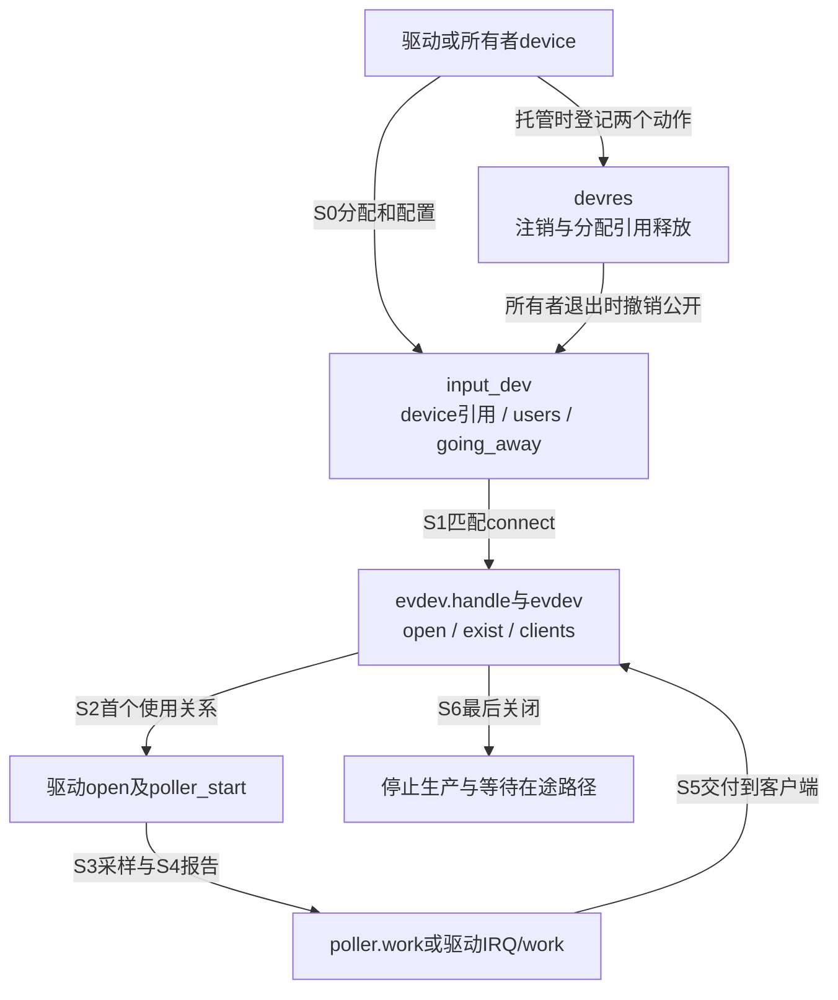
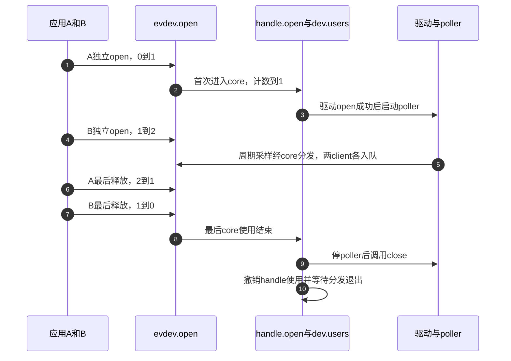

# 第3章\_设备怎样公开启停和退出

事件模块导读解释了一帧怎样交给客户端，本页补上它的前后条件：对象怎样变得可用，第一次使用怎样启动生产，最后使用者离开或设备消失后怎样停止。固定版本和配置见 [总索引](P01_Linux_6.12_Input源码阅读索引.md#1.1_固定版本与阅读任务)，运行模型先读 [生命周期正文](../../../../knowledge/driver_model/input/P03_设备注册能力与生命周期.md#3.1_发布意味着其他路径可以开始使用对象)。

## 3.1\_分开观察可见性使用关系与生产者

沿正文的虚拟轴模块读源码时，可以暂时去掉物理总线的不确定性：分配input_dev、配置轴与poller、注册、打开、周期报告、关闭和注销都存在，硬件只由demo.high翻转替代。这个例子适合证明调用配对，不证明任何触摸芯片的供电或采样时序。

有三条时间线需要同时记录。第一条是对象是否公开：device_add、handler连接和设备表决定谁能找到它。第二条是使用需求：evdev.open、handle.open和input_dev.users决定是否进入首次/末次回调。第三条是生产者：poller.work、重复timer及驱动IRQ/work决定是否还会有异步动作。对象仍有引用不保证硬件仍可用，使用者存在也不保证设备未inhibit。

| 阶段与状态位置 | 源码入口 | 应证明的边界 |
| --- | --- | --- |
| S0 input_dev、vals、锁、嵌入device引用 | [分配不变量](../source_explanations/P03_分配发布与两步资源撤销.md#3.1_分配先建立内部不变量与设备引用) | 分配不启动硬件；初始化后不再直接kfree |
| S0所有者devres记录 | [托管分配](../source_explanations/P03_分配发布与两步资源撤销.md#3.2_托管分配登记的是哪一个释放动作) | parent和记录所有者一致，分配释放不等于注销 |
| S1设备模型和handler列表 | [注册与失败](../source_explanations/P03_分配发布与两步资源撤销.md#3.3_注册把已准备对象交给设备模型和handler) | 注册返回前用户入口可能已可见，所有回调依赖先准备 |
| S6公开状态与分配引用 | [两步撤销](../source_explanations/P03_分配发布与两步资源撤销.md#3.4_注销与释放分别推进哪组状态) | 撤销公开后仍可有引用，最后释放不代替停生产者 |

先在input.h确认字段和接口，再追input.c。不要从名字猜input_free_device和input_unregister_device互为别名：前者结束未成功注册的分配，后者先撤销已公开对象；托管分支还会移除不同的devres记录。

## 3.2\_首次使用与最后使用之间追哪些计数

evdev_open先附加新client，再调用evdev_open_device。第一个client使evdev.open从0变1，进入input_open_device并增加handle.open、dev.users；同一evdev的第二个独立open只增加evdev.open。用户fd复制又不等于独立open，所以数fd并不能还原设备启动次数。

正常周期如下，条件限定为只有这个evdev持有core使用关系、没有inhibit，且驱动open成功。

步骤4没有再次启动设备，步骤6没有停止；步骤9的顺序只属于普通最后关闭。进入 [首次打开与失败回滚](../source_explanations/P04_使用计数失败回滚与断开.md#4.1_首次evdev打开怎样进入core并回滚)，再看 [最后关闭](../source_explanations/P04_使用计数失败回滚与断开.md#4.2_最后关闭怎样停止生产并退出分发)，可以用相同计数检查错误分支。驱动open失败只触发框架计数回退，不自动补调驱动close，半完成硬件必须由open自己回滚。

加入另一个handler后users有额外需求；加入inhibit后users非零却可能不采样；加入注销后going_away和exist阻止新操作。先指出哪个前提改变，再修改时间线，不能继续套两应用例子的固定数值。

## 3.3\_把延迟动作接回资源退出

轮询的状态落在input_dev_poller的poll、interval、input和work中，重复的状态落在input_dev的timer、repeat_key、rep和key位图中。输出异步工作则属于具体驱动私有对象，Input不会自动知道它保存的目标值和总线资源。

| 生产或执行路径 | 启动与消费 | 停止及不能省略的检查 |
| --- | --- | --- |
| poller | 首次启用先同步poll，再由可冻结workqueue周期执行 | stop同步取消；inhibit与普通close顺序不同 |
| 软件重复 | 按下批次后按能力/参数安排timer，到期重查key与inhibited | 释放停止重复，注销同步删除timer；不叠加硬件重复 |
| 输出work | 原子event回调保存目标，工作路径读取并做可睡传输 | 驱动禁止新请求并收束work，确保最终目标不丢 |

源码分别见 [能力与轴](../source_explanations/P05_能力轮询重复与输出的边界.md#5.1_声明能力与轴参数到底改了哪些字段)、[轮询启停](../source_explanations/P05_能力轮询重复与输出的边界.md#5.2_poller把周期工作接到打开与关闭)、[重复定时器](../source_explanations/P05_能力轮询重复与输出的边界.md#5.3_软件重复定时器怎样接续按住状态) 和 [输出注入](../source_explanations/P05_能力轮询重复与输出的边界.md#5.4_输出注入保持原子回调边界)。

本版本inhibit先调用close再停poller；解除时先open及poller_start，再清inhibited。首次同步poll可能发生在仍禁止接受输入的阶段。这个具体顺序必须保留，不能为画一张更整齐的图把它悄悄改成普通最后关闭路径。真实硬件的资源同步继续核对 [禁止和恢复](../source_explanations/P04_使用计数失败回滚与断开.md#4.4_禁止设备保留需求却改变启动状态)。

## 3.4\_从退出结果反查尚未收束的参与者

若remove之后仍有I²C读错误，应先确认哪条IRQ/work/poll路径仍在运行、读取的私有对象和总线是否已经撤销；evdev的引用仍存在并不能证明这些外部资源有效。若旧read不退出，则追exist变更、client.wait唤醒及等待条件；不要仅看event节点已删除。

这两条问题分别对应 [注销与旧文件通知](../source_explanations/P04_使用计数失败回滚与断开.md#4.3_注销怎样通知旧文件同时阻止新使用) 和驱动自己的生产者协议。设备失效后read可返回ENODEV，引用最后释放可以更晚；这不是要求用户先关完所有fd才能拔插。

用一个失败预测收尾：输入对象注册失败后，显式驱动立即return却没有input_free_device，遗漏的是哪一层？是分配引用，不是用户文件，因为注册并未成功交付。如果首次open返回错误却没有关掉已经启动的扫描，遗漏的是硬件回滚；框架计数归零不能替它停扫描。能分别指出这两个对象，才算把生命周期从函数名落实到责任。
