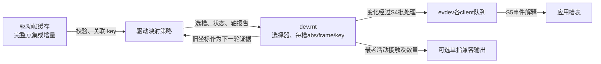
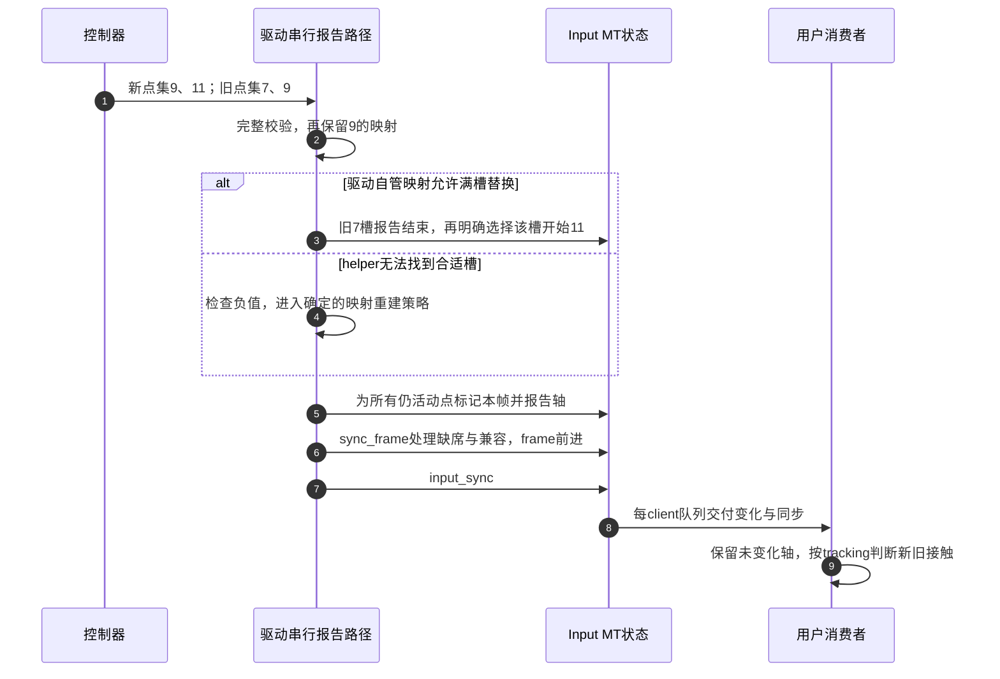

# 第4章\_接触身份怎样跨帧保留

本导读面向一个具体阅读任务：控制器点集已经到达驱动，怎样把它变成用户能持续跟踪的多点接触？先有 [事件帧与多点触控](../../../../knowledge/driver_model/input/P04_事件帧与多点触控.md) 的槽、接触和完整帧模型，再沿这里找 Linux 的状态位置与协作路径。固定版本身份、原件路径与配置入口见 [Input总索引](P01_Linux_6.12_Input源码阅读索引.md)；以下均为 NXP Linux 6.12.20 固定提交的公共实现，不描述任何触摸芯片的寄存器协议。

## 4.1\_先找三种身份和两份槽状态

假设硬件以 key7 和 key9 表示两次持续接触。驱动把它们关联到 slot0、slot1，Input 再用 tracking45、tracking46 向用户描述生命周期。它们的数字偶尔相等也不会让职责相同。

| 状态 | 保存位置与所有者 | 何时写入 | 后续谁读取 |
| --- | --- | --- | --- |
| 硬件点集和 key | 控制器提供，驱动接收缓冲保存已读帧 | S3 完整读取并校验 | 驱动映射逻辑 |
| 驱动自管 key→slot | 设备私有状态，采用自管映射时由驱动唯一维护 | 新旧完整点集比较后更新 | 后续帧及结束/复位路径 |
| 可选 helper key | `dev->mt->slots[i].key` | `input_mt_get_slot_by_key` 分配新槽时 | 该 helper 查找活动同 key 槽 |
| 当前被选择的槽 | `dev->mt->slot` | 选槽事件 | 后续 MT 轴的 core 接受路径 |
| 每槽 tracking、坐标等 | `dev->mt->slots[i].abs[]` | S4 事件接受 | 过滤重复、帧末清理、位置匹配、兼容指针 |
| 本内部帧是否见到该槽 | `slot->frame` 与 `mt->frame` | report 标记 / sync 推进 | DROP_UNUSED 和按 key 分配 |
| 计算匹配的工作区 | `dev->mt->red` | TRACK 初始化分配；匹配覆盖 | 矩阵规约与槽号结果填充 |
| 用户槽表与所选槽 | 每个消费者自己的内存 | S5 解释 MT 事件 | 应用的手势、绘制或输入逻辑 |

驱动自管映射与 helper key 是两种可选策略，不能默认两者自动同步。用户槽表也不是直接映射到内核的 slots 内存：它依赖客户端队列中的更新而推进，队列丢失时会落后于内核事实。

这不是一个单变量状态机：硬件接触、映射、槽活动、内部 seen 周期、用户消费进度彼此相关，却独立推进。下节用一次完整点集周期把它们对齐，避免只按函数名排调用链。

## 4.2\_把映射更新与帧收尾排成同一条路径

承接 Input 的 S0～S6：S0 初始化槽，S3 解析硬件样本，S4 更新与分发，S5 用户接收，S6 停止与失效。多点路径内部没有另起一套互不对应的全周期。

| 所处阶段 | 进入条件与动作 | 修改的状态 | 退出条件 |
| --- | --- | --- | --- |
| S0 准备 | 坐标能力已知，设置轴，再初始化槽 | mt、槽数量、flags、可选 red；tracking=-1 | 初始化成功，注册前完成依赖准备 |
| S3 取样 | 完整收包，先校验长度、点数、ID 唯一性与坐标 | 驱动候选点集 | 坏帧不提前污染已上报状态 |
| S3→S4 关联 | 根据硬件 key 或几何决定新旧对应 | 驱动映射或匹配输出 | 每个接触都有合法槽；失败走明确恢复策略 |
| S4 报告 | 串行选槽、报告生命周期与轴 | 内核槽当前值；槽 frame 标记 | 本帧有效接触及必要结束均已表达 |
| S4 收尾 | sync_frame，再 input_sync | 释放未见活动槽、派生兼容值、推进 frame、同步事件 | 完成此次报告，后续帧才进入 |
| S5 观察 | 用户逐事件更新本地槽，遇同步解释状态 | 用户自己的状态副本 | 本帧解释完成；失步则转恢复 |
| S6 停止 | 先阻止并排空生产者，按设备策略结束状态 | 驱动状态与内核槽；最终清理内存 | 不再有路径访问已释放 mt |

图中第 2 步先决定新旧对应；第 3、4 步是互斥的策略分支，不是必须连续调用的两个动作。无论选哪条路径，都要在后续报告前得到完整、合法的映射。

图中的失败分支没有假定一个通用恢复函数：有硬件稳定 key 的设备可先规划完整映射，无 ID 的设备要明确几何关联失败时怎样重建身份。不能只跳过新点后把剩余半帧当完整快照交给 DROP_UNUSED。

## 4.3\_按当前疑问进入唯一实现

| 需要解释的具体问题 | 实现入口 | 阅读时关注的条件 |
| --- | --- | --- |
| 为什么先配置轴再初始化槽 | [槽与派生能力](../source_explanations/P06_多点槽状态与帧收尾.md#6.1_初始化建立槽容量和派生能力) | copy_abs 只复制已经存在的来源轴 |
| false 报告为什么也占用本帧标记 | [接触状态](../source_explanations/P06_多点槽状态与帧收尾.md#6.2_报告活动状态怎样标记本帧并分配身份) | frame 赋值位于 active 判断之前 |
| 为什么 sync_frame 后还要 input_sync | [帧末处理](../source_explanations/P06_多点槽状态与帧收尾.md#6.3_内部帧结束为何还需要外部同步) | 内部周期与外部 SYN_REPORT 分开 |
| 单指坐标选哪根手指 | [兼容派生](../source_explanations/P06_多点槽状态与帧收尾.md#6.4_单指兼容把多点状态压缩成什么) | 最老活动接触、能力过滤、悬停计数特例 |
| key 不连续或两槽已满怎么办 | [按 key 查找](../source_explanations/P07_槽位映射与位置匹配.md#7.1_按key找槽为何会在本帧释放后仍失败) | active 与 used 是不同判断 |
| 没有 key 时谁负责对应关系 | [位置匹配入口](../source_explanations/P07_槽位映射与位置匹配.md#7.2_没有硬件身份时用位置建立有限关联) | TRACK 工作区、距离约束、逐项检查输出 |

每个函数体只在这些实现页展开；本导读组织的是同一周期中的读写关系。core 怎样把 MT 当前值与候选事件进行比较，继续沿 [事件接受中的绝对轴处理](../source_explanations/P01_事件接受与批量分发.md#1.2_绝对轴怎样选择旧值并抑制小幅变化)；不要另写一份轴过滤函数来解释槽协议。

## 4.4\_哪些证据能说明身份仍然可信

看到 tracking ID 没变，只能说明软件沿用了该身份。可靠硬件 key、完整采样和正确映射可加强“同一接触”的依据；距离匹配则只是基于位置的估计。控制器复位后 key 重新计数、漏掉结束包、用户丢队列，都可能破坏其中一层连续性。

源码核对至少用四个反例：完整帧静止点是否被错误 drop；满槽换人是否拿负槽号继续上报；增量帧是否误把缺席当离开；一次新接触是否因重用槽却没变 tracking 而被当旧接触。它们分别检验 seen、容量、硬件协议和生命周期，不能用“evtest有坐标输出”一个观察替代。

本次材料提供固定代码、完整 C 接收模型以及这些反例的推导。尚未运行目标触摸硬件、内核 MT 驱动或位置匹配压力测试；真实设备还要核验扫描/通知协议、时序、坐标变换以及 PM 后身份重建。
