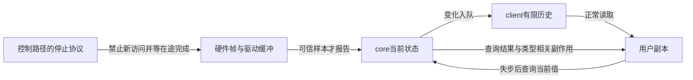
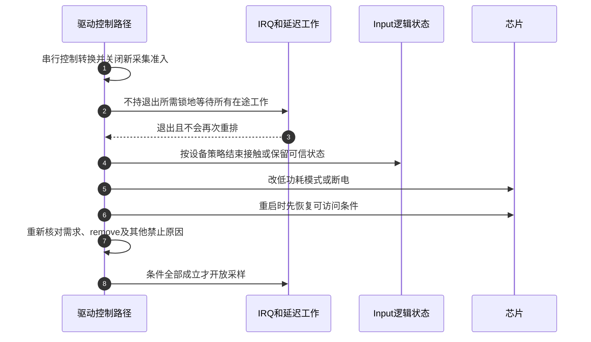

# 第5章\_失步与停机分别恢复哪份状态

正常报告已经把硬件点集变成core当前值，再交给各client队列。异常阅读首先回答“哪份状态失去了什么保证”：坏硬件帧影响S3，交错报告影响S4，队列溢出影响S5，停机与重启则改变S2/S3和S6的准入条件。先读 [并发丢帧与电源管理](../../../../knowledge/driver_model/input/P05_并发丢帧与电源管理.md) 的反例，再沿本页定位具体源码；固定版本及原件身份见 [Input总索引](P01_Linux_6.12_Input源码阅读索引.md)。

## 5.1\_从故障位置选择需要恢复的状态

硬件已经抬手而用户仍认为按下，可能是结束样本没有到core，也可能是更新到了core却没到该用户。两种故障都能形成“卡住”，但前者查询core仍得到旧值，后者查询才可能帮用户恢复。不能只看显示现象选择恢复接口。

| 所处阶段与状态地址 | 正常写入者 | 故障破坏什么 | 应寻找哪条路径 |
| --- | --- | --- | --- |
| S3 驱动原始缓冲和控制器帧序号 | 总线采集路径 | 样本完整性或硬件身份连续性 | 芯片帧/ACK/复位协议，Input库不能补造样本 |
| S4 dev.key、absinfo、mt.slots和vals | 驱动报告经core接受 | 多报告者交错或错误映射 | 驱动帧级串行化、能力与事件接受 |
| S5 client.buffer和用户槽表 | evdev入队、应用消费 | 历史事件缺失，副本不再可信 | SYN_DROPPED、查询副作用和用户同步流程 |
| S2/S6 设备需求、控制器模式和生产者准入 | 控制路径与异步执行设施 | 关电后访问、退出期间重新启动 | IRQ/work/timer停止、驱动锁序和PM边界 |
| timestamp数组与client.clk_type | 驱动/core时间登记，client控制 | 采样含义或时域被混淆 | 时间转换、队列清理，不靠重新编号事件修复 |

箭头返回core查询，不返回控制器重读；若错误已经在S3产生，查询不会修正那份错误事实。反过来，仅一个client过慢时，复位整个控制器会扰乱所有正常使用者，扩大故障范围。

## 5.2\_恢复用户副本时怎样读队列与快照

SYN_DROPPED使应用放弃未完成帧，跳过到包含下一SYN_REPORT，再按接口重建持久状态。快照是查询时刻的core状态，队列中其余记录可能早于它；不能把两者无条件拼接。位图查询和MT查询的实现不同，恢复者必须理解自己调用的那一类。

| 当前疑问 | 唯一实现入口 | 关键读写关系 |
| --- | --- | --- |
| 溢出为何只影响某client | [队列交付](../source_explanations/P02_evdev独立队列与读取边界.md#2.1_批次怎样复制到每个客户端) | 每client自己的head/tail/packet_head |
| 查键位图为何还改变队列 | [位图查询](../source_explanations/P08_状态重同步与事件时间.md#8.1_位图查询为何还会清理客户端队列) | event_lock后取buffer_lock，复制状态并清同类旧事件 |
| 一次MT查询是否冻结全部接触 | [多点查询](../source_explanations/P08_状态重同步与事件时间.md#8.2_多点查询没有冻结整张槽表) | 按轴逐槽复制，没有多轴原子快照 |
| 没溢出为什么也收到失步 | [主动注入标记](../source_explanations/P08_状态重同步与事件时间.md#8.3_失步标记也用于查询失败和时钟切换) | 用户复制失败、非空队列时钟切换 |
| 时间是不是芯片tick | [时间域转换](../source_explanations/P08_状态重同步与事件时间.md#8.4_驱动提供的时间必须已经属于主机单调时域) | 输入MONOTONIC，内部派生REAL/BOOT |

不要把恢复出的绝对状态当补回丢失轨迹。鼠标相对增量没有相应历史快照，触摸槽查询也不重现每个手势中间点；库生成的同步差异事件与真实采样事件应在应用语义上区分。

## 5.3\_把停止等待与逻辑状态清理接回S6

控制路径进入S6时，Input对象和硬件可能仍被IRQ线程、worker、timer及输出工作引用。关闭gate只拒绝新访问，在途者需要同步排空；等待完成以后才允许关电或释放它需要的资源。同时必须串行整个控制转换，防止另一条resume路径在等待间隙重新打开gate。

第2步必须与第1步的控制串行化同时成立：仅释放所有锁去等待，另一控制路径可能穿插重启；持有worker退出需要的锁等待，则可能死锁。不同锁的用途和持有范围要由真实调用关系证明。

Input core的 [系统PM回调](../source_explanations/P09_PM状态恢复与硬件停止边界.md#9.1_系统挂起先处理哪些Input逻辑状态) 释放键、切换输出，不负责整颗触摸芯片断电；[逻辑重置与MT释放](../source_explanations/P09_PM状态恢复与硬件停止边界.md#9.3_重置接口与多点释放有不同边界) 又是不同入口。inhibit、普通close和system suspend的函数链不相同，不能统一套一张“所有情况先close再清全部槽”的图。

真实芯片的 [停止证据与模式分支](../source_explanations/P09_PM状态恢复与硬件停止边界.md#9.4_逻辑清理怎样接回真实硬件停止) 对照edt-ft5x06及IRQ文档。该例解释为何供电、复位、参数恢复和IRQ开放必须有依赖，不提供可移植到任意屏幕的延时常量。

## 5.4\_用证据区分恢复完成与接口返回

查询成功证明用户缓冲收到了该接口返回的数据，不证明跨轴同一时刻；disable_irq返回提供对应处理退出保证，不证明另一个工作队列已停；Input resume返回也不证明控制器已经按板级时序上电。每个结论都要停在接口实际负责的范围。

目标验证应覆盖坏帧、唯一结束通知丢失、非空队列切时钟、两独立读者、在途解绑和触摸中挂起恢复。源码静态核对能找出必要条件和错误路径，但不替代这些运行。当前没有目标触摸硬件或内核PM实测，因此不能把预期验收结果写成已观察到的事实。
