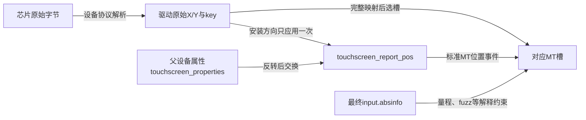
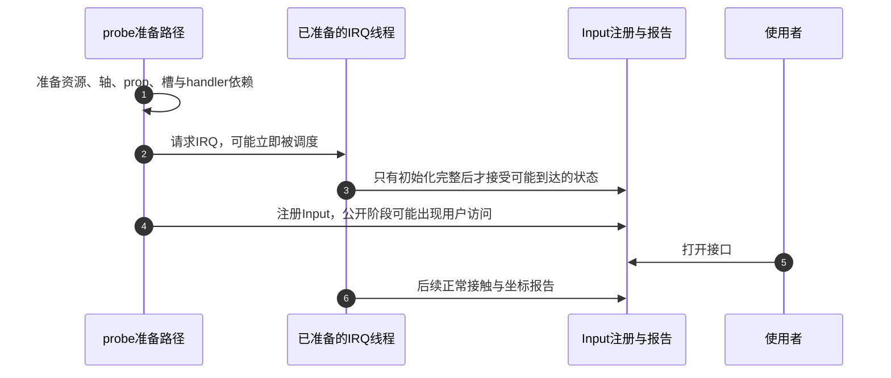

# 第6章\_触摸帧怎样接到坐标与发布路径

[触摸驱动设计与验证](../../../../knowledge/driver_model/input/P06_触摸驱动设计与验证.md) 提供完整教学字节解析和槽规划程序；这里帮助读者进入Linux实现，寻找通用坐标helper与设备驱动的接合点。教学包不是某芯片协议，固定内核证据见 [Input总索引](P01_Linux_6.12_Input源码阅读索引.md)，以NXP Linux 6.12.20提交为界。

## 6.1\_先把芯片协议与Input状态分开

控制器给出的X/Y可能需要处理大小端、位域和芯片特有轴顺序；面板安装方向则由固件属性描述；Input最后按标准轴保存状态。把这三个转换混在同一个“坐标修正”函数中，很容易把一次交换做两遍，或让轴范围还停在旧空间。

| 层次与状态位置 | 所有者 | 应完成的工作 | 不应推给下一层的事 |
| --- | --- | --- | --- |
| 控制器寄存器/FIFO和接收缓冲 | 芯片及驱动采集路径 | 按真实协议取得可信完整数据 | 总线短读、ACK和字节序错误 |
| 驱动解析结果与候选槽映射 | 驱动唯一报告路径 | 校验范围、ID、容量并确定新旧接触 | 让core猜测哪个key仍是同一接触 |
| touchscreen_properties | 注册前由通用helper填充 | 保存原最大值、反转和交换规则 | 自动识别面板真实安装方向 |
| input.absinfo | 驱动默认声明、属性解析共同准备 | 对外表达最终轴范围、噪声等参数 | 自动裁剪无效硬件坐标 |
| input.mt.slots | core接受事件维护 | 保存标准接触身份与各槽轴值 | 保存原始总线帧和全部历史 |

通用helper不产生硬件采样，也不校验帧CRC。它解决的是已取得的坐标怎样与声明空间一致，职责比整个触摸驱动窄。

## 6.2\_从注册前配置追到逐点变换

S0先声明原始默认轴和父设备，再解析属性，最后初始化MT槽。DIRECT/POINTER初始化可能复制单指兼容轴，所以要让它复制已经调整后的参数。S3取得原始坐标并规划槽，S4才在选定槽上变换和报告。

| 阶段 | 实现入口 | 本阶段完成的状态变化 |
| --- | --- | --- |
| S0设置默认能力 | [能力与轴参数](../source_explanations/P05_能力轮询重复与输出的边界.md#5.1_声明能力与轴参数到底改了哪些字段) | 建立EV_ABS、相应轴和默认参数 |
| S0解析安装属性 | [属性与轴描述](../source_explanations/P10_触摸属性怎样改变坐标与轴参数.md#10.1_属性先修改哪些轴参数) | 更新absinfo并保存prop，尚未产生采样事件 |
| S0准备槽 | [槽初始化](../source_explanations/P06_多点槽状态与帧收尾.md#6.1_初始化建立槽容量和派生能力) | 槽容量、身份初值和可选兼容能力 |
| S3关联身份 | [按key和位置匹配](../source_explanations/P07_槽位映射与位置匹配.md#7.1_按key找槽为何会在本帧释放后仍失败) | 设备选择适合自己的映射策略 |
| S4逐点变换 | [反转与交换](../source_explanations/P10_触摸属性怎样改变坐标与轴参数.md#10.3_每个坐标先反转再交换) | 先反转原轴，再交换，更新已选槽 |
| S4结束本帧 | [MT收尾](../source_explanations/P06_多点槽状态与帧收尾.md#6.3_内部帧结束为何还需要外部同步) | 按所用seen协议处理缺席，再外部同步 |

没有硬件ID而采用位置匹配时，还可使用 [匹配位置转换](../source_explanations/P10_触摸属性怎样改变坐标与轴参数.md#10.4_位置匹配的存储类型还有额外约束)；它把结果放进s16位置结构，并不直接发事件。输入范围和后续平方运算都要验证。

## 6.3\_真实驱动顺序是带条件的实例

同提交的edt-ft5x06在准备轴、解析属性、初始化MT以后，请求线程化IRQ，再input_register_device。它说明“IRQ先于注册”可以建立在handler依赖已完整准备的条件上，不能据此省略另一设备的open、gate、供电和错误撤销分析。

其事件处理还从硬件记录区分UP等类型，不使用DROP_UNUSED推断缺席；报告接触后调用指针兼容和input_sync。教学完整快照采用sync_frame维护seen，两者前提不同。看见真实驱动少一个helper时，应先检查是否使用那个helper所服务的状态协议，而不是按固定调用清单判错。

第2步是异步窗口，第4步也是公开窗口。设备若把启动动作放进open，第4步前就必须完成open依赖；设备若持续采样，第2步前就必须完成handler依赖。该图不证明所有硬件应始终扫描，也不为任意注册失败路径自动生成正确清理顺序。

设备模式和停机继续沿 [PM与硬件边界](../source_explanations/P09_PM状态恢复与硬件停止边界.md#9.4_逻辑清理怎样接回真实硬件停止)。无论资源显式释放还是devm登记，都要先阻止并排空访问者，再使其依赖失效。

## 6.4\_修改一个坐标问题应落在哪层

若芯片改了记录大小端，在设备解析层修改并验证坏包路径；若面板转向，在正确的固件属性与轴参数层处理；若同一key被错误当成新接触，检查映射和硬件身份语义；若只有慢应用卡住，应转查用户队列恢复。不能把所有问题都用交换X/Y或重置全部槽掩盖。

本模块的真实helper实现用于核对参数与事件路径，教学C程序用于验证字节和槽规划，板级测试用于证明供电、IRQ、坐标方向和唤醒。三层证据应各自记录。当前未运行目标触摸驱动或面板，本页不把源码顺序当作某板已验证结果。
