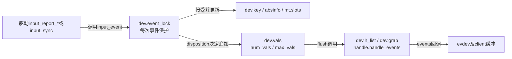
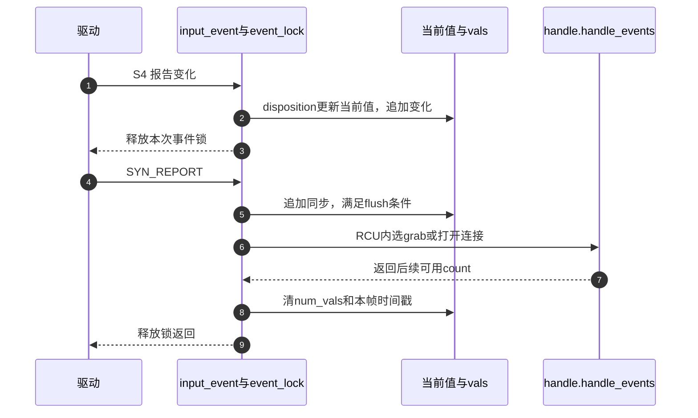

# 第1章\_事件接受与批量分发

本页沿S4核对一个重要区别：设备当前值改变、批次进入handler、应用读走记录，是三个不同时间点。前两项由input.c完成，第三项由下一页evdev实现接续。

| 阅读任务 | 入口 |
| --- | --- |
| 固定源码身份与整套阅读路线 | [总索引](../navigation/P01_Linux_6.12_Input源码阅读索引.md#1.1_固定版本与阅读任务) |
| 状态归属和S0～S6通信 | [事件模块导读](../navigation/P02_事件状态怎样到达各客户端.md#2.1_沿同一次移动寻找状态落点) |
| 从问题推导对象分层 | [体系结构正文](../../../../knowledge/driver_model/input/P02_体系结构与事件传递.md#2.1_一份设备事实为什么需要多份读取进度) |

实现固定于NXP Linux 6.12.20提交 `dfaf2136deb2af2e60b994421281ba42f1c087e0`。[drivers/input/input.c](../../linux/drivers/input/input.c) blob为 `c51858f1cdc556939c2ee1bd21669c71c169d84e`；[include/linux/input.h](../../linux/include/linux/input.h) blob为 `cd866b020a01d67081788e1baa2d372ce1c79767`。CONFIG_INPUT提供核心，CONFIG_INPUT_EVDEV决定本例消费接口是否存在；这里核对固定源码，不宣称目标板当前配置开启。摘录沿用原件GPL-2.0-only许可，中文注释为仓库补充。

## 1.1\_报告入口先接受状态再决定交付

input.h声明input_event及input_dev，驱动通过报告辅助接口进入input_event；内部静态函数只供本翻译单元使用。evbit和各类能力位图由注册前配置建立，key/absinfo等保存接受后的当前状态，vals则是分配时先创建、注册时按预计事件数调节的批量暂存空间。它们的生存期由input_dev管理，不能把批次数清零理解成设备状态清零。



输入类型必须在evbit范围内且已声明。input_event持event_lock并保存本地中断状态，因此同一设备的单次状态更新不会与另一次同时修改；它不覆盖驱动多个报告调用之间的空隙。函数文档允许在分配后、注册前用它种入初始状态，但此时不会到达handler，不能把这种用法误当成可对外报告。

```c
/**
 * @brief 检查事件类型能力，并在设备事件锁内处理一次报告。
 * @note 仓库补充中文阅读说明；原件执行语句保留，英文注释省略。
 */
void input_event(struct input_dev *dev,
		 unsigned int type, unsigned int code, int value)
{
	unsigned long flags;

	if (is_event_supported(type, dev->evbit, EV_MAX)) {

		spin_lock_irqsave(&dev->event_lock, flags);
		/* 此锁只覆盖一次事件，不自动覆盖驱动的一整帧。 */
		input_handle_event(dev, type, code, value);
		spin_unlock_irqrestore(&dev->event_lock, flags);
	}
}
```

入口所用is_event_supported是 `code <= max && test_bit(code, bm)`；同一辅助函数也检查各类code。EV_MAX及KEY_MAX等是相应编号上界，位图说明设备能力，边界检查不是自动补齐能力。input_handle_event调用input_get_disposition得到动作位：IGNORE为0，PASS_TO_HANDLERS为1，PASS_TO_DEVICE为2，SLOT为4，FLUSH为8，PASS_TO_ALL组合前两位。它对非同步事件加入输入随机性信息，再把动作位交给input_event_dispose；随机性收集不是接收者通知路径，本页不展开随机数子系统。

下列分支决定“保存什么”和“传什么”。inhibited先截住输入；SYN_REPORT要求追加并flush；普通键只有布尔按下状态变化才更新key位图，而value=2重复事件直接转发。REL零增量无须报告。ABS由轴状态与fuzz处理决定，下一小段解释它，其他输出类也列在代码后的对照表。

```c
/**
 * @brief 按事件类别更新当前状态并返回后续处理动作位。
 * @note 仓库补充中文阅读说明；原件执行语句保留，英文注释省略。
 */
static int input_get_disposition(struct input_dev *dev,
			  unsigned int type, unsigned int code, int *pval)
{
	int disposition = INPUT_IGNORE_EVENT;
	int value = *pval;

	if (dev->inhibited)
		return INPUT_IGNORE_EVENT;

	switch (type) {

	case EV_SYN:
		switch (code) {
		case SYN_CONFIG:
			disposition = INPUT_PASS_TO_ALL;
			break;

		case SYN_REPORT:
			disposition = INPUT_PASS_TO_HANDLERS | INPUT_FLUSH;
			break;
		case SYN_MT_REPORT:
			disposition = INPUT_PASS_TO_HANDLERS;
			break;
		}
		break;

	case EV_KEY:
		if (is_event_supported(code, dev->keybit, KEY_MAX)) {

			if (value == 2) {
				disposition = INPUT_PASS_TO_HANDLERS;
				break;
			}

			if (!!test_bit(code, dev->key) != !!value) {

				__change_bit(code, dev->key);
				disposition = INPUT_PASS_TO_HANDLERS;
			}
		}
		break;

	case EV_SW:
		if (is_event_supported(code, dev->swbit, SW_MAX) &&
		    !!test_bit(code, dev->sw) != !!value) {

			__change_bit(code, dev->sw);
			disposition = INPUT_PASS_TO_HANDLERS;
		}
		break;

	case EV_ABS:
		if (is_event_supported(code, dev->absbit, ABS_MAX))
			disposition = input_handle_abs_event(dev, code, &value);

		break;

	case EV_REL:
		if (is_event_supported(code, dev->relbit, REL_MAX) && value)
			disposition = INPUT_PASS_TO_HANDLERS;

		break;

	case EV_MSC:
		if (is_event_supported(code, dev->mscbit, MSC_MAX))
			disposition = INPUT_PASS_TO_ALL;

		break;

	case EV_LED:
		if (is_event_supported(code, dev->ledbit, LED_MAX) &&
		    !!test_bit(code, dev->led) != !!value) {

			__change_bit(code, dev->led);
			disposition = INPUT_PASS_TO_ALL;
		}
		break;

	case EV_SND:
		if (is_event_supported(code, dev->sndbit, SND_MAX)) {

			if (!!test_bit(code, dev->snd) != !!value)
				__change_bit(code, dev->snd);
			disposition = INPUT_PASS_TO_ALL;
		}
		break;

	case EV_REP:
		if (code <= REP_MAX && value >= 0 && dev->rep[code] != value) {
			dev->rep[code] = value;
			disposition = INPUT_PASS_TO_ALL;
		}
		break;

	case EV_FF:
		if (value >= 0)
			disposition = INPUT_PASS_TO_ALL;
		break;

	case EV_PWR:
		disposition = INPUT_PASS_TO_ALL;
		break;
	}

	*pval = value;
	return disposition;
}
```

| 分支 | 本次改变与边界 |
| --- | --- |
| EV_SYN | SYN_CONFIG给设备与handler；SYN_REPORT结束批次；SYN_MT_REPORT用于MT协议边界，不等同整帧flush |
| EV_KEY、EV_SW | 在声明能力内更新当前位；普通重复状态被丢弃，键重复value=2另行传递 |
| EV_ABS、EV_REL | 前者维护值并可能去抖；后者只传非零增量，不维护累计位置 |
| EV_MSC | 能力允许时传给设备与handler，不为所有MSC建立快照 |
| EV_LED、EV_SND | 维护对应输出位；LED相同布尔值不重复传，SND仍可传递同值 |
| EV_REP | 非负且改变的延时/周期存入rep数组；不是接收到一次重复键 |
| EV_FF、EV_PWR | 此分支分别检查非负value、接受电源事件；外围能力与调用路径仍需成立，不代表任意硬件都支持 |

## 1.2\_绝对轴怎样选择旧值并抑制小幅变化

EV_ABS分支还留下一个问题：坐标轻微抖动是否都应成为新变化，又应该与哪一份旧坐标比较？设备可能只有普通轴，也可能同时记录多个接触，比较地址必须先选对。

input_handle_abs_event选择旧值地址：普通轴是absinfo[code].value，Protocol B多点轴是当前mt slot的abs数组，未采用slot的多点事件不在这里进行同样的值比较。ABS_MT_SLOT本身先只修改待选槽；真正的数据到来、确需切换时才要求dispose补发slot选择。该槽索引、接触身份与帧规则在MT章节继续解释。

fuzz也不是简单的“差值小于阈值就丢弃”。input_defuzz_abs_event在最内层半阈值范围保持旧值，在下一层取旧值三份新值一份的整数平均，再外一层平均新旧，超过两倍范围保留新值；最终若值仍相同才忽略。整数除法和严格不等号使边界值行为也重要。下面保留两者，修改时不能只改最后的相等判断。

```c
/**
 * @brief 按三层区间调整绝对轴样本，零fuzz直接使用新值。
 * @note 仓库补充中文阅读说明；原件执行语句保留，英文注释省略。
 */
static int input_defuzz_abs_event(int value, int old_val, int fuzz)
{
	if (fuzz) {
		if (value > old_val - fuzz / 2 && value < old_val + fuzz / 2)
			return old_val;

		if (value > old_val - fuzz && value < old_val + fuzz)
			return (old_val * 3 + value) / 4;

		if (value > old_val - fuzz * 2 && value < old_val + fuzz * 2)
			return (old_val + value) / 2;
	}

	return value;
}
```

```c
/**
 * @brief 找到轴状态地址，进行fuzz处理并按需提交槽选择。
 * @note 仓库补充中文阅读说明；原件执行语句保留，英文注释省略。
 */
static int input_handle_abs_event(struct input_dev *dev,
				  unsigned int code, int *pval)
{
	struct input_mt *mt = dev->mt;
	bool is_new_slot = false;
	bool is_mt_event;
	int *pold;

	if (code == ABS_MT_SLOT) {

		if (mt && *pval >= 0 && *pval < mt->num_slots)
			mt->slot = *pval;

		return INPUT_IGNORE_EVENT;
	}

	is_mt_event = input_is_mt_value(code);

	if (!is_mt_event) {
		pold = &dev->absinfo[code].value;
	} else if (mt) {
		pold = &mt->slots[mt->slot].abs[code - ABS_MT_FIRST];
		is_new_slot = mt->slot != dev->absinfo[ABS_MT_SLOT].value;
	} else {

		pold = NULL;
	}

	if (pold) {
		*pval = input_defuzz_abs_event(*pval, *pold,
						dev->absinfo[code].fuzz);
		if (*pold == *pval)
			return INPUT_IGNORE_EVENT;

		*pold = *pval;
	}

	if (is_new_slot) {
		dev->absinfo[ABS_MT_SLOT].value = mt->slot;
		return INPUT_PASS_TO_HANDLERS | INPUT_SLOT;
	}

	return INPUT_PASS_TO_HANDLERS;
}
```

这里的is_mt_event来自input_is_mt_value对MT轴编号范围的判断；ABS_MT_FIRST用于将轴code变成slot数组偏移，mt->slot是当前选槽，num_slots限制范围。pold=NULL表示本分支不保存/比较该样本，不是空指针也可解引用。修改轴过滤应同时检查普通轴、无slot的MT、有slot的MT以及槽切换后首个有效变化；只用鼠标坐标验证会漏掉后三类。

## 1.3\_暂存容量与两条flush路径

接受动作还没有决定何时进入handler。dispose先执行需要的dev->event回调，再把发给handler的值追加进vals。dev->event是设备输出等请求回调，不是handler消费接口，仍处于event_lock上下文，不能因为它属于设备驱动就在里面睡眠。

input_value只有type/code/value，不含evdev的用户时间戳布局；v指向下一空位，num_vals是有效项数。INPUT_SLOT会先插入ABS_MT_SLOT，再写本事件，因此容量路径预留两个位置。INPUT_FLUSH与容量保护是两个分支：正常同步仅在至少有内容项加同步项时分发，并清计数及单调时钟时间戳；接近容量时追加静态input_value_sync，其值为 `{ EV_SYN, SYN_REPORT, 1 }`，分发并清计数。SYN_REPORT的value不承担轴或键语义。

```c
/**
 * @brief 执行设备回调、暂存变化，并在正常同步或容量阈值处交付批次。
 * @note 仓库补充中文阅读说明；原件执行语句保留，英文注释省略。
 */
static void input_event_dispose(struct input_dev *dev, int disposition,
				unsigned int type, unsigned int code, int value)
{
	if ((disposition & INPUT_PASS_TO_DEVICE) && dev->event)
		dev->event(dev, type, code, value);

	if (disposition & INPUT_PASS_TO_HANDLERS) {
		struct input_value *v;

		if (disposition & INPUT_SLOT) {
			v = &dev->vals[dev->num_vals++];
			v->type = EV_ABS;
			v->code = ABS_MT_SLOT;
			v->value = dev->mt->slot;
		}

		v = &dev->vals[dev->num_vals++];
		v->type = type;
		v->code = code;
		v->value = value;
	}

	/* 正常同步与容量保护是不同的flush路径。 */
	if (disposition & INPUT_FLUSH) {
		if (dev->num_vals >= 2)
			input_pass_values(dev, dev->vals, dev->num_vals);
		dev->num_vals = 0;

		dev->timestamp[INPUT_CLK_MONO] = ktime_set(0, 0);
	} else if (dev->num_vals >= dev->max_vals - 2) {
		dev->vals[dev->num_vals++] = input_value_sync;
		input_pass_values(dev, dev->vals, dev->num_vals);
		dev->num_vals = 0;
	}
}
```

这里省略的英文注释并不改变语句顺序。INPUT_CLK_MONO用于判断是否要合成新时间戳，ktime_set(0,0)把它重置；容量分支没有同样的清时间戳语句。时间戳是报告观察时间，不自动等于硬件采样瞬间。两条路径都清num_vals，但当前键/轴状态仍留在原位置。

修改时首先保护“先容纳最多两个追加值，再有空间补同步”的容量不变量；若移走max_vals-2阈值或改变追加顺序，必须联合检查注册时容量、MT额外槽记录和evdev可见同步边界。删除合成同步不能只以减少唤醒为理由，因为read等待完整帧。把普通flush时间戳重置复制到容量分支也会改变同一硬件帧的时间解释，应有明确协议目标和测试。

## 1.4\_连接选择与过滤怎样共同决定下一接收者

input_pass_values持event_lock进入RCU读侧，使用dev->grab选择独占handle；无独占时遍历dev->h_list，只调用open非零的连接。RCU保护列表遍历时对象仍可引用，event_lock保护事件和批次，两者不互相替代。lockdep_assert_held检查调用契约；它不是获取锁，关闭诊断也不能删掉真正的锁保护。

```c
/**
 * @brief 在已打开连接间传递同一批值，独占或过滤可改变分发集合。
 * @note 仓库补充中文阅读说明；原件执行语句保留，英文注释省略。
 */
static void input_pass_values(struct input_dev *dev,
			      struct input_value *vals, unsigned int count)
{
	struct input_handle *handle;
	struct input_value *v;

	lockdep_assert_held(&dev->event_lock);

	rcu_read_lock();

	handle = rcu_dereference(dev->grab);
	if (handle) {
		/* 返回的是继续传给后续连接的剩余项数。 */
		count = handle->handle_events(handle, vals, count);
	} else {
		list_for_each_entry_rcu(handle, &dev->h_list, d_node)
			if (handle->open) {
				count = handle->handle_events(handle, vals,
							      count);
				if (!count)
					break;
			}
	}

	rcu_read_unlock();

	if (test_bit(EV_REP, dev->evbit) && test_bit(EV_KEY, dev->evbit)) {
		for (v = vals; v != vals + count; v++) {
			if (v->type == EV_KEY && v->value != 2) {
				if (v->value)
					input_start_autorepeat(dev, v->code);
				else
					input_stop_autorepeat(dev);
			}
		}
	}
}
```

handle_events返回的是 **供后续处理的剩余项数**，不是“已经读走多少项”。过滤handler可以压缩同一个vals数组并返回更小count，后面的handle得到剩余记录；count为0就停止。普通evdev复制后返回原count，所以后续普通handler仍可接收。函数尾部只对最终保留的键事件管理软件自动重复：EV_REP和EV_KEY能力需同时存在，value=2不再启动重复，按下调用input_start_autorepeat、释放调用input_stop_autorepeat。前者检查非零REP_PERIOD/REP_DELAY及已初始化timer，把repeat_key记入设备并安排定时器；后者取消timer。重复周期详见 [软件重复实现](P05_能力轮询重复与输出的边界.md#5.3_软件重复定时器怎样接续按住状态)，此处保留它受过滤结果影响的时序，不能把循环尾部视为无关日志。

批量回调并非所有handler都有。input_handle_setup_event_handler在注册handle时设置实际分派函数，优先顺序是filter、单项event、批量events，均无则使用返回原count的空分派。下面保留选择和两个非平凡适配器；空适配器只返回count，无额外状态。

```c
/**
 * @brief 为连接绑定过滤、单项或批量分派入口。
 * @note 仓库补充中文阅读说明；原件执行语句保留，英文注释省略。
 */
static void input_handle_setup_event_handler(struct input_handle *handle)
{
	struct input_handler *handler = handle->handler;

	if (handler->filter)
		handle->handle_events = input_handle_events_filter;
	else if (handler->event)
		handle->handle_events = input_handle_events_default;
	else if (handler->events)
		handle->handle_events = handler->events;
	else
		handle->handle_events = input_handle_events_null;
}
```

```c
/**
 * @brief 保留filter未截住的项并返回压缩后的长度。
 * @note 仓库补充中文阅读说明；原件执行语句保留，英文注释省略。
 */
static unsigned int input_handle_events_filter(struct input_handle *handle,
					       struct input_value *vals,
					       unsigned int count)
{
	struct input_handler *handler = handle->handler;
	struct input_value *end = vals;
	struct input_value *v;

	for (v = vals; v != vals + count; v++) {
		if (handler->filter(handle, v->type, v->code, v->value))
			continue;
		if (end != v)
			*end = *v;
		end++;
	}

	return end - vals;
}
```

```c
/**
 * @brief 把批量输入逐项交给只提供event回调的handler。
 * @note 仓库补充中文阅读说明；原件执行语句保留，英文注释省略。
 */
static unsigned int input_handle_events_default(struct input_handle *handle,
						struct input_value *vals,
						unsigned int count)
{
	struct input_handler *handler = handle->handler;
	struct input_value *v;

	for (v = vals; v != vals + count; v++)
		handler->event(handle, v->type, v->code, v->value);

	return count;
}
```

filter返回true时跳过，end只随保留项前移；因此 `end - vals` 才是剩余长度，不能返回原count。input_register_handle把filter连接加入dev->h_list头部，把普通连接放尾部，并同时挂入handler->h_list；这样过滤先于普通分发。多个filter之间的顺序也可能影响结果，不能把它们当成互不相关的观察者。

改回调签名或选择顺序时，要检查只实现event、只实现events、filter和空回调四类连接；input_register_handler在建立handler前先由input_handler_check_methods统计filter、event、events三个非空回调，超过一个返回-EINVAL；因此正常注册不允许把它们同时填写后依赖这里的优先顺序。过滤算法修改还要检查重复键定时器以及同步记录是否被删掉，防止下游永远等不到帧边界。grab分支直接调用独占连接，不能宣称它仍必经所有过滤handler。

## 1.5\_把一次状态变化接回完整调用周期



步骤2已经更新设备事实，步骤6才进入handler；步骤7没有等待用户read。步骤8只是重用暂存空间。容量触发的变体发生在驱动还没执行步骤4时，且不执行相同的时间戳清除；这也是为什么不能拿本图推导任意大硬件帧都一次交付。

做一次修改预测：把filter的返回值改为原count会怎样？被移走记录后，数组尾部可能仍留旧项，后续handler可能收到重复或应过滤项。把dispose清num_vals移到回调前又怎样？若同时继续把该字段当作传入长度，批次可能变成空；应保持“确定批次→同步消费→重用存储”的顺序，不能把vals地址保存后异步使用。真正需要异步消费的handler必须自行复制并维护生命期。

本页检查来自固定源码的执行语句与状态关系，尚不等于内核运行测试。下一步到 [evdev队列实现](P02_evdev独立队列与读取边界.md#2.1_批次怎样复制到每个客户端)，核对S5如何给每个读者独立游标。
