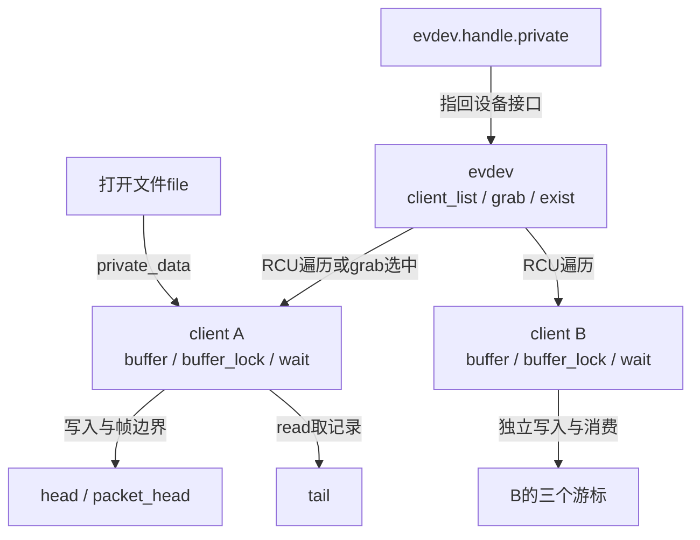
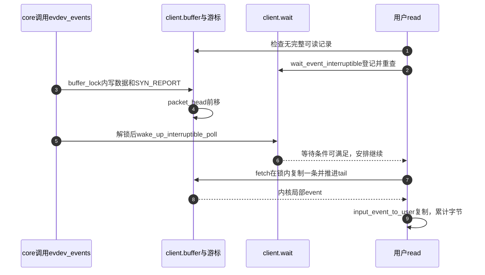

# 第2章\_evdev独立队列与读取边界

core完成S4只证明某个handle回调已经执行。evdev还要把批次复制到客户端，标记可读取的帧，并通知等待者，才能接续S5。本页从这个交接点阅读，不把内核队列和用户已经处理完事件混为一谈。

| 阅读任务 | 入口 |
| --- | --- |
| 版本、原件和所有模块 | [总索引](../navigation/P01_Linux_6.12_Input源码阅读索引.md#1.1_固定版本与阅读任务) |
| S4～S5的对象和通信 | [模块导读](../navigation/P02_事件状态怎样到达各客户端.md#2.2_从批量回调追到可读条件) |
| 三个游标的纸上实验 | [体系结构正文](../../../../knowledge/driver_model/input/P02_体系结构与事件传递.md#2.4_三个游标怎样保护完整帧与独立消费) |
| core交接前的状态和过滤 | [批量分发实现](P01_事件接受与批量分发.md#1.4_连接选择与过滤怎样共同决定下一接收者) |

固定证据为NXP Linux 6.12.20提交 `dfaf2136deb2af2e60b994421281ba42f1c087e0` 的 [drivers/input/evdev.c](../../linux/drivers/input/evdev.c)，blob `b5cbb57ee5f60073a41d16da23a8d3fa6c09f04a`。UAPI结构见 [include/uapi/linux/input.h](../../linux/include/uapi/linux/input.h)，blob `2557eb7b056178b2b8be98d9cea855eba1bd5aaf`。需要CONFIG_INPUT_EVDEV对应实现已加载且连接成功；本次未在目标内核执行。摘录沿用原件GPL-2.0-only许可，中文说明为仓库补充。

## 2.1\_批次怎样复制到每个客户端

evdev_events由evdev_handler.events登记，handle->private指回该设备的evdev实例；这个实例的client_list保存独立open建立的client。client的buffer是随client分配的环形数组，file->private_data保存client指针。独立open有独立数组，dup或fork继承的同一打开文件描述共享原数组。



RCU读侧保护遍历中的client不会被并发释放；附加/删除client由client_lock串行，删除后等待既有RCU读侧结束，再释放client。它不代替buffer_lock，也不使慢客户端拥有无限历史。下面evdev_events从input_dev取得各时钟域时间，选grab或遍历list，再把同一批次交给各client。

```c
/**
 * @brief 将core批次交给独占客户端或全部已连接客户端。
 * @note 仓库补充中文阅读说明；原件执行语句保留，英文注释省略。
 */
static unsigned int evdev_events(struct input_handle *handle,
				 struct input_value *vals, unsigned int count)
{
	struct evdev *evdev = handle->private;
	struct evdev_client *client;
	ktime_t *ev_time = input_get_timestamp(handle->dev);

	rcu_read_lock();

	client = rcu_dereference(evdev->grab);

	if (client)
		evdev_pass_values(client, vals, count, ev_time);
	else
		list_for_each_entry_rcu(client, &evdev->client_list, node)
			evdev_pass_values(client, vals, count, ev_time);

	rcu_read_unlock();

	return count;
}
```

每个client用clk_type选择时间域。input_get_timestamp负责提供本次使用的设备时间，ktime_to_timespec64转成秒/纳秒，再以微秒填入用户事件；这不自动校准控制器时钟。client->revoked表示单个客户端已被撤销，仍在列表中也不再入队。`__evdev_is_filtered`检查本client的type/code mask，缺少相应mask时按默认接收处理，不能把它误作core的handler filter。

```c
/**
 * @brief 在客户端锁内筛选和复制记录，并在有效帧结束后唤醒等待者。
 * @note 仓库补充中文阅读说明；原件执行语句保留，英文注释省略。
 */
static void evdev_pass_values(struct evdev_client *client,
			const struct input_value *vals, unsigned int count,
			ktime_t *ev_time)
{
	const struct input_value *v;
	struct input_event event;
	struct timespec64 ts;
	bool wakeup = false;

	if (client->revoked)
		return;

	ts = ktime_to_timespec64(ev_time[client->clk_type]);
	event.input_event_sec = ts.tv_sec;
	event.input_event_usec = ts.tv_nsec / NSEC_PER_USEC;

	spin_lock(&client->buffer_lock);

	for (v = vals; v != vals + count; v++) {
		if (__evdev_is_filtered(client, v->type, v->code))
			continue;

		if (v->type == EV_SYN && v->code == SYN_REPORT) {

			/* 没有新增记录就丢弃空同步 */
	if (client->packet_head == client->head)
				continue;

			wakeup = true;
		}

		event.type = v->type;
		event.code = v->code;
		event.value = v->value;
		__pass_event(client, &event);
	}

	/* 队列更新完成后再唤醒，等待者会重新检查条件 */
	spin_unlock(&client->buffer_lock);

	if (wakeup)
		wake_up_interruptible_poll(&client->wait,
			EPOLLIN | EPOLLOUT | EPOLLRDNORM | EPOLLWRNORM);
}
```

这里已经由上游关本地中断，所以使用spin_lock；不能把同样代码任意搬到一个可能被本地IRQ重入的进程路径。wakeup只在接受非空SYN_REPORT时置位，解锁后wake_up_interruptible_poll通知client.wait，通知掩码包含可读/可写标志；它不会运行用户事件处理函数，也不承诺被唤醒任务立即获得CPU。

修改客户端过滤时，必须保留同步和失步协议的可解释性，检查“所有数据都被过滤只剩同步”“中途切换mask”“某client已撤销”这些路径。修改时间戳时要同时检查client选择的时钟域，不能只改变秒字段却遗留微秒转换。回调返回原count，意味着evdev复制记录没有截住后续core handler。

## 2.2\_写游标如何变成帧边界以及失步证据

__pass_event把记录写到head处，再通过 `& (bufsize - 1)` 环绕。这个位运算依赖bufsize为2的幂，分配路径据预计每包事件数和最低容量选择并向2的幂取整；零初始化使head、tail、packet_head起点一致。更改容量算法时必须继续满足该不变量，不能只把容量改成任意正整数。

head追上tail说明已覆盖未消费记录。此实现不保留旧历史的可靠性：它把tail移到新head之前两个位置，用SYN_DROPPED覆盖该处，保留最新事件，并把packet_head退到tail，等待后续有效同步。若最新事件本身就是SYN_REPORT，后续分支会立即建立新的packet_head。因此溢出与同步可在同一次调用中依次发生。

```c
/**
 * @brief 写入一条记录，处理客户端追尾，并在同步记录后提交读取边界。
 * @note 仓库补充中文阅读说明；原件执行语句保留，英文注释省略。
 */
static void __pass_event(struct evdev_client *client,
			 const struct input_event *event)
{
	client->buffer[client->head++] = *event;
	client->head &= client->bufsize - 1;

	/* 追尾只损坏本client的历史；保留失步标志与最新记录 */
	if (unlikely(client->head == client->tail)) {

		client->tail = (client->head - 2) & (client->bufsize - 1);

		client->buffer[client->tail] = (struct input_event) {
			.input_event_sec = event->input_event_sec,
			.input_event_usec = event->input_event_usec,
			.type = EV_SYN,
			.code = SYN_DROPPED,
			.value = 0,
		};

		client->packet_head = client->tail;
	}

	if (event->type == EV_SYN && event->code == SYN_REPORT) {
		/* 同步记录也已写入，可读区间推进到其后 */
	client->packet_head = client->head;
		kill_fasync(&client->fasync, SIGIO, POLL_IN);
	}
}
```

`unlikely`只是分支预测提示，不保证不会溢出。SYN_DROPPED沿用当前记录时间，type/code/value是失步标志而不是设备真实事件。消费者应忽略失步之后直到并包括下一个SYN_REPORT的事件，再查询可恢复的当前状态；相对增量和瞬态历史不一定可重建。这里的丢失是client队列丢失，不自动证明控制器丢了硬件帧。

SYN_REPORT还调用kill_fasync通知注册异步信号的client，fasync对象由evdev_fasync通过fasync_helper维护。SIGIO/POLL_IN表示可读通知，并不是把完整事件内容装进信号。client.wait唤醒发生在上节evdev_pass_values解锁以后，两个通知面向不同等待方式，不应删掉其中一个并认为“已有通知就够了”。

若改溢出策略，必须联合验证tail、packet_head和失步记录的相对位置。只移动tail而不修packet_head可能暴露未结束帧；只静默覆盖历史则让应用继续用不完整增量推导状态。记录数较少的测试还必须覆盖环绕和“追尾事件恰为同步”两个分支。

## 2.3\_读取为何可能拆帧但不会主动暴露未完成帧

evdev_fetch_next_event在buffer_lock内检查packet_head与tail，存在完整窗口时复制一条到调用者的内核局部变量，再推进tail。evdev_read随后把这个局部变量复制到用户地址。这样用户缺页等复制行为不发生在该spinlock内，但也意味着发生-EFAULT时，已经取出的记录可能已被消费，不能承诺失败读取自动回滚游标。

```c
/**
 * @brief 只从已经提交的帧窗口取一条记录，并推进该client的tail。
 * @note 仓库补充中文阅读说明；原件执行语句保留，英文注释省略。
 */
static int evdev_fetch_next_event(struct evdev_client *client,
				  struct input_event *event)
{
	int have_event;

	spin_lock_irq(&client->buffer_lock);

	have_event = client->packet_head != client->tail;
	if (have_event) {
		*event = client->buffer[client->tail++];
		client->tail &= client->bufsize - 1;
	}

	spin_unlock_irq(&client->buffer_lock);

	return have_event;
}
```

```c
/**
 * @brief 检查设备可用性，按用户空间大小取记录，空队列时等待或返回EAGAIN。
 * @note 仓库补充中文阅读说明；原件执行语句保留，英文注释省略。
 */
static ssize_t evdev_read(struct file *file, char __user *buffer,
			  size_t count, loff_t *ppos)
{
	struct evdev_client *client = file->private_data;
	struct evdev *evdev = client->evdev;
	struct input_event event;
	size_t read = 0;
	int error;

	if (count != 0 && count < input_event_size())
		return -EINVAL;

	for (;;) {
		if (!evdev->exist || client->revoked)
			return -ENODEV;

		if (client->packet_head == client->tail &&
		    (file->f_flags & O_NONBLOCK))
			return -EAGAIN;

		if (count == 0)
			break;

		while (read + input_event_size() <= count &&
		       evdev_fetch_next_event(client, &event)) {

			if (input_event_to_user(buffer + read, &event))
				return -EFAULT;

			read += input_event_size();
		}

		if (read)
			break;

		if (!(file->f_flags & O_NONBLOCK)) {
			error = wait_event_interruptible(client->wait,
					client->packet_head != client->tail ||
					!evdev->exist || client->revoked);
			if (error)
				return error;
		}
	}

	return read;
}
```

input_event_size与input_event_to_user处理当前调用者ABI的大小和布局，尤其不能把32位兼容进程等同于内核本机结构大小。前者决定一次至少装下一条事件，后者复制/转换到用户缓冲；本页不展开架构兼容层的逐字段布局。count是用户缓冲字节数，read是已复制字节数，ppos在这个事件流接口中不承担随机寻址。

| 条件 | 该版本路径 | 不能据此推出什么 |
| --- | --- | --- |
| 非零count不足一条事件 | -EINVAL | 不会返回半个input_event |
| exist为false或client revoked | -ENODEV | 不保证缓存全部排空再EOF |
| 无完整可读记录且O_NONBLOCK | -EAGAIN | 不等于设备没有新当前状态 |
| count为0且前面错误条件未触发 | 返回0，不取记录 | 检查次序仍可能先返回错误 |
| 至少复制了一条且空间耗尽 | 返回已复制字节数 | 不保证刚好一帧 |
| 阻塞且无可读记录 | wait_event_interruptible等待 | 信号可打断，醒来须重查条件 |

wait_event_interruptible的条件还包含设备消失和client撤销，确保不是永远等下一次硬件事件。它返回的非零错误被传回调用者；可能被系统调用重启机制处理，应用要按自己的信号策略处理。evdev_poll通过poll_wait登记同一个client.wait，设备有效时报告可写，失效时报告HUP/ERR，同时依据packet_head与tail报告可读。可读与挂起标志可以同时存在，不能仅看一个标志就跳过read错误检查。



步骤2不是无保护地“先看一眼再睡”，等待原语会登记和重查，避免条件变化恰落在观察与睡眠之间造成永久遗漏。步骤7一次只取一条，因此read不是对整个队列做不可分割快照；生产者可继续入队。步骤9若失败，局部记录已经从队列取走，这是修改读取路径时要保留或明确改变的语义。

在设备仍存在、无溢出的纸上模型中，先入X、Y、SYN，再让read空间只装一条：第一次只取X，第二次还能取Y和SYN；另一个client的tail始终不变。再把生产速度提高到追尾，答案必须加入SYN_DROPPED和重同步，不能把第一种模型无限外推。

本页函数都位于evdev.c内部，通过handler及file_operations入口使用，不向设备驱动直接导出。修改时联合检查事件回调不可睡眠约束、client列表删除后的RCU等待、buffer_lock、用户复制错误及断开唤醒。文件引用延长对象生命期，不延长硬件可用期；连接和撤销的完整配对继续在生命周期模块核对。
