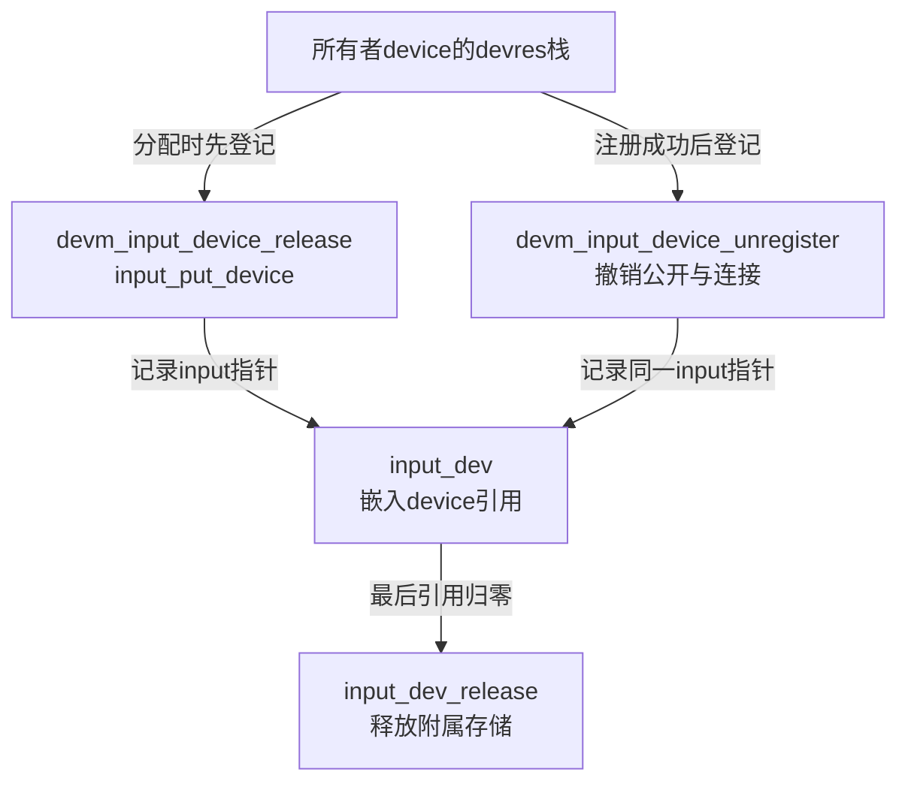
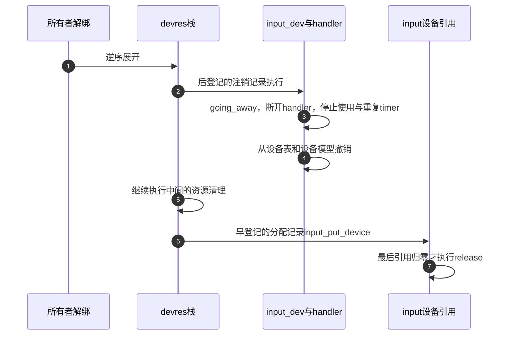

# 第3章\_分配发布与两步资源撤销

input_dev的内存生命、设备可见性和使用计数不是同一个状态。本页沿S0分配、S1注册和S6注销解释前两项，再把使用计数交给下一页。源码来自 [固定版本总索引](../navigation/P01_Linux_6.12_Input源码阅读索引.md#1.1_固定版本与阅读任务)，场景见 [生命周期正文](../../../../knowledge/driver_model/input/P03_设备注册能力与生命周期.md#3.1_发布意味着其他路径可以开始使用对象)，按路径阅读见 [生命周期模块导读](../navigation/P03_设备怎样公开启停和退出.md#3.1_分开观察可见性使用关系与生产者)。

固定NXP提交为 `dfaf2136deb2af2e60b994421281ba42f1c087e0`，版本6.12.20。[drivers/input/input.c](../../linux/drivers/input/input.c) blob `c51858f1cdc556939c2ee1bd21669c71c169d84e`；[include/linux/input.h](../../linux/include/linux/input.h) blob `cd866b020a01d67081788e1baa2d372ce1c79767`。CONFIG_INPUT提供本页实现，CONFIG_INPUT_EVDEV决定是否还有本例的用户字符接口；没有核对目标运行配置。执行语句保留原件GPL-2.0-only许可，中文注释为仓库补充。

## 3.1\_分配先建立内部不变量与设备引用

input_allocate_device声明在input.h、导出给驱动；它不仅分配input_dev，还准备最初10项vals、mutex、event_lock、重复定时器和链表头。input_no是本函数静态原子计数，初值-1，命名时先递增得到input0等名称；这个名字不同于evdev的event编号，也不是硬件身份。

```c
/**
 * @brief 为input设备建立初始存储、锁、设备模型引用和内部名称。
 * @note 仓库补充中文阅读说明；原件执行语句保留，英文注释省略。
 */
struct input_dev *input_allocate_device(void)
{
	static atomic_t input_no = ATOMIC_INIT(-1);
	struct input_dev *dev;

	dev = kzalloc(sizeof(*dev), GFP_KERNEL);
	if (!dev)
		return NULL;

	dev->max_vals = 10;
	dev->vals = kcalloc(dev->max_vals, sizeof(*dev->vals), GFP_KERNEL);
	if (!dev->vals) {
		kfree(dev);
		return NULL;
	}

	mutex_init(&dev->mutex);
	spin_lock_init(&dev->event_lock);
	timer_setup(&dev->timer, NULL, 0);
	INIT_LIST_HEAD(&dev->h_list);
	INIT_LIST_HEAD(&dev->node);

	dev->dev.type = &input_dev_type;
	dev->dev.class = &input_class;
	/* 此后通过设备引用配对释放，不能直接kfree。 */
	device_initialize(&dev->dev);

	dev_set_name(&dev->dev, "input%lu",
		     (unsigned long)atomic_inc_return(&input_no));

	__module_get(THIS_MODULE);

	return dev;
}
```

kzalloc/kcalloc使字段和数组初始清零。第二次分配失败时尚未device_initialize，可直接释放外层结构；device_initialize之后对象纳入设备模型引用管理，就须通过input_free_device/input_put_device等配对，不能直接kfree。

input_dev_type关联属性组、release、uevent和PM回调，input_class把对象放入input类；属性组和uevent提供sysfs/设备信息，PM是系统休眠入口，这些入口不在分配时执行硬件启动。timer_setup此时用NULL回调，注册再按重复策略决定是否启用软件重复。__module_get(THIS_MODULE)持有的是此源码所属Input core模块，而不是自动替设备驱动任意异步路径持引用。

input.h的input_get_device/input_put_device分别包装嵌入dev的get_device/put_device；空指针受保护，但不替调用者证明当前指针有效。input_set_drvdata/input_get_drvdata通过设备模型保存/取出驱动私有指针，不复制该对象，也不接管释放。最后设备引用归零会进入下列release。

```c
/**
 * @brief 在最后设备引用结束后清理Input附属存储并释放核心模块引用。
 * @note 仓库补充中文阅读说明；原件执行语句保留，英文注释省略。
 */
static void input_dev_release(struct device *device)
{
	struct input_dev *dev = to_input_dev(device);

	input_ff_destroy(dev);
	input_mt_destroy_slots(dev);
	kfree(dev->poller);
	kfree(dev->absinfo);
	kfree(dev->vals);
	kfree(dev);

	module_put(THIS_MODULE);
}
```

input_ff_destroy撤销力反馈附属状态，input_mt_destroy_slots释放MT槽，随后释放poller、absinfo、vals及主结构，最后module_put与分配时的引用配对。本函数没有cancel_delayed_work_sync，也不关设备IRQ：那些生产者必须在注销/关闭时收束，不能等release才试图补救悬空访问。to_input_dev根据嵌入device找回外层input_dev；它不是重新分配对象。

修改分配字段时要同时检查release和注册前失败路径；新增已启动的异步动作则不能只加一条kfree，必须先设计停止点。将input_no当稳定持久标识使用也不正确，卸载/重启及枚举次序会影响命名。

## 3.2\_托管分配登记的是哪一个释放动作

devm_input_allocate_device先为devm_input_device_release分配devres记录，再调用普通分配。input_devres只有input指针，devres本身把它与所有者设备的释放栈关联。分配失败分别释放已取得的记录；成功后设置parent及devres_managed，再登记到所有者。

```c
/**
 * @brief 把分配引用的释放登记到所有者devres，并固定父设备关系。
 * @note 仓库补充中文阅读说明；原件执行语句保留，英文注释省略。
 */
struct input_dev *devm_input_allocate_device(struct device *dev)
{
	struct input_dev *input;
	struct input_devres *devres;

	devres = devres_alloc(devm_input_device_release,
			      sizeof(*devres), GFP_KERNEL);
	if (!devres)
		return NULL;

	input = input_allocate_device();
	if (!input) {
		devres_free(devres);
		return NULL;
	}

	input->dev.parent = dev;
	input->devres_managed = true;

	devres->input = input;
	devres_add(dev, devres);

	return input;
}
```

devm_input_device_release从记录取input并调用input_put_device，负责放掉分配引用；不是执行input_unregister_device。devm_input_device_match按记录里的input指针与给定data相等匹配，用于从devres栈移除特定记录。日志dev_dbg只是显示记录，不改变配对。



两条记录保存同一对象，但职责不同。逆序展开时先注销，再到分配释放；中间还可能有驱动其他资源清理。因此parent既是设备层级关系，又是这些记录的所有者，随意改parent会让后续devres查找落到错误设备上。需要不同所有权模型时，应先设计明确交接，不能仅把字段改成另一设备。

## 3.3\_注册把已准备对象交给设备模型和handler

input_register_device先检查EV_ABS与absinfo一致性，为托管对象准备额外注销记录，再整理能力和暂存容量。device_add之后设备模型已经可见；挂入input_dev_list并连接handler时，evdev等用户入口也可能建立。因此所有回调依赖的数据必须在调用前完成，不能在返回后才补drvdata。

```c
/**
 * @brief 完成能力与容量准备，发布设备并连接handler，失败按已完成阶段撤销。
 * @note 仓库补充中文阅读说明；原件执行语句保留，英文注释省略。
 */
int input_register_device(struct input_dev *dev)
{
	struct input_devres *devres = NULL;
	struct input_handler *handler;
	const char *path;
	int error;

	if (test_bit(EV_ABS, dev->evbit) && !dev->absinfo) {
		dev_err(&dev->dev,
			"Absolute device without dev->absinfo, refusing to register\n");
		return -EINVAL;
	}

	if (dev->devres_managed) {
		devres = devres_alloc(devm_input_device_unregister,
				      sizeof(*devres), GFP_KERNEL);
		if (!devres)
			return -ENOMEM;

		devres->input = dev;
	}

	__set_bit(EV_SYN, dev->evbit);

	__clear_bit(KEY_RESERVED, dev->keybit);

	input_cleanse_bitmasks(dev);

	error = input_device_tune_vals(dev);
	if (error)
		goto err_devres_free;

	if (!dev->rep[REP_DELAY] && !dev->rep[REP_PERIOD])
		input_enable_softrepeat(dev, 250, 33);

	if (!dev->getkeycode)
		dev->getkeycode = input_default_getkeycode;

	if (!dev->setkeycode)
		dev->setkeycode = input_default_setkeycode;

	if (dev->poller)
		input_dev_poller_finalize(dev->poller);

	/* 公开设备模型前，驱动所有入口依赖必须已经准备好。 */
	error = device_add(&dev->dev);
	if (error)
		goto err_devres_free;

	path = kobject_get_path(&dev->dev.kobj, GFP_KERNEL);
	pr_info("%s as %s\n",
		dev->name ? dev->name : "Unspecified device",
		path ? path : "N/A");
	kfree(path);

	error = mutex_lock_interruptible(&input_mutex);
	if (error)
		goto err_device_del;

	list_add_tail(&dev->node, &input_dev_list);

	list_for_each_entry(handler, &input_handler_list, node)
		input_attach_handler(dev, handler);

	input_wakeup_procfs_readers();

	mutex_unlock(&input_mutex);

	if (dev->devres_managed) {
		dev_dbg(dev->dev.parent, "%s: registering %s with devres.\n",
			__func__, dev_name(&dev->dev));
		devres_add(dev->dev.parent, devres);
	}
	return 0;

err_device_del:
	device_del(&dev->dev);
err_devres_free:
	devres_free(devres);
	return error;
}
```

这段代码的辅助操作分别承担以下职责，不能把它们一概当成注册成功的同义词。

| 操作/状态 | 功能及失败或条件边界 |
| --- | --- |
| EV_SYN、KEY_RESERVED、input_cleanse_bitmasks | 补同步能力、去保留键码，清掉没有对应evbit类型的code位图 |
| input_device_tune_vals | 按能力估计事件数，并取不小于hint的容量需求；必要时分配新数组，在event_lock内换指针后释放旧数组；分配失败退出 |
| input_enable_softrepeat | 仅当两个rep参数都为0时设置默认250/33及timer回调，实际重复还受能力和键状态约束 |
| getkeycode/setkeycode默认回调 | 驱动未提供时使用core键码映射实现；不意味着所有键码表都已填好 |
| input_dev_poller_finalize | 配置已有poller的默认间隔和最大值，此处不启动采样 |
| device_add/device_del | 发布/撤销设备模型；添加失败或后续锁失败走对应回滚 |
| input_mutex、input_dev_list、input_handler_list | 全局注册互斥及两类对象列表，串行注册/注销匹配 |
| input_attach_handler | 用id table和可选match筛选，再调用connect；单个handler错误不会由此循环转成整个注册失败 |
| input_wakeup_procfs_readers | 通知设备列表观察者发生变化，与evdev每帧唤醒不同 |
| devres_add | 成功末尾才把注销动作登记到所有者，提前失败的临时记录直接devres_free |

getkeycode/setkeycode属于键码映射旁支，路径日志的kobject_get_path、pr_info及kfree只构造/释放显示字符串；这些机械显示不作为本页对象上线证明。input_device_tune_vals的估计由能力位、轴数和MT槽数等组成，不是驱动帧长的无上限保证；容量flush的副作用见 [批量暂存实现](P01_事件接受与批量分发.md#1.3_暂存容量与两条flush路径)。

错误标签应从已完成动作反读：还没device_add成功就失败，不需device_del；device_add成功但锁被打断，先device_del；所有失败都释放尚未挂入所有者的注销记录。调用者仍须结束自己的分配引用，显式对象用input_free_device，托管对象通常让所有者失败清理。不能在失败后假定框架已替显式调用者释放input_dev。

匹配两端的输入也要核对。input_match_device_id按id.flags选择身份及能力检查，input_match_device遍历直到空终止项，允许可选handler.match进一步过滤；input_attach_handler在匹配后调用connect，非ENODEV错误会记录日志。handler注册又会遍历已有device，保证注册顺序不同仍有机会连接，但不保证每次资源分配都成功。

修改发布顺序时，应检查注册过程中的并发open、device_add后失败、handler部分连接以及devres记录尚未添加的窗口。不能仅用“函数返回0”测试替代这些分支，也不应把connect失败改成全局回滚而不分析已连接handler如何撤销。

## 3.4\_注销与释放分别推进哪组状态

普通input_free_device仅用于尚未注册或注册失败的分配；若对象是托管的，会先从devres移除对应分配释放记录，再放引用。注册成功后则走input_unregister_device：显式对象注销后放分配引用，托管对象只移除注销记录并执行注销，分配引用仍由更早那条devres记录管理。

```c
/**
 * @brief 结束未成功注册的分配引用，并移除可能存在的托管分配记录。
 * @note 仓库补充中文阅读说明；原件执行语句保留，英文注释省略。
 */
void input_free_device(struct input_dev *dev)
{
	if (dev) {
		if (dev->devres_managed)
			WARN_ON(devres_destroy(dev->dev.parent,
						devm_input_device_release,
						devm_input_device_match,
						dev));
		input_put_device(dev);
	}
}
```

```c
/**
 * @brief 撤销注册，按是否托管决定何时放掉分配引用。
 * @note 仓库补充中文阅读说明；原件执行语句保留，英文注释省略。
 */
void input_unregister_device(struct input_dev *dev)
{
	/* 托管分支撤销注销记录，分配引用留给早登记的释放记录。 */
	if (dev->devres_managed) {
		WARN_ON(devres_destroy(dev->dev.parent,
					devm_input_device_unregister,
					devm_input_device_match,
					dev));
		__input_unregister_device(dev);

	} else {
		__input_unregister_device(dev);
		input_put_device(dev);
	}
}
```

WARN_ON用于诊断预期devres记录找不到，不能把诊断当作重新建立正确所有权。devres_destroy移除指定回调及对象匹配的记录而不调用该释放动作，因此显式接口随后自己执行应做的注销或put；重复调用仍可能访问已结束的对象，不因WARN存在而安全。

内部__input_unregister_device先执行input_disconnect_device，阻止新打开并处理已按键及普通handle分发，然后在input_mutex下让每个handler断开。列表遍历使用safe形式，因为disconnect应撤销handle；WARN_ON检查链表最终为空，但不替失败的handler自动补完断开。最后同步删除软件重复timer、移除设备表、通知列表观察者并device_del。

```c
/**
 * @brief 先关闭使用入口，再拆handler连接和设备公开状态。
 * @note 仓库补充中文阅读说明；原件执行语句保留，英文注释省略。
 */
static void __input_unregister_device(struct input_dev *dev)
{
	struct input_handle *handle, *next;

	input_disconnect_device(dev);

	mutex_lock(&input_mutex);

	list_for_each_entry_safe(handle, next, &dev->h_list, d_node)
		handle->handler->disconnect(handle);
	WARN_ON(!list_empty(&dev->h_list));

	del_timer_sync(&dev->timer);
	list_del_init(&dev->node);

	input_wakeup_procfs_readers();

	mutex_unlock(&input_mutex);

	device_del(&dev->dev);
}
```

input_disconnect_device中的going_away、分发收束与evdev的exist/引用关系见 [打开与断开实现](P04_使用计数失败回滚与断开.md#4.3_注销怎样通知旧文件同时阻止新使用)。input_dev.timer由重复功能使用，del_timer_sync必须在释放存储前完成；poller的停止通过使用关系收束完成，不能认为这里的timer注销也自动处理所有work。



步骤4之后不能再提供有效设备访问，但步骤6之前分配引用仍存在。步骤7也可能更晚，因为已有文件关联对象还持有其他引用。驱动其他资源若比采样生产者更早消失，仍可能发生总线访问错误；两步Input撤销只管理其自身对象，不证明整个驱动清理顺序正确。

修改时逐项保持三个配对：分配引用最终put、发布状态最终注销、生产者最终停止。用一个布尔registered只能帮助区分前两条清理选择，不能替代在途IRQ/work同步，也不能替代设备模型引用。调用者从unregister返回后不再使用该input指针，即使某条托管路径实现上暂时保留内存，也不应把内部保留窗口变成任意继续访问的理由。
