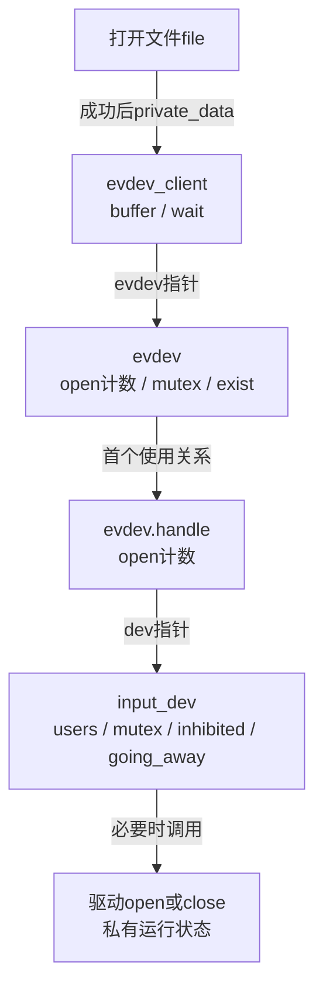
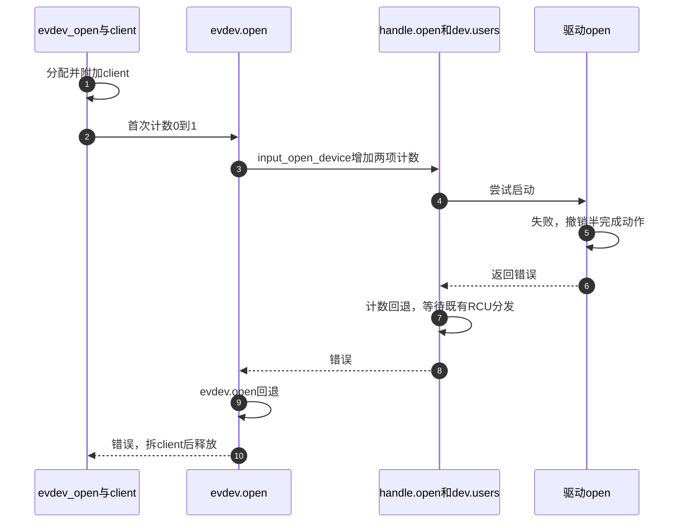
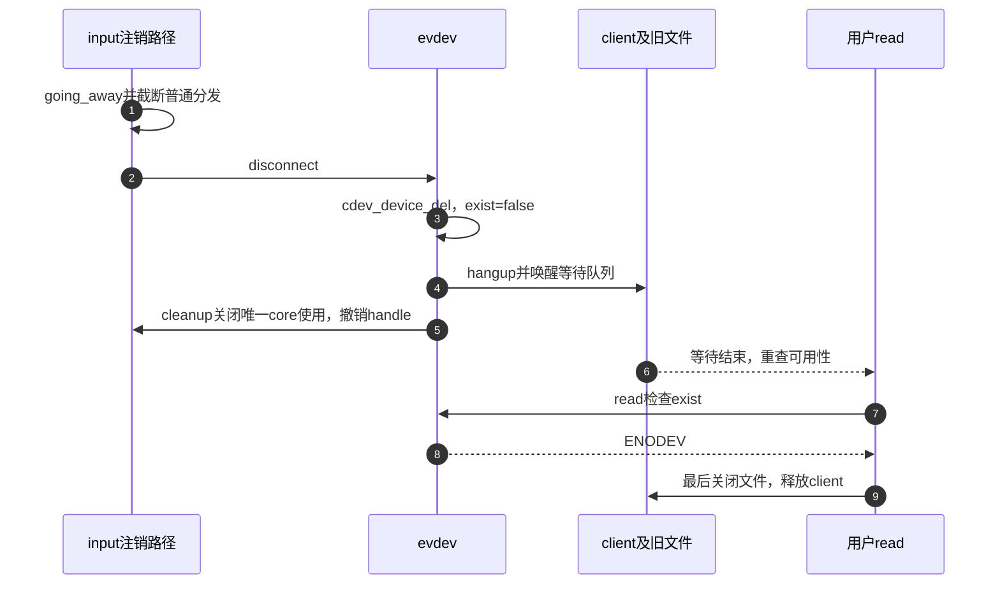

# 第4章\_使用计数失败回滚与断开

公开input_dev与启动硬件之间，还有handler和evdev各自的使用关系。本页固定NXP Linux 6.12.20提交 `dfaf2136deb2af2e60b994421281ba42f1c087e0`，沿首次打开失败、最后关闭、注销和inhibit四条路径区分它们。

| 阅读任务 | 入口 |
| --- | --- |
| 版本和原件地图 | [总索引](../navigation/P01_Linux_6.12_Input源码阅读索引.md#1.1_固定版本与阅读任务) |
| 按使用周期找对象 | [生命周期导读](../navigation/P03_设备怎样公开启停和退出.md#3.2_首次使用与最后使用之间追哪些计数) |
| 两应用的正常和失败预测 | [生命周期正文](../../../../knowledge/driver_model/input/P03_设备注册能力与生命周期.md#3.3_首次打开与最后关闭为什么需要两级计数) |
| 分配引用和devres | [发布与两步撤销](P03_分配发布与两步资源撤销.md#3.2_托管分配登记的是哪一个释放动作) |

原件 [input.c](../../linux/drivers/input/input.c) blob `c51858f1cdc556939c2ee1bd21669c71c169d84e` 与 [evdev.c](../../linux/drivers/input/evdev.c) blob `b5cbb57ee5f60073a41d16da23a8d3fa6c09f04a`。核心配置为CONFIG_INPUT，evdev接口需CONFIG_INPUT_EVDEV；没有以目标运行配置作证明。摘录保留GPL-2.0-only执行语句，中文注释为仓库补充。

## 4.1\_首次evdev打开怎样进入core并回滚

file_operations.open进入evdev_open，从inode的cdev找evdev，分配包括buffer尾数组的client，初始化wait/锁并附加到client_list，随后进入evdev_open_device。附加早于core open，使驱动首次open或poller立即产生的事件有机会入队；失败则拆client并释放，不能把“已附加”当成用户已获得有效fd。



下面保留整个入口，让分配与失败配对能连续阅读。evdev_compute_buffer_size取预计事件数乘8与最低64中的大值，再向2的幂取整；struct_size计算结构加尾数组的大小，kvzalloc允许选择适合的分配方式并清零。stream_open设置流式文件行为，不是第二次设备启动。

```c
/**
 * @brief 建立独立客户端，进入evdev使用关系，失败时撤销列表与内存。
 * @note 仓库补充中文阅读说明；原件执行语句保留，英文注释省略。
 */
static int evdev_open(struct inode *inode, struct file *file)
{
	struct evdev *evdev = container_of(inode->i_cdev, struct evdev, cdev);
	unsigned int bufsize = evdev_compute_buffer_size(evdev->handle.dev);
	struct evdev_client *client;
	int error;

	client = kvzalloc(struct_size(client, buffer, bufsize), GFP_KERNEL);
	if (!client)
		return -ENOMEM;

	init_waitqueue_head(&client->wait);
	client->bufsize = bufsize;
	spin_lock_init(&client->buffer_lock);
	client->evdev = evdev;
	evdev_attach_client(evdev, client);

	error = evdev_open_device(evdev);
	if (error)
		goto err_free_client;

	file->private_data = client;
	stream_open(inode, file);

	return 0;

 err_free_client:
	evdev_detach_client(evdev, client);
	kvfree(client);
	return error;
}
```

```c
/**
 * @brief 只在本evdev首次打开时进入input core，并回退失败的计数。
 * @note 仓库补充中文阅读说明；原件执行语句保留，英文注释省略。
 */
static int evdev_open_device(struct evdev *evdev)
{
	int retval;

	retval = mutex_lock_interruptible(&evdev->mutex);
	if (retval)
		return retval;

	if (!evdev->exist)
		retval = -ENODEV;
	else if (!evdev->open++) {
		retval = input_open_device(&evdev->handle);
		if (retval)
			evdev->open--;
	}

	mutex_unlock(&evdev->mutex);
	return retval;
}
```

mutex_lock_interruptible成功返回0，所以非首次打开沿用retval=0；exist=false阻止对已断开实例的新使用。`!evdev->open++`判断自增前是否为0，进入core失败才减回。不能把后缀++读成先增加再判断，也不能把evdev.open与dev.users写成同一计数。

```c
/**
 * @brief 串行检查设备可用性，增加使用关系，首次启动失败时完整退回计数。
 * @note 仓库补充中文阅读说明；原件执行语句保留，英文注释省略。
 */
int input_open_device(struct input_handle *handle)
{
	struct input_dev *dev = handle->dev;
	int retval;

	retval = mutex_lock_interruptible(&dev->mutex);
	if (retval)
		return retval;

	if (dev->going_away) {
		retval = -ENODEV;
		goto out;
	}

	/* 先增加使用关系；驱动启动失败时在下面逐项回退。 */
	handle->open++;

	if (dev->users++ || dev->inhibited) {

		goto out;
	}

	if (dev->open) {
		retval = dev->open(dev);
		if (retval) {
			dev->users--;
			handle->open--;

			synchronize_rcu();
			goto out;
		}
	}

	if (dev->poller)
		input_dev_poller_start(dev->poller);

 out:
	mutex_unlock(&dev->mutex);
	return retval;
}
```

going_away在增加计数前拒绝新使用。handle.open记录这个连接的打开关系，dev.users汇总核心使用；已有使用者或inhibited都会跳过硬件open，但保留需求计数。设备open失败时core减回两项，并synchronize_rcu确保旧分发退出；驱动必须在返回错误前自己撤销半完成启动，core不会替它补调close。成功后才启动已有poller。



步骤5处理硬件，步骤7处理core分发，步骤10处理client生命期；不能把任一项省掉。evdev_attach_client在client_lock下list_add_tail_rcu；detach在同锁下list_del_rcu后synchronize_rcu，保证异步遍历不再持有待释放client。改变附加时机应同时验证首次同步poll、启动失败和并发事件；不能简单移动到open成功之后而无视最早事件丢失的变化。

## 4.2\_最后关闭怎样停止生产并退出分发

evdev_release先按设备有效性执行可选flush、释放本client的独占，再拆client、释放mask和内存，最后调用evdev_close_device。flush通过input_flush_device在dev.mutex下调用可选dev.flush，它是设备定义的文件使用收尾，不等于把evdev队列全部交给用户。evdev_ungrab只会替真正的独占client释放独占；非持有者的错误不会改变其他client的grab。

```c
/**
 * @brief 只有设备仍存在且本evdev最后一个打开关系结束时关闭core使用。
 * @note 仓库补充中文阅读说明；原件执行语句保留，英文注释省略。
 */
static void evdev_close_device(struct evdev *evdev)
{
	mutex_lock(&evdev->mutex);

	if (evdev->exist && !--evdev->open)
		input_close_device(&evdev->handle);

	mutex_unlock(&evdev->mutex);
}
```

```c
/**
 * @brief 撤销独占及使用关系，在普通最后关闭时先停poller再调用驱动close。
 * @note 仓库补充中文阅读说明；原件执行语句保留，英文注释省略。
 */
void input_close_device(struct input_handle *handle)
{
	struct input_dev *dev = handle->dev;

	mutex_lock(&dev->mutex);

	__input_release_device(handle);

	/* 普通最后关闭先停止poller，再调用设备close。 */
	if (!--dev->users && !dev->inhibited) {
		if (dev->poller)
			input_dev_poller_stop(dev->poller);
		if (dev->close)
			dev->close(dev);
	}

	if (!--handle->open) {

		synchronize_rcu();
	}

	mutex_unlock(&dev->mutex);
}
```

__input_release_device只在此handle持有dev.grab时清grab并等待RCU旧分发，随后对仍打开且有start回调的handler通知重新同步。dev.users减为0且未inhibit才执行停止；poller_stop同步取消其工作，驱动close随后关闭其他生产者。handle.open随后减为0时再等待既有事件分发结束。这里close没有失败返回值，驱动不能返回后仍让采样无期限访问将释放的数据。

设备已经inhibit时，停止已由禁止路径执行，最后需求消失不应再重复调用close。设备注销后evdev.exist为false，已有文件随后release不会再对已清理的core使用关系减一次。`evdev.open`在失效实例中也不再承担正常活设备的逐文件计数合同，不能拿它当全局对象引用数。

修改减计数顺序须检查正常最后关闭、还有其他handler、inhibit后关闭、注销后的迟到文件释放。RCU等待只针对相应事件遍历，不代替IRQ同步或任意驱动work取消。不能把synchronize_rcu保留了就宣称整个驱动已经没有在途访问。

## 4.3\_注销怎样通知旧文件同时阻止新使用

注销准备先拿dev.mutex设going_away，与正在进行的input_open_device串行；再在event_lock内释放已按下的键状态，并把普通handle.open设为0阻止后续普通分发。这个清零是退出阶段的截流，不是逐个用户正常close。因此后续断开收束中不应套用普通运行期“所有计数都必须一直非负”的简化模型。

```c
/**
 * @brief 阻止新的核心打开，并在设备事件锁内撤销普通分发入口。
 * @note 仓库补充中文阅读说明；原件执行语句保留，英文注释省略。
 */
static void input_disconnect_device(struct input_dev *dev)
{
	struct input_handle *handle;

	mutex_lock(&dev->mutex);
	/* 与open互斥，先阻止新使用关系。 */
	dev->going_away = true;
	mutex_unlock(&dev->mutex);

	spin_lock_irq(&dev->event_lock);

	if (input_dev_release_keys(dev))
		input_handle_event(dev, EV_SYN, SYN_REPORT, 1);

	list_for_each_entry(handle, &dev->h_list, d_node)
		handle->open = 0;

	spin_unlock_irq(&dev->event_lock);
}
```

input_dev_release_keys对已按下键逐项生成释放，需要时追加同步，避免下游残留按住状态；它处理键状态，不能据此承诺全部MT或私有硬件状态也已复位。随后__input_unregister_device在全局注册锁下逐个调用disconnect，evdev路径如下。

```c
/**
 * @brief 先撤销字符设备入口，再清理使用关系、编号和handle引用。
 * @note 仓库补充中文阅读说明；原件执行语句保留，英文注释省略。
 */
static void evdev_disconnect(struct input_handle *handle)
{
	struct evdev *evdev = handle->private;

	cdev_device_del(&evdev->cdev, &evdev->dev);
	evdev_cleanup(evdev);
	input_free_minor(MINOR(evdev->dev.devt));
	input_unregister_handle(handle);
	put_device(&evdev->dev);
}
```

```c
/**
 * @brief 标记实例失效，唤醒全部client，若仍有使用关系则关闭core。
 * @note 仓库补充中文阅读说明；原件执行语句保留，英文注释省略。
 */
static void evdev_cleanup(struct evdev *evdev)
{
	struct input_handle *handle = &evdev->handle;

	evdev_mark_dead(evdev);
	evdev_hangup(evdev);

	if (evdev->open) {
		input_flush_device(handle, NULL);
		input_close_device(handle);
	}
}
```

evdev_mark_dead在evdev.mutex下将exist设为false；evdev_hangup在client_lock下遍历client，对fasync发POLL_HUP，并唤醒client.wait的HUP/ERR等待。input_close_device在cleanup中最多替这个evdev撤销一次core使用，不能按残留client数调用多次。

input_unregister_handle从设备和handler两侧链表移除handle并等待RCU访问结束；input_free_minor释放编号，不要求旧fd先关闭。cdev_device_del取消新入口，put_device放evdev注册持有的设备引用；已有打开文件关联引用可让对象稍后释放。最终evdev_free再放handle.dev持有的input引用并释放evdev。引用保护内存，不让exist重新变true。



步骤4通知和步骤6实际运行有调度间隔；步骤8不能推导所有历史已读完。read的精确行为见 [读取边界](P02_evdev独立队列与读取边界.md#2.3_读取为何可能拆帧但不会主动暴露未完成帧)。驱动可以在注销前或close/资源清理中收束采样，但最终释放前必须完成；不能在仍有生产者时直接释放input或私有对象。

## 4.4\_禁止设备保留需求却改变启动状态

inhibit由设备属性写入路径触发，使用dev.mutex串行；它保留users表达当前使用需求。已禁止时重复请求直接返回；有users则调用close并停poller，再释放MT槽、按键并同步，关闭LED/声音等设备状态，最后设inhibited=true。

```c
/**
 * @brief 保留使用需求，执行停止及释放状态后建立禁止标志。
 * @note 仓库补充中文阅读说明；原件执行语句保留，英文注释省略。
 */
static int input_inhibit_device(struct input_dev *dev)
{
	mutex_lock(&dev->mutex);

	if (dev->inhibited)
		goto out;

	/* 此入口先close再停poller，不能套普通最后关闭顺序。 */
	if (dev->users) {
		if (dev->close)
			dev->close(dev);
		if (dev->poller)
			input_dev_poller_stop(dev->poller);
	}

	spin_lock_irq(&dev->event_lock);
	input_mt_release_slots(dev);
	input_dev_release_keys(dev);
	input_handle_event(dev, EV_SYN, SYN_REPORT, 1);
	input_dev_toggle(dev, false);
	spin_unlock_irq(&dev->event_lock);

	dev->inhibited = true;

out:
	mutex_unlock(&dev->mutex);
	return 0;
}
```

```c
/**
 * @brief 有保留需求时尝试重开，失败维持禁止，成功恢复接受状态。
 * @note 仓库补充中文阅读说明；原件执行语句保留，英文注释省略。
 */
static int input_uninhibit_device(struct input_dev *dev)
{
	int ret = 0;

	mutex_lock(&dev->mutex);

	if (!dev->inhibited)
		goto out;

	if (dev->users) {
		if (dev->open) {
			ret = dev->open(dev);
			if (ret)
				goto out;
		}
		if (dev->poller)
			input_dev_poller_start(dev->poller);
	}

	/* 成功重开后才恢复接受；此前同步poll可能被过滤。 */
	dev->inhibited = false;
	spin_lock_irq(&dev->event_lock);
	input_dev_toggle(dev, true);
	spin_unlock_irq(&dev->event_lock);

out:
	mutex_unlock(&dev->mutex);
	return ret;
}
```

input_mt_release_slots终止活跃接触，input_dev_toggle按开启/关闭方向处理已有输出等设备状态；它们与dev.close不是同一职责。普通最后关闭先停poller再close，但inhibit代码先close再停poller，真实驱动若close断电，需要自己的采样同步保证这段顺序不会让poll访问失效硬件。不能把普通close图当作所有close调用点的统一时序。

恢复时open失败通过out返回，不清inhibited；成功时先启动poller，再清inhibited，随后在event_lock下恢复输出等状态。poller_start可能同步执行一次poll，而此刻inhibited尚未清除，因此该次输入报告可能被接受路径忽略。后续周期才在恢复接受后运行，不能保证恢复时第一份硬件样本一定可见。

本节不是让驱动随意绕开inhibit，而是要求按真正调用顺序安排自己的状态：私有运行标志和锁应保护总线访问，停止动作不能持有工作回调也需要的锁再同步等待该回调。修改时要覆盖无人使用时禁止/解除、有人使用时禁止、禁止期间新增/关闭需求、重开失败及在途poll；只有常规双open测试不足以证明这些分支。
