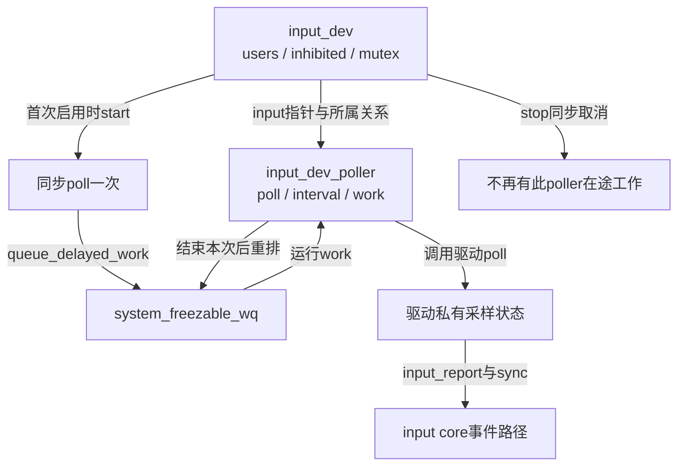
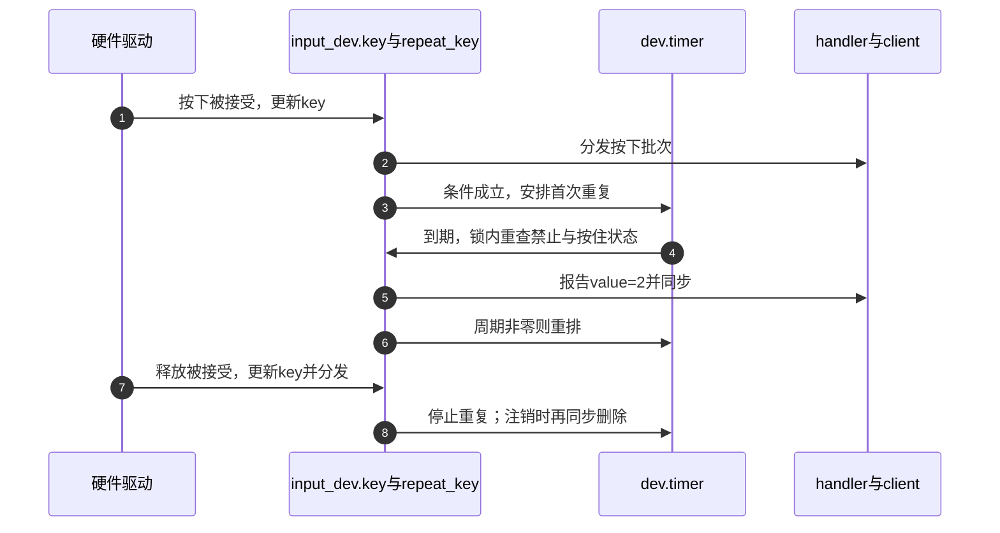

# 第5章\_能力轮询重复与输出的边界

注册声明能力，真正产生或执行动作的可能是轮询工作、重复定时器或输出回调。本页把这些入口放回input_dev生命周期，核对谁启动、谁保存状态、谁停止，避免只记住API名称。

版本与范围见 [总索引](../navigation/P01_Linux_6.12_Input源码阅读索引.md#1.1_固定版本与阅读任务)，阅读路线见 [生命周期模块导读](../navigation/P03_设备怎样公开启停和退出.md#3.3_把延迟动作接回资源退出)，完整例子见 [虚拟轴模块](../../../../knowledge/driver_model/input/P03_设备注册能力与生命周期.md#3.4_用完整虚拟设备观察这条生命线)。固定提交为 `dfaf2136deb2af2e60b994421281ba42f1c087e0`，没有完成目标内核构建或硬件测试。

| 上游原件 | Git blob | 本页职责 |
| --- | --- | --- |
| [drivers/input/input.c](../../linux/drivers/input/input.c) | c51858f1cdc556939c2ee1bd21669c71c169d84e | 能力、轴、重复及注入 |
| [drivers/input/input-poller.c](https://github.com/nxp-imx/linux-imx/blob/dfaf2136deb2af2e60b994421281ba42f1c087e0/drivers/input/input-poller.c) | 688e3cb1c2a0cbab90be24121e175b43b24dcbdf | 延迟轮询与启停 |
| [drivers/input/evdev.c](../../linux/drivers/input/evdev.c) | b5cbb57ee5f60073a41d16da23a8d3fa6c09f04a | 用户输出请求的进入 |
| [include/linux/input.h](../../linux/include/linux/input.h) | cd866b020a01d67081788e1baa2d372ce1c79767 | 配置接口声明及轴访问器 |

核心需CONFIG_INPUT，用户evdev接口需CONFIG_INPUT_EVDEV；本页不沿用其他版本曾有的轮询配置名。摘录执行语句遵循原件GPL-2.0-only，中文注释与解释为仓库补充。

## 5.1\_声明能力与轴参数到底改了哪些字段

input_set_capability先检查有明确code上限的类型，再按类型设置code位，最后设置evbit。EV_ABS分支还尝试分配absinfo；它不是仅贴一个能力标签。未知类型打印错误并返回，不创造私有协议。


```c
/**
 * @brief 按事件类型更新能力位图，必要时准备绝对轴存储。
 * @note 仓库补充中文阅读说明；原件执行语句保留，英文注释省略。
 */
void input_set_capability(struct input_dev *dev, unsigned int type, unsigned int code)
{
	if (type < EV_CNT && input_max_code[type] &&
	    code > input_max_code[type]) {
		pr_err("%s: invalid code %u for type %u\n", __func__, code,
		       type);
		dump_stack();
		return;
	}

	switch (type) {
	case EV_KEY:
		__set_bit(code, dev->keybit);
		break;

	case EV_REL:
		__set_bit(code, dev->relbit);
		break;

	case EV_ABS:
		input_alloc_absinfo(dev);
		__set_bit(code, dev->absbit);
		break;

	case EV_MSC:
		__set_bit(code, dev->mscbit);
		break;

	case EV_SW:
		__set_bit(code, dev->swbit);
		break;

	case EV_LED:
		__set_bit(code, dev->ledbit);
		break;

	case EV_SND:
		__set_bit(code, dev->sndbit);
		break;

	case EV_FF:
		__set_bit(code, dev->ffbit);
		break;

	case EV_PWR:

		break;

	default:
		pr_err("%s: unknown type %u (code %u)\n", __func__, type, code);
		dump_stack();
		return;
	}

	__set_bit(type, dev->evbit);
}
```


input_max_code给KEY、REL、ABS、MSC、SW、LED、SND、FF提供编号上限；dump_stack只是诊断，没有返回值可供调用者判定成功。__set_bit在初始化阶段设置对应位，不能据此在设备已公开时无同步地更改协议。EV_PWR没有code位图。EV_REP不在此switch支持列表内，重复能力通常直接设置evbit中的EV_REP，不能盲目把所有事件类型都交给该辅助函数。

轴参数必须配套absinfo。input_alloc_absinfo在已有数组时直接返回，否则分配ABS_CNT项；失败保留NULL并记录诊断。input_set_abs_params先设能力，再分配，失败由后续注册拒绝EV_ABS却无absinfo的对象。


```c
/**
 * @brief 设置轴能力及范围噪声字段，分配失败留待注册检查。
 * @note 仓库补充中文阅读说明；原件执行语句保留，英文注释省略。
 */
void input_set_abs_params(struct input_dev *dev, unsigned int axis,
			  int min, int max, int fuzz, int flat)
{
	struct input_absinfo *absinfo;

	__set_bit(EV_ABS, dev->evbit);
	__set_bit(axis, dev->absbit);

	input_alloc_absinfo(dev);
	if (!dev->absinfo)
		return;

	absinfo = &dev->absinfo[axis];
	absinfo->minimum = min;
	absinfo->maximum = max;
	absinfo->fuzz = fuzz;
	absinfo->flat = flat;
}
```


axis必须是合法轴编号，不能因为别的辅助函数有检查就把任意值传进此接口。input.h的INPUT_GENERATE_ABS_ACCESSORS生成val/min/max/fuzz/flat/res访问器；get在无absinfo时返回0，set先尝试分配，成功才更新指定字段。因此读到0不能区分真实零值与尚无轴数组。input_abs_set_res写resolution，不设置该轴能力位。minimum/maximum不自动钳位事件，fuzz算法见 [轴接受实现](P01_事件接受与批量分发.md#1.2_绝对轴怎样选择旧值并抑制小幅变化)。

改能力声明时同时检查注册一致性、handler匹配及用户态查询。增加轴不只增加absbit，还改变预计事件数和缓冲开销；删去能力后，也必须检查驱动是否仍报告对应事件。

## 5.2\_poller把周期工作接到打开与关闭

input_dev_poller保存poll函数、当前/最小/最大间隔、input指针和delayed_work；input_dev->poller指向它。input_setup_polling创建并清零对象，初始化work、绑定input和poll后发布指针。它只建立机制，不立即启动，调用者必须检查返回值。


```c
/**
 * @brief 准备轮询对象与延迟工作，失败返回ENOMEM。
 * @note 仓库补充中文阅读说明；原件执行语句保留，英文注释省略。
 */
int input_setup_polling(struct input_dev *dev,
			void (*poll_fn)(struct input_dev *dev))
{
	struct input_dev_poller *poller;

	poller = kzalloc(sizeof(*poller), GFP_KERNEL);
	if (!poller) {

		dev_err(dev->dev.parent ?: &dev->dev,
			"%s: unable to allocate poller structure\n", __func__);
		return -ENOMEM;
	}

	/* 这里只初始化，不启动轮询。 */
	INIT_DELAYED_WORK(&poller->work, input_dev_poller_work);
	poller->input = dev;
	poller->poll = poll_fn;

	dev->poller = poller;
	return 0;
}
```


input_set_poll_interval及min/max先通过input_dev_ensure_poller检查对象存在，再写相应字段；初始化应在注册前完成。input_dev_poller_finalize在注册时把零当前间隔设为500ms，零max设为当前间隔，min保留既有值。运行期sysfs写poll会检查min/max，在dev.mutex内更新间隔；设备当前enabled时同步取消旧work，再按非零新值重排。



调度、工作、开始和停止分别如下。queue_delayed_work排到可冻结工作队列；毫秒转jiffies后，较长延迟用round_jiffies_relative合并时点。因此它提供周期性机会，不保证严格1000ms采样。poll回调可睡，但首次start中的同步poll发生在core持dev.mutex的路径，不能反过来再拿该锁。


```c
/**
 * @brief 将间隔转为延迟，并排到可冻结工作队列。
 * @note 仓库补充中文阅读说明；原件执行语句保留，英文注释省略。
 */
static void input_dev_poller_queue_work(struct input_dev_poller *poller)
{
	unsigned long delay;

	delay = msecs_to_jiffies(poller->poll_interval);
	if (delay >= HZ)
		delay = round_jiffies_relative(delay);

	queue_delayed_work(system_freezable_wq, &poller->work, delay);
}
```


```c
/**
 * @brief 执行一次驱动poll，然后安排下一轮。
 * @note 仓库补充中文阅读说明；原件执行语句保留，英文注释省略。
 */
static void input_dev_poller_work(struct work_struct *work)
{
	struct input_dev_poller *poller =
		container_of(work, struct input_dev_poller, work.work);

	poller->poll(poller->input);
	input_dev_poller_queue_work(poller);
}
```


```c
/**
 * @brief 间隔非零时同步采样一次，再开始周期工作。
 * @note 仓库补充中文阅读说明；原件执行语句保留，英文注释省略。
 */
void input_dev_poller_start(struct input_dev_poller *poller)
{

	if (poller->poll_interval > 0) {
		poller->poll(poller->input);
		input_dev_poller_queue_work(poller);
	}
}
```


```c
/**
 * @brief 同步取消轮询工作，等待已经执行的回调结束。
 * @note 仓库补充中文阅读说明；原件执行语句保留，英文注释省略。
 */
void input_dev_poller_stop(struct input_dev_poller *poller)
{
	cancel_delayed_work_sync(&poller->work);
}
```


container_of用work的嵌入位置找回poller；input和poll由setup设定，不能在work仍运行时释放或替换。cancel_delayed_work_sync支持收束这里自行重排的工作，但不能另有不受约束的并发路径在取消后重新排同一work。

普通最后关闭先stop再close；inhibit先close再stop，解除inhibit又在清标志前start。不同入口的硬件资源约束见 [禁止与恢复](P04_使用计数失败回滚与断开.md#4.4_禁止设备保留需求却改变启动状态)。不能只看stop叶函数就断言所有close已经等过poll。

改周期要检查0值、min/max、长延迟取整和运行中调整；改poll使用的锁要检查首次同步poll、后台poll和停止路径是否形成锁等待环。释放poller发生在最终release，取消工作发生得更早，两者不能互换。

## 5.3\_软件重复定时器怎样接续按住状态

普通按下事件完成分发后，input_pass_values根据最终保留的键记录管理自动重复。input_start_autorepeat要求EV_REP、非零REP_PERIOD/REP_DELAY以及timer回调存在，记下repeat_key并安排首次到期；释放路径input_stop_autorepeat取消timer。它依赖当前key位图，不是每次重新读硬件引脚。

input_enable_softrepeat指定timer.function和两个参数；注册时仅在两个参数都为0时提供250/33默认值。驱动自行设置二者时应明确重复由谁负责，不能把硬件重复和core定时重复叠加。


```c
/**
 * @brief 选择core软件重复回调，并配置首次延迟与后续周期。
 * @note 仓库补充中文阅读说明；原件执行语句保留，英文注释省略。
 */
void input_enable_softrepeat(struct input_dev *dev, int delay, int period)
{
	dev->timer.function = input_repeat_key;
	dev->rep[REP_DELAY] = delay;
	dev->rep[REP_PERIOD] = period;
}
```


```c
/**
 * @brief 在设备仍允许且按键仍按住时报告重复并安排下一次。
 * @note 仓库补充中文阅读说明；原件执行语句保留，英文注释省略。
 */
static void input_repeat_key(struct timer_list *t)
{
	struct input_dev *dev = from_timer(dev, t, timer);
	unsigned long flags;

	spin_lock_irqsave(&dev->event_lock, flags);

	/* 每次到期重新核对设备是否允许以及按键是否仍按住。 */
	if (!dev->inhibited &&
	    test_bit(dev->repeat_key, dev->key) &&
	    is_event_supported(dev->repeat_key, dev->keybit, KEY_MAX)) {

		input_set_timestamp(dev, ktime_get());
		input_handle_event(dev, EV_KEY, dev->repeat_key, 2);
		input_handle_event(dev, EV_SYN, SYN_REPORT, 1);

		if (dev->rep[REP_PERIOD])
			mod_timer(&dev->timer, jiffies +
					msecs_to_jiffies(dev->rep[REP_PERIOD]));
	}

	spin_unlock_irqrestore(&dev->event_lock, flags);
}
```


from_timer按timer成员找回input_dev；event_lock保护键状态及报告，inhibited先阻止重复，key位图和keybit分别证明仍按住与能力允许。input_set_timestamp以当前单调时间标记软件生成事件；value=2报告重复，再以SYN_REPORT同步。REP_PERIOD为0则不重排，即使本次报告已发生。



步骤4重查当前状态，所以重复不是盲目复制最初按下；步骤7释放的交付和定时器处理由事件锁协调。修改repeat_key选择或过滤顺序，要检查快速换键、释放、inhibit及注销；软件生成不证明真实键盘重复率，也不决定桌面快捷键策略。

## 5.4\_输出注入保持原子回调边界

evdev_write限制单次注入处理量，取evdev.mutex、检查exist和revoked，将用户事件转换到内核格式后逐项调用input_inject_event；每次注入返回后可cond_resched，不能把这个调度机会误认为dev.event内部可以睡眠。


```c
/**
 * @brief 在事件锁与RCU保护下检查核心独占，再进入同一事件处理路径。
 * @note 仓库补充中文阅读说明；原件执行语句保留，英文注释省略。
 */
void input_inject_event(struct input_handle *handle,
			unsigned int type, unsigned int code, int value)
{
	struct input_dev *dev = handle->dev;
	struct input_handle *grab;
	unsigned long flags;

	if (is_event_supported(type, dev->evbit, EV_MAX)) {
		spin_lock_irqsave(&dev->event_lock, flags);

		rcu_read_lock();
		grab = rcu_dereference(dev->grab);
		/* 这里检查的是core handle独占，不是evdev client读独占。 */
		if (!grab || grab == handle)
			input_handle_event(dev, type, code, value);
		rcu_read_unlock();

		spin_unlock_irqrestore(&dev->event_lock, flags);
	}
}
```


handle指出注入来源，dev来自handle->dev；类型能力仍须检查，dev.grab存在时仅允许持有它的handle注入。此处只检查core handle独占，不能推导同一evdev下所有client的写操作都被独占client排斥；读取独占与所有操作授权不是一回事。

input_handle_event按类型更新状态，input_event_dispose对PASS_TO_DEVICE调用dev.event；两者已在 [接受与分发实现](P01_事件接受与批量分发.md#1.1_报告入口先接受状态再决定交付) 唯一展开。LED/SND需要可睡总线时，回调只保存驱动目标并安排work，工作路径读取目标、传输并记录结果。FF还需效果上传、播放与释放协议，不能把注入函数当成全部力反馈实现。

回调输入不是硬件完成通知。改成异步输出后，要说明目标值放在哪个私有字段、谁保护它、旧work执行中出现新目标怎样保证最终应用，以及注销如何禁止新请求并等旧工作结束。只增加queue_work仍可能丢更新或访问已释放资源。
