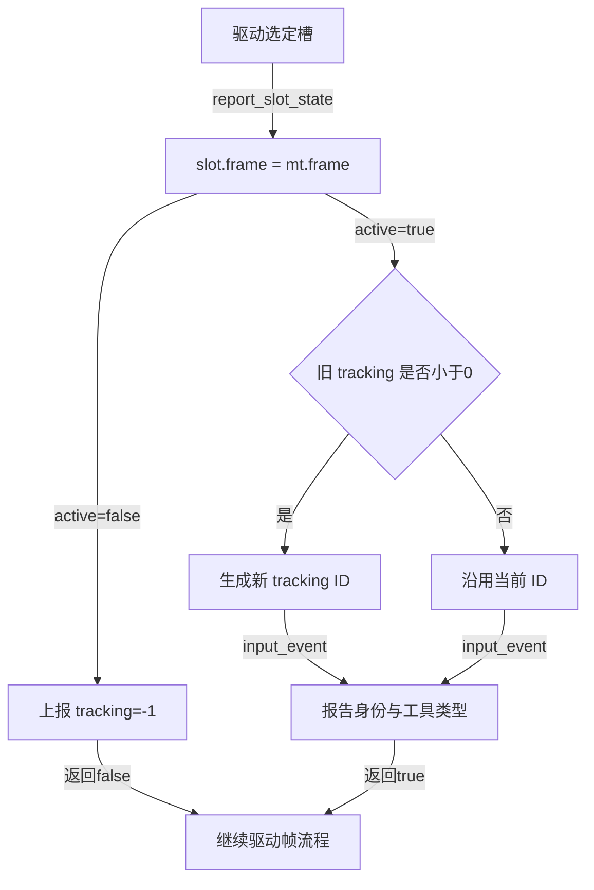
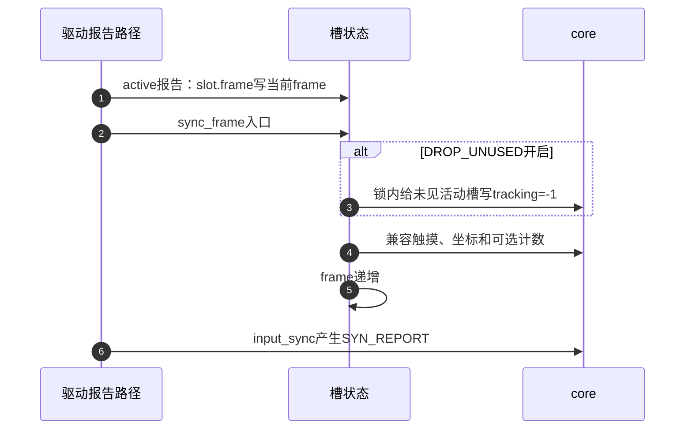

# 第6章\_多点槽状态与帧收尾

沿 [多点模块导读](../navigation/P04_接触身份怎样跨帧保留.md#4.1_先找三种身份和两份槽状态) 进入本页。证据统一为 [Input总索引](../navigation/P01_Linux_6.12_Input源码阅读索引.md) 的 NXP Linux 6.12.20，提交 `dfaf2136deb2af2e60b994421281ba42f1c087e0`。上游位置 `drivers/input/input-mt.c`，blob `6b04a674f832a048a3e021f92517d8529d27f652`；头文件 `include/linux/input/mt.h`，blob `2cf89a538b18bbc7c99c8705c2d22bdc95065238`。这里解释固定实现，不把驱动硬件点集的含义交给辅助库猜测。

## 6.1\_初始化建立槽容量和派生能力

S0 注册前准备时，驱动先设置 MT 坐标等轴，再初始化槽。这样 DIRECT/POINTER 分支才能把已经存在的 MT 轴复制成单指兼容轴；倒过来调用不会自动回头补复制。每槽的 abs 数组以 `code - ABS_MT_FIRST` 定位，保存该槽自己的当前值；frame 保存最近被状态报告看到的内部周期；key 留给可选的按 key 映射。

| 字段或配置 | 初始/后续写入 | 谁用它作决定 |
| --- | --- | --- |
| `mt->num_slots` 与 `slots[]` | 初始化分配，数量固定 | 选槽、逐槽清理和匹配 |
| `slots[i].abs[TRACKING_ID-FIRST]` | 初始化 -1，事件路径更新 | 判断接触是否活动 |
| `mt->slot` | 零分配起步；ABS_MT_SLOT 更新 | 后续 MT 轴写哪个槽 |
| `mt->frame` / `slot->frame` | 初始 1 / 0；同步推进 / report 标记 | 判定本周期是否见过该槽 |
| `mt->trkid` | 零起步，生成新身份时递增并按 0xffff 取低位 | 接触编号；不是控制器硬件 ID |
| `mt->red` | 仅 INPUT_MT_TRACK 分配 n×n 整数空间 | 无硬件 ID 的位置匹配 |

```c
/**
 * @brief 仓库补充阅读说明：分配槽并按标志声明能力；重复初始化不会更新原 flags。
 * @note 以下保留固定版本执行语句，中文说明不是上游注释。
 */
int input_mt_init_slots(struct input_dev *dev, unsigned int num_slots,
			unsigned int flags)
{
	struct input_mt *mt = dev->mt;
	int i;

	if (!num_slots)
		return 0;
	/* 同槽数重复调用直接返回，不能把它当 flags 修改接口。 */
	if (mt)
		return mt->num_slots != num_slots ? -EINVAL : 0;

	if (num_slots > 1024)
		return -EINVAL;

	mt = kzalloc(struct_size(mt, slots, num_slots), GFP_KERNEL);
	if (!mt)
		goto err_mem;

	mt->num_slots = num_slots;
	mt->flags = flags;
	input_set_abs_params(dev, ABS_MT_SLOT, 0, num_slots - 1, 0, 0);
	input_set_abs_params(dev, ABS_MT_TRACKING_ID, 0, TRKID_MAX, 0, 0);

	if (flags & (INPUT_MT_POINTER | INPUT_MT_DIRECT)) {
		__set_bit(EV_KEY, dev->evbit);
		__set_bit(BTN_TOUCH, dev->keybit);

		copy_abs(dev, ABS_X, ABS_MT_POSITION_X);
		copy_abs(dev, ABS_Y, ABS_MT_POSITION_Y);
		copy_abs(dev, ABS_PRESSURE, ABS_MT_PRESSURE);
	}
	if (flags & INPUT_MT_POINTER) {
		__set_bit(BTN_TOOL_FINGER, dev->keybit);
		__set_bit(BTN_TOOL_DOUBLETAP, dev->keybit);
		if (num_slots >= 3)
			__set_bit(BTN_TOOL_TRIPLETAP, dev->keybit);
		if (num_slots >= 4)
			__set_bit(BTN_TOOL_QUADTAP, dev->keybit);
		if (num_slots >= 5)
			__set_bit(BTN_TOOL_QUINTTAP, dev->keybit);
		__set_bit(INPUT_PROP_POINTER, dev->propbit);
	}
	if (flags & INPUT_MT_DIRECT)
		__set_bit(INPUT_PROP_DIRECT, dev->propbit);
	if (flags & INPUT_MT_SEMI_MT)
		__set_bit(INPUT_PROP_SEMI_MT, dev->propbit);
	if (flags & INPUT_MT_TRACK) {
		unsigned int n2 = num_slots * num_slots;
		mt->red = kcalloc(n2, sizeof(*mt->red), GFP_KERNEL);
		if (!mt->red)
			goto err_mem;
	}

	for (i = 0; i < num_slots; i++)
		input_mt_set_value(&mt->slots[i], ABS_MT_TRACKING_ID, -1);

	mt->frame = 1;

	dev->mt = mt;
	return 0;
err_mem:
	kfree(mt);
	return -ENOMEM;
}
```

`num_slots=0` 直接成功，不代表创建了 MT 状态；已有 mt 且槽数相同也直接成功，原 flags 不变。数量上限 1024 是实现防止巨额分配的保护，不是所有硬件都能支持的触点数。TRACK 的矩阵是平方空间，其他槽状态为线性空间；分配失败返回 -ENOMEM。

`copy_abs` 只复制已声明的来源轴，并把兼容轴 fuzz 清零。具体复制如下，不能把“调用初始化”解释成必定出现 ABS_X/Y/PRESSURE：

```c
/**
 * @brief 仓库补充阅读说明：来源轴存在才建立单指对应轴，复制范围后清零其 fuzz。
 * @note 以下保留固定版本执行语句，中文说明不是上游注释。
 */
static void copy_abs(struct input_dev *dev, unsigned int dst, unsigned int src)
{
	if (dev->absinfo && test_bit(src, dev->absbit)) {
		dev->absinfo[dst] = dev->absinfo[src];
		dev->absinfo[dst].fuzz = 0;
		__set_bit(dst, dev->absbit);
	}
}
```

### 6.1.1\_销毁与设备生命周期保持配对

槽空间随 input device 的最终释放清理；显式销毁主要用于尚未交付对象的错误路径。它不会停止正在调用报告接口的工作线程，不能在报告仍可能访问 mt 时释放。调用者先按生命周期协议停止访问，再处理内存。

```c
/**
 * @brief 仓库补充阅读说明：释放匹配工作区和槽对象，最后清空 dev.mt 指针。
 * @note 以下保留固定版本执行语句，中文说明不是上游注释。
 */
void input_mt_destroy_slots(struct input_dev *dev)
{
	if (dev->mt) {
		kfree(dev->mt->red);
		kfree(dev->mt);
	}
	dev->mt = NULL;
}
```

## 6.2\_报告活动状态怎样标记本帧并分配身份

S4 每次报告首先标记 `slot->frame=mt->frame`，包括报告 inactive 的分支。因此“已经释放”和“本帧没有用过”是两个不同条件。选择槽后，inactive 发 -1；active 只在原 tracking ID 小于零时生成新编号，随后再走普通 Input 事件入口更新身份和已声明的工具类型。

```c
/**
 * @brief 仓库补充阅读说明：先标记本帧使用，再报告释放或沿用/创建接触身份。
 * @note 以下保留固定版本执行语句，中文说明不是上游注释。
 */
bool input_mt_report_slot_state(struct input_dev *dev,
				unsigned int tool_type, bool active)
{
	struct input_mt *mt = dev->mt;
	struct input_mt_slot *slot;
	int id;

	if (!mt)
		return false;

	slot = &mt->slots[mt->slot];
	/* false 分支也算本帧使用过，影响后面的按 key 找槽。 */
	slot->frame = mt->frame;

	if (!active) {
		input_event(dev, EV_ABS, ABS_MT_TRACKING_ID, -1);
		return false;
	}

	id = input_mt_get_value(slot, ABS_MT_TRACKING_ID);
	if (id < 0)
		id = input_mt_new_trkid(mt);

	input_event(dev, EV_ABS, ABS_MT_TRACKING_ID, id);
	input_event(dev, EV_ABS, ABS_MT_TOOL_TYPE, tool_type);

	return true;
}
```

此原件函数上方的英文注释还声称 tool type 改变也会生成新 ID，但实际函数只有 `id < 0` 才生成。应记录这项注释与代码差异，不能用注释替执行分支作证。类型改变可以发生在同一次接触中，驱动若要结束并开始另一接触，应明确维护生命周期。

`slot->frame` 的直接写入没有被整帧的 event_lock 包住；各 input_event 自己加锁，也不能使“选槽—状态—X—Y”整组调用不可交错。驱动必须串行化整帧及复位/释放路径，否则另一个报告者可以改变当前槽。



## 6.3\_内部帧结束为何还需要外部同步

DROP_UNUSED 的判断同时要求“活动”和“本帧未见”，它不清零所有槽。清理内部函数要求调用者持有 event_lock，因为它直接调用不再重复取锁的 input_handle_event。

```c
/**
 * @brief 仓库补充阅读说明：锁内释放活动但未标记本帧出现的槽。
 * @note 以下保留固定版本执行语句，中文说明不是上游注释。
 */
static void __input_mt_drop_unused(struct input_dev *dev, struct input_mt *mt)
{
	int i;

	lockdep_assert_held(&dev->event_lock);

	for (i = 0; i < mt->num_slots; i++) {
		if (input_mt_is_active(&mt->slots[i]) &&
		    !input_mt_is_used(mt, &mt->slots[i])) {
			input_handle_event(dev, EV_ABS, ABS_MT_SLOT, i);
			input_handle_event(dev, EV_ABS, ABS_MT_TRACKING_ID, -1);
		}
	}
}
```

公共 `input_mt_drop_unused` 自己获取锁，执行清理并推进 frame。`input_mt_sync_frame` 则按 flags 决定是否清理，随后进行单指兼容，再推进 frame。它们都不是“仅给最后一条消息补一个 SYN_REPORT”的别名。

```c
/**
 * @brief 仓库补充阅读说明：显式清理未见槽并推进内部周期，调用者不能将其当无副作用查询。
 * @note 以下保留固定版本执行语句，中文说明不是上游注释。
 */
void input_mt_drop_unused(struct input_dev *dev)
{
	struct input_mt *mt = dev->mt;

	if (mt) {
		unsigned long flags;

		spin_lock_irqsave(&dev->event_lock, flags);

		__input_mt_drop_unused(dev, mt);
		mt->frame++;

		spin_unlock_irqrestore(&dev->event_lock, flags);
	}
}
```

```c
/**
 * @brief 仓库补充阅读说明：可选清理后执行兼容报告并推进内部帧，不生成外层同步。
 * @note 以下保留固定版本执行语句，中文说明不是上游注释。
 */
void input_mt_sync_frame(struct input_dev *dev)
{
	struct input_mt *mt = dev->mt;
	bool use_count = false;

	if (!mt)
		return;

	if (mt->flags & INPUT_MT_DROP_UNUSED) {
		unsigned long flags;

		spin_lock_irqsave(&dev->event_lock, flags);
		__input_mt_drop_unused(dev, mt);
		spin_unlock_irqrestore(&dev->event_lock, flags);
	}

	if ((mt->flags & INPUT_MT_POINTER) && !(mt->flags & INPUT_MT_SEMI_MT))
		use_count = true;

	input_mt_report_pointer_emulation(dev, use_count);

	mt->frame++;
}
```

驱动在完整点集上每个仍活动槽都调用 report_slot_state，再 sync_frame，最后 input_sync。对增量点集，先重建完整快照或者不使用 DROP_UNUSED。多调用一次清理会改变 seen 的判定周期，不能把它当解决槽分配失败的补丁。



第 1 步的 seen 标记是第 3 步清理的依据；第 5 步只推进内部周期，第 6 步才由驱动发外部同步。这两个边界不能互换。

## 6.4\_单指兼容把多点状态压缩成什么

接口扫描全部活动槽，按 tracking ID 的环绕比较选择最老接触，同时统计活动数。把该接触的 MT 坐标投影成单指轴，意味着其他点的位置被舍弃；因此这是兼容表示，不是手势识别。

```c
/**
 * @brief 仓库补充阅读说明：从最老活动接触派生单指状态，按条件派生计数。
 * @note 以下保留固定版本执行语句，中文说明不是上游注释。
 */
void input_mt_report_pointer_emulation(struct input_dev *dev, bool use_count)
{
	struct input_mt *mt = dev->mt;
	struct input_mt_slot *oldest;
	int oldid, count, i;

	if (!mt)
		return;

	oldest = NULL;
	oldid = mt->trkid;
	count = 0;

	for (i = 0; i < mt->num_slots; ++i) {
		struct input_mt_slot *ps = &mt->slots[i];
		int id = input_mt_get_value(ps, ABS_MT_TRACKING_ID);

		if (id < 0)
			continue;
		if ((id - oldid) & TRKID_SGN) {
			oldest = ps;
			oldid = id;
		}
		count++;
	}

	input_event(dev, EV_KEY, BTN_TOUCH, count > 0);

	if (use_count) {
		if (count == 0 &&
		    !test_bit(ABS_MT_DISTANCE, dev->absbit) &&
		    test_bit(ABS_DISTANCE, dev->absbit) &&
		    input_abs_get_val(dev, ABS_DISTANCE) != 0) {

			count = 1;
		}

		input_mt_report_finger_count(dev, count);
	}

	if (oldest) {
		int x = input_mt_get_value(oldest, ABS_MT_POSITION_X);
		int y = input_mt_get_value(oldest, ABS_MT_POSITION_Y);

		input_event(dev, EV_ABS, ABS_X, x);
		input_event(dev, EV_ABS, ABS_Y, y);

		if (test_bit(ABS_MT_PRESSURE, dev->absbit)) {
			int p = input_mt_get_value(oldest, ABS_MT_PRESSURE);
			input_event(dev, EV_ABS, ABS_PRESSURE, p);
		}
	} else {
		if (test_bit(ABS_MT_PRESSURE, dev->absbit))
			input_event(dev, EV_ABS, ABS_PRESSURE, 0);
	}
}
```

```c
/**
 * @brief 仓库补充阅读说明：逐个报告接触数按键条件，未声明的能力会被core过滤。
 * @note 以下保留固定版本执行语句，中文说明不是上游注释。
 */
void input_mt_report_finger_count(struct input_dev *dev, int count)
{
	input_event(dev, EV_KEY, BTN_TOOL_FINGER, count == 1);
	input_event(dev, EV_KEY, BTN_TOOL_DOUBLETAP, count == 2);
	input_event(dev, EV_KEY, BTN_TOOL_TRIPLETAP, count == 3);
	input_event(dev, EV_KEY, BTN_TOOL_QUADTAP, count == 4);
	input_event(dev, EV_KEY, BTN_TOOL_QUINTTAP, count == 5);
}
```

如果 use_count 为真，通常按活动槽数报告 BTN_TOOL_FINGER 等；但“没有逐接触距离轴、存在全局距离轴且全局距离非零”时，零活动槽也可能报告一个靠近中的工具。这是实现中的悬停兼容条件，不能把所有计数都称为按住屏幕的手指数。

sync_frame 仅在 POINTER 且非 SEMI_MT 时自动启用 use_count；即便 use_count 为假，它仍调用兼容函数，BTN_TOUCH 和单指坐标是否可见再由能力位决定。若硬件可检测数量多于位置报告数量，驱动提供真实计数时应避免用较少的活动槽数覆盖。

以上实现证明槽、seen 和兼容状态怎样变化，不证明硬件样本有效，也不保证用户队列没有丢失。继续 [映射与位置匹配](P07_槽位映射与位置匹配.md#7.1_按key找槽为何会在本帧释放后仍失败)，把硬件 ID 与这些槽状态对上。
