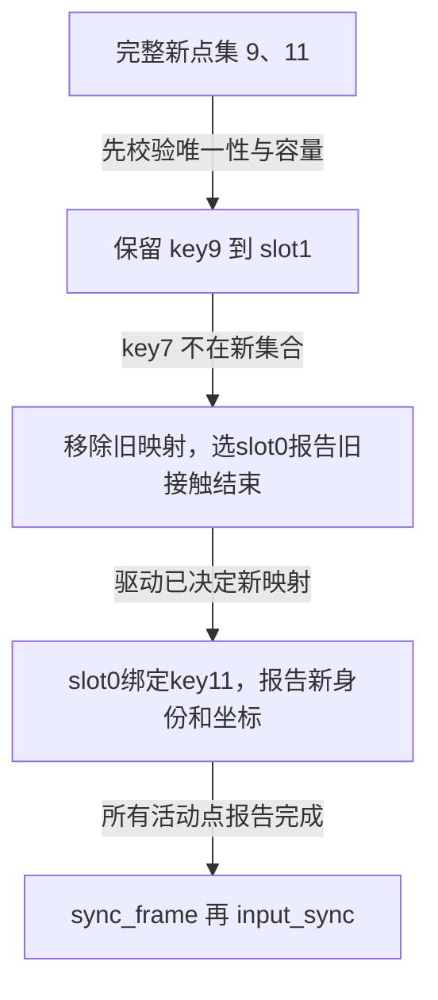
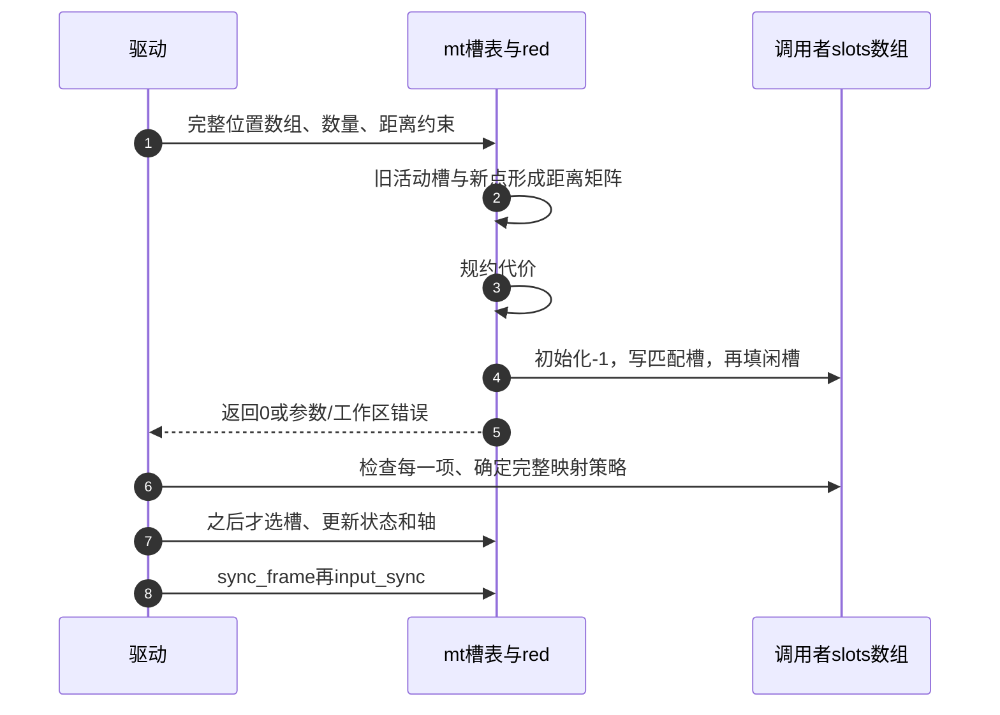

# 第7章\_槽位映射与位置匹配

沿 [多点模块导读](../navigation/P04_接触身份怎样跨帧保留.md#4.1_先找三种身份和两份槽状态) 进入本页。证据统一为 [Input总索引](../navigation/P01_Linux_6.12_Input源码阅读索引.md) 的 NXP Linux 6.12.20，提交 `dfaf2136deb2af2e60b994421281ba42f1c087e0`。上游位置 `drivers/input/input-mt.c`，blob `6b04a674f832a048a3e021f92517d8529d27f652`；头文件 `include/linux/input/mt.h`，blob `2cf89a538b18bbc7c99c8705c2d22bdc95065238`。这里解释固定实现，不把驱动硬件点集的含义交给辅助库猜测。

## 7.1\_按key找槽为何会在本帧释放后仍失败

该接口解决“硬件 key 稳定，但数值不能直接当槽下标”。它不拥有硬件帧，也不会先替驱动找出消失的接触。第一遍只认活动且 key 相同的槽；第二遍只认闲置且本内部帧没有用过的槽，找到后写 key，但不自动选槽或激活。

```c
/**
 * @brief 仓库补充阅读说明：先续接活动同key，再找闲置且本帧未用的槽，否则返回负值。
 * @note 以下保留固定版本执行语句，中文说明不是上游注释。
 */
int input_mt_get_slot_by_key(struct input_dev *dev, int key)
{
	struct input_mt *mt = dev->mt;
	struct input_mt_slot *s;

	if (!mt)
		return -1;

	for (s = mt->slots; s != mt->slots + mt->num_slots; s++)
		if (input_mt_is_active(s) && s->key == key)
			return s - mt->slots;

	for (s = mt->slots; s != mt->slots + mt->num_slots; s++)
		/* inactive 与本帧未用是两个必须同时成立的条件。 */
		if (!input_mt_is_active(s) && !input_mt_is_used(mt, s)) {
			s->key = key;
			return s - mt->slots;
		}

	return -1;
}
```

| 两槽已被 key7、key9 占满后的操作 | key11 能否取得旧槽 | 原因 |
| --- | --- | --- |
| 新完整帧只调用 get_slot(9)、get_slot(11) | 不能 | key7 仍 active，尚未到帧末 drop |
| 先对 key7 的槽报告 inactive，再 get_slot(11) | 仍不能 | 状态报告把 slot.frame 写成当前 frame，该槽本帧已用 |
| 驱动自管完整映射，明确选旧槽报告结束后再开始 key11 | 可以表达替换 | 不再由此 helper 分配；新旧身份转换由驱动负责 |

自管映射要先校验新点集，保留 key 交集，再回收已离开者的槽并分配新 key；不能在报告途中发现重复 key 才撤销半帧。`get_slot_by_key` 的失败返回不是“所有设备都必须多开一个槽”的证据，而是在提示当前映射策略的前提不成立。



## 7.2\_没有硬件身份时用位置建立有限关联

输入只有点的位置时，库把旧活动槽作为候选，把当前点作为另一组对象。代价来自两坐标差的平方和，再减去 `mu=2*dmax*dmax`。距离近可支持连续性的推测，但不等于证明同一根手指；相同位置的两个新旧接触完全可能不同。

调用前需 INPUT_MT_TRACK 分配 red 工作区；调用者传入位置数组和待写槽号数组，函数本身不报告轴、不释放旧接触，也不调用同步。

```c
/**
 * @brief 仓库补充阅读说明：检查工作区和数量，建立代价矩阵并把结果写入调用者槽号数组。
 * @note 以下保留固定版本执行语句，中文说明不是上游注释。
 */
int input_mt_assign_slots(struct input_dev *dev, int *slots,
			  const struct input_mt_pos *pos, int num_pos,
			  int dmax)
{
	struct input_mt *mt = dev->mt;
	int mu = 2 * dmax * dmax;
	int nrc;

	if (!mt || !mt->red)
		return -ENXIO;
	if (num_pos > mt->num_slots)
		return -EINVAL;
	if (num_pos < 1)
		return 0;

	nrc = input_mt_set_matrix(mt, pos, num_pos, mu);
	find_reduced_matrix(mt->red, num_pos, nrc / num_pos, nrc, mu);
	input_mt_set_slots(mt, slots, num_pos);

	return 0;
}
```

| 输入或结果 | 源码边界 |
| --- | --- |
| `pos` | `struct input_mt_pos` 的 x/y 是 s16；窄化前必须校验坐标 |
| `num_pos` | 大于槽数返回 -EINVAL；小于1直接返回0，不能把负数当有效点集 |
| `dmax` | 注释定义0表示无限；正值参与平方运算，需要合理数值边界 |
| `red` | 没有 mt 或没分配 red 返回 -ENXIO |
| `slots[j]` | 每项先置 -1，再赋关联槽或闲槽；返回0不单独检查所有项已填好 |

例如一个旧活动槽在 `(0,0)`，新点为 `(100,0)`，dmax=1，代价为9998。不存在满足距离限制的旧接触，也没有闲槽可供新点，输出就可能保留 -1；调用者不能把 -1 传给 input_mt_slot，也不能假装本帧为空。应按本设备的身份重建策略处理完整点集。

## 7.3\_代价矩阵怎样从旧状态形成

矩阵只为旧活动槽建行；每行依次存所有当前点的代价。设活动旧槽数 m，新点数 n，则有效区域为 m×n，底层工作区按最大槽数平方准备。运行时 nrc 是有效元素数量。

```c
/**
 * @brief 仓库补充阅读说明：只遍历旧活动槽，与本帧各位置计算距离代价。
 * @note 以下保留固定版本执行语句，中文说明不是上游注释。
 */
static int input_mt_set_matrix(struct input_mt *mt,
			       const struct input_mt_pos *pos, int num_pos,
			       int mu)
{
	const struct input_mt_pos *p;
	struct input_mt_slot *s;
	int *w = mt->red;
	int x, y;

	for (s = mt->slots; s != mt->slots + mt->num_slots; s++) {
		if (!input_mt_is_active(s))
			continue;
		x = input_mt_get_value(s, ABS_MT_POSITION_X);
		y = input_mt_get_value(s, ABS_MT_POSITION_Y);
		for (p = pos; p != pos + num_pos; p++) {
			int dx = x - p->x, dy = y - p->y;
			*w++ = dx * dx + dy * dy - mu;
		}
	}

	return w - mt->red;
}
```

接下来交替调整两个方向的代价。adjust_dual 找当前向量最小和次小值，用阈值判断是否调整，可能对正矩阵的过覆盖情况增加惩罚；find_reduced_matrix 在有限次数内重复行列调整，直到本轮没有继续调整的需要。这是一套匹配实现，不能把函数名中的 best-match 当成物理身份的证明。

```c
/**
 * @brief 仓库补充阅读说明：依据两个最小值调整代价向量，保留阈值和收敛分支。
 * @note 以下保留固定版本执行语句，中文说明不是上游注释。
 */
static int adjust_dual(int *begin, int step, int *end, int eq, int mu)
{
	int f, *p, s, c;

	if (begin == end)
		return 0;

	f = *begin;
	p = begin + step;
	s = p == end ? f + 1 : *p;

	for (; p != end; p += step) {
		if (*p < f) {
			s = f;
			f = *p;
		} else if (*p < s) {
			s = *p;
		}
	}

	c = (f + s + 1) / 2;
	if (c == 0 || (c > mu && (!eq || mu > 0)))
		return 0;

	if (s < 0 && mu <= 0)
		c *= 2;

	for (p = begin; p != end; p += step)
		*p -= c;

	return (c < s && s <= 0) || (f >= 0 && f < c);
}
```

```c
/**
 * @brief 仓库补充阅读说明：沿矩阵两个方向交替调整，按本轮变化决定提前结束。
 * @note 以下保留固定版本执行语句，中文说明不是上游注释。
 */
static void find_reduced_matrix(int *w, int nr, int nc, int nrc, int mu)
{
	int i, k, sum;

	for (k = 0; k < nrc; k++) {
		for (i = 0; i < nr; i++)
			adjust_dual(w + i, nr, w + i + nrc, nr <= nc, mu);
		sum = 0;
		for (i = 0; i < nrc; i += nr)
			sum += adjust_dual(w + i, 1, w + i + nr, nc <= nr, mu);
		if (!sum)
			break;
	}
}
```

这些运算使用 int，包含 dx²、dy²、2×dmax² 以及后续加减；即使输入坐标是 s16，也不能由此推出任意两端极值差的平方不会溢出。驱动要限制在设备真实量程和合理匹配距离；若不能满足运算边界，应重新选择匹配模型，不能仅作强制类型转换。

## 7.4\_为什么计算成功后仍需逐项检查

结果填充先把每个槽号设为 -1，再从活动旧槽对应矩阵的负值选择匹配，最后用闲槽补没有关联上的新点。旧活动但没匹配上的槽不会在这里自动变成闲槽；这与按 key 的满容量换人问题有相似的资源约束，却不是相同的算法路径。

```c
/**
 * @brief 仓库补充阅读说明：先关联旧活动槽，再使用本来闲置的槽，不自动回收未匹配活动槽。
 * @note 以下保留固定版本执行语句，中文说明不是上游注释。
 */
static void input_mt_set_slots(struct input_mt *mt,
			       int *slots, int num_pos)
{
	struct input_mt_slot *s;
	int *w = mt->red, j;

	for (j = 0; j != num_pos; j++)
		slots[j] = -1;

	for (s = mt->slots; s != mt->slots + mt->num_slots; s++) {
		if (!input_mt_is_active(s))
			continue;

		for (j = 0; j != num_pos; j++) {
			if (w[j] < 0) {
				slots[j] = s - mt->slots;
				break;
			}
		}

		w += num_pos;
	}

	for (s = mt->slots; s != mt->slots + mt->num_slots; s++) {
		if (input_mt_is_active(s))
			continue;

		for (j = 0; j != num_pos; j++) {
			if (slots[j] < 0) {
				slots[j] = s - mt->slots;
				break;
			}
		}
	}
}
```



第 5 步返回后，第 6 步仍检查数组中的每一项；只有形成完整映射，才能执行第 7、8 步的报告与收尾。

空点集返回0意味着没有要分配的位置，并不已经把所有旧槽释放；完整快照的帧尾清理仍要执行。交叉、遮挡和失采使几何证据不足时，驱动应承认接触身份不确定并按协议恢复，不把稳定的槽号冒充稳定的物理手指。

回到 [模块的完整帧顺序](../navigation/P04_接触身份怎样跨帧保留.md#4.2_把映射更新与帧收尾排成同一条路径)，比较硬件稳定 key、自管映射和距离匹配的适用条件。唯一实现只回答这版库如何工作，不替具体芯片选择协议。
