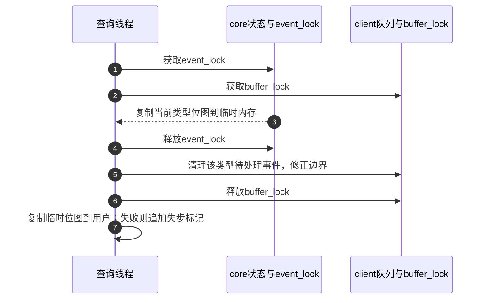

# 第8章\_状态重同步与事件时间

[异常与停止模块导读](../navigation/P05_失步与停机分别恢复哪份状态.md#5.1_从故障位置选择需要恢复的状态) 先组织S3～S6的所有权，本页再展开固定实现。版本身份见 [Input总索引](../navigation/P01_Linux_6.12_Input源码阅读索引.md)：NXP Linux 6.12.20，提交 `dfaf2136deb2af2e60b994421281ba42f1c087e0`。原件 `drivers/input/input.c` blob `c51858f1cdc556939c2ee1bd21669c71c169d84e`，`drivers/input/evdev.c` blob `b5cbb57ee5f60073a41d16da23a8d3fa6c09f04a`。

## 8.1\_位图查询为何还会清理客户端队列

用户已落后于core时，复制当前按键位图只能解决一半问题：client队列还可能包含复制前的按键事件，继续重放会把新状态倒退。evdev_handle_get_val在相同类型范围内协调状态复制与队列清理，供KEY、SW、LED、SND查询使用。它不是所有ioctl共享的快照算法。

锁次序为dev.event_lock→client.buffer_lock，与正常报告的顺序一致；持有两锁时先复制位图，再放event_lock，仍持buffer_lock清队列。新报告可以更新core，但其向本client交付需要等待buffer_lock，因此这段实现不会把随后排队的同类事件当旧队列一并删除。

```c
/**
 * @brief 仓库补充阅读说明：复制位图后清本client同类队列，用户复制失败则重新提示失步。
 * @note 中文说明不是上游注释；保留固定版本执行语句。
 */
static int evdev_handle_get_val(struct evdev_client *client,
				struct input_dev *dev, unsigned int type,
				unsigned long *bits, unsigned int maxbit,
				unsigned int maxlen, void __user *p,
				int compat)
{
	int ret;
	unsigned long *mem;

	mem = bitmap_alloc(maxbit, GFP_KERNEL);
	if (!mem)
		return -ENOMEM;

	spin_lock_irq(&dev->event_lock);
	spin_lock(&client->buffer_lock);

	bitmap_copy(mem, bits, maxbit);

	spin_unlock(&dev->event_lock);

	__evdev_flush_queue(client, type);

	spin_unlock_irq(&client->buffer_lock);

	ret = bits_to_user(mem, maxbit, maxlen, p, compat);
	if (ret < 0)
		evdev_queue_syn_dropped(client);

	bitmap_free(mem);

	return ret;
}
```

`bits_to_user`在释放自旋锁后执行；此时若失败，队列清理已经发生，不能当作一次没有副作用的失败读取。它追加SYN_DROPPED，让用户知道需要恢复。返回值还受用户缓冲长度及compat位图布局影响，调用者应检查接口实际返回，不把未写满的内存当全部状态。

队列压缩从tail向head扫描，跳过目标类型，保留其他类型，并维护完整包边界；空的SYN_REPORT组可以被删除，开头的同步标记有专门保留规则。

```c
/**
 * @brief 仓库补充阅读说明：在buffer_lock内压缩目标类型事件并重建packet_head。
 * @note 中文说明不是上游注释；保留固定版本执行语句。
 */
static void __evdev_flush_queue(struct evdev_client *client, unsigned int type)
{
	unsigned int i, head, num;
	unsigned int mask = client->bufsize - 1;
	bool is_report;
	struct input_event *ev;

	BUG_ON(type == EV_SYN);

	head = client->tail;
	client->packet_head = client->tail;

	num = 1;

	for (i = client->tail; i != client->head; i = (i + 1) & mask) {
		ev = &client->buffer[i];
		is_report = ev->type == EV_SYN && ev->code == SYN_REPORT;

		if (ev->type == type) {

			continue;
		} else if (is_report && !num) {

			continue;
		} else if (head != i) {

			client->buffer[head] = *ev;
		}

		num++;
		head = (head + 1) & mask;

		if (is_report) {
			num = 0;
			client->packet_head = head;
		}
	}

	client->head = head;
}
```



第3步固定这次位图，第5步处理该client旧事件；其他类型、其他client不被一并清空。不能把这段实现总结成“任意ioctl都会清全部队列”。

## 8.2\_多点查询没有冻结整张槽表

EVIOCGMTSLOTS的输入缓冲首元素是要查询的MT轴code，后面空间用于接收各槽值。函数先检查存在mt以及code确为MT值轴，再按用户长度和实际槽数两者较小者逐槽复制。ABS_MT_SLOT是选择器，不属于这个接口可查询的MT值轴。

```c
/**
 * @brief 仓库补充阅读说明：按指定轴逐槽复制，长度控制数量，不构成多轴原子快照。
 * @note 中文说明不是上游注释；保留固定版本执行语句。
 */
static int evdev_handle_mt_request(struct input_dev *dev,
				   unsigned int size,
				   int __user *ip)
{
	const struct input_mt *mt = dev->mt;
	unsigned int code;
	int max_slots;
	int i;

	if (get_user(code, &ip[0]))
		return -EFAULT;
	if (!mt || !input_is_mt_value(code))
		return -EINVAL;

	max_slots = (size - sizeof(__u32)) / sizeof(__s32);
	for (i = 0; i < mt->num_slots && i < max_slots; i++) {
		int value = input_mt_get_value(&mt->slots[i], code);
		if (put_user(value, &ip[1 + i]))
			return -EFAULT;
	}

	return 0;
}
```

这条路径没有event_lock覆盖整轮逐槽读取，也没有复用位图查询的队列清理。外层evdev mutex串行设备控制，不阻止生产者在event_lock下继续更新槽。分别查询tracking、X、Y，更不保证来自同一硬件帧。

普通EVIOCGABS分支在evdev_do_ioctl中复制 `dev->absinfo[t]`，返回该轴的value/min/max/fuzz/flat/resolution；它也不提供跨轴事务。对MT要区分轴元数据、报告选择器和每槽值，不能只查一次ABS_MT_POSITION_X就认为取得全部接触坐标。ABS_MT_SLOT的absinfo.value记录已随有效MT变化发布的槽选择；驱动暂存的mt.slot可以已经改变而尚未发布，二者不能混称同一个寄存器式当前值。

恢复器需要当前状态来重新建立可继续消费的副本，但不能从这些接口追回已经丢失的相对运动、扫描历史或每一帧路径。若设备在查询过程中变化，应按协议及后续事件协调，不宣称得到一个静止瞬间的全部状态。

## 8.3\_失步标记也用于查询失败和时钟切换

溢出如何在队列中放标记已在 [evdev队列实现](P02_evdev独立队列与读取边界.md#2.1_批次怎样复制到每个客户端) 展开，这里只解释另外的注入入口。内部函数用当前client时钟生成SYN_DROPPED并入队；若再次追尾，只保留这枚标记并调整packet_head。

```c
/**
 * @brief 仓库补充阅读说明：在已持buffer_lock时加入失步标记，追尾时保留该标记。
 * @note 中文说明不是上游注释；保留固定版本执行语句。
 */
static void __evdev_queue_syn_dropped(struct evdev_client *client)
{
	ktime_t *ev_time = input_get_timestamp(client->evdev->handle.dev);
	struct timespec64 ts = ktime_to_timespec64(ev_time[client->clk_type]);
	struct input_event ev;

	ev.input_event_sec = ts.tv_sec;
	ev.input_event_usec = ts.tv_nsec / NSEC_PER_USEC;
	ev.type = EV_SYN;
	ev.code = SYN_DROPPED;
	ev.value = 0;

	client->buffer[client->head++] = ev;
	client->head &= client->bufsize - 1;

	if (unlikely(client->head == client->tail)) {

		client->tail = (client->head - 1) & (client->bufsize - 1);
		client->packet_head = client->tail;
	}
}
```

```c
/**
 * @brief 仓库补充阅读说明：为需要主动提示失步的调用点取得client缓冲锁。
 * @note 中文说明不是上游注释；保留固定版本执行语句。
 */
static void evdev_queue_syn_dropped(struct evdev_client *client)
{
	unsigned long flags;

	spin_lock_irqsave(&client->buffer_lock, flags);
	__evdev_queue_syn_dropped(client);
	spin_unlock_irqrestore(&client->buffer_lock, flags);
}
```

这些函数没有自动追加SYN_REPORT或完成一次完整帧唤醒；不能推断调用返回就意味着用户已读到标记。实际可读窗口仍依后续同步和队列条件推进。

evdev_set_clk_type接受REALTIME、MONOTONIC、BOOTTIME，其余返回EINVAL。新类型不同且队列非空时，旧队列被清空并注入失步；类型未变或空队列没有这项清理。

```c
/**
 * @brief 仓库补充阅读说明：改变client所选时域，非空旧队列需要丢弃并提示重同步。
 * @note 中文说明不是上游注释；保留固定版本执行语句。
 */
static int evdev_set_clk_type(struct evdev_client *client, unsigned int clkid)
{
	unsigned long flags;
	enum input_clock_type clk_type;

	switch (clkid) {

	case CLOCK_REALTIME:
		clk_type = INPUT_CLK_REAL;
		break;
	case CLOCK_MONOTONIC:
		clk_type = INPUT_CLK_MONO;
		break;
	case CLOCK_BOOTTIME:
		clk_type = INPUT_CLK_BOOT;
		break;
	default:
		return -EINVAL;
	}

	if (client->clk_type != clk_type) {
		client->clk_type = clk_type;

		spin_lock_irqsave(&client->buffer_lock, flags);

		if (client->head != client->tail) {
			client->packet_head = client->head = client->tail;
			__evdev_queue_syn_dropped(client);
		}

		spin_unlock_irqrestore(&client->buffer_lock, flags);
	}

	return 0;
}
```

它不会改变其他client的选择，也不是设备采样频率设置。切时钟的失步与慢读者溢出使用相同通知类型，诊断时需结合调用背景。

## 8.4\_驱动提供的时间必须已经属于主机单调时域

input_set_timestamp保存三个表示，入参是CLOCK_MONOTONIC的事件时间，而非任意芯片tick。REAL和BOOT由该单调值换算，原件要求尽快登记，尤其避免取值与转换之间跨系统挂起造成不准确。

```c
/**
 * @brief 仓库补充阅读说明：保存单调时间并换算墙钟和包含睡眠的时钟表示。
 * @note 中文说明不是上游注释；保留固定版本执行语句。
 */
void input_set_timestamp(struct input_dev *dev, ktime_t timestamp)
{
	dev->timestamp[INPUT_CLK_MONO] = timestamp;
	dev->timestamp[INPUT_CLK_REAL] = ktime_mono_to_real(timestamp);
	dev->timestamp[INPUT_CLK_BOOT] = ktime_mono_to_any(timestamp,
							   TK_OFFS_BOOT);
}
```

```c
/**
 * @brief 仓库补充阅读说明：单调时间为零时补当前时间，再提供各时域数组。
 * @note 中文说明不是上游注释；保留固定版本执行语句。
 */
ktime_t *input_get_timestamp(struct input_dev *dev)
{
	const ktime_t invalid_timestamp = ktime_set(0, 0);

	if (!ktime_compare(dev->timestamp[INPUT_CLK_MONO], invalid_timestamp))
		input_set_timestamp(dev, ktime_get());

	return dev->timestamp;
}
```

input_get_timestamp把单调字段为零视作无效，需要时调用ktime_get补齐；这可能是报告/交付路径取得的时间，不自动等于控制器采样。函数返回的是设备内数组指针，调用路径要遵守自己的事件与报告同步，不能当独立分配的不可变对象长期保存。

正常同步与容量触发怎样清理timestamp已在 [批处理实现](P01_事件接受与批量分发.md#1.3_暂存容量与两条flush路径) 核对。本页不复制那份函数体；这里只确定时间域、无效值和client选择与队列失步的关系。
