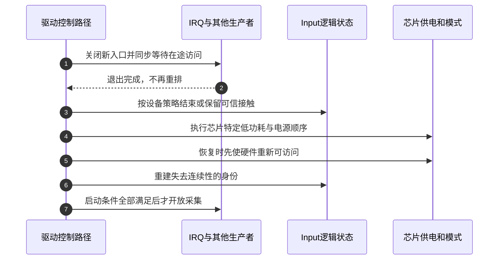

# 第9章\_PM状态恢复与硬件停止边界

[异常与停止模块导读](../navigation/P05_失步与停机分别恢复哪份状态.md#5.1_从故障位置选择需要恢复的状态) 先组织S3～S6的所有权，本页再展开固定实现。版本身份见 [Input总索引](../navigation/P01_Linux_6.12_Input源码阅读索引.md)：NXP Linux 6.12.20，提交 `dfaf2136deb2af2e60b994421281ba42f1c087e0`。原件 `drivers/input/input.c` blob `c51858f1cdc556939c2ee1bd21669c71c169d84e`，`drivers/input/evdev.c` blob `b5cbb57ee5f60073a41d16da23a8d3fa6c09f04a`。

## 9.1\_系统挂起先处理哪些Input逻辑状态

Input对象既有键和槽的逻辑状态，又关联真实控制器。系统挂起回调处理前者中的一部分，不等于芯片已经断电。以下suspend释放按键，必要时发同步，然后关闭活动输出；resume恢复输出。两个函数均持event_lock，不允许设备event回调睡眠。

```c
/**
 * @brief 仓库补充阅读说明：释放逻辑按键并切换输出，不控制触摸芯片供电或全槽清理。
 * @note 中文说明不是上游注释；保留固定版本执行语句。
 */
static int input_dev_suspend(struct device *dev)
{
	struct input_dev *input_dev = to_input_dev(dev);

	spin_lock_irq(&input_dev->event_lock);

	if (input_dev_release_keys(input_dev))
		input_handle_event(input_dev, EV_SYN, SYN_REPORT, 1);

	input_dev_toggle(input_dev, false);

	spin_unlock_irq(&input_dev->event_lock);

	return 0;
}
```

```c
/**
 * @brief 仓库补充阅读说明：在事件锁内恢复已保存输出配置，不读取新的硬件触摸帧。
 * @note 中文说明不是上游注释；保留固定版本执行语句。
 */
static int input_dev_resume(struct device *dev)
{
	struct input_dev *input_dev = to_input_dev(dev);

	spin_lock_irq(&input_dev->event_lock);

	input_dev_toggle(input_dev, true);

	spin_unlock_irq(&input_dev->event_lock);

	return 0;
}
```

这里没有input_mt_release_slots。不能因为inhibit路径调用了它，就声称system suspend也自动清空MT；也不能把resume返回0解释为regulator、总线和芯片复位已经由Input core完成。

freeze只释放键，poweroff只切换输出；PM操作表把restore映射到同一个resume函数。这些差异服务于系统睡眠阶段，不能随意把所有回调替换成一个“大复位”。

```c
/**
 * @brief 仓库补充阅读说明：冻结阶段释放按键并同步，不在这里切换输出。
 * @note 中文说明不是上游注释；保留固定版本执行语句。
 */
static int input_dev_freeze(struct device *dev)
{
	struct input_dev *input_dev = to_input_dev(dev);

	spin_lock_irq(&input_dev->event_lock);

	if (input_dev_release_keys(input_dev))
		input_handle_event(input_dev, EV_SYN, SYN_REPORT, 1);

	spin_unlock_irq(&input_dev->event_lock);

	return 0;
}
```

```c
/**
 * @brief 仓库补充阅读说明：休眠关机阶段切换输出，芯片资源仍由驱动控制。
 * @note 中文说明不是上游注释；保留固定版本执行语句。
 */
static int input_dev_poweroff(struct device *dev)
{
	struct input_dev *input_dev = to_input_dev(dev);

	spin_lock_irq(&input_dev->event_lock);

	input_dev_toggle(input_dev, false);

	spin_unlock_irq(&input_dev->event_lock);

	return 0;
}
```

## 9.2\_释放按键与切换输出修改什么

input_dev_release_keys需要已经持event_lock。它遍历当前按下键，通过普通内部事件处理尝试报告释放，返回是否发现需要补同步的按键；并非把设备全部能力和轴信息清零。need_sync在访问到按下键后设置，不是每条释放已被所有下游接受的证明，内部事件仍有inhibit等接受条件。

```c
/**
 * @brief 仓库补充阅读说明：锁内尝试释放当前按下键，标记调用者是否需要同步。
 * @note 中文说明不是上游注释；保留固定版本执行语句。
 */
static bool input_dev_release_keys(struct input_dev *dev)
{
	bool need_sync = false;
	int code;

	lockdep_assert_held(&dev->event_lock);

	if (is_event_supported(EV_KEY, dev->evbit, EV_MAX)) {
		for_each_set_bit(code, dev->key, KEY_CNT) {
			input_handle_event(dev, EV_KEY, code, 0);
			need_sync = true;
		}
	}

	return need_sync;
}
```

输出切换保留core的逻辑期望。关闭LED/声音时向设备event回调发0，开启时按保存位图恢复；这并不抹掉逻辑位图。恢复时还会重发已配置的重复参数。

```c
/**
 * @brief 仓库补充阅读说明：通过设备event重放或关闭输出，逻辑保存值与物理执行分开。
 * @note 中文说明不是上游注释；保留固定版本执行语句。
 */
static void input_dev_toggle(struct input_dev *dev, bool activate)
{
	if (!dev->event)
		return;

	INPUT_DO_TOGGLE(dev, LED, led, activate);
	INPUT_DO_TOGGLE(dev, SND, snd, activate);

	if (activate && test_bit(EV_REP, dev->evbit)) {
		dev->event(dev, EV_REP, REP_PERIOD, dev->rep[REP_PERIOD]);
		dev->event(dev, EV_REP, REP_DELAY, dev->rep[REP_DELAY]);
	}
}
```

上面调用的宏在同一原件中定义，下面保留唯一展开。先检查支持该类型，再遍历声明的输出能力；关闭时只处理逻辑上活动的输出，开启时也会给不活动项发送0以恢复完整设置。

```c
/** @brief 仓库补充阅读说明：按已有输出能力与逻辑值切换设备输出。 */
#define INPUT_DO_TOGGLE(dev, type, bits, on)				\
	do {								\
		int i;							\
		bool active;						\
									\
		if (!test_bit(EV_##type, dev->evbit))			\
			break;						\
									\
		for_each_set_bit(i, dev->bits##bit, type##_CNT) {	\
			active = test_bit(i, dev->bits);		\
			if (!active && !on)				\
				continue;				\
									\
			dev->event(dev, EV_##type, i, on ? active : 0);	\
		}							\
	} while (0)
```

设备event回调的返回值在这段切换中没有用于回滚逻辑位图，故EVIOCGLED得到的期望值不能证明物理灯已完成动作。若需要可睡总线，回调需使用自身的异步输出协议，停止时也要同步排空它。

## 9.3\_重置接口与多点释放有不同边界

input_reset_device取dev.mutex和event_lock，重放输出并释放按键；它不等于芯片reset引脚操作，也不自动重建硬件key映射。

```c
/**
 * @brief 仓库补充阅读说明：锁内重放输出并释放按键，不能替控制器复位协议。
 * @note 中文说明不是上游注释；保留固定版本执行语句。
 */
void input_reset_device(struct input_dev *dev)
{
	unsigned long flags;

	mutex_lock(&dev->mutex);
	spin_lock_irqsave(&dev->event_lock, flags);

	input_dev_toggle(dev, true);
	if (input_dev_release_keys(dev))
		input_handle_event(dev, EV_SYN, SYN_REPORT, 1);

	spin_unlock_irqrestore(&dev->event_lock, flags);
	mutex_unlock(&dev->mutex);
}
```

相对地，input_mt_release_slots由持event_lock的内部调用点使用。它推进frame使原来的seen全部过期，调用未见槽清理，再处理兼容压力并再次推进frame。其底层清理已在 [MT帧收尾](P06_多点槽状态与帧收尾.md#6.3_内部帧结束为何还需要外部同步) 唯一展开。

该函数位于同提交的 `drivers/input/input-mt.c`，blob `6b04a674f832a048a3e021f92517d8529d27f652`，其文件身份与本页前面的input.c分开。

```c
/**
 * @brief 仓库补充阅读说明：利用内部frame使所有活动槽成为未见并释放，要求调用者已持事件锁。
 * @note 中文说明不是上游注释；保留固定版本执行语句。
 */
void input_mt_release_slots(struct input_dev *dev)
{
	struct input_mt *mt = dev->mt;

	lockdep_assert_held(&dev->event_lock);

	if (mt) {

		mt->frame++;

		__input_mt_drop_unused(dev, mt);

		if (test_bit(ABS_PRESSURE, dev->absbit))
			input_handle_event(dev, EV_ABS, ABS_PRESSURE, 0);

		mt->frame++;
	}
}
```

这个函数不在公开input/mt.h中提供给普通设备驱动作为随意调用的全槽重置API。驱动需要报告结束时，应按自己的串行化协议用公开选槽/状态/同步接口表达；不能从上游内部调用点抄出函数名就当通用契约。

## 9.4\_逻辑清理怎样接回真实硬件停止

硬件层至少要证明“不再进入新采集”和“已经进入的访问结束”。固定版本kernel/irq/manage.c的disable_irq先禁用再synchronize_irq，注释明确等待可能睡眠、不能持有handler所需资源；synchronize_irq等待硬中断与线程处理，不替驱动停止重排的worker或timer。源码blob `f0803d6bd2969820443f25b5b508ec553f4cb9a2`，这里只使用其契约，不重复维护IRQ专题的函数体。



第3、6步要依据硬件是否保存身份选择策略；这幅图表达责任依赖，不声称内核统一按这七个调用调度。Input core自身PM回调与父设备驱动回调的框架顺序，也不能单靠这幅教学图反推。

实际驱动 [edt-ft5x06.c固定原件](https://github.com/nxp-imx/linux-imx/blob/dfaf2136deb2af2e60b994421281ba42f1c087e0/drivers/input/touchscreen/edt-ft5x06.c) 的blob为 `85c6d8ce003f3a2b131c33ecaae47c23dc7b3313`。其suspend在device_may_wakeup时直接返回，非唤醒分支再区分不支持、hibernate与poweroff；poweroff模式才禁用IRQ、操作reset和电源。resume的poweroff分支先恢复电源和复位，再恢复寄存器参数并enable_irq；另一个休眠分支通过wake GPIO处理。失败还需按实际已开启电源回滚，不能只恢复一个软件running标志。

这份例子证明“芯片模式决定动作顺序”，不证明所有驱动都先在相同位置disable_irq；也不证明只读到device_may_wakeup分支就已核验整个平台唤醒链。供电、IRQ路由和低功耗保持须继续查目标平台。

[同版本系统睡眠与中断文档](https://github.com/nxp-imx/linux-imx/blob/dfaf2136deb2af2e60b994421281ba42f1c087e0/Documentation/power/suspend-and-interrupts.rst)，blob `f588feeecad0fccb7d8f6a169cb93d24a273960a`，区分IRQF_NO_SUSPEND与enable_irq_wake。前者不是后者的替代，睡眠唤醒也不意味着正常设备线程继续读总线。本页完成静态职责核对，未进行目标板PM、断电或触摸身份实测。
