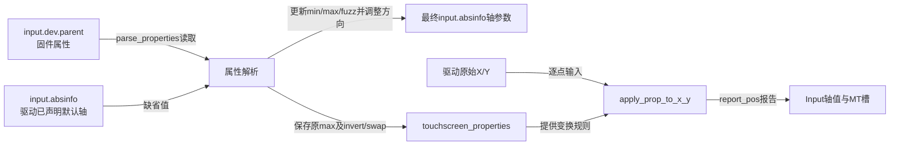
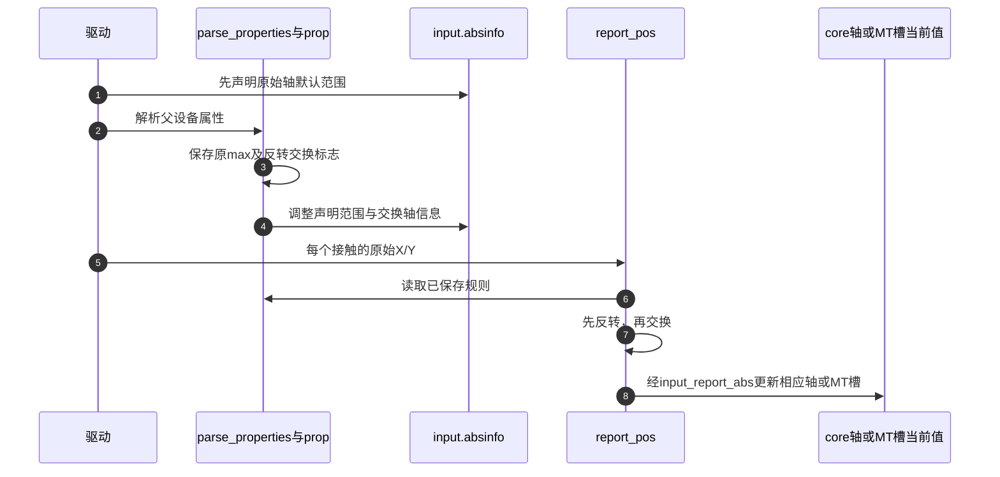

# 第10章\_触摸属性怎样改变坐标与轴参数

同一块面板旋转安装后，用户观察到的坐标方向必须与声明范围一致。这套helper把“注册前解析属性”和“报告时应用变换”连接起来，但不读取芯片帧，也不决定接触身份。先通过 [触摸适配导读](../navigation/P06_触摸帧怎样接到坐标与发布路径.md#6.1_先把芯片协议与Input状态分开) 定位它在驱动中的职责，固定版本见 [Input总索引](../navigation/P01_Linux_6.12_Input源码阅读索引.md)。

证据为NXP Linux 6.12.20提交 `dfaf2136deb2af2e60b994421281ba42f1c087e0`：`drivers/input/touchscreen.c` blob `4620e20d0190f7bb0e5ab197cca0765dcd8ad821`，`include/linux/input/touchscreen.h` blob `fe66e2b58f62d8881777df0b02f84e8a42e183b0`，通用touchscreen.yaml blob `431c13335c402f50a770988676bb0c20fb76da7c`。同提交Makefile将touchscreen.o纳入CONFIG_INPUT对应的input-core；evdev是否提供用户节点另由CONFIG_INPUT_EVDEV决定。

## 10.1\_属性先修改哪些轴参数

驱动先声明默认轴，再给input.dev.parent赋予实际父设备。parse_properties从这个父设备读取固件属性；multitouch参数选择MT位置轴还是普通X/Y轴。声明的input_absinfo描述报告空间，prop则保存以后处理每个原始坐标的规则，两者不是同一个状态副本。



| 状态 | 写入时间 | 消费者 |
| --- | --- | --- |
| absinfo[位置轴].minimum/maximum/fuzz | 默认声明与解析属性时 | core过滤、用户能力查询、兼容轴复制 |
| prop.max_x/max_y | 从反转/交换前轴范围保存 | 反转公式，不能替换为交换后的最大值 |
| prop.invert_x/invert_y | 读取对应布尔属性 | 每次原始坐标处理 |
| prop.swap_x_y | 读取交换属性 | 解析阶段交换轴信息，报告阶段交换值 |

```c
/**
 * @brief 仓库补充阅读说明：读取父设备通用属性，更新轴参数，再保存并应用反转交换规则。
 * @note 中文注释不是上游原文，以下保留固定版本执行语句。
 */
void touchscreen_parse_properties(struct input_dev *input, bool multitouch,
				  struct touchscreen_properties *prop)
{
	struct device *dev = input->dev.parent;
	struct input_absinfo *absinfo;
	unsigned int axis, axis_x, axis_y;
	unsigned int minimum, maximum, fuzz;
	bool data_present;

	input_alloc_absinfo(input);
	if (!input->absinfo)
		return;

	axis_x = multitouch ? ABS_MT_POSITION_X : ABS_X;
	axis_y = multitouch ? ABS_MT_POSITION_Y : ABS_Y;

	data_present = touchscreen_get_prop_u32(dev, "touchscreen-min-x",
						input_abs_get_min(input, axis_x),
						&minimum);
	data_present |= touchscreen_get_prop_u32(dev, "touchscreen-size-x",
						 input_abs_get_max(input,
								   axis_x) + 1,
						 &maximum);
	data_present |= touchscreen_get_prop_u32(dev, "touchscreen-fuzz-x",
						 input_abs_get_fuzz(input, axis_x),
						 &fuzz);
	if (data_present)
		touchscreen_set_params(input, axis_x, minimum, maximum - 1, fuzz);

	data_present = touchscreen_get_prop_u32(dev, "touchscreen-min-y",
						input_abs_get_min(input, axis_y),
						&minimum);
	data_present |= touchscreen_get_prop_u32(dev, "touchscreen-size-y",
						 input_abs_get_max(input,
								   axis_y) + 1,
						 &maximum);
	data_present |= touchscreen_get_prop_u32(dev, "touchscreen-fuzz-y",
						 input_abs_get_fuzz(input, axis_y),
						 &fuzz);
	if (data_present)
		touchscreen_set_params(input, axis_y, minimum, maximum - 1, fuzz);

	axis = multitouch ? ABS_MT_PRESSURE : ABS_PRESSURE;
	data_present = touchscreen_get_prop_u32(dev,
						"touchscreen-max-pressure",
						input_abs_get_max(input, axis),
						&maximum);
	data_present |= touchscreen_get_prop_u32(dev,
						 "touchscreen-fuzz-pressure",
						 input_abs_get_fuzz(input, axis),
						 &fuzz);
	if (data_present)
		touchscreen_set_params(input, axis, 0, maximum, fuzz);

	if (!prop)
		return;

	prop->max_x = input_abs_get_max(input, axis_x);
	prop->max_y = input_abs_get_max(input, axis_y);

	prop->invert_x =
		device_property_read_bool(dev, "touchscreen-inverted-x");
	if (prop->invert_x) {
		absinfo = &input->absinfo[axis_x];
		absinfo->maximum -= absinfo->minimum;
		absinfo->minimum = 0;
	}

	prop->invert_y =
		device_property_read_bool(dev, "touchscreen-inverted-y");
	if (prop->invert_y) {
		absinfo = &input->absinfo[axis_y];
		absinfo->maximum -= absinfo->minimum;
		absinfo->minimum = 0;
	}

	prop->swap_x_y =
		device_property_read_bool(dev, "touchscreen-swapped-x-y");
	if (prop->swap_x_y)
		swap(input->absinfo[axis_x], input->absinfo[axis_y]);
}
```

data_present使用按位或累积读取结果，所以同一轴的min、size、fuzz都会读取，不是找到一项就短路。任一项存在才写回组合参数；缺失项沿用默认值。size的默认值是旧maximum+1，写回时减1，与binding的“最大坐标加一”一致；不是任意minimum下的区间长度。

压力分支只读取max-pressure与fuzz-pressure，并将minimum设为0。通用binding中还出现min-pressure、average-samples、面板关联或物理尺寸，并不意味着此函数处理这些属性。不要根据YAML字段名推断驱动已实现功能。

prop为NULL时，普通轴参数读取已经发生，函数在方向信息之前返回。非NULL时先存原max，再按反转把声明区间变成零起点，最后交换整份轴信息。因此fuzz、flat、resolution等随被交换的input_absinfo一起交换；不能在外层再重复交换一遍。

修改解析顺序时，必须同时核对report时的公式、兼容轴复制的调用时机以及旧默认范围。范围和属性值不是无条件可信，size=0、minimum大于maximum或数值窄化都需要设备配置校验，不能让unsigned减法替代合法性判断。

## 10.2\_属性读取失败与未声明轴怎样处理

touchscreen_get_prop_u32把任意读取错误都降为默认值并返回false；它不向上区分“属性缺失”和“属性格式错误”。使用者不能把parse函数没有报错当成所有固件属性均正确。

```c
/**
 * @brief 仓库补充阅读说明：读属性失败时采用给定默认值，不传播具体读取错误。
 * @note 中文注释不是上游原文，以下保留固定版本执行语句。
 */
static bool touchscreen_get_prop_u32(struct device *dev,
				     const char *property,
				     unsigned int default_value,
				     unsigned int *value)
{
	u32 val;
	int error;

	error = device_property_read_u32(dev, property, &val);
	if (error) {
		*value = default_value;
		return false;
	}

	*value = val;
	return true;
}
```

```c
/**
 * @brief 仓库补充阅读说明：只更新已声明轴的min/max/fuzz，未声明则告警并返回。
 * @note 中文注释不是上游原文，以下保留固定版本执行语句。
 */
static void touchscreen_set_params(struct input_dev *dev,
				   unsigned long axis,
				   int min, int max, int fuzz)
{
	struct input_absinfo *absinfo;

	if (!test_bit(axis, dev->absbit)) {
		dev_warn(&dev->dev,
			 "Parameters are specified but the axis %lu is not set up\n",
			 axis);
		return;
	}

	absinfo = &dev->absinfo[axis];
	absinfo->minimum = min;
	absinfo->maximum = max;
	absinfo->fuzz = fuzz;
}
```

set_params不负责创建轴能力，parse开头的input_alloc_absinfo只保证有轴参数存储。分配失败时parse直接返回，而它的类型为void；驱动仍需正确建立和检查设备能力。dev_warn是未声明轴的诊断，不会自动修复漏掉的input_set_abs_params。

device_property_read_u32/read_bool属于固件属性访问层，此处关心取值、失败和父设备选择，不重复展开OF/ACPI后端。改成遇任何错误都终止probe会改变默认值契约，必须区分可选属性与强制要求，并审查既有调用者。

## 10.3\_每个坐标先反转再交换

apply函数不再读取固件，它只消费prop。每个轴先使用原最大值减去输入，之后才交换X/Y。以X最大1023、Y最大767为例，反转X并交换后，原始100/200变成200/923，最终轴范围也应交换成X最大767、Y最大1023。

```c
/**
 * @brief 仓库补充阅读说明：按原坐标轴反转，再交换两坐标。
 * @note 中文注释不是上游原文，以下保留固定版本执行语句。
 */
static void
touchscreen_apply_prop_to_x_y(const struct touchscreen_properties *prop,
			      unsigned int *x, unsigned int *y)
{
	if (prop->invert_x)
		*x = prop->max_x - *x;

	if (prop->invert_y)
		*y = prop->max_y - *y;

	if (prop->swap_x_y)
		swap(*x, *y);
}
```

```c
/**
 * @brief 仓库补充阅读说明：变换一次后，按multitouch选择真实Input位置轴上报。
 * @note 中文注释不是上游原文，以下保留固定版本执行语句。
 */
void touchscreen_report_pos(struct input_dev *input,
			    const struct touchscreen_properties *prop,
			    unsigned int x, unsigned int y,
			    bool multitouch)
{
	touchscreen_apply_prop_to_x_y(prop, &x, &y);
	input_report_abs(input, multitouch ? ABS_MT_POSITION_X : ABS_X, x);
	input_report_abs(input, multitouch ? ABS_MT_POSITION_Y : ABS_Y, y);
}
```



第5步必须仍是原始坐标，第8步消费最终坐标；若驱动在第5步前已经执行相同变换，就会双重反转或交换。声明轴参数与更新当前值是两条路径；MT实际当前值保存在选定槽中，不是所有触点共用一对普通轴value。

修改坐标类型或公式时应覆盖四角、边界、非零minimum、单轴反转、双轴反转与交换组合。没有范围检查时，无符号max-x在x超界会下溢，helper不会为错误原始包自动裁剪。

## 10.4\_位置匹配的存储类型还有额外约束

另一条输出不立即报告事件，而是把变换结果放进input_mt_pos，供位置匹配使用。其x/y为s16，这里直接赋值，没有额外范围检查。

```c
/**
 * @brief 仓库补充阅读说明：变换坐标后存入匹配位置结构，调用者负责s16范围。
 * @note 中文注释不是上游原文，以下保留固定版本执行语句。
 */
void touchscreen_set_mt_pos(struct input_mt_pos *pos,
			    const struct touchscreen_properties *prop,
			    unsigned int x, unsigned int y)
{
	touchscreen_apply_prop_to_x_y(prop, &x, &y);
	pos->x = x;
	pos->y = y;
}
```

这与report_pos的消费目标不同：前者构造位置匹配输入，后者发送事件，不能对同一坐标先set_mt_pos变换一次、后report_pos再变换一次。匹配还受平方距离的整数范围约束，见 [位置匹配的运算边界](P07_槽位映射与位置匹配.md#7.3_代价矩阵怎样从旧状态形成)。

公开的parse_properties、set_mt_pos、report_pos在input/touchscreen.h声明并导出；get_prop_u32、set_params及apply函数是文件内实现。修改公开签名或prop字段，要联动所有调用者的初始化、报告与匹配路径；若只改某驱动的安装方向，应先修改该设备正确的固件属性和验证，不应把平台特例硬编码进通用helper。

本页核对函数与属性契约，未验证某块面板的校准、设备树加载或真实触摸方向。目标设备的四角记录应与本例纯计算验证分开保存。
