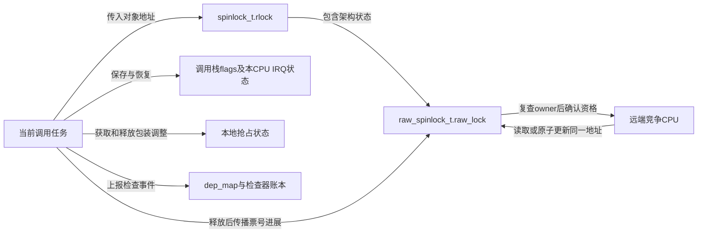
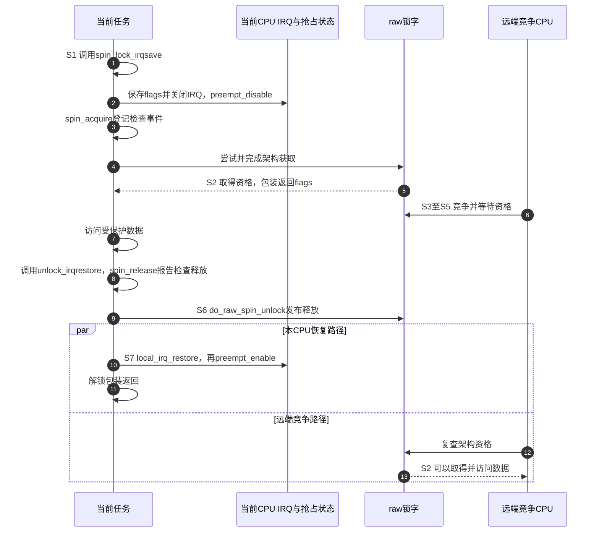

# 第2章\_Linux\_6.12\_spinlock模块源码概念导读

## 2.1\_模块问题与配置边界

一次 `spin_lock_irqsave()` 同时约束本地执行路径和远端竞争者，但这两种效果并不写入同一个状态地址：关中断改变当前 CPU，互斥资格则由共享锁对象承载。本章追踪这些动作怎样由公共包装送到架构实现，不重复使用教程。

读者已在[实现与上下文正文](../../../../knowledge/linux/synchronization_and_asynchrony/synchronization/locks/P04_spinlock实现与上下文边界.md#4.3.1_从反复抢夺改为领号等待)建立票号和本地重入模型。现在面对源码里的多层同名包装，任务是追踪业务传入的锁地址怎样到达架构锁字，并分清调试记录、抢占状态、IRQ保存值分别由谁维护。不能看见名为spin_lock的函数就跳过中间配置分叉。

固定证据是[总索引声明的 NXP Linux 6.12.20 提交](P01_Linux_6.12_锁源码总阅读索引.md#1.1_版本边界与阅读任务) `dfaf2136deb2af2e60b994421281ba42f1c087e0`。本章选取非 RT、SMP 的常规包装分支，再以 ARM32 票号锁承接架构层。仓库保存过 UP、非 RT 配置记录，但本次外部工作树不可访问，不能把历史记录称为当前配置核验，也不能声称本章分支就是目标正在执行的代码。

## 2.2\_接口层次与状态地址

先沿调用者传入的同一个对象向内找。非 RT 分支中，业务 `spinlock_t` 内的 `rlock` 保存 raw 对象，后者的 `raw_lock` 保存 `arch_spinlock_t`。这条嵌套链解释了为什么包装函数不断取得成员地址：它们最终要让所有竞争 CPU 访问同一份架构锁状态。

本地约束和诊断记录另有载体。IRQ 保存值由调用者的 `flags` 变量保留；抢占约束属于当前执行路径。`CONFIG_DEBUG_SPINLOCK` 可额外提供 magic、owner_cpu 和调试 owner；关闭调试并不会消除互斥。Lockdep 的 dep_map 又属于另一组检查状态，不能拿调试 owner 字段当作 ARM 票号算法的取得资格。按这个区别再看各层职责：

| 层 | 入口/状态 | 所有权 |
| --- | --- | --- |
| 公共类型 | `spinlock_t` | 非 RT 内嵌 `raw_spinlock_t`；RT 内嵌 `rt_mutex_base` |
| 上下文包装 | `spin_lock_bh/irq/irqsave` | 当前 CPU 的 softirq/IRQ/抢占状态 |
| raw 包装 | `raw_spin_lock*`、`do_raw_spin_lock()` | debug/Lockdep、raw 锁协议 |
| 架构层 | `arch_spin_lock(&lock->raw_lock)` | 具体原子锁字与排队算法 |
| I/O 顺序辅助 | `mmiowb_spin_lock/unlock()` | 锁保护 MMIO 写的架构排序边界 |



## 2.3\_普通获取调用链

```text
spin_lock(lock)
  → raw_spin_lock(&lock->rlock)
    → _raw_spin_lock()
      → __raw_spin_lock()（所选SMP通用内联分支）
        → preempt_disable()、spin_acquire()、LOCK_CONTENDED()
          → do_raw_spin_lock()
            → arch_spin_lock(&lock->raw_lock)
            → mmiowb_spin_lock()
```

释放走对应的 unlock 包装。在未启用 DEBUG_SPINLOCK 的 `do_raw_spin_unlock()` 中，先执行 `mmiowb_spin_unlock()`，再调用 `arch_spin_unlock()` 发布锁的可取得状态；外层随后解除本地抢占约束。它不是把获取调用链逐行倒放。具体实现和裁剪代码见[spinlock 包装与 raw 路径源码实现](../source_explanations/include/linux/spinlock.h.md#1.4_spin_lock到raw包装)。

这是一条明确选择的阅读路径，不能声称所有构建都逐层产生函数调用：`_raw_*`可以被内联映射，`kernel/locking/spinlock.c`也提供非内联入口；GENERIC_LOCKBREAK与调试配置会改变所用包装分支。`LOCK_CONTENDED`可先尝试再进入竞争路径，不是额外业务锁。此处只组织调用职责，宏体留给实现讲解。

常规分支的完整函数见[普通获取与释放](../source_explanations/include/linux/spinlock_api_smp.h.md#1.2_普通获取和释放的顺序)、[IRQ保存恢复](../source_explanations/include/linux/spinlock_api_smp.h.md#1.3_irqsave把哪份状态带回调用者)及[trylock失败恢复](../source_explanations/include/linux/spinlock_api_smp.h.md#1.4_trylock失败为什么不能留下约束)，这里不重复函数体。

沿P03的阶段检查该调用链：S0先初始化并保证对象有效；S1包装建立本地约束、尝试架构取得；有竞争时S3/S4/S5由架构算法落实，ARM领号把尝试与排队位置合并；S2才是业务持有；S6先释放架构锁，S7再恢复本地上下文。`spin_acquire`位于功能获取前的检查事件，不能用它代替S2成功证据；trylock成功与失败的检查/恢复路径还需单独阅读。

## 2.4\_irqsave分支的通信顺序

普通 `spin_lock()` 不保存 IRQ 状态；调用者选择 irqsave 变体以后，才增加保存和恢复动作。下面固定由两个 CPU 上的任务竞争同一把锁，画出一次成功取得与释放。检查事件不授予锁资格，恢复本地 IRQ 也不是远端进入的前置条件。



图中的 flags 保存在调用者的局部变量中，描述保存时那一个 CPU 的 IRQ 状态，恢复必须遵守同 CPU 与正确配对要求；它不属于共享锁字。其他 CPU 可以并发访问锁字争取资格，而当前 CPU 的关 IRQ 不会屏蔽远端 CPU。

图采用 `spinlock_api_smp.h` 的常规非lockbreak路径：保存IRQ状态后施加抢占约束，登记检查事件，再完成架构锁获取；释放端先报告检查释放、释放架构锁，再恢复IRQ和抢占状态。因而远端可能在本CPU尚未完成全部恢复时取得锁，不能把图中纵向先后误当作远端必须等待本地函数返回。

若本地硬中断也要拿同锁，irqsave在获取前屏蔽它，避免中断暂停真正解锁者后自己无限等待；若调用者进入时IRQ已关闭，恢复后仍应关闭。NMI不由普通IRQ屏蔽排除，仍须另行证明不会递归取同锁。

## 2.5\_PREEMPT\_RT分叉点

`include/linux/spinlock_types.h` 在非 RT 分支把 `spinlock_t` 映射为 raw；RT 分支改为 `rt_mutex_base`。因此不能从非 RT `spin_lock()` 直接内联到 raw 的代码，推断 RT 也必然忙等。严格 raw 语义仍从 `raw_spinlock_t` 路径阅读。

还要更早检查SMP/UP分叉：`spinlock_types_raw.h` 在SMP下包含架构类型，UP下包含 `spinlock_types_up.h`；`spinlock.h` 分别选择架构操作与 `spinlock_up.h`，通用API还区分UP调试/非调试。因此，阅读 ARM 票号函数体只能说明所选 SMP 分支，不能冒充历史 UP 配置的实际宏展开。RT 普通锁的 irqsave 也不关硬中断，上一节图只属于已声明的非 RT 分支。

## 2.6\_源码阅读顺序

1. `include/linux/spinlock_types_raw.h`：raw 锁对象和调试字段。
2. `include/linux/spinlock_types.h`：普通/RT 类型分叉。
3. `include/linux/spinlock.h`：公共包装与 `do_raw_spin_*`。
4. `include/linux/spinlock_api_smp.h` 与 `kernel/locking/spinlock.c`：内联/非内联通用入口、本地状态和配置例外；UP另查对应up头文件。
5. `arch/arm/include/asm/spinlock_types.h` 与 `spinlock.h`：票号布局与原子操作；仅在所选SMP分支进入，不代表当前配置。

现有[类型讲解](../source_explanations/include/linux/spinlock_types.h.md#1.2_spinlock_t的配置映射)和[raw到架构边界](../source_explanations/include/linux/spinlock.h.md#1.5_do_raw_spin_lock到架构边界)承担具体裁剪阅读。ARM阻塞获取见[领号与等待](../source_explanations/arch/arm/include/asm/spinlock.h.md#1.2_取得票号不等于已经进入)，释放与事件见[服务号推进](../source_explanations/arch/arm/include/asm/spinlock.h.md#1.3_事件通知为何仍须复查)。未展开的trylock、事件替换宏和其他配置仍对照固定源码，不把有限函数覆盖扩大成全部spinlock实现。

## 2.7\_复核问题

- 共享锁状态和本地 IRQ 状态分别保存在哪里？
- 公共 `spin_lock()` 包装为什么还要调用架构实现，两层分别负责什么？
- PREEMPT_RT 下哪一个类型仍表示严格 raw 语义？
- `mmiowb_spin_*` 为什么不能被概括成锁本身完成所有 MMIO 顺序？

总索引：[Linux 6.12 锁源码总阅读索引](P01_Linux_6.12_锁源码总阅读索引.md#1.6_建议阅读顺序)。

上一篇：[Linux 6.12 锁源码总阅读索引](P01_Linux_6.12_锁源码总阅读索引.md)。

下一篇：[mutex 与 rwsem 模块源码概念导读](P03_Linux_6.12_mutex与rwsem模块源码概念导读.md)。
