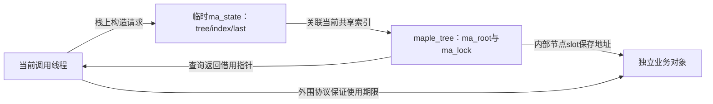
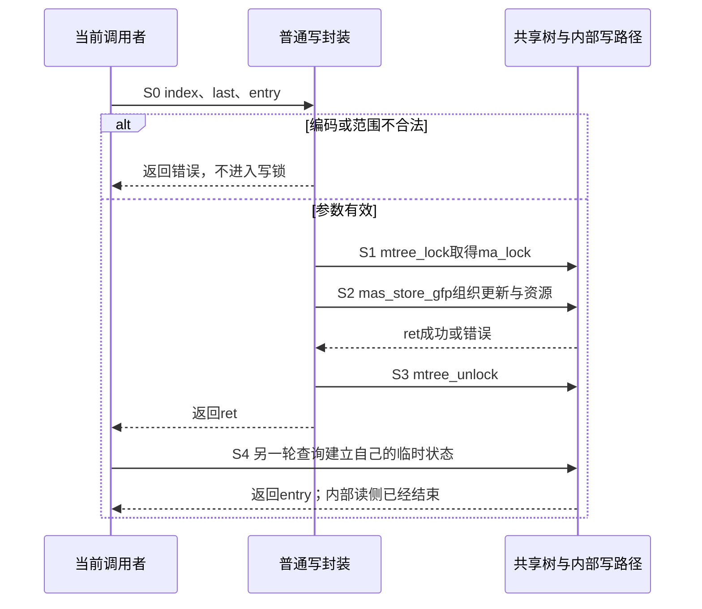

# 第7章\_普通接口与范围契约

## 7.1\_从请求到共享索引

沿[总索引](P01_Linux_6.12_Maple范围源码阅读索引.md#1.1_从地址查询进入版本证据)进入官方固定 Linux 6.12.20。普通接口把 ma_state 放在当前调用栈，树内节点保存范围映射，业务对象有独立所有权。教材实例见[P40](../../../../knowledge/linux/data_structures/红黑树_rb-tree/P40_Maple普通接口中的范围与查询.md#40.2_同一棵树中的覆盖与拒绝覆盖)，这里追踪具体封装和证据边界。

同一段资源 [100,199] 已指向 A 时，store 可以把 [150,249] 改为 B，insert 则必须拒绝与 A 重叠的申请。区别不在名字是否都带 range，而在封装选择的更新协议。先定位当前请求保存在哪里，再看锁保护哪棵共享树，最后沿错误出口检查有没有把一次失败写成业务成功。

## 7.2\_沿一次调用划分责任

| 阶段 | 地址与读写路径 | 唯一实现入口 |
| --- | --- | --- |
| S0 提交请求 | 普通写接口创建栈上 ma_state、检查编码及范围 | [store/insert](../source_explanations/lib/maple_tree.c.md#1.11_普通写入与整段擦除) |
| S1 进入写路径 | mtree_lock 直接取得 mt->ma_lock，没有 external 自动分派 | [锁宏](../source_explanations/include/linux/maple_tree.h.md#1.12_普通接口的锁与迭代宏) |
| S2 存储协议 | store 调 mas_store_gfp；insert 调 mas_insert 并处理 mas_nomem 重试；erase 定位整段后清除 | [普通写封装](../source_explanations/lib/maple_tree.c.md#1.11_普通写入与整段擦除)，完整内部算法尚未展开 |
| S3 结果归还 | 封装释放锁，返回 ret 或原 entry；insert 清理本次状态资源 | 同上，返回值不代替业务对象释放协议 |
| S4 独立读取 | load/find 自建临时状态，内部 RCU 读侧在返回前结束 | [点查](../source_explanations/lib/maple_tree.c.md#1.10_普通点查与读侧边界)、[find](../source_explanations/lib/maple_tree.c.md#1.12_向后查找与回绕终止) |

mtree_store/mtree_insert 是起止相同的范围请求。宏 mt_for_each 首次用 mt_find、后续用 mt_find_after，后者检查零来终止 last+1 的无符号回绕。原先的[vma_lookup](../source_explanations/include/linux/mm.h.md#1.2_vma_lookup只查询当前地址)仍在 mm.h 唯一展开，不能由点查封装推导出完整 VMA 锁协议。

下面按 store_range 的实际外围调用顺序读函数；S2 内部可能进入补分配重试，图中的一次调用不表示始终持有同一把锁。

## 7.3\_结果与证明边界

store 允许覆盖；insert 对占用报告 -EEXIST（固定英文文档 EEXISTS 是拼写问题）；erase 删除当前命中范围。查询的 max 不裁剪命中范围，只有成功才写回 index。内部读取使用 RCU 不等于返回对象自动获得引用。

编码入口见[xa_is_advanced 与 zero-entry](../source_explanations/include/linux/xarray.h.md#1.3_普通接口检查与零entry)。store/insert 的入参谓词与 mt_is_reserved 不同；load/find 将特殊零 entry 隐藏为 NULL，不能据此判断原始槽编码。

既有验证记录中，完整私有模块通过 ARM 前端。宿主检查把范围存储和行走明确作为替身，仅执行固定普通封装以观察调用顺序、错误出口与回绕控制。未执行目标 Kbuild、MODPOST、装卸、动态分裂、RCU 或并发验证，不把这些结果称为完整 Maple 内核运行。
