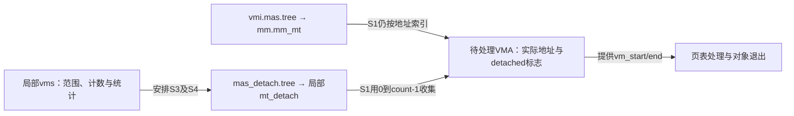
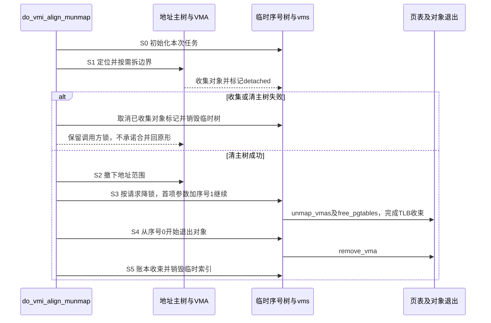

# 第10章\_撤销范围与临时索引

## 10.1\_状态变量的类型不能告诉我们树键是什么

从[总索引](P01_Linux_6.12_Maple范围源码阅读索引.md#1.1_从地址查询进入版本证据)进入固定 Linux 6.12.20。do_vmi_align_munmap 中 vmi 关联地址主树，mas_detach 关联序号临时树。首项 VMA 可经参数传入，后续游标从序号 1 开始；对象自身的 vm_start/end 才描述虚拟地址。教材的 E/F/G 完整场景见[P42](../../../../knowledge/linux/data_structures/红黑树_rb-tree/P42_撤销映射中的两棵Maple树.md#42.3_沿S0到S5观察职责转移)。

需要撤销一段映射时，主树必须停止把这些地址交给正常查询者；但是页表和对象清理还需要逐个找到它们。临时树因此保存待处理 VMA 的入口，用连续序号表达本次处理顺序。它承担的是退出期间的集合管理，不是第二个地址空间。

## 10.2\_两棵树沿S0到S5分工

主树不再返回 VMA，并不表示处理器已经停止使用旧映射。后续还要撤销页表项，并按内核协议处理 TLB（Translation Lookaside Buffer，地址转换后备缓冲器）中的旧地址转换；最后才能收束对象与账本。S0～S5 将这些不同责任按先后接起来。

| 阶段 | 共享或局部状态 | 唯一实现入口 |
| --- | --- | --- |
| S0 | 局部临时树、计数、范围与账本 | [对齐入口](../source_explanations/mm/vma.c.md#1.2_对齐撤销建立临时树)、[任务初始化](../source_explanations/mm/vma.h.md#1.2_初始化撤销任务) |
| S1 | 首尾拆分，临时序号存储与对象 detached 标记；主树尚未整体清空 | [收集](../source_explanations/mm/vma.c.md#1.3_收集与边界拆分) |
| S2 | vma_iter_clear_gfp 清地址主树，成功进入不可返回原状阶段 | [对齐入口](../source_explanations/mm/vma.c.md#1.2_对齐撤销建立临时树)；包装沿既有 mm.h |
| S3 | 可选降锁，临时首项参数与序号 1 继续；请求地址和搜索上界区分 | [clear_ptes](../source_explanations/mm/vma.c.md#1.4_从序号一继续页表处理)、[unmap_vmas](../source_explanations/mm/memory.c.md#1.2_解除映射与继续遍历)、[free_pgtables](../source_explanations/mm/memory.c.md#1.3_释放页表与上界哨兵) |
| S4/S5 | 从序号零退出对象，完成账本与临时索引销毁 | [完成阶段](../source_explanations/mm/vma.c.md#1.5_完成账本与对象退出) |
| 错误恢复 | 取消已收集对象的分离标记，销毁临时索引；不承诺逆转所有 split | [reattach](../source_explanations/mm/vma.h.md#1.3_恢复分离标记而非逆转全部拆分) |

图示有实际待撤销映射的正常任务及其失败分支。它不把零页数早退也推导成完全相同的清理序列。

## 10.3\_调用上下文限制结论

free_pgtables 中 ceiling=0 有明确页表上界哨兵契约，不可拿来为普通空 VMA 请求辩护。unmap_vmas 的 tree_end 在临时树路径是计数上界，exit_mmap 等别的调用方却可以传地址树状态；同一函数需要结合当前 tree 读参数单位。

本模块核对八个控制函数与恢复入口的固定正文，保持 notifier、hugetlb、零页数早退和 DEBUG 分支，不将源码阅读称为动态运行。C++ 分区模型只证明示例区间和处理序号，不模拟真实 VMA 对象、失败回滚、TLB 或并发。完整 MM 修改和体系结构页表仍有独立研究边界。
