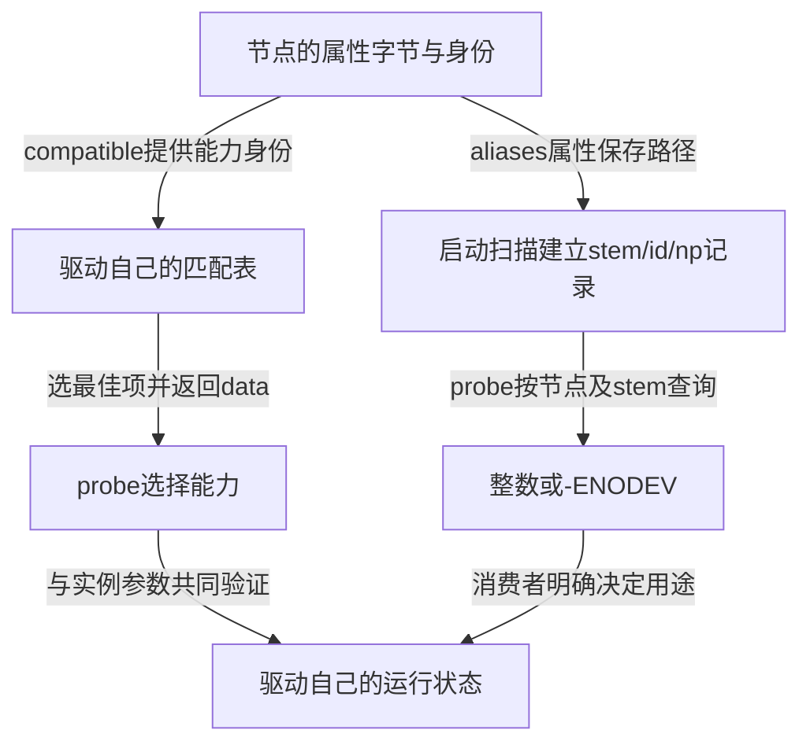

# 第1章\_OF绑定与别名源码阅读索引

同一节点的compatible决定驱动能否处理它，aliases则可能给它提供板级编号。修改其中一项以后，究竟该沿哪条路径找使用者？本索引将两条路径按固定源码分开，避免把“找到节点”“选中能力项”和“分配设备号”当作同一个函数的副作用。

## 1.1\_版本与阅读任务

本专题使用NXP官方`linux-imx`仓库，发布标签`lf-6.12.20-2.0.0`，不可变提交`dfaf2136deb2af2e60b994421281ba42f1c087e0`，Linux 6.12.20。官方来源为 [nxp-imx/linux-imx](https://github.com/nxp-imx/linux-imx/tree/dfaf2136deb2af2e60b994421281ba42f1c087e0)，核对记录见 [源码基线](../../linux/SOURCE_BASELINE.md#1.262_OF匹配与别名查询复核)。本轮使用固定官方文件快照，只读核对；当前外部工作树与目标配置未确认，不把缓存目录名称当作源码身份。

进入时应已理解 [描述到驱动服务](../../../../knowledge/driver_model/device_tree/P11_从设备描述到驱动服务怎样逐层确认.md) 与 [别名多实例实验](../../../../knowledge/driver_model/device_tree/P12_设备别名怎样参与多实例识别.md)。这里承担修改源码所需的字段、选择分支和调用上下文，正文仍承担跨版本的理解与使用任务。

图中两条路径最终在probe内交会，但别名查询不参与compatible分数，匹配器也不分配编号。按这个区别进入 [描述身份与编号消费者导读](P02_描述身份怎样交给匹配与编号消费者.md#2.1_先沿设备关联找到本次匹配对象)。

| 源码簇 | 需要回答的问题 | 唯一实现入口 |
| --- | --- | --- |
| `include/linux/of.h`、`mod_devicetable.h` | 节点、属性与能力表存在哪里；哪些字段受配置影响 | [描述节点与能力表](../source_explanations/P01_OF节点怎样选出驱动能力条目.md#1.1_描述节点与能力表保存不同的数据) |
| `drivers/of/base.c`的兼容性与表扫描 | 如何按节点列表顺序选择，name/type和同分如何处理 | [得分与最佳项](../source_explanations/P01_OF节点怎样选出驱动能力条目.md#1.2_分数怎样表达节点兼容顺序和附加条件) |
| `drivers/base/platform.c`、`drivers/of/device.c` | 候选驱动的OF结果怎样接到probe里的data | [平台入口与data读取](../source_explanations/P01_OF节点怎样选出驱动能力条目.md#1.3_平台匹配与probe读取怎样接到同一张表) |
| `drivers/of/of_private.h`、`base.c` | 路径怎样变成编号记录；查询如何同步与失败 | [别名建立](../source_explanations/P02_别名路径怎样成为编号查询记录.md#2.1_启动扫描怎样建立节点与编号的关联)、[查询实现](../source_explanations/P02_别名路径怎样成为编号查询记录.md#2.2_查询只返回已有记录而不分配号码) |

## 1.2\_配置与相邻机制保持各自边界

这里的真实OF路径以`CONFIG_OF`等适用配置为前提；关闭OF时头文件中的桩接口不能被解释为运行了同一套节点算法。`CONFIG_OF_DYNAMIC`影响节点动态生命周期，`CONFIG_OF_KOBJ`影响节点中的kobject及sysfs表示。本文解释条件分支，没有宣称目标板全部启用它们。

平台枚举、资源转换与Driver Core状态不是本目录另写一套实现的理由。节点什么时候成为平台设备回到 [设备树主线](../../../../knowledge/driver_model/device_tree/设备树+platform开发/P02_设备树驱动开发方式.md#2.2.2_枚举要看所在总线和节点用途)；S0～S4、临时关联和绑定集合继续使用 [Driver Core状态拓扑](../../../../knowledge/linux/device_model/P04_Driver_Core状态拓扑.md#4.3_把一次绑定推进到撤销)。失败及devres实现入口由其既有阅读链维护。

本目录摘录只展开OF身份选择和编号查询，中文Doxygen与中文行内注释均为仓库补充，不是上游原注释。验证包含固定源码比对、离线DT输入及图文冷读，不包含目标内核编译、模块装入、运行时overlay重配置或实际串口编号实验。
