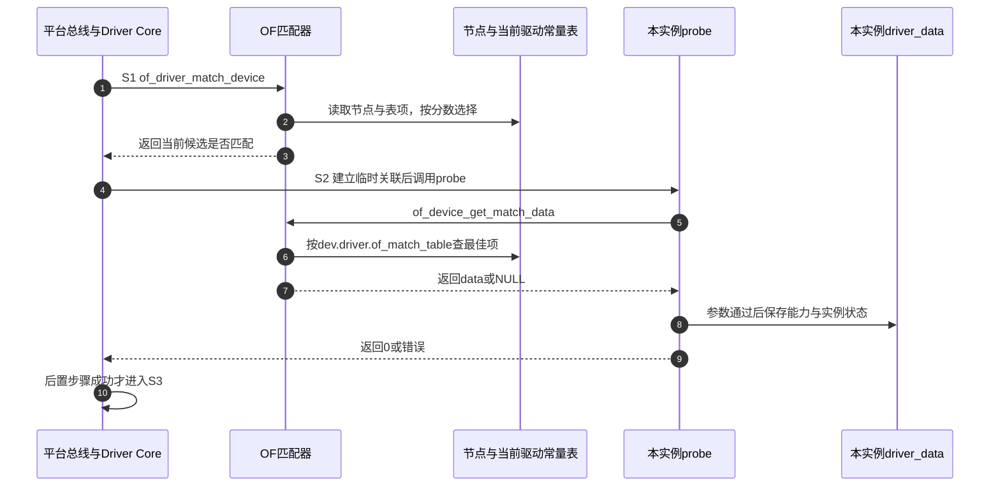

# 第2章\_描述身份怎样交给匹配与编号消费者

修改一个设备节点时，最容易混淆的是数据的接收者。compatible由匹配器与驱动能力表共同解释；别名则先由OF核心整理，最终仍由驱动决定用途。本篇沿一个教学实例的S1相遇、S2准备服务到S3服务追踪两条路径，源码身份与配置见 [总阅读索引](P01_OF绑定与别名源码阅读索引.md#1.1_版本与阅读任务)。

## 2.1\_先沿设备关联找到本次匹配对象

进入S1时，实例已经登记在平台总线，`platform_device.dev.of_node`指向它的描述节点；驱动也已登记，并通过`device_driver.of_match_table`关联自己的常量表。平台匹配入口负责判断这个候选是否适用，并不负责把DTB展开成节点。

OF匹配沿设备指针取得节点，把节点compatible列表与当前表项逐一比较。最佳项决定返回值，但不会改变设备属性，也不会把另一个驱动的表拿来参赛。到了S2，驱动通过`of_device_get_match_data()`从当前驱动的表重新取得最佳项的data，用它解释实例参数。两次查表各有调用目的，没有一个“全局已选能力指针”自动写入设备私有状态。

步骤1～3只判断候选，4～7进入probe后再次沿当前表取data，8～10才把能力兑现为实例状态并完成后置检查。这里`data`是模块常量表中的指针；本教学驱动将它保存在每实例状态中，受绑定/模块生命周期约束。它不是带独立引用计数的任意长寿命对象，不能在驱动卸载后继续使用。匹配读取涉及的节点锁也不保护整个probe业务流程。

实现修改时按 [字段定义](../source_explanations/P01_OF节点怎样选出驱动能力条目.md#1.1_描述节点与能力表保存不同的数据) → [得分规则](../source_explanations/P01_OF节点怎样选出驱动能力条目.md#1.2_分数怎样表达节点兼容顺序和附加条件) → [平台入口与data读取](../source_explanations/P01_OF节点怎样选出驱动能力条目.md#1.3_平台匹配与probe读取怎样接到同一张表) 顺序阅读。不要只改匹配表顺序就假定兼容级别改变；先用同一个节点列表预测得分。

## 2.2\_编号查询的完成点由消费者接住

别名记录建立得更早：启动扫描读取路径，找到节点，把末尾数字和stem保存到`alias_prop`。驱动进入S2时按`np+stem`查询，OF核心返回一个已有整数或`-ENODEV`，到这里只完成了 **查找**。字符设备minor分配、串口line索引赋值或本例sysfs显示，是后续消费者动作。

| 状态落点 | 谁写入 | 谁读取 | 完成意味着什么 |
| --- | --- | --- | --- |
| `/aliases`属性字节 | DT编译与固件交付 | 启动OF扫描、路径查询 | 描述存在，未分配Linux设备号 |
| `aliases_lookup`中的`alias_prop` | 启动扫描及内部添加函数 | `of_alias_get_id`在of_mutex下遍历 | 得到节点和stem对应的已有记录 |
| 本例`binding_state.alias_id` | 每次probe保存查询返回值 | 本实例sysfs show | 仅报告结果，缺失仍可服务 |
| 实际驱动自己的端口索引/号码资源 | 该驱动或子系统的分配协议 | 后续注册和业务路径 | 是否成功必须看消费者范围与冲突检查 |

这些是多组状态：描述、查询缓存、绑定状态和业务编号互相关联，不能画成一个取值从“节点”变成“设备号”的单一枚举。核心查询使用mutex，只说明它按这一协议访问列表，不意味着所有驱动的编号分配也自动获得同一把锁。

读 [启动扫描实现](../source_explanations/P02_别名路径怎样成为编号查询记录.md#2.1_启动扫描怎样建立节点与编号的关联) 后，再读 [编号查询实现](../source_explanations/P02_别名路径怎样成为编号查询记录.md#2.2_查询只返回已有记录而不分配号码)。给消费者增加动态兜底时，要另行检查分配、并发、失败回退和移除归还；只把负值改成0没有完成这些职责。

## 2.3\_用同一组输入覆盖正常缺失与失败路径

沿正文两实例实验，先核对A为v2/12/0、B为v1/4/1。随后交换aliases：只有编号查询结果变，能力仍由compatible决定。再删除B的别名：本教学驱动显示absent，串口这类要求编号的消费者却可能拒绝probe。最后把B参数改为12：OF匹配仍成功，但驱动自己的验证失败。

这些反例分别落在描述、查询和S2业务初始化，不能统称“绑定算法失效”。若A解绑后B也丢失状态，应检查驱动的全局对象与清理归属，而不是先修改OF匹配器。若运行时改aliases却仍得到旧结果，应先检查目标版本是否有相应索引更新路径，不把启动扫描缓存视为实时查询属性的同义词。

本例使用`driver.dev_groups`建立只读属性，失败或S4撤销时由核心去掉该组，再释放devres；具体核心状态沿 [Driver Core拓扑](../../../../knowledge/linux/device_model/P04_Driver_Core状态拓扑.md#4.3_把一次绑定推进到撤销) 阅读。本目录不复制那组函数体；这里只说明OF结果在哪个阶段交给它们。
