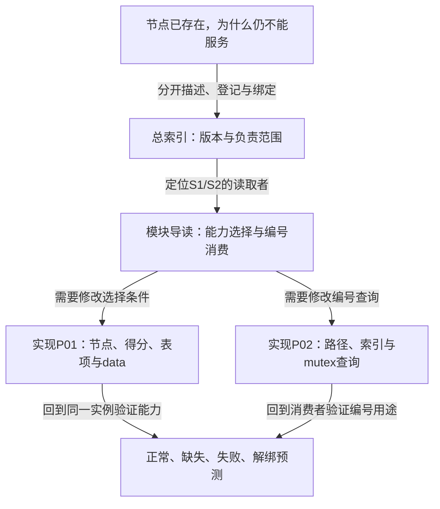

# 第1章\_OF绑定与别名源码阅读大纲

## 1.1\_从两种身份问题进入实际读写路径

本目录解决“设备描述如何成为能力选择与编号查询输入”，不重新维护整套Driver Core或设备树教程。先在知识正文 [绑定证据](../../../knowledge/driver_model/device_tree/P11_从设备描述到驱动服务怎样逐层确认.md) 和 [多实例别名实验](../../../knowledge/driver_model/device_tree/P12_设备别名怎样参与多实例识别.md) 建立问题，再进入固定实现。

适合的阅读现场是：你已经能区分节点与设备，正在增加一个硬件变体，或要解释同类实例为何取得不同编号。前一种修改需要追踪匹配表项与能力指针，后一种需要追踪路径索引和消费者分配规则。读完后应能预测交换别名、删除能力项与单实例失败各自影响哪组状态，并指出验证应停留在离线输入还是必须进入目标运行环境。

| 阅读位置 | 当前问题 | 依赖与后续 |
| --- | --- | --- |
| [总索引](navigation/P01_OF绑定与别名源码阅读索引.md#1.1_版本与阅读任务) | 哪个版本、配置与源码负责本结论 | 依赖正文分层，进入模块协作 |
| [模块导读](navigation/P02_描述身份怎样交给匹配与编号消费者.md#2.1_先沿设备关联找到本次匹配对象) | 谁在S1、S2读描述，结果放在哪里 | 不展开函数体，按问题进入唯一实现 |
| [节点与匹配实现](source_explanations/P01_OF节点怎样选出驱动能力条目.md#1.1_描述节点与能力表保存不同的数据) | 能力表如何选中，data怎样交给probe | 回到多实例与失败测试 |
| [别名实现](source_explanations/P02_别名路径怎样成为编号查询记录.md#2.1_启动扫描怎样建立节点与编号的关联) | 路径怎样整理成stem/id/np记录 | 查询完成后继续检查消费者协议 |

## 1.2\_越过本目录边界时去哪里

DTB展开与枚举回到 [设备树主线](../../../knowledge/driver_model/device_tree/设备树+platform开发/P02_设备树驱动开发方式.md)；节点引用回到 [OF属性与引用周期](../../../knowledge/driver_model/device_tree/设备树+platform开发/P09_OF属性读取与节点引用生命周期.md)；绑定集合、临时关联和撤销回到 [设备模型](../../../knowledge/linux/device_model/P04_Driver_Core状态拓扑.md)。需要`/dev`接口时继续 [字符设备安全移除](../../../knowledge/driver_model/character_device/P09_安全移除_旧fd与模块卸载.md)，不把编号查到或devm分配成功当作旧fd安全的证明。
