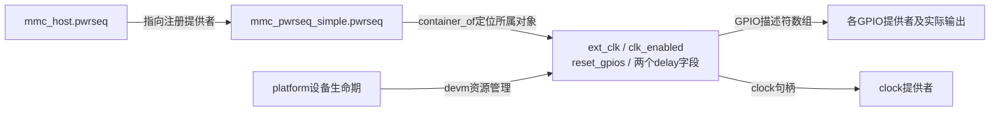
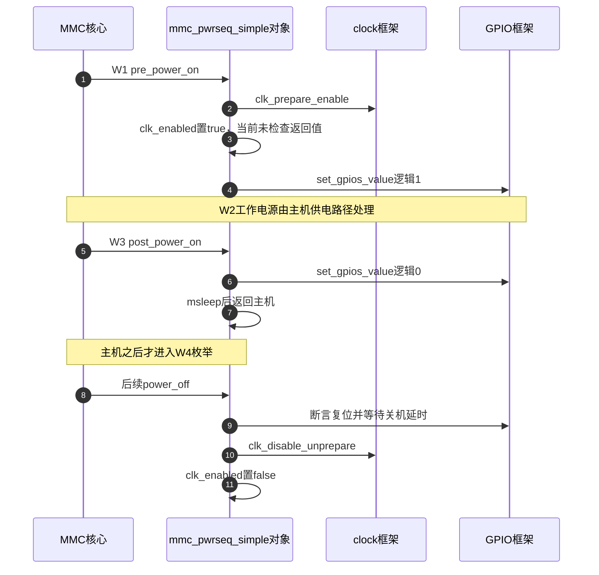

# 第1章\_MMC简单时序怎样跨过枚举前准备

模块尚未被枚举时，无线驱动不能承担第一次释放复位的全部职责。本篇追踪简单MMC时序提供者怎样提前持有连接，并在主机上电过程里使用它们。**讲解层次：实现层，固定NXP Linux 6.12.20。**

| 关联阅读 | 用途 |
| --- | --- |
| [总阅读索引](../navigation/P01_组合外设源码阅读索引.md#1.1_版本与证据范围) | 固定提交与条件性配置 |
| [模块导读](../navigation/P02_资源准备与事件完成怎样交接.md#2.2_资源准备要区分句柄取得请求发出和硬件成功) | 区分取得、请求与成功 |
| [应用W阶段](../../../../knowledge/driver_model/device_tree/P06_从供电复位到SDIO无线设备枚举.md#6.3_沿一次上电看每种状态何时改变) | 本文直接复用W0～W4，不另造一套阶段 |

## 1.1\_先建立句柄和复位初态

上游位置为 [`drivers/mmc/core/pwrseq_simple.c`](https://github.com/nxp-imx/linux-imx/blob/dfaf2136deb2af2e60b994421281ba42f1c087e0/drivers/mmc/core/pwrseq_simple.c)，相关配置`CONFIG_PWRSEQ_SIMPLE`。探测分配`struct mmc_pwrseq_simple`，其中内嵌的`pwrseq`注册给MMC核心；`ext_clk`保存时钟句柄，`reset_gpios`保存描述符数组，两个delay字段保存固件给出的时间，`clk_enabled`用于本提供者的启停配对。

GPIO数组被请求为`GPIOD_OUT_HIGH`，这里的HIGH是逻辑1，即断言复位，不保证物理引脚为高。数组可包含多个不同极性的复位输出，描述符负责转换。外部clock缺失`-ENOENT`可被允许，GPIO取得的`-ENOENT`或`-ENOSYS`也被此版本允许；其他错误通过`dev_err_probe`返回。可选资源缺失与真实取得失败不能混写。



这张图是内核对象与句柄关系，不表示一个软件结构体包含时钟硬件。`to_pwrseq_simple()`通过内嵌成员定位整个对象；主机回调先由`host->pwrseq`取得该对象，再访问其中的资源。移除回调注销提供者，devm随后管理取得资源的释放；主机运行期关机协议与驱动移除不是同一个动作。

## 1.2\_上电与关闭回调怎样使用这些句柄

下面保留两段完整回调；中文Doxygen和行内注释为仓库补充，非上游原文。其他探测、模块注册和辅助函数在此不复制，其行为在相邻段落解释。

```c
/**
 * @brief 仓库补充阅读说明：W1请求参考时钟并断言复位。
 * @param host 持有本时序提供者的MMC主机。
 * @note 此回调返回void，且当前实现没有检查clock使能返回值。
 */
static void mmc_pwrseq_simple_pre_power_on(struct mmc_host *host)
{
    struct mmc_pwrseq_simple *pwrseq = to_pwrseq_simple(host->pwrseq);

    if (!IS_ERR(pwrseq->ext_clk) && !pwrseq->clk_enabled) {
        clk_prepare_enable(pwrseq->ext_clk);
        pwrseq->clk_enabled = true; /* 本驱动记录，不是独立硬件测量。 */
    }

    mmc_pwrseq_simple_set_gpios_value(pwrseq, 1);
}

/**
 * @brief 仓库补充阅读说明：W3释放复位，再等待模块可访问。
 * @param host 对应MMC主机。
 * @note msleep要求可睡眠上下文，等待单位为毫秒。
 */
static void mmc_pwrseq_simple_post_power_on(struct mmc_host *host)
{
    struct mmc_pwrseq_simple *pwrseq = to_pwrseq_simple(host->pwrseq);

    mmc_pwrseq_simple_set_gpios_value(pwrseq, 0);

    if (pwrseq->post_power_on_delay_ms)
        msleep(pwrseq->post_power_on_delay_ms);
}
```

**实现原理：** W1只在有效clock句柄且未记录启用时发出使能请求，避免对同一个状态重复增加本驱动的需求。`IS_ERR`检查句柄是否为错误指针，不是在读取clock是否振荡；由于`clk_prepare_enable`返回值未检查，后面的`true`不能证明使能成功。W3把复位逻辑值改为0，再执行约定等待；等待结束不能修复供电或接线错误。

辅助函数`mmc_pwrseq_simple_set_gpios_value()`先确认GPIO数组不是错误指针，再按数组长度分配bitmap，用全1或全0填充，并调用`gpiod_set_array_value_cansleep()`，最后释放bitmap。它没有返回执行结果；分配失败直接返回，GPIO设置的结果也不在这一回调链上完整传播。因此“函数执行到末尾”不是每根复位线已实际改变的证明。`GFP_KERNEL`分配和可睡眠GPIO访问也限定了执行上下文，不能搬到硬中断处理里。

关闭回调写逻辑1断言复位，若配置`power_off_delay_us`则用`usleep_range`等待，再按`clk_enabled`撤销参考时钟需求并清该字段。这里的clock是可选外部参考时钟，卡工作电源由MMC供电路径另行管理；不能说此函数直接关闭了所有模块电源。



第2～3步明确展示了未检查返回值的边界，不能画成“clock成功响应后才记录”。图中GPIO调用也不声称具备本实现未传播的完整成功应答。

**可修改性说明：** 改善错误传播需要一起审查pwrseq操作接口、主机调用者与回退协议，不能只在`void`回调中增加一个无人读取的局部错误。修改GPIO数组处理应保持极性转换、可睡眠上下文与数组资源配对；修改延时需验证它处于电源还是复位的哪两个事件之间。实际验证至少覆盖可选资源缺失、提供者未就绪、启用失败、重复上电/关闭以及模块重新枚举，不把静态源码核对当作这些路径已运行。
