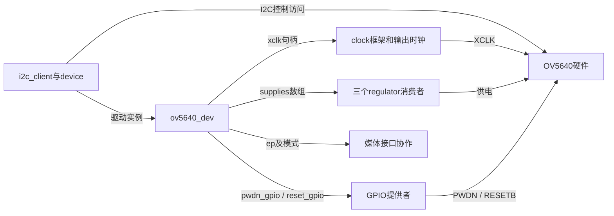
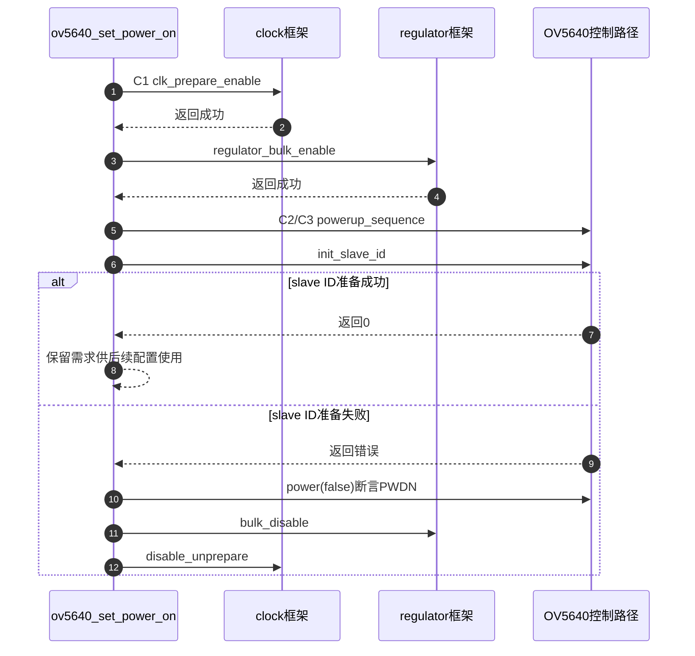

# 第2章\_OV5640怎样建立时钟供电与复位时序

摄像头的PAD配置成立以后，仍要按器件协议推进clock、电源、PWDN与复位。本篇追到固定驱动的状态及失败回退，解释为什么不能只选择一个`default`状态就宣布传感器准备完成。**讲解层次：实现层，固定NXP Linux 6.12.20。**

| 关联阅读 | 用途 |
| --- | --- |
| [总索引](../navigation/P01_组合外设源码阅读索引.md#1.1_版本与证据范围) | 版本、配置和其他模块 |
| [模块导读](../navigation/P02_资源准备与事件完成怎样交接.md#2.2_资源准备要区分句柄取得请求发出和硬件成功) | 资源准备之间的差别 |
| [应用C阶段](../../../../knowledge/driver_model/device_tree/P07_摄像头控制连接怎样成为图像数据流.md#7.3_用上电周期分清GPIO时序与pin状态) | 复用C0～C4的状态与物理意义 |

## 2.1\_资源取得与传感器状态的对应

上游为 [`drivers/media/i2c/ov5640.c`](https://github.com/nxp-imx/linux-imx/blob/dfaf2136deb2af2e60b994421281ba42f1c087e0/drivers/media/i2c/ov5640.c)，配置`CONFIG_VIDEO_OV5640`。`struct ov5640_dev`是每个传感器的软件对象，持有`i2c_client`、`xclk`、`supplies`、`pwdn_gpio`、`reset_gpio`及媒体端点/模式状态。

探测先查找并解析媒体端点，检查总线类型；再取得`xclk`并检查频率范围。PWDN与reset通过可选描述符接口取得，初值均为逻辑1。它们缺失可得到空指针，GPIO接口对这种可选描述符有相应处理；真实错误指针则返回失败。`ov5640_get_regulators()`建立三个供电消费者。资源取得没有代替后续使能，也没有直接启动图像输出。



对象图分开内存中的句柄与硬件信号。应用中的C0对应资源取得，C1对应框架需求建立，C2～C3改变控制脚，C4才进入后续配置和媒体协作。

## 2.2\_上电时序及失败回退的次序

下面是完整`ov5640_set_power_on()`，中文Doxygen和行内注释均为仓库补充。日志保留原文；函数调用的内部行为随后解释，不复制整个寄存器初始化表。

```c
/**
 * @brief 仓库补充阅读说明：建立C1条件，推进C2/C3，失败时配对回退。
 * @param sensor 当前传感器实例。
 * @return 成功为0，失败为相关调用的负错误码。
 * @note 这是可睡眠的设备电源路径，不是帧中断处理函数。
 */
static int ov5640_set_power_on(struct ov5640_dev *sensor)
{
    struct i2c_client *client = sensor->i2c_client;
    int ret;

    ret = clk_prepare_enable(sensor->xclk);
    if (ret) {
        dev_err(&client->dev, "%s: failed to enable clock\n", __func__);
        return ret;
    }

    ret = regulator_bulk_enable(OV5640_NUM_SUPPLIES,
                                sensor->supplies);
    if (ret) {
        dev_err(&client->dev, "%s: failed to enable regulators\n", __func__);
        goto xclk_off; /* 供电未成功，不重复走本函数的全供电关闭。 */
    }

    ov5640_powerup_sequence(sensor);

    ret = ov5640_init_slave_id(sensor);
    if (ret)
        goto power_off;

    return 0;

power_off:
    ov5640_power(sensor, false);
    regulator_bulk_disable(OV5640_NUM_SUPPLIES, sensor->supplies);
xclk_off:
    clk_disable_unprepare(sensor->xclk);
    return ret;
}
```

**实现原理：** clock失败时尚未进入供电阶段；bulk供电失败时由其接口处理相应已启用项的回退，本函数撤销clock请求；`ov5640_init_slave_id()`失败时则需要先让器件掉电状态有效，再撤销供电和clock。`OV5640_NUM_SUPPLIES`指本驱动的三个供电条目，不是任意板上电源轨总数。`dev_err`只记录诊断，真正控制返回/回退的是`ret`和跳转。

`ov5640_power()`通过`pwdn_gpio`写`enable ? 0 : 1`，因此`false`表示断言powerdown。`ov5640_powerup_sequence()`在PWDN存在时先断言reset和PWDN，等待5～10 ms，解除PWDN，等待1～2 ms，再释放reset；没有PWDN时改走软件复位。之后等待20～25 ms并请求软件standby，为寄存器准备留出条件。这些是本版驱动动作，不是本次板上测量。

该辅助函数返回`void`，其中软件复位/standby写寄存器的错误没有在这层完整传播。因此外层虽然检查clock、供电及slave ID路径，也不能宣称每一步都严格检查成功。保持这种区分，才能准确提出错误处理改进，而不是给源码补一份它没有的保证。



图选择“clock和供电均成功以后”的分支，早期失败在前文已经逐项说明。第5步无返回值检查不能被解读为硬件成功应答。外层电源管理还会执行后续接口配置；probe中的身份检查、媒体注册及失败清理各有额外步骤，本图不把它们伪装成已经完成。

## 2.3\_电源生命周期怎样连接媒体使用

探测经传感器resume建立电源状态，启动runtime PM管理，检查芯片身份并注册媒体子设备，随后允许自动休眠。失败路径会撤销PM及器件电源，再清理控制与媒体实体。正常电源关闭通过`ov5640_set_power_off()`断言PWDN、撤销供电及clock；其他共享使用者仍可能保留实际电源。

这些回调工作在允许等待和I2C访问的上下文。传感器对象还保存控制和模式状态并使用自己的锁协调相应操作；不能从“每设备一个结构体”推断所有调用都可以并发切电。本文只展开上电函数簇，不把帧接收器的IRQ、DMA或缓冲区生命周期移入传感器驱动。

**可修改性说明：** 改变GPIO先后次序必须核对PWDN缺失、有独立RESETB、模块组合PWUP等分支；改变供电顺序必须检查bulk接口、失败点与运行期PM配对。若将辅助函数改成可返回错误，需要同步所有调用者及回退标签，验证中途GPIO/I2C失败后的状态。验证不能只读到芯片ID，还需检查重新上电、停止后恢复和目标接口出流；本轮仅完成固定源码核对。
