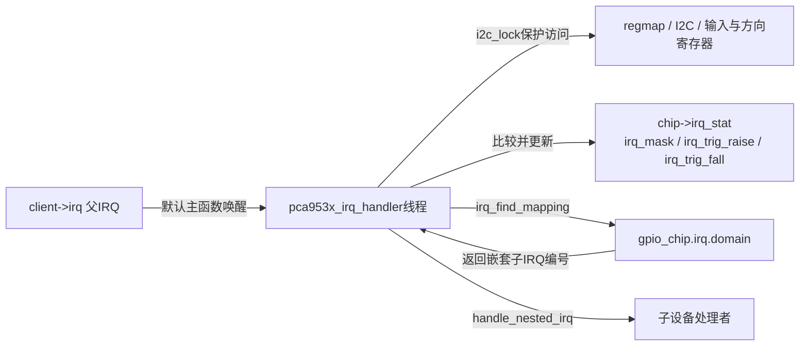
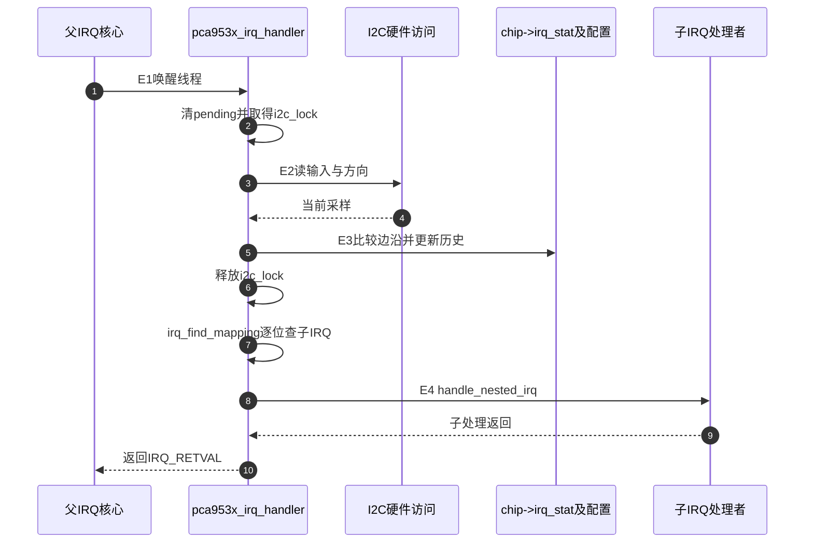

# 第3章\_PCA953x怎样比较输入并分派嵌套中断

扩展器INT只通知“有变化”，不能直接给出Linux子IRQ。本文追踪父IRQ线程怎样读取硬件、比较旧输入并进入子处理者，特别注意哪些状态是软件历史。**讲解层次：实现层，固定NXP Linux 6.12.20的普通PCA9539分支。**

| 关联阅读 | 用途 |
| --- | --- |
| [总索引](../navigation/P01_组合外设源码阅读索引.md#1.1_版本与证据范围) | 来源与配置条件 |
| [模块导读](../navigation/P02_资源准备与事件完成怎样交接.md#2.3_外部事件怎样通过历史状态找到消费者) | 先建立线程、硬件与历史采样关系 |
| [应用E阶段](../../../../knowledge/driver_model/device_tree/P08_扩展GPIO与共享中断怎样找到事件来源.md#8.3_从硬件输入到历史采样再到子IRQ) | E0～E4、硬件寄存器及按键K阶段映射 |

## 3.1\_父IRQ线程与每线状态如何建立

上游为 [`drivers/gpio/gpio-pca953x.c`](https://github.com/nxp-imx/linux-imx/blob/dfaf2136deb2af2e60b994421281ba42f1c087e0/drivers/gpio/gpio-pca953x.c)。`struct pca953x_chip`包含`gpio_chip`、I2C客户端、regmap以及`i2c_lock`。IRQ支持开启时，还包含`irq_stat`、`irq_mask`、上升/下降边沿位图和`irq_lock`。

`pca953x_irq_setup()`先检查父IRQ、配置和器件中断能力，读取输入及方向，形成`irq_stat`基线。它设置`gpio_chip.irq.threaded=true`，子处理为`handle_simple_irq`，没有安装硬中断parent handler或parents数组；父IRQ由本驱动另行申请为线程化IRQ。

下面裁剪初始化尾部；中文Doxygen为仓库补充，前面的读取、能力检查及girq字段设置未复制。

```c
/**
 * @brief 仓库补充阅读说明：申请可睡眠的父IRQ线程。
 * @note 摘自pca953x_irq_setup，不是独立函数。
 * NULL使用默认主处理函数；chip作为本注册者的稳定身份。
 */
ret = devm_request_threaded_irq(dev, client->irq, NULL, pca953x_irq_handler,
                              IRQF_ONESHOT | IRQF_SHARED, dev_name(dev),
                              chip);
if (ret)
    return dev_err_probe(dev, client->irq, "failed to request irq\n");
```

`IRQF_ONESHOT`配合线程期间的IRQ屏蔽，`IRQF_SHARED`允许与兼容注册者共线；设备来源仍需线程查询。特别留意此版本失败分支把`client->irq`传给`dev_err_probe`，不是上一行的`ret`。这是实际源码的返回值边界，不能在摘录时悄悄修成期望代码，再宣称与固定版本一致。



GPIO/IRQ配置回调修改mask与边沿配置，`irq_bus_lock`/`irq_bus_sync_unlock`配合配置期锁及必要硬件同步；输入采样路径使用`i2c_lock`保护设备访问。两把锁职责不同，不能写成“一把锁冻结所有硬件和软件状态”。

## 3.2\_用新旧输入推导哪些局部线需要处理

`pca953x_irq_pending()`的输入是当前chip和输出bitmap `pending`，返回是否存在应分派的位。先读取当前输入，失败就返回false；再读取方向，取得旧`irq_stat`。下段保留比较核心，变量声明及前面读取裁剪掉；中文注释是仓库补充。

```c
/**
 * @brief 仓库补充阅读说明：E3把一次采样转换成符合边沿配置的位图。
 * @note 以下摘自pca953x_irq_pending；各数组均有gc->ngpio位。
 */
bitmap_copy(old_stat, chip->irq_stat, gc->ngpio);

bitmap_and(new_stat, cur_stat, reg_direction, gc->ngpio);
bitmap_xor(cur_stat, new_stat, old_stat, gc->ngpio);
bitmap_and(trigger, cur_stat, chip->irq_mask, gc->ngpio);

bitmap_copy(chip->irq_stat, new_stat, gc->ngpio);

if (bitmap_empty(trigger, gc->ngpio))
    return false;

bitmap_and(cur_stat, chip->irq_trig_fall, old_stat, gc->ngpio);
bitmap_and(old_stat, chip->irq_trig_raise, new_stat, gc->ngpio);
bitmap_or(new_stat, old_stat, cur_stat, gc->ngpio);
bitmap_and(pending, new_stat, trigger, gc->ngpio);

return !bitmap_empty(pending, gc->ngpio);
```

**实现原理：** `reg_direction`中输入位为1，先与当前采样相与排除输出线；新旧值异或得到发生变化的位，再与`irq_mask`相与，仅保留参与通知的线。随后更新`chip->irq_stat`，即使当前没有匹配边沿，也把本次有效输入作为下一轮历史。

下降沿需要旧值为1，上升沿需要新值为1；两组条件合并后再与变化位相与，得到`pending`。临时数组名称在后半段被复用，不能一直把`cur_stat`理解成原始硬件读值。`gc->ngpio`限定当前器件线数，不能把`MAX_LINE`容量当作每颗芯片实际提供的GPIO数。

例如第5路旧值1、新值0、方向输入、mask允许且下降沿开启，则该位进入pending；若旧值与新值相同，即使中间曾跳变，当前比较也不能还原那个事件。这是采样模型的边界。

此版本对输入读取失败有显式返回，但方向读取的返回值未在此处检查。它不是“所有寄存器读失败都会严格停止”的实现。研究异常路径时需要保留这个事实，不能根据正常路径推演出源码未提供的错误保证。

## 3.3\_父线程怎样调用子处理者并结束本轮

线程先清空pending，在`scoped_guard(mutex, &chip->i2c_lock)`作用域内调用pending计算；离开作用域后才逐位查找映射并调用`handle_nested_irq()`。这样不会带着I2C访问锁进入可能再次读取GPIO的子处理者。未映射位会记录限速警告并跳过，不能把局部线号直接拿来调用Linux IRQ。



这是正常映射存在的路径。没有pending或没有成功调用任何子IRQ时，线程返回未处理结果；调用过匹配子IRQ则报告处理过。该结果不表示应用已经读取完输入事件，也不证明硬件不会立即出现下一次变化。

`CONFIG_GPIO_PCA953X_IRQ`关闭时，替代setup路径不会建立这套中断处理；在检测到需要IRQ的条件下会告警，但GPIO功能仍可存在。启用GPIO驱动与启用其IRQ功能不能当作同一个证据。

**可修改性说明：** 若调整采样算法，要同时审查输入方向变化、mask/边沿配置、基线初始化、读取错误和子IRQ未映射分支；若把锁范围扩到子回调，需检查子回调再次进入GPIO访问形成的锁依赖。若要保证短脉冲不丢，应先检查硬件是否提供所需锁存或计数能力，而不是只改bitmap公式。普通PCA9539与PCAL扩展能力不能无条件混合。移除、PM和唤醒路径还需由设备生命周期约束停止新请求，devm释放IRQ不等于自动完成所有板级断电协议。
