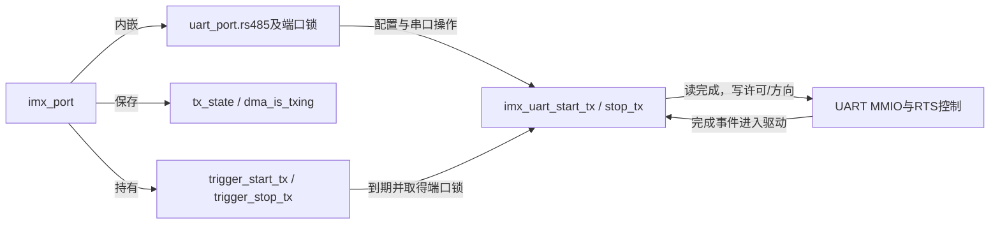
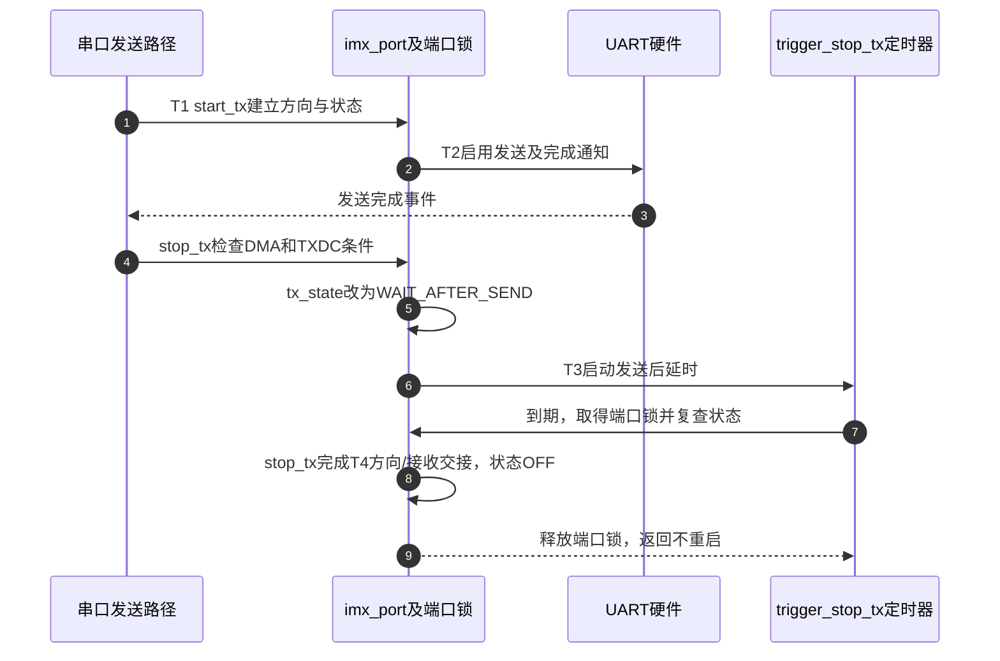

# 第4章\_iMX串口怎样在发送完成后释放方向

串口队列没有新字节时，最后一字节可能仍在移位器中。本篇追踪固定i.MX驱动如何等到发送完成，再执行发送后延时并释放方向。**讲解层次：实现层，固定NXP Linux 6.12.20。**

| 关联阅读 | 用途 |
| --- | --- |
| [总索引](../navigation/P01_组合外设源码阅读索引.md#1.1_版本与证据范围) | 来源和配置条件 |
| [模块导读](../navigation/P02_资源准备与事件完成怎样交接.md#2.4_发送完成由哪个事件授权释放方向) | 完成中断与定时器的分工 |
| [应用T阶段](../../../../knowledge/driver_model/device_tree/P09_RS485方向控制为什么必须等待发送完成.md#9.2_从方向有效到最后停止位再到释放总线) | T0～T4的物理意义 |
| [本地寄存器表](../../../../knowledge/driver_model/device_tree/P09_RS485方向控制为什么必须等待发送完成.md#9.4_iMX驱动在哪里区分FIFO空与发送完成) | MMIO偏移、TXDC与TXFE区别 |

## 4.1\_每端口发送状态与支持能力

上游为 [`drivers/tty/serial/imx.c`](https://github.com/nxp-imx/linux-imx/blob/dfaf2136deb2af2e60b994421281ba42f1c087e0/drivers/tty/serial/imx.c)，相关配置`CONFIG_SERIAL_IMX`。每端口`struct imx_port`内嵌`uart_port`，还保存`tx_state`、DMA发送状态和`trigger_start_tx`/`trigger_stop_tx`定时器。`uart_port.rs485`保存本端口接受后的RS-485请求。

probe设置`rs485_config=imx_uart_rs485_config`，只在有RTS硬件能力或RTS GPIO路径时提供对应`rs485_supported`。`mctrl_gpio_init`建立受支持的调制解调器控制GPIO；这不是任意名为DE的GPIO都会自动进入驱动。通用串口核心处理配置清理和ioctl，本节只拥有i.MX端口的具体使用。



T0对应`OFF`，T1对应`WAIT_AFTER_RTS`，T2对应`SEND`，T3对应`WAIT_AFTER_SEND`，T4完成后回到`OFF`。状态属于端口软件，UART移位器仍按硬件时钟发送；端口锁协调软件入口，不能冻结移位器。

## 4.2\_停止发送必须先跨过硬件完成条件

`imx_uart_start_tx()`在`OFF`时按配置设置RTS，处理发送期间接收策略，进入`WAIT_AFTER_RTS`；有发送前延时则启动开始定时器，否则继续进入`SEND`并启用相应发送路径。若原状态是尾部等待，会取消停止定时器并恢复发送，防止旧定时器在新报文中途撤销方向。

停止路径首先检查`dma_is_txing`，DMA尚未完成时返回；然后关闭发送就绪中断并读取完成状态。下段摘录自`imx_uart_stop_tx()`，省略前面的局部对象取得和后面的RS-485状态处理。中文Doxygen和行内说明是仓库补充。

```c
/**
 * @brief 仓库补充阅读说明：T2检查移位器完成后才进入尾部状态。
 * @note 摘自imx_uart_stop_tx，调用者须保持端口同步约束。
 */
ucr4 = imx_uart_readl(sport, UCR4);
usr2 = imx_uart_readl(sport, USR2);
if ((!(usr2 & USR2_TXDC)) && (ucr4 & UCR4_TCEN)) {
    /* 移位器仍忙，等待发送完成事件再次推进。 */
    return;
}

ucr4 &= ~UCR4_TCEN;
imx_uart_writel(sport, ucr4, UCR4);
```

`imx_uart_readl/writel`通过端口映射访问硬件；`UCR4_TCEN`是完成中断许可，`USR2_TXDC`是发送器完成状态。这里条件包含TCEN，不能把源码改述成所有路径都无条件轮询TXDC。正常RS-485发送路径会安排完成许可，DMA分支在其回调阶段配合建立它，随后完成事件使停止路径继续。

进入RS-485分支后，若处于`SEND`，驱动先改为`WAIT_AFTER_SEND`；有`delay_rts_after_send`就启动停止定时器并返回。没有延时则继续调整RTS、按条件恢复接收，并写回`OFF`。RTS的有效/无效辅助路径还涉及硬件RTS和GPIO实现差量，不能仅根据函数名推断板上DE的最终电平。

**实现原理：** DMA完成、发送器完成、可选尾部延时完成是三个不同条件。定时器是最后一个条件的实现，不能替代前两个；软件状态防止这些不同执行路径各自重复收尾。若新数据在尾部进入，必须与停止定时器协调，而不是让新旧周期同时拥有方向控制权。

## 4.3\_定时器怎样返回受保护的停止路径

下面保留完整停止定时器回调；中文Doxygen为仓库补充。开始定时器对应检查`WAIT_AFTER_RTS`并调用`imx_uart_start_tx`，采用同样的端口锁配对，故不复制第二份近似函数体。

```c
/**
 * @brief 仓库补充阅读说明：T3到期后重新检查状态，再完成T4。
 * @param t 嵌在当前imx_port中的停止定时器。
 * @return HRTIMER_NORESTART，不由本次回调自动周期重启。
 */
static enum hrtimer_restart imx_trigger_stop_tx(struct hrtimer *t)
{
    struct imx_port *sport = container_of(t, struct imx_port, trigger_stop_tx);
    unsigned long flags;

    uart_port_lock_irqsave(&sport->port, &flags);
    if (sport->tx_state == WAIT_AFTER_SEND)
        imx_uart_stop_tx(&sport->port);
    uart_port_unlock_irqrestore(&sport->port, flags);

    return HRTIMER_NORESTART;
}
```

`container_of`从定时器成员定位端口对象；`flags`保存进入锁之前的本地IRQ状态，退出时恢复。重新检查`tx_state`可避免状态已改变时继续旧收尾。hrtimer及端口锁上下文不能执行任意可睡眠GPIO事务，因此“用I2C扩展器接一个RTS GPIO即可等价替换”需要额外实现支持，不能由DT语法推断。



图选择没有新数据插入的正常周期。若T3期间到达新字节，开始路径取消旧停止计时并恢复发送；端口锁和状态复查把这一分支与图中第7～8步协调起来。不能通过删除状态判断来“减少一次分支”。

## 4.4\_修改方向行为需要同时验证哪些路径

最小修改面取决于需求：仅改变延时应走支持的配置请求；改变硬件RTS电平映射需要同时核对DTE/DCE、接收开关及GPIO路径；改变发送完成条件需要同时审查PIO、DMA、发送中断、定时器和关闭端口路径。

关闭端口还要停止传输、处理中断与定时器并使线路处于可接受状态，不能仅释放`imx_port`内存。修改后至少验证无延时/有延时、DMA/非DMA、尾部到达新数据、关闭时仍有发送，以及低有效RTS与接收组合限制。输出证据应包含配置回读、驱动状态与TX/方向波形；本轮没有执行这些目标硬件路径。
