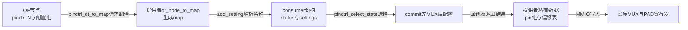

# 第2章\_从描述到选择与硬件落点导读

已经能从DT找到UART引脚组，下一步若直接搜索一个 `writel`，很容易跳过真正的问题：这个组是否属于当前consumer的state，这个state是否被选过，以及这次选择是否完整成功。本导读沿一次工作状态切换组织源码对象和调用，不逐句复制函数体。

**讲解层次：实现层，NXP Linux 6.12.20，版本身份见 [总索引](P01_Linux_6.12_pinctrl源码阅读索引.md#1.1_版本边界与阅读路线)。** 通用core与i.MX6UL提供者分层阅读，不把提供者的编码或回调选择当作所有平台的契约。

## 2.1\_一条配置如何经过三个持有者

最初的描述在OF设备树节点里，包含状态名称和配置节点引用。消费者取得句柄后，core将其整理为命名状态和设置列表。提供者保存实际pin、组、功能与寄存器映射，接到设置请求时才执行硬件操作。这三个持有者回答不同问题：固件想表达什么，consumer可选择什么，控制器怎样兑现。

图中描述、状态对象和寄存器不是三份自动同步的镜像。取得句柄只建立前半条链；选择动作才走后半条链。如果外部程序直接改寄存器，不能期待consumer的 `state` 指针随之更新。

字段及生命周期入口是 [句柄状态与设置](../source_explanations/P01_状态映射选择与探测交接.md#1.1_句柄状态与设置分别保存什么)，DT属性的连续编号、空状态和缺名字分支见 [映射建立](../source_explanations/P01_状态映射选择与探测交接.md#1.2_从连续属性建立映射与状态)。这些分支先决定有没有可选状态，还不能回答PAD当前值。

## 2.2\_把源码路径放进同一个切换周期

本文沿用 [知识正文的P0～P6](../../../../knowledge/driver_model/device_tree/P03_引脚状态切换与GPIO占用交接.md#3.3_沿一次切换规定谁先停止谁后继续)，不另建一套阶段编号。该周期包含设备业务状态、core选择记录、pin占用和硬件配置，不能缩成一个state指针的二态变化。

| 公共阶段 | 此版本源码落点与参与者 | 当前证据与交接 |
| --- | --- | --- |
| P0，配置建立 | get/create → DT map → add_setting → lookup | 句柄持有命名state及settings；还没有由lookup执行选择 |
| P1，旧用途静止 | consumer自己的I/O、DMA、IRQ及操作周期锁 | core没有通用函数替所有外设排空，必须查真实驱动 |
| P2，执行配置 | select/commit → pinmux/pinconf → 提供者 | 调整占用，逐项写MUX，再逐项写电气配置 |
| P3，成功 | commit写当前state并返回0 | 本次调用完成；驱动才可按业务协议继续 |
| P4，失败 | commit清理部分记录并尝试重施旧state | 可能有部分寄存器已变，返回原错误不证明恢复完整 |
| P5，恢复 | consumer恢复路径或实际PM回调选择工作状态 | 资源可访问、配置与外设恢复顺序要按设备核对 |
| P6，移除 | consumer先停止入口，devres/put再清理 | 软件对象及占用归还，不承诺自动还原固件配置 |

probe是这个机制的一个调用场景：设备核心在probe前选择init或default，probe后条件满足时尝试从init切到default。PM则必须找实际调用者；名称叫sleep不会自动触发。两者共享选择器，却有不同触发条件和错误传播，分别进入 [探测交接](../source_explanations/P01_状态映射选择与探测交接.md#1.4_设备探测怎样交接init与default) 与 [PM辅助接口](../source_explanations/P01_状态映射选择与探测交接.md#1.5_PM辅助接口只执行被调用的选择)。

源码阅读时应先在consumer中找P1和P5，再进入 [选择实现](../source_explanations/P01_状态映射选择与探测交接.md#1.3_选择过程为何不是原子事务) 的时序图核对P2～P4。这样才能判断“漏了选择”与“选择时机不对”，而不只是证明函数存在。

控制器还可以成为自己的consumer，用default状态应用不属于独立外设的板级配置。这种pinctrl hog同样复用上述对象和选择器，触发点在控制器启用路径；它与gpiolib逐线hog不是同一种占用。具体初始化、错误和寿命见 [控制器自身状态消费者](../source_explanations/P01_状态映射选择与探测交接.md#1.6_控制器怎样成为自己的状态消费者)。

## 2.3\_提供者把通用设置兑现到硬件

以i.MX6UL为例，普通 `fsl,pins` 条目由六cell构成。提供者把MUX/PAD偏移存入按pin ID索引的表，把模式、输入选择和PAD值放入组的逐pin数据。映射回调再生成MUX组设置与逐pin配置设置。选择时分别调用mux和pinconf回调，才将这些值写到IOMUXC。

因此有两次不同的名称解析：DT节点先找到组，通用map又被转换成selector和配置setting；两者都不应画成硬件数据流。具体保存位置见 [六cell解析](../source_explanations/P02_iMX6UL配置解析与寄存器落点.md#2.1_六个cell怎样成为组和逐pin配置)，map职责见 [映射回调](../source_explanations/P02_iMX6UL配置解析与寄存器落点.md#2.2_映射回调生成设置而没有执行选择)，实际地址与读写效果见 [寄存器落点](../source_explanations/P02_iMX6UL配置解析与寄存器落点.md#2.3_选择时分别写MUX输入选择与PAD)。

同一PAD用于GPIO时，线编号还需经 `gpio-ranges` 转换为提供者pin ID。GPIO请求参与pin占用检查，但是否自动设置复用取决于提供者回调；i.MX6UL不能仅据request成功推断已经写入GPIO模式。这个问题只在GPIO交接时出现，进入 [GPIO请求与释放](../source_explanations/P02_iMX6UL配置解析与寄存器落点.md#2.4_GPIO请求怎样经过pin占用而不承诺自动复用) 核对，不要把它强加到纯UART配置路径。

## 2.4\_观察位置与不能证明的结论

现在可以按链路逐段选择观察点。若只看设备树，无法区分状态没有选择与选择后被覆盖；若只看一个寄存器，又不知道是谁写的。排障需要让证据对应到同一consumer、同一状态和同一次事件。

| 观察对象 | 固定实现中的入口 | 能证明什么 | 不能证明什么 |
| --- | --- | --- | --- |
| 最终属性 | 运行中的OF树，或实际启动DTB | 当前描述及引用关系 | 不证明驱动执行了select |
| 提供者/映射/句柄 | debugfs根的 `pinctrl-devices`、`pinctrl-maps`、`pinctrl-handles` | 已注册对象、映射与consumer状态记录 | 不是寄存器全量镜像 |
| pin与组 | 控制器目录的 `pins`、`pingroups`、`gpio-ranges` | 提供者编号、组和范围 | 不代表外部连接正确 |
| 占用与配置观察 | `pinmux-pins`、可用的 `pinconf-pins` 等 | 实现暴露的owner及配置读回 | 不保证显示全部硬件字段 |
| 选择路径日志 | 相应文件实际存在的dynamic debug调用点 | 被执行的路径及返回结果线索 | 没日志可能只是没启用，不证明未调用 |
| 指定寄存器 | 提供者资源、偏移和访问规则核对后的读回 | 该时刻对应字段 | 不证明波形、协议、供电与未来行为 |

这些debugfs入口由 `drivers/pinctrl/core.c`、`pinmux.c`、`pinconf.c` 注册，依赖配置和回调，不是稳定用户空间ABI。通用的 `consumer/state`、`info` 等路径不能凭想象使用。`pinmux-select` 若存在，是直接选group/function的调试写口；它绕过完整state选择，不自动执行配套pinconf、设备停机和PM同步，不适合作为生产状态切换接口。

可执行的只读采集脚本、日志开关及证据组合见 [诊断正文](../../../../knowledge/driver_model/device_tree/P04_沿状态与寄存器定位引脚问题.md)。本导读不把静态源码核对标成板级验证；真正的收发与休眠唤醒仍需目标环境证据。

回到 [总索引](P01_Linux_6.12_pinctrl源码阅读索引.md) 可以按函数进入唯一实现标题。读完本导读，至少应能指出一个故障停在P0、P2还是P5，并说明下一条证据应观察软件对象还是硬件寄存器。
