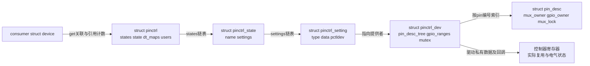
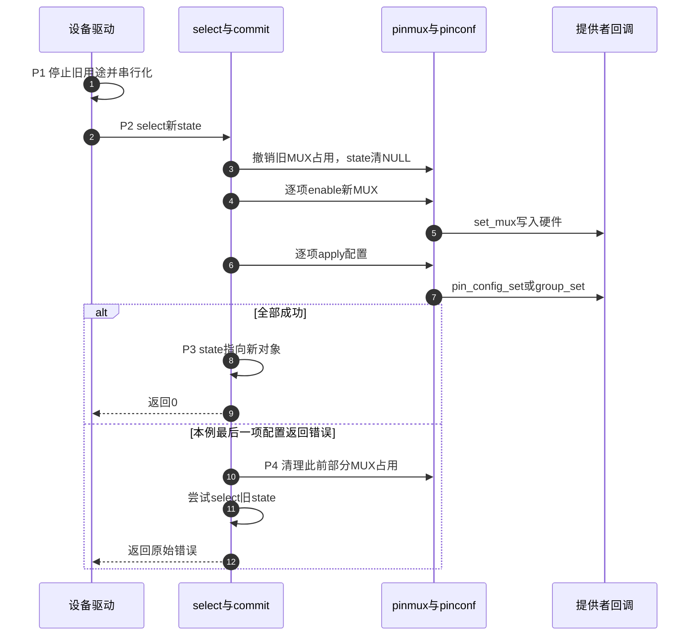

# 第1章\_状态映射选择与探测交接

消费者已经声明 work 和 quiet 两个状态，但声明存在并不能回答“此刻选择了哪一个，选择中途失败以后又剩下什么”。本篇沿句柄建立、状态选择和设备探测交接阅读实现，固定这些问题各自由哪份状态回答。

**讲解层次：实现层，NXP Linux 6.12.20 固定提交。** 下文源码来自上述提交，摘录中的中文 Doxygen 和行内注释为仓库补充，非上游原文；用省略注释明确裁剪位置，不把片段当作可独立编译的替代实现。

| 阅读任务 | 入口 |
| --- | --- |
| 确认版本、配置及全部模块 | [总索引](../navigation/P01_Linux_6.12_pinctrl源码阅读索引.md#1.1_版本边界与阅读路线) |
| 先看模块协作与阶段 | [描述到选择导读](../navigation/P02_从描述到选择与硬件落点导读.md#2.1_一条配置如何经过三个持有者) |
| 查看驱动使用与完整示例 | [状态切换正文](../../../../knowledge/driver_model/device_tree/P03_引脚状态切换与GPIO占用交接.md#3.3_沿一次切换规定谁先停止谁后继续) |
| 沿提供者进入寄存器 | [i.MX6UL 实现](P02_iMX6UL配置解析与寄存器落点.md#2.3_选择时分别写MUX输入选择与PAD) |

## 1.1\_句柄状态与设置分别保存什么

一个设备需要能够记住多套配置，且一个状态可能横跨多个控制器。只保存“当前模式整数”不够：选择时还得知道每条设置交给谁，释放时还得知道谁持有这些对象。因此 core 将消费者句柄、命名状态和设置条目分开，控制器对象则由提供者注册。

声明位于 [drivers/pinctrl/core.h](https://github.com/nxp-imx/linux-imx/blob/dfaf2136deb2af2e60b994421281ba42f1c087e0/drivers/pinctrl/core.h)，建立及释放位于 [drivers/pinctrl/core.c](https://github.com/nxp-imx/linux-imx/blob/dfaf2136deb2af2e60b994421281ba42f1c087e0/drivers/pinctrl/core.c)。当前需要的字段如下。

| 载体及字段 | 初始化与写入者 | 读取者及生命期 |
| --- | --- | --- |
| `pinctrl.dev`、`states`、`dt_maps` | `create_pinctrl` 关联consumer并初始化链表，解析路径登记映射和状态 | lookup/select及释放路径读取；随句柄释放 |
| `pinctrl.state` | 选择开始清空，全部应用成功后写入新state | 同状态快捷判断、初始化交接、debugfs读取；不是硬件镜像 |
| `pinctrl.users` | 新句柄初始化kref，重复get增加引用 | put减引用，最后一次进入release/free |
| `pinctrl_state.name/settings` | `create_state` 建立名字与链表，`add_setting` 插入条目 | lookup按名字找；commit按settings执行 |
| `pinctrl_setting.type/pctldev/dev_name/data` | `add_setting` 保存类型、提供者、consumer身份及解析后的组/功能或配置 | pinmux/pinconf路径分派；随state清理 |
| `pinctrl_dev.pin_desc_tree/gpio_ranges/mutex` | 控制器注册与范围登记建立逐pin索引和GPIO映射 | pin请求/释放和控制器操作；属于提供者，不属于consumer |
| `pin_desc.mux_owner/mux_usecount/gpio_owner/mux_lock` | pin请求、释放路径维护并在mux_lock下检查 | 冲突检查与诊断读取；不保存外设传输是否完成 |



图中框表示软件对象，只有最右侧是硬件状态；箭头表示指针、索引或实际回调路径。`state` 指针更新不会自动读取寄存器，外部绕过框架写硬件也不会自动改变它。

下面摘取 `create_pinctrl` 的建立动作，省略映射遍历和错误清理，完整分派在下一节解释。

```c
/**
 * @brief 仓库阅读说明：为一个消费者建立状态容器。
 * @param dev 消费者设备；pctldev非空用于控制器自身的hog路径。
 * @return 有效句柄或错误指针。这里的分配不等于硬件选择。
 */
/* create_pinctrl() 内的连续建立片段。 */
p = kzalloc(sizeof(*p), GFP_KERNEL);
if (!p)
    return ERR_PTR(-ENOMEM);
p->dev = dev;
INIT_LIST_HEAD(&p->states);       /* 等待add_setting建立命名状态。 */
INIT_LIST_HEAD(&p->dt_maps);      /* 保存本句柄产生的DT映射以便释放。 */
ret = pinctrl_dt_to_map(p, pctldev);
if (ret < 0) {
    kfree(p);
    return ERR_PTR(ret);
}
/* 后续按consumer遍历映射、建立setting，成功后初始化users并登记句柄。 */
```

**实现原理。** `pinctrl_get` 先按设备查已存在句柄；存在则增加 `users`，否则创建。设备核心与驱动各自取得同一设备的句柄，可能共享同一状态对象。`devm_pinctrl_get` 再用 devres 包装 get/put，并不是另一套独立硬件状态。`pinctrl_put` 最后一个引用触发 `pinctrl_release`，后者遍历状态和设置，清理当前状态的mux占用、释放设置及DT映射，最后释放句柄。put不承诺恢复固件配置，已取得的state指针也不能继续使用。

全局句柄表与映射表分别有mutex，逐pin占用另有锁。这些锁服务各自对象；`pinctrl_select_state` 本身没有替消费者串行化整段设备业务。驱动仍需防止remove、PM和普通I/O无约束地使用同一句柄。

**可修改性说明。** 改动state或setting生命期时必须同时检查get/put、devres、失败释放和debugfs遍历；不能只修改成功创建路径。新增状态字段应明确其初始化与清空时刻。改变同一设备共享句柄的规则会影响设备核心的init交接判断，验证应包括重复get、最后一次put及设备解绑，不能只测一次probe。

## 1.2\_从连续属性建立映射与状态

现在已有容器，尚缺每个状态应执行哪些设置。DT路径先让提供者把配置节点翻译为map，再由core把map中的名称解析为可执行setting。两级转换允许不同控制器采用不同的DT编码，同时让选择阶段面对统一的类型。

源码入口是 [devicetree.c 的 pinctrl_dt_to_map](https://github.com/nxp-imx/linux-imx/blob/dfaf2136deb2af2e60b994421281ba42f1c087e0/drivers/pinctrl/devicetree.c)，随后回到 `core.c:create_pinctrl/add_setting`。下列片段取自属性查找与名称确定部分，省略前置OF节点检查、分配和失败分支；`prop` 是刚找到的 `pinctrl-N` 属性。

```c
/**
 * @brief 仓库阅读说明：属性内容按phandle逐cell解释，名称另行读取。
 * @note state是从0连续递增的编号；属性缺失会结束扫描。
 */
list = prop->value;
size /= sizeof(*list);              /* 属性字节数转为32位cell个数。 */
ret = of_property_read_string_index(np, "pinctrl-names",
                                    state, &statename);
if (ret < 0)
    statename = prop->name + strlen("pinctrl-");
/* 后续每次be32_to_cpup(list++)取得一个phandle，查配置节点并调用提供者。 */
```

实际循环从 `pinctrl-0` 开始构造属性名。首项不存在返回 `-ENODEV`；后续遇到缺项即停止，不再搜索更大编号。名字表没有对应字符串时使用属性名中的数字后缀，比如 `"1"`。空属性存在但没有phandle时会生成dummy map，因而可以有一个没有setting的合法状态；这与根本没有属性不同。

每个phandle经 `of_find_node_by_phandle` 找到配置节点。`dt_to_map_one_config` 沿父节点找到提供者，调用其 `dt_node_to_map`，再记住生成的map用于后续释放。提供者未就绪可能导致延迟探测；无效phandle和解析错误则沿错误路径释放已生成的DT映射。此处没有“按 `#pinctrl-cells` 为每个phandle追加N个参数”的规则。该属性在本文件另一些绑定辅助函数中存在，不能借其名字改写consumer列表的解析。

`create_pinctrl` 在映射表锁下筛选本设备的map，`add_setting` 按状态名查找或创建state；dummy类型只建立state，其他类型分配setting并找到提供者。MUX类型由 `pinmux_map_to_setting` 把功能/组名解析为selector；CONFIGS类型由 `pinconf_map_to_setting` 处理pin或组及配置。成功后插入 `state->settings`，没有在这里执行一次完整硬件选择。

**实现原理。** map描述来源与命名关系，setting保存当前内核可以执行的目标。二者不能混写成 `pinctrl_state.maps[]`。P0结束时consumer已有状态与设置；P2才会执行它们。i.MX生成map的细节见 [配置变成设置而未写硬件](P02_iMX6UL配置解析与寄存器落点.md#2.2_映射回调生成设置而没有执行选择)。

**可修改性说明。** 若修改属性遍历方式，必须同时检查空状态、编号缺口、缺名字、无效phandle、多提供者以及延迟探测后重试；否则“可以解析第一块板”会掩盖绑定语义变化。改变map分配必须与 `dt_free_map`、错误回收配对。不要在DT解析回调加入硬件写入，否则P0获取句柄就可能改变仍在工作的信号。

## 1.3\_选择过程为何不是原子事务

P1由设备驱动停止旧用途后，P2进入core。选择器面对的是一组回调，并没有通用硬件影子寄存器、提交位或完整寄存器快照，无法把所有写入包装成一个不可分割动作。

`core.c:pinctrl_select_state` 的完整短函数如下。

```c
/**
 * @brief 仓库阅读说明：选择一个属于本句柄的有效state。
 * @param p 消费者句柄，调用者必须保证生命期及操作串行化。
 * @param state 已成功lookup得到的状态，不得传错误指针。
 * @return 0或负错误；同一state对象可直接成功而不再次写硬件。
 */
int pinctrl_select_state(struct pinctrl *p, struct pinctrl_state *state)
{
    if (p->state == state)
        return 0;

    return pinctrl_commit_state(p, state);
}
```

`pinctrl_commit_state` 首先用 `READ_ONCE(p->state)` 保存旧state，遍历旧state的MUX设置，调用 `pinmux_disable_setting` 撤销软件占用；随后把 `p->state` 置NULL。它先遍历新state的所有MUX设置，经 `pinmux_enable_setting` 取得pin并调用提供者 `set_mux`，再遍历CONFIGS设置，经 `pinconf_apply_setting` 调用对应pin或组配置回调。只有两轮均成功才写 `p->state = state`。

`READ_ONCE` 只是读取该指针的方式，不把上述两轮循环变成互斥事务，也不等待UART发送完成。某些提供者请求 `link_consumers` 时，选择路径还创建到提供者的设备链接，带 Runtime PM 与consumer移除标志；控制器自身hog跳过这一链接以避免环。设备链接也不是寄存器回滚日志。



步骤3清理的是软件mux记录；步骤5、7才会有具体硬件写入。图中错误固定在最后一项配置返回时出现；如果更早的MUX回调失败，后续配置调用会被跳过。步骤8只在成功路径发生；失败分支可能已执行部分写入，因而不能把返回错误解释成“什么也没发生”。这是与 [正文P0～P6](../../../../knowledge/driver_model/device_tree/P03_引脚状态切换与GPIO占用交接.md#3.3_沿一次切换规定谁先停止谁后继续) 相同的周期，图只放大P2～P4。

失败路径的末尾直接揭示恢复保证的边界：

```c
/**
 * @brief 仓库阅读说明：commit失败路径末尾；ret仍是新状态的原始错误。
 * @note 此前已按setting位置清理部分MUX记录，不能反向还原任意PAD写入。
 */
/* p->state此前已置NULL，重施旧state不会因指针相等而跳过。 */
if (old_state)
    pinctrl_select_state(p, old_state);  /* 这里未把恢复调用结果作为返回值。 */
return ret;
```

**实现原理。** 这个恢复是重新执行旧设置，不是逐寄存器还原快照。新状态可能修改了旧状态未覆盖的pin或字段，恢复调用也可能失败。驱动需要根据设备要求保持停止、复位或报告故障，不能无条件继续业务。若其他代码已绕过框架修改硬件，而 `p->state` 仍指向旧对象，重复选择同一对象还可能命中快捷返回。

`include/linux/pinctrl/consumer.h` 在 `CONFIG_PINCTRL=n` 时提供若干返回NULL或0的stub；`CONFIG_PM=n` 时PM辅助接口也可无动作成功。这是配置兼容路径，不能证明实际执行过上述回调。关闭 `CONFIG_DEBUG_FS` 只移除观察入口，不取消功能状态和驱动的串行化责任。

**可修改性说明。** 改变两轮执行顺序会改变瞬态电气行为；新增回滚必须清楚说明哪些寄存器可读、是否有副作用、提供者资源是否可用。删除同state快捷返回会改变每次调用的成本与副作用，不能以“方便恢复”为由局部改动。验证至少覆盖第二条设置失败、恢复再次失败、同state重复选择、多控制器状态和PM/remove交错；仅检查返回0不足以验证硬件结果。

## 1.4\_设备探测怎样交接init与default

配置文件不主动调用select。probe前后之所以出现自动选择，是设备核心显式执行了两个入口。[drivers/base/pinctrl.c](https://github.com/nxp-imx/linux-imx/blob/dfaf2136deb2af2e60b994421281ba42f1c087e0/drivers/base/pinctrl.c) 的 `pinctrl_bind_pins` 为 `dev->pins` 分配 `struct dev_pin_info`，取得句柄，查找default，再决定是否先用init。

```c
/**
 * @brief 仓库阅读说明：已取得default之后，选择probe使用的初始配置。
 * @note 摘自pinctrl_bind_pins；省略分配、default查找及后续错误清理。
 */
dev->pins->init_state = pinctrl_lookup_state(dev->pins->p,
                                           PINCTRL_STATE_INIT);
if (IS_ERR(dev->pins->init_state)) {
    ret = pinctrl_select_state(dev->pins->p,
                               dev->pins->default_state);
} else {
    ret = pinctrl_select_state(dev->pins->p, dev->pins->init_state);
}
```

`PINCTRL_STATE_INIT/DEFAULT` 是标准状态名称常量。找不到default会清理句柄与 `dev->pins`，返回成功；因此只有init而无default不会获得同样的自动交接。此函数还跳过 `of_node_reused` 的设备。初始容器分配失败直接返回 `-ENOMEM`；后续清理路径只向上传递 `-EPROBE_DEFER` 和 `-EINVAL`，其他错误按该实现规则忽略，不能概括成“任何选择失败都阻止probe”。

probe成功后，[drivers/base/dd.c](https://github.com/nxp-imx/linux-imx/blob/dfaf2136deb2af2e60b994421281ba42f1c087e0/drivers/base/dd.c) 调用 `pinctrl_init_done`。后者要求 `dev->pins` 存在、init/default有效，且当前指针仍等于init，才选择default。驱动如果已主动切到别的state，该条件不成立，不会覆盖驱动选择。

这里还有返回值边界：`pinctrl_init_done` 会打印选择失败并返回错误，但该版本 `really_probe` 中的调用没有接收这个返回值。所以“probe最终成功”本身不能证明init到default的最后选择成功。排障必须结合日志和真实状态检查，而不能只看driver符号链接。

**实现原理与可修改性。** 设备核心保存的 `dev->pins` 是标准状态缓存，驱动自行get/lookup仍使用consumer句柄。改变init完成判断会影响主动切状态的驱动；改变错误传递会改变设备是否绑定和延迟探测行为，必须同时核对dd.c调用者、devres清理、无default设备与失败重试。不要为修复某块板的状态缺失而把全局规则改成“所有设备都必须有sleep”。

## 1.5\_PM辅助接口只执行被调用的选择

probe建立的sleep/idle缓存不会自己监听系统电源事件。设备的真实PM回调必须选择状态，且要确定选择前后外设、时钟、DMA和唤醒输入的顺序。

`core.c` 的sleep helper是一个很短的适配层：

```c
/**
 * @brief 仓库阅读说明：选择已缓存的sleep状态，不负责设备停机。
 * @param dev 已参与设备核心pinctrl绑定的设备。
 * @return 没有pins时返回0；有状态时返回选择结果。
 */
int pinctrl_pm_select_sleep_state(struct device *dev)
{
    if (!dev->pins)
        return 0;
    return pinctrl_select_bound_state(dev, dev->pins->sleep_state);
}
```

被调用的 `pinctrl_select_bound_state` 对错误状态指针也直接返回0，表示该可选状态不存在；否则select，失败打印状态名并返回错误。default helper最终进入default选择，idle helper使用idle缓存。它们返回 `int`，不是 `void`；调用者是否检查返回值又是下一层事实。

例如固定 [drivers/tty/serial/imx.c](https://github.com/nxp-imx/linux-imx/blob/dfaf2136deb2af2e60b994421281ba42f1c087e0/drivers/tty/serial/imx.c) 的 `imx_uart_suspend_noirq` 保存上下文、关闭ipg时钟后调用sleep helper；`imx_uart_resume_noirq` 先调用default helper，再启用时钟并恢复上下文。这两个位置没有传播pinctrl helper错误。这能证明有真实调用路径，不能证明每次硬件选择都成功，更不能推广成其他外设的固定电源顺序。

**实现原理与可修改性。** helper只承担P2/P5的配置选择，P1停机及P3之后的降电仍归设备协议。若一个板型必须有sleep才能安全断电，应在驱动策略中明确要求、取得状态并处理选择失败，而不能依赖“缺状态返回0”。修改helper错误策略会影响大量允许省略状态的设备；验证应区分 `CONFIG_PM` 开关、无pins、有pins无sleep、有效sleep成功和回调失败。debug日志只辅助观察，不替代外设静止和PAD实际电平的验证。

读完本篇应能解释：句柄建立为什么不等于选择，选择错误为什么不保证原状，以及设备绑定为什么不等于所有后续状态切换成功。接着沿 [i.MX6UL提供者](P02_iMX6UL配置解析与寄存器落点.md) 查看一条setting最终写到哪些寄存器。
