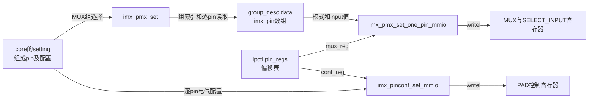
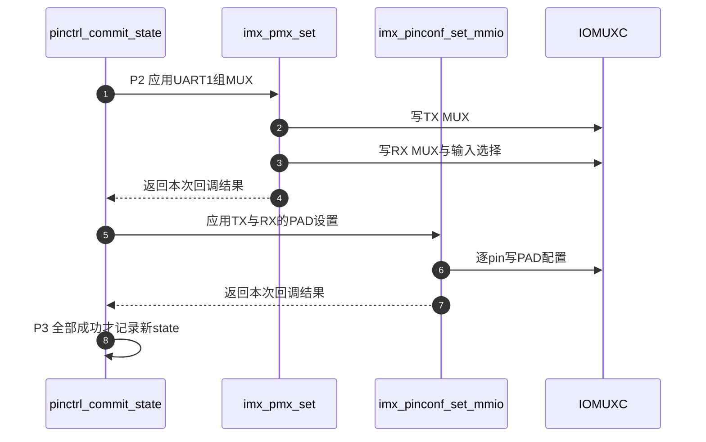

# 第2章\_iMX6UL配置解析与寄存器落点

上一份实现讲解已经把选择拆成MUX与配置两轮。现在以i.MX6UL的UART1 TX/RX为例，继续追问：DT中的六个cell先存在哪里，哪个回调把它们写到硬件，以及申请GPIO是否必然走同一条写入路径。

**讲解层次：实现层，固定NXP Linux 6.12.20的i.MX6UL MMIO路径。** 不把共用驱动中的SCU、共享MUX/PAD寄存器等分支当成i.MX6UL实物。源码摘录中的中文说明由仓库补充，非上游原文。

| 关联阅读 | 入口 |
| --- | --- |
| 版本与配置 | [总索引](../navigation/P01_Linux_6.12_pinctrl源码阅读索引.md#1.1_版本边界与阅读路线) |
| 模块合作与状态阶段 | [导读](../navigation/P02_从描述到选择与硬件落点导读.md#2.3_提供者把通用设置兑现到硬件) |
| 通用选择、失败恢复 | [状态选择实现](P01_状态映射选择与探测交接.md#1.3_选择过程为何不是原子事务) |
| 六cell格式及电气字段 | [配置正文](../../../../knowledge/driver_model/device_tree/P02_引脚配置怎样连接外设与焊盘.md) |
| GPIO consumer与中断 | [GPIO正文](../../../../knowledge/driver_model/device_tree/P01_GPIO连接命名占用与按键事件.md) |

## 2.1\_六个cell怎样成为组和逐pin配置

消费者引用组节点，提供者必须先理解这个组有哪些pin、各pin使用哪个功能以及电气参数。解析阶段把这些内容保存在内存，使后续状态选择能够反复使用，不必每次重新解释DT字节。

源码位于 [drivers/pinctrl/freescale/pinctrl-imx.c](https://github.com/nxp-imx/linux-imx/blob/dfaf2136deb2af2e60b994421281ba42f1c087e0/drivers/pinctrl/freescale/pinctrl-imx.c)，结构位于同目录 [pinctrl-imx.h](https://github.com/nxp-imx/linux-imx/blob/dfaf2136deb2af2e60b994421281ba42f1c087e0/drivers/pinctrl/freescale/pinctrl-imx.h)。`imx_pinctrl_parse_groups` 按SoC标志确定每pin编码长度：普通MMIO为24字节、共享寄存器分支为20字节、SCU分支为12字节。i.MX6UL走24字节路径，验证属性非空且长度整除后分配组的pin编号数组与 `imx_pin` 数组，再逐pin解析。

```c
/**
 * @brief 仓库阅读说明：普通MMIO条目在偏移解析完成后保存剩余四个cell。
 * @note 摘自imx_pinctrl_parse_pin_mmio；此前读取mux_reg和conf_reg，处理无寄存器哨兵。
 */
*pin_id = (mux_reg != -1) ? mux_reg / 4 : conf_reg / 4;
pin_reg = &ipctl->pin_regs[*pin_id];
pin->pin = *pin_id;
pin_reg->mux_reg = mux_reg;            /* 偏移表按提供者pin ID索引。 */
pin_reg->conf_reg = conf_reg;
pin_mmio->input_reg = be32_to_cpu(*list++);
pin_mmio->mux_mode = be32_to_cpu(*list++);
pin_mmio->input_val = be32_to_cpu(*list++);
config = be32_to_cpu(*list++);
if (config & IMX_PAD_SION)
    pin_mmio->mux_mode |= IOMUXC_CONFIG_SION;
pin_mmio->config = config & ~IMX_PAD_SION;
*list_p = list;                       /* 下一次解析从下一条pin开始。 */
```

`list` 指向DT的大端cell，`be32_to_cpu` 完成数值转换。`IMX_PAD_SION` 是配置编码中的SION标记；解析把它移入mux值的 `IOMUXC_CONFIG_SION` 位，再从PAD配置中去掉该标记。因此“第六个cell一定原封不动写PAD”也不够准确。没有MUX寄存器的条目使用 `-1` 哨兵；不能把这个值当作有效偏移访问。

| 软件载体 | 保存什么 | 谁建立、谁使用 |
| --- | --- | --- |
| `imx_pinctrl.base` | 控制器资源映射得到的 `__iomem` 虚拟地址 | probe映射，MMIO回调相加使用；不是DT中的物理地址数值 |
| `imx_pinctrl.pin_regs[pin_id]` | `mux_reg/conf_reg` 两个寄存器偏移 | 解析保存，mux/pinconf回调读取 |
| `group_desc.grp.pins/npins` | 提供者pin ID数组和数量 | 组解析建立，组枚举及选择读取 |
| `group_desc.data` 指向的 `imx_pin[]` | 每pin的编号、模式、输入选择及PAD配置 | 组解析分配，映射与写入回调读取 |
| `imx_pin_mmio.input_reg/input_val` | 输入选择寄存器偏移与选择值 | 解析保存，mux回调消费 |
| `imx_pin_mmio.mux_mode/config` | 已处理SION的模式值及电气配置 | 解析保存，两个不同回调消费 |

UART1 TX宏给出MUX偏移 `0x84`，因此提供者pin ID为 `0x84/4=33`；RX偏移 `0x88`，ID为34。这是此驱动的编号构造，并不表示GPIO1的线33/34。宏定义与pin枚举分别可核对 [imx6ul-pinfunc.h](https://github.com/nxp-imx/linux-imx/blob/dfaf2136deb2af2e60b994421281ba42f1c087e0/arch/arm/boot/dts/nxp/imx/imx6ul-pinfunc.h) 和 [pinctrl-imx6ul.c](https://github.com/nxp-imx/linux-imx/blob/dfaf2136deb2af2e60b994421281ba42f1c087e0/drivers/pinctrl/freescale/pinctrl-imx6ul.c)。

**实现原理与可修改性。** 解析主要改软件对象，不完成consumer状态选择。修改cell布局会同时影响绑定、宏展开、长度检查、指针推进和运行时回调；只把 `FSL_PIN_SIZE` 改小会让后续cell错位。修改pin编号算法必须同步pin枚举、偏移表与GPIO范围。验证应包括两pin连续条目、缺cell、无MUX/无PAD、SION标记和错误后资源释放；SCU等未研究分支不能靠i.MX6UL测试宣称覆盖。

## 2.2\_映射回调生成设置而没有执行选择

组已解析，但consumer需要通用core认识的map。`imx_dt_node_to_map` 先按配置节点名找到组，准备一个MUX map，再为需要PAD配置的pin各准备一个CONFIGS_PIN map。MUX map指向父节点对应的功能和当前组；配置map指向pin名称及已有 `config` 数据。

```c
/**
 * @brief 仓库阅读说明：映射回调建立一条功能与组关系。
 * @note 摘自imx_dt_node_to_map；省略查组、计数、分配失败处理和后续逐pin配置map。
 */
new_map[0].type = PIN_MAP_TYPE_MUX_GROUP;
new_map[0].data.mux.function = parent->name;
new_map[0].data.mux.group = np->name;
of_node_put(parent);
/* 后续CONFIGS_PIN条目引用pin_get_name以及pin->conf.mmio.config。 */
```

对非SCU路径，带 `IMX_NO_PAD_CTL` 标志的pin不产生PAD配置map。这表达“不让这个状态改此pin的PAD配置”，并不表达“写0”或“自动恢复复位值”。其余pin每条配置map的 `num_configs` 为1，引用解析阶段保存的配置；map数组由 `imx_dt_free_map` 释放，而组数据随提供者的设备资源生存。不能提前释放组数据后仍让map引用它。

本函数没有 `writel`，更没有GPIO方向写入。它返回成功证明配置节点能够翻译，不证明消费者已经选择。这个阶段对应P0中的映射建立；把它与P2的 `imx_pmx_set` 混为一谈，会错误解释“设备树里有配置，但寄存器没有变化”。

**可修改性说明。** 增加一种map类型必须同时检查core是否能转换为setting、选择器是否能执行及失败路径是否释放。改变 `IMX_NO_PAD_CTL` 行为会覆盖本来需要保留的电气配置。验证应比较同一组启用/关闭该标志后的map数量、状态settings与实际PAD写入次数，而不是只检查DT能编译。

## 2.3\_选择时分别写MUX输入选择与PAD

P2真正调用提供者。`imx_pmx_set` 先验证group和function selector，取得组数据，再逐pin调用 `imx_pmx_set_one_pin_mmio`。这里i.MX6UL的普通路径直接写MUX值，并在该条目有输入选择寄存器时再写选择值；SCU路径则留给其配置调用，不能套用本节寄存器关系。



图中软件对象保存将要写入的值与地址偏移，右侧寄存器保存实际硬件配置。一个setting经回调触发写入，不存在“修改软件表以后硬件自动同步”的后台线程。

下面是MMIO写入回调中的普通MUX分支，保留原表达式，省略共享寄存器与特殊输入选择编码分支。

```c
/**
 * @brief 仓库阅读说明：普通分离寄存器路径写MUX。
 * @note 位于imx_pmx_set_one_pin_mmio的非SHARE_MUX_CONF_REG分支。
 */
writel(pin_mmio->mux_mode, ipctl->base + pin_reg->mux_reg);
/* 后续如有普通input_reg，选择input_sel_base或base后再写input_val。 */
```

后续 `imx_pinconf_set_mmio` 先检查 `conf_reg` 有效，再遍历configs；普通分离寄存器分支执行 `writel(configs[i], ipctl->base + pin_reg->conf_reg)`。共用驱动中的共享寄存器分支采用读改写保留MUX位，但这不是本例普通PAD路径。输入选择另有 `input_val` 高字节为 `0xff` 的特殊编码处理，也不能将其布局直接用作UART1普通条目。

为使地址推导可在本页完成，下表以IOMUXC物理基址 `0x020e0000`、UART1功能宏和普通MMIO路径展开。软件实际使用映射后的 `base+offset`。

| 操作对象 | 偏移与物理地址 | 本例写入值/字段 | 当前动作及边界 |
| --- | --- | --- | --- |
| UART1_TX_DATA MUX | `0x84` → `0x020e0084` | UART1模式0；SION来自编码转换 | 选择PAD复用；不设置GPIO方向 |
| UART1_RX_DATA MUX | `0x88` → `0x020e0088` | UART1模式0；SION同上 | 选择PAD复用；不代表UART已启用 |
| UART1 RX SELECT_INPUT | `0x624` → `0x020e0624` | 此宏输入选择值3 | 选择输入来源；TX宏输入偏移为0，无对应写入 |
| UART1_TX_DATA PAD | `0x310` → `0x020e0310` | `config`，经软件标志处理 | 调整HYS、偏置、驱动等；不是串口数据 |
| UART1_RX_DATA PAD | `0x314` → `0x020e0314` | `config`，经软件标志处理 | 同上；当前状态可用NO_PAD_CTL跳过 |

普通PAD编码当前涉及：HYS位16、PUS位15:14、PUE位13、PKE位12、ODE位11、SPEED位7:6、DSE位5:3、SRE位0。软件扩展标志SION位30会移到MUX位4，NO_PAD_CTL位31决定不产生PAD设置，不能当硬件PAD控制位原样解释。完整取值及教学数值推导见 [配置正文](../../../../knowledge/driver_model/device_tree/P02_引脚配置怎样连接外设与焊盘.md)。这里的字段与宏来自固定 [i.MX6UL绑定](https://github.com/nxp-imx/linux-imx/blob/dfaf2136deb2af2e60b994421281ba42f1c087e0/Documentation/devicetree/bindings/pinctrl/fsl,imx6ul-pinctrl.yaml)，没有据此声称任意数值都适合某块板。



步骤2、3、6是不同写入，步骤8不能把它们反向合并成一次硬件原子事务。读回这些寄存器可以检验对应字段，仍不能证明UART波特率、外部连线、供电和通信帧正确。

**实现原理与可修改性。** 当前回调使用顺序MMIO写入实现配置，硬件故障不一定能转换成这个C函数的负返回值。改MUX或PAD顺序之前必须分析瞬态输出和控制器可访问性；改读改写规则必须限定SoC标志，不能用一个型号推断全家族。验证应同时比较状态选择日志、对应寄存器和外部信号；MMIO代码静态检查不能代替板级电气验证。

## 2.4\_GPIO请求怎样经过pin占用而不承诺自动复用

同一PAD还能作为GPIO，但GPIO线编号属于GPIO控制器。固定 [imx6ul.dtsi](https://github.com/nxp-imx/linux-imx/blob/dfaf2136deb2af2e60b994421281ba42f1c087e0/arch/arm/boot/dts/nxp/imx/imx6ul.dtsi) 为GPIO1登记三段 `gpio-ranges`：线0～9映到pin23～32，线10～15映到pin17～22，线16～31映到pin33～48。因此线3是pin26，线16才是UART1_TX_DATA对应的pin33。

GPIO驱动通过request接入pinctrl时，`core.c:pinctrl_gpio_request` 先定位范围和提供者，取得提供者mutex，再用 `gpio_to_pin` 转换编号，最后进入 `pinmux_request_gpio`。后者建立GPIO owner名称并调用逐pin的 `pin_request`。没有匹配范围的情况还有ready判断与错误分支，不应把没有范围一概解释成同一种错误。

`pinmux.c:pin_request` 的关键回调分派如下，前面的占用检查与模块引用不在片段中重复。

```c
/**
 * @brief 仓库阅读说明：GPIO申请只调用实际提供的可选回调。
 * @note 摘自pin_request；gpio_range非空标识当前请求来自GPIO范围。
 */
if (gpio_range && ops->gpio_request_enable)
    status = ops->gpio_request_enable(pctldev, gpio_range, pin);
else if (ops->request)
    status = ops->request(pctldev, pin);
else
    status = 0;
```

这里没有无条件调用 `set_mux`。固定i.MX的 `imx_pmx_ops` 注册功能枚举与 `imx_pmx_set`，没有提供 `gpio_request_enable` 或 `request`，也没有设置 `strict`。因此在这个实现中，GPIO申请可以登记pin侧占用，却不能单凭申请成功证明UART PAD已切到GPIO模式；应由正确的pinctrl状态或已核实的板级配置完成复用。

占用检查在 `pin_desc.mux_lock` 下进行。MUX请求检查其他MUX owner，GPIO请求检查已有GPIO owner；`ops->strict` 还决定是否跨GPIO/MUX类型检查。它不是所有控制器都默认开启的排他规则。软件允许两类记录同时存在，也不等于板上允许两个输出源电气冲突。原实现冲突路径的默认状态为 `-EINVAL`，不应写死为必定 `-EBUSY`。

请求通过后增加提供者模块引用；回调失败会释放引用并撤销本次owner/count。`pin_free` 在最后一个MUX引用或GPIO释放时调用可选free回调、清空owner并归还模块引用。它并不保存“GPIO之前曾是UART”这样的恢复栈，因而释放GPIO不自动恢复UART复用。GPIO描述符占用是gpiolib另一层状态，不能用pin侧owner替代它。

**可修改性说明。** 加入 `gpio_request_enable` 必须同步释放语义、并发状态选择、GPIO方向初始化与错误回滚；不能只在申请时盲写模式5。打开strict会改变既有请求是否被拒绝，需要核对所有同时使用GPIO与功能路径的消费者。修改ranges会改变GPIO请求实际占用的pin，验证至少手算跨段边界9/10、15/16，检查重复申请、回调失败、释放及随后重新选UART。中断号映射和触发方式另由GPIO IRQ实现处理，不由本节ranges代办。

本例闭合的是“DT配置 → 软件设置 → 回调 → IOMUXC”以及GPIO请求的交界。板上能否收发UART、休眠后能否唤醒，还需要外设驱动、时钟、电源与实际线路证据；继续排查可用 [状态与寄存器定位正文](../../../../knowledge/driver_model/device_tree/P04_沿状态与寄存器定位引脚问题.md)。
