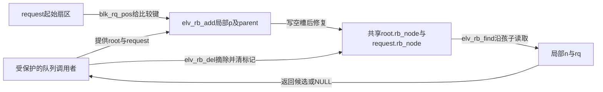
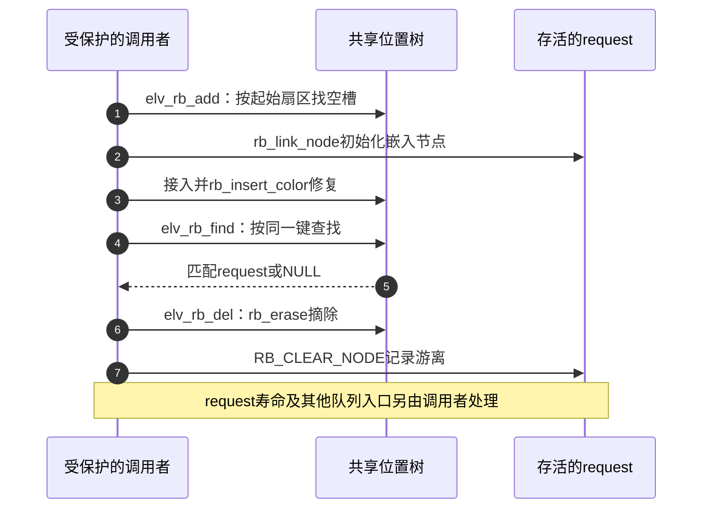

# 第1章\_elevator.c请求位置索引

块请求需要按起始扇区找到同位置或相邻位置的对象。这里把 request 的嵌入节点接入位置索引；最终先分发谁还取决于调度器的其他状态，不能只由树的顺序决定。

本页对应[内核调用场景导读](../../navigation/P10_内核调用场景与选择边界导读.md#10.2_按排序键和业务问题逐项阅读)。上游相对位置为 `block/elevator.c`，来源为 NXP linux-imx 官方提交 `dfaf2136deb2af2e60b994421281ba42f1c087e0`（Linux 6.12.20），文件 Git blob 为 `43ba4ab1ada7fd2462a44d3582de9e115973e4be`。选择性保留下面的完整函数，未列出的子系统过程不由本页代替。原许可证及上下文可在[固定源文件](https://github.com/nxp-imx/linux-imx/blob/dfaf2136deb2af2e60b994421281ba42f1c087e0/block/elevator.c)核对。

中文 Doxygen 为仓库补充，不是上游注释；函数语句保持固定版本。

## 1.1\_按逻辑扇区接入请求

blk_rq_pos 提供请求的逻辑起始位置，较小向左，其余向右，再挂接和修复。相等位置向右是插入政策，不是旋转后全局“相等只在右”的不变量；它也不表示这个请求一定下一个发出。

```c
/**
 * 仓库补充阅读说明：按逻辑扇区接入请求。
 * 前置条件、状态副作用和调用方责任见本节正文，非上游原文。
 */
void elv_rb_add(struct rb_root *root, struct request *rq)
{
	struct rb_node **p = &root->rb_node;
	struct rb_node *parent = NULL;
	struct request *__rq;

	while (*p) {
		parent = *p;
		__rq = rb_entry(parent, struct request, rb_node);

		if (blk_rq_pos(rq) < blk_rq_pos(__rq))
			p = &(*p)->rb_left;
		else if (blk_rq_pos(rq) >= blk_rq_pos(__rq))
			p = &(*p)->rb_right;
	}

	rb_link_node(&rq->rb_node, parent, p);
	rb_insert_color(&rq->rb_node, root);
}
```

## 1.2\_请求摘除与位置查找

删除只维护成员与标记。RB_EMPTY_NODE 是检查节点游离标记的宏；BUG_ON 是条件成立时进入内核错误处理的断言宏，不能当成可以忽略的业务失败码。摘除之后，RB_CLEAR_NODE 宏把节点设为游离状态，不释放 request。查找按同一起始扇区比较，返回任意命中的请求；它不是覆盖区间查询，也不实现整套 I/O 调度。对象同步和生命周期在调用方，前驱后继还需遵守父链遍历前提。

```c
/**
 * 仓库补充阅读说明：请求摘除与位置查找。
 * 前置条件、状态副作用和调用方责任见本节正文，非上游原文。
 */
void elv_rb_del(struct rb_root *root, struct request *rq)
{
	BUG_ON(RB_EMPTY_NODE(&rq->rb_node));
	rb_erase(&rq->rb_node, root);
	RB_CLEAR_NODE(&rq->rb_node);
}
```

```c
/**
 * 仓库补充阅读说明：请求摘除与位置查找。
 * 前置条件、状态副作用和调用方责任见本节正文，非上游原文。
 */
struct request *elv_rb_find(struct rb_root *root, sector_t sector)
{
	struct rb_node *n = root->rb_node;
	struct request *rq;

	while (n) {
		rq = rb_entry(n, struct request, rb_node);

		if (sector < blk_rq_pos(rq))
			n = n->rb_left;
		else if (sector > blk_rq_pos(rq))
			n = n->rb_right;
		else
			return rq;
	}

	return NULL;
}
```

返回[场景导读](../../navigation/P10_内核调用场景与选择边界导读.md#10.2_按排序键和业务问题逐项阅读)与[总索引](../../navigation/P01_Linux_6.12_rbtree源码阅读索引.md#1.1_固定提交与阅读边界)。本页源码核对不是子系统构建、运行、并发或性能验证。

## 1.3\_位置索引怎样交还业务对象

root 和各 request.rb_node 由调用者的队列保护协议共同约束；p/parent/n 是每次调用的局部游标。查找不增加对象引用，删除不释放 request。



下面串起一次索引成员周期，表示三个函数的职责；它不是完整块层分发时序。实际调用者须在查找、使用和更新之间保持需要的保护。



修改排序必须同时修改 find 的比较，并核对相邻请求及合并调用者；不能只改 add。改变删除语义需保持清标记与真实摘除的先后，禁止把 BUG_ON 当成可重试的错误返回。验证至少区分相等起点、无匹配、首尾请求和仍有其他入口的对象；本页没有给完整 I/O 调度提供运行或性能证据。
