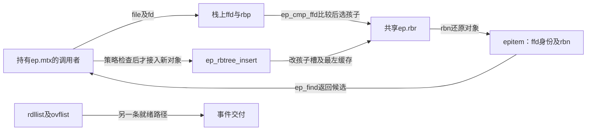
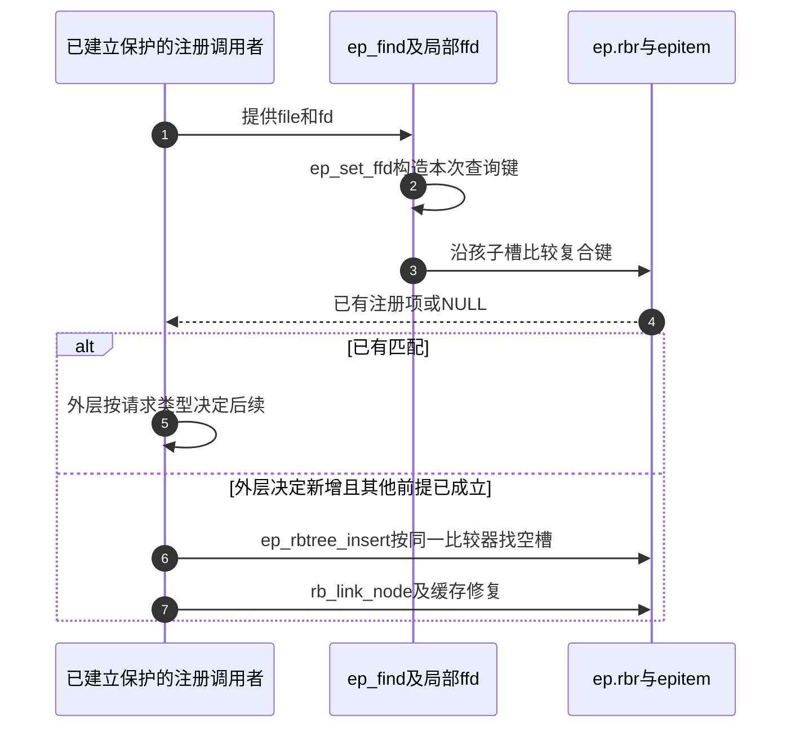

# 第1章\_eventpoll.c注册对象复合键

同一文件对象可以由不同描述符引用，仅记 fd 或仅记 file 都不足以表达这里使用的注册键。epoll 的注册树以两者组成身份；就绪事件另有存储和交付路径。以下只追踪注册索引的查找与接入。

本页对应[内核调用场景导读](../../navigation/P10_内核调用场景与选择边界导读.md#10.2_按排序键和业务问题逐项阅读)。上游相对位置为 `fs/eventpoll.c`，来源为 NXP linux-imx 官方提交 `dfaf2136deb2af2e60b994421281ba42f1c087e0`（Linux 6.12.20），文件 Git blob 为 `1a06e462b6efba8824456cffebad040720c4226a`。选择性保留下面的完整函数，未列出的子系统过程不由本页代替。原许可证及上下文可在[固定源文件](https://github.com/nxp-imx/linux-imx/blob/dfaf2136deb2af2e60b994421281ba42f1c087e0/fs/eventpoll.c)核对。

中文 Doxygen 为仓库补充，不是上游注释；函数语句保持固定版本。

## 1.1\_文件对象与描述符组成键

先比较 file 对象身份，再比较 fd。这里保留的是内核源码采用的指针关系比较，不应复制成可移植 ISO C 任意对象地址排序示例；正文的宿主教学仍使用稳定业务 id。fd 来自该子系统的描述符域，不把这里的减法推广到任意有符号键。

```c
/**
 * 仓库补充阅读说明：文件对象与描述符组成键。
 * 前置条件、状态副作用和调用方责任见本节正文，非上游原文。
 */
static inline void ep_set_ffd(struct epoll_filefd *ffd,
			      struct file *file, int fd)
{
	ffd->file = file;
	ffd->fd = fd;
}
```

```c
/**
 * 仓库补充阅读说明：文件对象与描述符组成键。
 * 前置条件、状态副作用和调用方责任见本节正文，非上游原文。
 */
static inline int ep_cmp_ffd(struct epoll_filefd *p1,
			     struct epoll_filefd *p2)
{
	return (p1->file > p2->file ? +1:
	        (p1->file < p2->file ? -1 : p1->fd - p2->fd));
}
```

## 1.2\_持有注册互斥锁后查找

上游函数前的说明要求持有 ep->mtx。查询先组合 file/fd，再在 ep->rbr 上下降；这个树索引的是注册对象，不是就绪事件排序。返回地址不会自行取得供任意锁外使用的引用。

```c
/**
 * 仓库补充阅读说明：持有注册互斥锁后查找。
 * 前置条件、状态副作用和调用方责任见本节正文，非上游原文。
 */
static struct epitem *ep_find(struct eventpoll *ep, struct file *file, int fd)
{
	int kcmp;
	struct rb_node *rbp;
	struct epitem *epi, *epir = NULL;
	struct epoll_filefd ffd;

	ep_set_ffd(&ffd, file, fd);
	for (rbp = ep->rbr.rb_root.rb_node; rbp; ) {
		epi = rb_entry(rbp, struct epitem, rbn);
		kcmp = ep_cmp_ffd(&ffd, &epi->ffd);
		if (kcmp > 0)
			rbp = rbp->rb_right;
		else if (kcmp < 0)
			rbp = rbp->rb_left;
		else {
			epir = epi;
			break;
		}
	}

	return epir;
}
```

## 1.3\_注册树的缓存插入

比较结果大于零向右并取消 leftmost，其余向左，挂接后走缓存修复。可见相等键的下降方向由具体调用者决定；注册策略的查重和错误处理在更高层，不能由这个内部函数单独推出重复注册被接受。

```c
/**
 * 仓库补充阅读说明：注册树的缓存插入。
 * 前置条件、状态副作用和调用方责任见本节正文，非上游原文。
 */
static void ep_rbtree_insert(struct eventpoll *ep, struct epitem *epi)
{
	int kcmp;
	struct rb_node **p = &ep->rbr.rb_root.rb_node, *parent = NULL;
	struct epitem *epic;
	bool leftmost = true;

	while (*p) {
		parent = *p;
		epic = rb_entry(parent, struct epitem, rbn);
		kcmp = ep_cmp_ffd(&epi->ffd, &epic->ffd);
		if (kcmp > 0) {
			p = &parent->rb_right;
			leftmost = false;
		} else
			p = &parent->rb_left;
	}
	rb_link_node(&epi->rbn, parent, p);
	rb_insert_color_cached(&epi->rbn, &ep->rbr, leftmost);
}
```

返回[场景导读](../../navigation/P10_内核调用场景与选择边界导读.md#10.2_按排序键和业务问题逐项阅读)与[总索引](../../navigation/P01_Linux_6.12_rbtree源码阅读索引.md#1.1_固定提交与阅读边界)。本页源码核对不是子系统构建、运行、并发或性能验证。

## 1.4\_注册身份与就绪交付分开追踪

查询时 ffd 和 rbp 属于当前调用，ep->rbr 与 epitem.ffd/rbn 属于共享注册集合。ep->mtx 的持有条件来自外层；这些短函数不会自行把整个注册过程锁住。rdllist/ovflist 是就绪路径的状态，不能从 rbr 的次序推导事件交付次序。





这个时序只覆盖本页两个入口的衔接，不省略成完整 epoll_ctl 实现。修改复合键必须同时核对查询、插入和外层注册政策；不能把内部“相等向左”当成允许重复注册。修改缓存维护须验证最左身份，修改返回对象用法须检查锁外寿命，不能从 safe 名称或查找成功推导长期引用。
