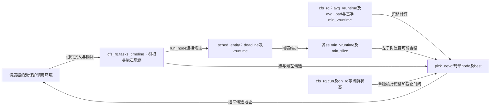
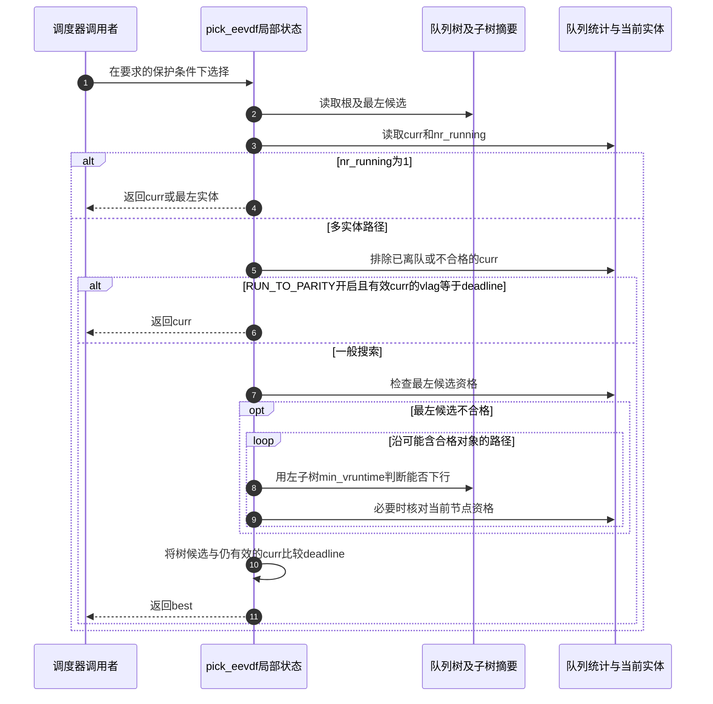

# 第1章\_fair.c排序资格与候选选择

公平调度的候选选择同时面对两个问题：谁在当前虚拟时间下有资格运行，以及合格者中谁的虚拟截止时间更早。固定实现按 deadline 排树，用 vruntime 与子树摘要检查资格；仅取最左节点不能完成整个选择。

本页对应[内核调用场景导读](../../../navigation/P10_内核调用场景与选择边界导读.md#10.2_按排序键和业务问题逐项阅读)。上游相对位置为 `kernel/sched/fair.c`，来源为 NXP linux-imx 官方提交 `dfaf2136deb2af2e60b994421281ba42f1c087e0`（Linux 6.12.20），文件 Git blob 为 `58ba14ed8fbcb98ef1d2bb6779aae1a51c71e595`。选择性保留下面的完整函数，未列出的子系统过程不由本页代替。原许可证及上下文可在[固定源文件](https://github.com/nxp-imx/linux-imx/blob/dfaf2136deb2af2e60b994421281ba42f1c087e0/kernel/sched/fair.c)核对。

中文 Doxygen 为仓库补充，不是上游注释；函数语句保持固定版本。

## 1.1\_树按虚拟截止时间比较

entity_before 比较 deadline 的有符号差，__entity_less 把 rb_node 还原为 sched_entity 后委托它。它依赖内核时间与差值范围约定，不能用作任意 u64 全域排序器。此固定版本的树键不是 vruntime，字段名称 tasks_timeline 没有改变这项事实。

```c
/**
 * 仓库补充阅读说明：树按虚拟截止时间比较。
 * 前置条件、状态副作用和调用方责任见本节正文，非上游原文。
 */
static inline bool entity_before(const struct sched_entity *a,
				 const struct sched_entity *b)
{
	/*
	 * Tiebreak on vruntime seems unnecessary since it can
	 * hardly happen.
	 */
	return (s64)(a->deadline - b->deadline) < 0;
}
```

```c
/**
 * 仓库补充阅读说明：树按虚拟截止时间比较。
 * 前置条件、状态副作用和调用方责任见本节正文，非上游原文。
 */
static inline bool __entity_less(struct rb_node *a, const struct rb_node *b)
{
	return entity_before(__node_2_se(a), __node_2_se(b));
}
```

## 1.2\_资格由虚拟运行时间另行判定

“有资格”在这里要求候选虚拟运行时间没有超过当前加权虚拟时间。cfs_rq->min_vruntime 是整条队列计算相对值的基准；se->min_vruntime 是节点子树的摘要，虽同名却不在同一地址。entity_key 以实体 vruntime 减队列基准，scale_load_down 将调度权重缩放后参加加权计算。

avg_vruntime 与 avg_load 保存加权计算的状态；若当前实体仍 on_rq，把它的贡献加入局部 avg/load。最后以乘法比较避免先做平均除法导致精度丢失。此处只解释容器剪枝读取什么，不把完整权重、lag 更新和调度公平性证明压缩成一个比较式。

```c
/**
 * 仓库补充阅读说明：资格由虚拟运行时间另行判定。
 * 前置条件、状态副作用和调用方责任见本节正文，非上游原文。
 */
static int vruntime_eligible(struct cfs_rq *cfs_rq, u64 vruntime)
{
	struct sched_entity *curr = cfs_rq->curr;
	s64 avg = cfs_rq->avg_vruntime;
	long load = cfs_rq->avg_load;

	if (curr && curr->on_rq) {
		unsigned long weight = scale_load_down(curr->load.weight);

		avg += entity_key(cfs_rq, curr) * weight;
		load += weight;
	}

	return avg >= (s64)(vruntime - cfs_rq->min_vruntime) * load;
}
```

```c
/**
 * 仓库补充阅读说明：资格由虚拟运行时间另行判定。
 * 前置条件、状态副作用和调用方责任见本节正文，非上游原文。
 */
int entity_eligible(struct cfs_rq *cfs_rq, struct sched_entity *se)
{
	return vruntime_eligible(cfs_rq, se->vruntime);
}
```

## 1.3\_入队和出队组合缓存与增强

接入前更新平均运行时间统计，并初始化 min_vruntime、min_slice，再调用 rb_add_augmented_cached；摘除走增强缓存删除并移除平均统计贡献。min_vruntime_cb 来自本文件的生成回调，树结构、缓存、摘要和统计是不同状态，不应只因用了一个包装就认为已具备完整同步。

```c
/**
 * 仓库补充阅读说明：入队和出队组合缓存与增强。
 * 前置条件、状态副作用和调用方责任见本节正文，非上游原文。
 */
static void __enqueue_entity(struct cfs_rq *cfs_rq, struct sched_entity *se)
{
	avg_vruntime_add(cfs_rq, se);
	se->min_vruntime = se->vruntime;
	se->min_slice = se->slice;
	rb_add_augmented_cached(&se->run_node, &cfs_rq->tasks_timeline,
				__entity_less, &min_vruntime_cb);
}
```

```c
/**
 * 仓库补充阅读说明：入队和出队组合缓存与增强。
 * 前置条件、状态副作用和调用方责任见本节正文，非上游原文。
 */
static void __dequeue_entity(struct cfs_rq *cfs_rq, struct sched_entity *se)
{
	rb_erase_augmented_cached(&se->run_node, &cfs_rq->tasks_timeline,
				  &min_vruntime_cb);
	avg_vruntime_sub(cfs_rq, se);
}
```

## 1.4\_先取合格候选再与当前实体比较

EEVDF（Earliest Eligible Virtual Deadline First，最早合格虚拟截止时间优先）把资格与截止时间分开。RUN_TO_PARITY 是调度特性开关，允许满足本节条件的当前实体继续运行；它不是树的颜色或排序位。

入口先读树根、最左实体与 curr。单实体分支可能提前返回；多实体路径先过滤当前资格，再判断 RUN_TO_PARITY 是否允许早退。一般路径先试最左的资格，再用左子树 min_vruntime 判断是否可能存在更早的合格候选；左边不合格才检查自身或进入右边。found 还会比较仍合法的 curr，因此返回值不能简化为固定取 rb_first_cached。源码注释的 EEVD 指最早合格虚拟截止时间候选，HACK 是上游对 set_next_entity 中相关处理的描述，不是本函数的新接口。

```c
/**
 * 仓库补充阅读说明：先取合格候选再与当前实体比较。
 * 前置条件、状态副作用和调用方责任见本节正文，非上游原文。
 */
static struct sched_entity *pick_eevdf(struct cfs_rq *cfs_rq)
{
	struct rb_node *node = cfs_rq->tasks_timeline.rb_root.rb_node;
	struct sched_entity *se = __pick_first_entity(cfs_rq);
	struct sched_entity *curr = cfs_rq->curr;
	struct sched_entity *best = NULL;

	/*
	 * We can safely skip eligibility check if there is only one entity
	 * in this cfs_rq, saving some cycles.
	 */
	if (cfs_rq->nr_running == 1)
		return curr && curr->on_rq ? curr : se;

	if (curr && (!curr->on_rq || !entity_eligible(cfs_rq, curr)))
		curr = NULL;

	/*
	 * Once selected, run a task until it either becomes non-eligible or
	 * until it gets a new slice. See the HACK in set_next_entity().
	 */
	if (sched_feat(RUN_TO_PARITY) && curr && curr->vlag == curr->deadline)
		return curr;

	/* Pick the leftmost entity if it's eligible */
	if (se && entity_eligible(cfs_rq, se)) {
		best = se;
		goto found;
	}

	/* Heap search for the EEVD entity */
	while (node) {
		struct rb_node *left = node->rb_left;

		/*
		 * Eligible entities in left subtree are always better
		 * choices, since they have earlier deadlines.
		 */
		if (left && vruntime_eligible(cfs_rq,
					__node_2_se(left)->min_vruntime)) {
			node = left;
			continue;
		}

		se = __node_2_se(node);

		/*
		 * The left subtree either is empty or has no eligible
		 * entity, so check the current node since it is the one
		 * with earliest deadline that might be eligible.
		 */
		if (entity_eligible(cfs_rq, se)) {
			best = se;
			break;
		}

		node = node->rb_right;
	}
found:
	if (!best || (curr && entity_before(curr, best)))
		best = curr;

	return best;
}
```

返回[场景导读](../../../navigation/P10_内核调用场景与选择边界导读.md#10.2_按排序键和业务问题逐项阅读)与[总索引](../../../navigation/P01_Linux_6.12_rbtree源码阅读索引.md#1.1_固定提交与阅读边界)。本页源码核对不是子系统构建、运行、并发或性能验证。

## 1.5\_一次选择读取哪几组状态

__enqueue_entity/__dequeue_entity 改共享统计、拓扑和摘要；pick_eevdf 的 node/se/curr/best 只是本次选择的局部变量。当前实体可能还需单独参与比较，不能由树根或最左缓存独自代表所有候选。





单实体路径先返回；多实体路径才过滤当前实体，再判断 RUN_TO_PARITY，最后进入一般搜索。min_slice 由同组维护路径保存，但此处所示资格剪枝读取的是 min_vruntime，不能混称为一项统计。

修改比较器要同时核对接入顺序和最终 curr/best 比较；修改资格公式或摘要要核对平均统计、当前实体贡献、子树更新及剪枝条件，不能只在 pick 中替换一个字段。验证应覆盖单实体、当前离队/不合格、特性开关、最左不合格而子树有合格者、以及 curr 优于树候选。完整调度公平性、权重变化与抢占仍须沿调度专题和目标配置另行验证。
