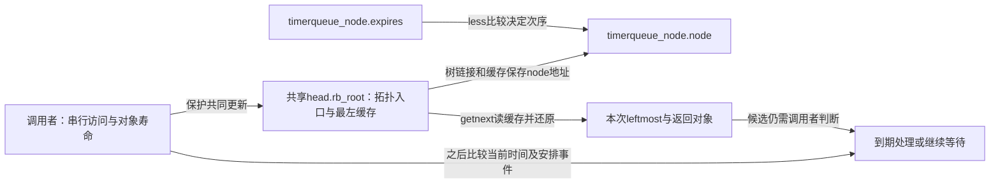
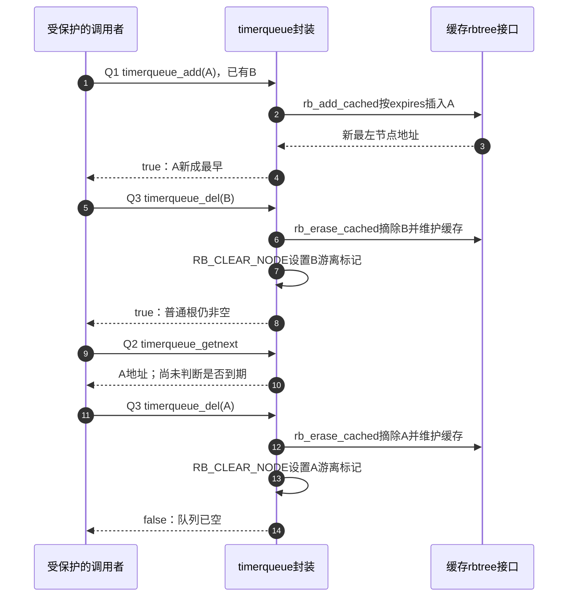

# 第1章\_timerqueue.c到期顺序与返回值

多个定时对象要按到期时间排列，调用者又经常需要知道最早对象是否变化。timerqueue 将缓存红黑树用于这个任务，但插入、删除和取首回答不同的问题；三个返回值不能统一当成功码使用。

本页对应[内核调用场景导读](../../navigation/P10_内核调用场景与选择边界导读.md#10.2_按排序键和业务问题逐项阅读)。上游相对位置为 `lib/timerqueue.c`，来源为 NXP linux-imx 官方提交 `dfaf2136deb2af2e60b994421281ba42f1c087e0`（Linux 6.12.20），文件 Git blob 为 `cdb9c7658478f0505e2d1bdc8e6ede6a812fa958`。选择性保留下面的完整函数，未列出的子系统过程不由本页代替。原许可证及上下文可在[固定源文件](https://github.com/nxp-imx/linux-imx/blob/dfaf2136deb2af2e60b994421281ba42f1c087e0/lib/timerqueue.c)核对。

中文 Doxygen 为仓库补充，不是上游注释；函数语句保持固定版本。

## 1.1\_到期时间决定比较顺序

业务 node 包含 expires，比较器通过 __node_2_tq 还原 timerqueue_node，再按到期时间比较。相同到期时间并不被此布尔比较器判成“拒绝重复”。__node_2_tq 只是 rb_entry 的本文件包装，成员名为 node。

```c
/**
 * 仓库补充阅读说明：到期时间决定比较顺序。
 * 前置条件、状态副作用和调用方责任见本节正文，非上游原文。
 */
static inline bool __timerqueue_less(struct rb_node *a, const struct rb_node *b)
{
	return __node_2_tq(a)->expires < __node_2_tq(b)->expires;
}
```

## 1.2\_插入返回是否成为最早对象

前置条件是节点尚未入队且调用者已串行化队列访问。RB_EMPTY_NODE 宏检查节点的游离标记；WARN_ON_ONCE 是诊断，不是失败返回分支，警告后仍继续，不能把误用当成安全拒绝。rb_add_cached 的指针返回转换为 bool，true 表示本次新成最早，不是一般成功码。

```c
/**
 * 仓库补充阅读说明：插入返回是否成为最早对象。
 * 前置条件、状态副作用和调用方责任见本节正文，非上游原文。
 */
bool timerqueue_add(struct timerqueue_head *head, struct timerqueue_node *node)
{
	/* Make sure we don't add nodes that are already added */
	WARN_ON_ONCE(!RB_EMPTY_NODE(&node->node));

	return rb_add_cached(&node->node, &head->rb_root, __timerqueue_less);
}
```

## 1.3\_删除返回余队列是否非空

删除后通过 RB_CLEAR_NODE 宏设置游离标记，再用 RB_EMPTY_ROOT 宏独立检查普通根是否为空；返回值的含义与 rb_erase_cached 不同。这里的标记更新依赖 timerqueue 使用者的对象和访问协议，不应移植到仍需为并发读者保留旧字段的任意读复制更新（Read-Copy Update，RCU）场景。

```c
/**
 * 仓库补充阅读说明：删除返回余队列是否非空。
 * 前置条件、状态副作用和调用方责任见本节正文，非上游原文。
 */
bool timerqueue_del(struct timerqueue_head *head, struct timerqueue_node *node)
{
	WARN_ON_ONCE(RB_EMPTY_NODE(&node->node));

	rb_erase_cached(&node->node, &head->rb_root);
	RB_CLEAR_NODE(&node->node);

	return !RB_EMPTY_ROOT(&head->rb_root.rb_root);
}
```

返回[场景导读](../../navigation/P10_内核调用场景与选择边界导读.md#10.2_按排序键和业务问题逐项阅读)与[总索引](../../navigation/P01_Linux_6.12_rbtree源码阅读索引.md#1.1_固定提交与阅读边界)。本页源码核对不是子系统构建、运行、并发或性能验证。

## 1.4\_沿同一队列解释三个返回值

设队列中已有 expires=20 的 B，再加入 expires=10 的 A。add(A) 返回 true，因为最早对象改变；删掉 B 后 del(B) 也返回 true，却因为队列中还剩 A。随后 getnext 返回 A，最后 del(A) 返回 false，因为队列已空。时间值这里只用于同一时间基准下的排序，不表示绝对墙钟。



Q0 是调用者先建立有效对象、游离标记和访问保护；Q1 更新队列，Q2 读取候选，Q3 摘除及标记。下图只观察容器操作，硬件时钟安排和定时回调不在这三个函数中完成。



修改比较器需保持所有已入队对象的同一排序规则；修改 add/del 需配对拓扑、缓存和游离标记，并保留各自返回语义。应检查空队列、同到期时间、删除首项/非首项/末项，以及仍被业务使用的摘下对象。诊断告警不能替代这些前提，也不能依据一次返回值替对象释放。
