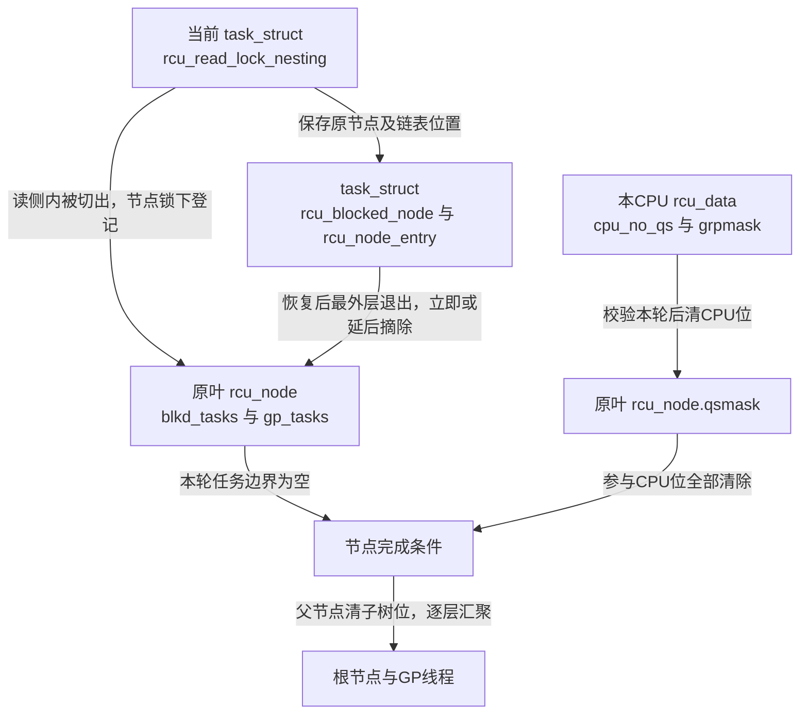
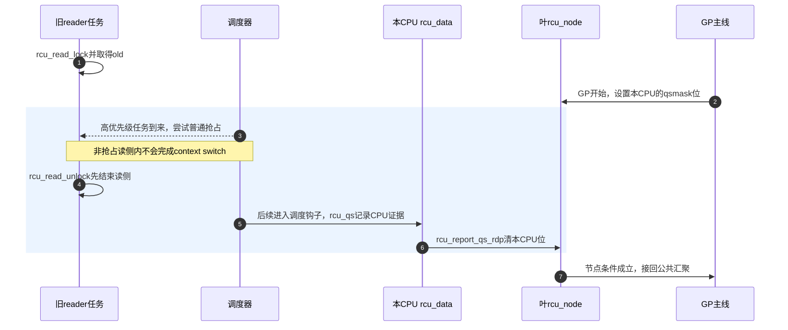
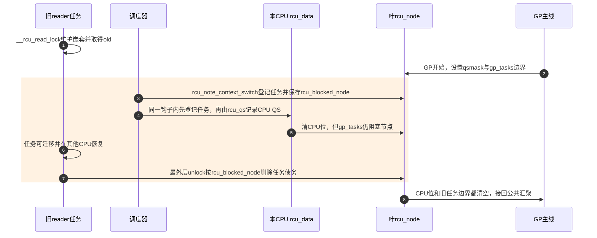

# 第2章\_Linux\_6.12\_RCU公共接口与读侧模型模块源码概念导读

## 2.1\_模块问题与配置边界

本篇回答一个版本化源码阅读问题：普通 RCU 的公共 API 在 Linux 6.12.20 中从哪里进入，Tree RCU 的非抢占 / 抢占读侧分支各增加什么状态，又怎样重新接回共同的 CPU QS、节点汇聚和 GP 完成主线。

它不会按配置各复制一次 `synchronize_rcu()`、GP kthread、callback 和 `rcu_barrier()`。那些公共模块分别进入 P03～P08；本篇只组织公共接口、读侧进入/退出、context switch 和 blocked-task 债务。

源码身份固定为：

| 项目 | 边界 |
| --- | --- |
| 官方仓库 | `https://github.com/nxp-imx/linux-imx.git` |
| 发布标签 / 提交 | `lf-6.12.20-2.0.0` / `dfaf2136deb2af2e60b994421281ba42f1c087e0` |
| 内核版本 | Linux 6.12.20 |
| 本篇展开的条件分支 | `CONFIG_TREE_RCU=y`；分别考察 `CONFIG_PREEMPT_RCU=y` 与关闭时的实现 |

这里比较固定源码中的构建分支，不宣称当前目标正在运行其中之一。既有 Tree/PREEMPT 记录与 2026-09-05 Tiny 配置记录是不同历史快照；本轮未完成当前目标工作树与配置的现场核验。完整身份和文件哈希边界见 [Linux 源码阅读基线](../../linux/SOURCE_BASELINE.md#1.5.1_RCU家族证据)。

`CONFIG_PREEMPT_RCU` 是 Kconfig 中控制 **Preemptible Read-Copy Update（可抢占式读—复制—更新）** 读侧模型的布尔配置项；下文表格中的 `PREEMPT_RCU` 只是省略 `CONFIG_` 前缀后的源码分支简称，不是另一种 RCU 类型或第二套 GP 系统。

进入版本化函数以前，先固定两条稳定机制回链：[P05 的 S3～S7](../../../../knowledge/linux/synchronization_and_asynchrony/synchronization/rcu/P05_Tree_RCU_公共骨架与完整周期.md#5.5.2_S3到S7_GP请求证明与根完成)说明读侧证据怎样接入公共 GP 证明链；[P06 的 R0～R7](../../../../knowledge/linux/synchronization_and_asynchrony/synchronization/rcu/P06_Tree_RCU_读侧执行模型与配置差异.md#6.6_一组统一阶段怎样覆盖两种配置)说明本模块的局部阶段怎样映射回公共周期。本篇只把这两条稳定结论落到 Linux 6.12.20 的字段和函数。

## 2.2\_先固定公共调用场景

下面是调用关系骨架：`active_obj` 是标有 `__rcu` 的共享指针，`update_mutex` 串行化所有发布者；`new_obj` 已私有分配并完成初始化，只发布一次。对象发布后不再修改，`use()` 只在读侧内读取，不阻塞，也不保存指针供读侧外使用。空入口表示暂时没有对象。

```c
/* reader：公共接口不暴露Tree/Tiny和抢占分支。 */
rcu_read_lock();
obj = rcu_dereference(active_obj);
if (obj)
    use(obj);
rcu_read_unlock();

/* writer：锁负责发布者之间的串行化，GP负责旧读者。 */
mutex_lock(&update_mutex);
old = rcu_replace_pointer(active_obj, new_obj,
                          lockdep_is_held(&update_mutex));
mutex_unlock(&update_mutex);
synchronize_rcu();
kfree(old);
```

写者在允许睡眠且不持有 RCU 读锁的上下文等待；只回收这次替换取得的 `old`，不能重新读取当前入口后释放它。这个骨架用于定位公共接口，完整分配、错误返回和长期引用交接由后面的应用章节承担。

容器可能把取得和检查分开：hlist 的 RCU 循环用 [rcu_dereference_raw](../source_explanations/P01_Linux_6.12_RCU_公共接口与检查机制源码详解.md#1.3.4_rcu_dereference_raw的无检查取得)取得 first/next，在循环入口另行检查上下文。其局部对象周期见[哈希节点导读](../../hash_table/navigation/P03_节点连接与并发边界导读.md#3.2_普通修改与RCU发布的分界)。这改变检查放置的位置，不改变调用方建立读侧区间和推迟销毁的责任。

源码阅读要分清两条线：

1. **对象协议线**：发布、取得和回收契约由公共头文件与调用者代码建立；
2. **证明实现线**：Tree RCU 根据构建配置用 CPU 债务，或 CPU + 被抢占任务债务证明旧 reader 结束。

`rcu_dereference()` 返回的仍是同一个对象地址；本篇不会把它误写成对象副本。若指针要离开读侧，需要上层生命周期协议，见知识正文的 [RCU、kref 与复合对象生命周期](../../../../knowledge/linux/synchronization_and_asynchrony/synchronization/rcu/P21_RCU_kref与复合对象生命周期.md#21.1_先按分配与所有权拓扑选模板)。

## 2.3\_源码文件与实现所有权

| 文件 | 本模块中的职责 | 不应从这里推出什么 |
| --- | --- | --- |
| `include/linux/rcupdate.h` | 公共读侧包装、发布/取得、Sparse 与部分 Lockdep 桥接 | 不包含完整 Tree GP 状态机 |
| `kernel/rcu/update.c` | 通用初始化、等待桥、读侧状态查询和检查 map | 不代表所有 callback 都在这里执行 |
| `kernel/rcu/tree_plugin.h` | PREEMPT_RCU 与非 PREEMPT_RCU 插件分支、调度 QS、blocked task | 不拥有全局 GP 请求主循环 |
| `include/linux/sched.h` | 抢占 reader 的每任务字段 | 字段存在不等于任务已登记到节点 |
| `kernel/rcu/tree.c` | context-switch 接口、CPU QS 上报和公共 Tree 主线 | 不应把所有配置差异都归到同一函数体 |
| `kernel/rcu/tree.h` | `rcu_data`、`rcu_node`、`rcu_state` 的结构定义 | 结构声明本身不能证明状态顺序 |

推荐先读公共接口，再看 `tree_plugin.h` 的配置分支，最后追 `tree.c` 如何消费两种分支产生的证据。

## 2.4\_共同职责与差异矩阵

| 子模块 | 共同输入 | 非抢占分支 | 抢占分支 | 共同出口 |
| --- | --- | --- | --- | --- |
| 读侧进入 | `rcu_read_lock()` | 通过非抢占构建或抢占禁止操作维持 CPU 不变量 | 增加当前任务嵌套状态 | reader 可安全取得当前对象 |
| 读侧退出 | `rcu_read_unlock()` | 恢复抢占条件 | 最外层退出可能走特殊清债 | reader 不再使用临时旧指针 |
| context switch | 当前任务将离开 CPU | 读侧内不会被普通抢占切走 | 若切出旧 reader，先登记到叶节点 | CPU 之后可以形成本地 QS |
| CPU 上报 | `rcu_data` 已记录 QS | 清节点 CPU 位 | 同样清 CPU 位，但不得越过旧任务集合 | 进入 `rcu_node` 公共汇聚 |
| 节点门控 | CPU 位已清 | `qsmask==0` 可继续传播 | 还要求本轮 `gp_tasks` 为空 | 共同向父节点 / 根传播 |

源码阅读只在差异列展开条件分支，公共出口不再复制。

## 2.5\_非抢占分支的最小调用链

非抢占普通读侧把“任务是否仍持有旧指针”压缩成 CPU 不变量：**任务若还在读侧，普通抢占不能把它换出，因此一个发生在 GP 边界之后的合法 CPU QS 足以排除该 CPU 上的既有旧 reader**。

下面的 `EQS` 是 **Extended Quiescent State（扩展静止状态）** 的缩写，表示 CPU 已进入一段可由 RCU 持续视为不承载本类旧 reader 的状态；这里它是一类形成或预先声明静止证据的 CPU 路径名称，不是新的 GP 阶段。

阅读顺序：

```text
读侧退出后，调度钩子等合法主动QS路径
    → rcu_qs()记录本CPU证据
    → rcu_report_qs_rdp()校验本轮状态并清叶节点位
    → rcu_report_qs_rnp()沿树汇聚

CPU进入EQS，更新context_tracking中的状态/计数
    → GP侧采样并判定已静止或已经跨过所需边界
    → 清该CPU对应的等待位，接入同一节点汇聚
```

第二条是远端观察证据的路径，不能硬接成“每次先调用本地 `rcu_qs()`，然后才允许 GP 观察”。具体采样和复查见 [FQS 的两阶段观察](P05_Linux_6.12_Tree_RCU_force_QS与Stall模块源码概念导读.md#5.4_FQS是两阶段远端观察而不是无条件IPI)。本分支不维护一张普通 reader 任务表；GP 开始时建立保守 CPU 债务，随后由合法事件排除旧 reader 的可能性。

## 2.6\_抢占分支为什么必须增加任务债务

抢占式 reader 可以在临界区内被换出，所以 context switch 前必须判断当前任务是否持有旧读侧债务。若是，源码将任务和叶节点连接起来：

```text
current->RCU读侧嵌套状态
    +
current->登记节点/链表位置
    +
rcu_node.blkd_tasks与gp_tasks边界
```

阅读顺序：

```text
__rcu_read_lock()维护任务嵌套
    → rcu_note_context_switch()进入插件钩子
    → rcu_preempt_ctxt_queue()把任务登记到叶节点
    → CPU仍可单独报告自己的QS
    → 节点同时检查qsmask和gp_tasks
    → 任务在任意CPU最外层unlock
    → 从原登记节点删除并恢复传播
```

任务迁移不改变债务归属：`rcu_blocked_node` 是 `task_struct` 中保存原登记叶节点的字段，因此完整字段路径写作 `task_struct.rcu_blocked_node`。最外层 unlock 从这个任务字段取回节点，而不是根据恢复运行时当前 CPU 的 `rcu_data.mynode` 猜测应该修改哪片 `blkd_tasks`。具体写入与读取位置见 [`rcu_note_context_switch()` 转移读侧债务](../source_explanations/P03_Linux_6.12_Tree_RCU_抢占读者债务关键函数源码实现.md#3.4_rcu_note_context_switch转移读侧债务) 和 [最外层退出删除任务并恢复传播](../source_explanations/P03_Linux_6.12_Tree_RCU_抢占读者债务关键函数源码实现.md#3.8_最外层退出删除任务并恢复传播)。

## 2.7\_GP开始前后被抢占的任务怎样分界

先区分两个时刻：任务何时进入读侧，何时被抢占。一个任务可以在 GP 开始前取得旧对象，却在 GP 开始后才被换出。此时 CPU 的等待位仍代表它，切换前必须把这份责任转入任务登记，不能因为“抢占发生得晚”就忽略它。

反过来，源码也没有为每个 reader 保存精确进入时间，再按时间戳完美分类。`rcu_preempt_ctxt_queue()` 在节点锁下同时查看普通轮的 `qsmask`、`gp_tasks` 和加速轮的 `expmask`、`exp_tasks`，决定插入位置和边界。当前 CPU 的普通等待位尚未清除时，新登记任务可能纳入本轮等待；普通轮与加速轮共用链表还会造成保守的额外等待。源码明确允许这种不精确性：**不得提前越过需要保护的 reader，但不保证每个晚到 reader 都完全不影响当前轮。**

因此节点除了链表头，还需要指向本轮等待区间起点的边界指针：

- 任务入队时根据节点等待位和已有任务边界决定位置，而不是只比较抢占时刻；
- GP 初始化时接管边界前已经登记的旧任务；
- 任务删除时更新边界，并判断当前轮旧任务集合是否归零；
- CPU 报告路径即使看到 `qsmask==0`，也要同时检查 blocked-reader 条件。

`gp_tasks` 指向的元素及其后的元素都阻塞当前普通轮；边界之前可以有与本轮无关的登记。因此并非整条 `blkd_tasks` 清空才能结束当前 GP。精确插入分支在 [抢占债务实现](../source_explanations/P03_Linux_6.12_Tree_RCU_抢占读者债务关键函数源码实现.md#3.4_rcu_note_context_switch转移读侧债务) 继续核对。

## 2.8\_端到端状态与通信

**讲解层次：固定版本的状态落点。** 对象指针由应用维护，RCU 并不逐个登记对象地址；它维护的是足以证明旧读区结束的状态。下图将本地嵌套、共享任务登记和 CPU 汇报区分开：



任务正常进入/退出主要修改自己的嵌套状态；发生调度时才可能在节点锁下加入共享链表。CPU 汇报也会操作节点锁与共享等待位，因此读侧不广播 IPI，并不意味着系统没有跨 CPU 状态通信或缓存一致性成本。

知识正文的 R0～R7 在此对应以下源码读法，后面两张时序图沿同一周期比较：

| 阶段 | 主要状态与写入者 | 后续消费者 / 退出条件 |
| --- | --- | --- |
| R0～R1 进入并取得 | 公共读侧包装建立边界，应用取得对象；抢占分支增加当前任务嵌套 | 应用只在有效读区内消费指针 |
| R2 GP建债 | GP初始化节点等待位及已有任务边界 | CPU报告和任务退出分别消除自己的责任 |
| R3 调度登记 | 调度钩子把仍在读区的任务挂入原叶节点，保存 `rcu_blocked_node` | CPU可以报告；任务登记仍由节点保留 |
| R4 CPU报告 | 本地路径记录QS，上报路径在节点锁下清对应 `qsmask` 位 | 节点还要检查本轮任务边界 |
| R5～R6 恢复并退出 | 当前任务减少嵌套；特殊退出立即或延后按原节点摘除登记 | 允许传播的上下文重新检查节点完成条件 |
| R7 公共出口 | 节点汇聚路径向父节点清位，最后通知GP主线 | 根完成后由公共GP逻辑发布完成；不是直接调用应用回调 |

非抢占分支中，调度压力出现不等于 context switch 已经完成：



第 3 步只是调度尝试；第 4 步先结束读侧，第 5～6 步才记录并汇报合法的 CPU QS。`__schedule()` 中的 `rcu_note_context_switch()` 位于底层 `context_switch()` 之前，不能把图理解为换出完成后才记录 QS。记录证据和稍后向节点汇报也不是必须紧邻的两个调用。

抢占分支允许 context switch 真正发生，因此切换前必须先改变债务载体：



第 3 步先把债务从 CPU 执行现场转入任务字段和原叶节点，第 4 步仍在切换前的钩子内，之后第 5 步可以单独清 CPU 位。图中的第 5、6 步并不要求固定先后：任务何时恢复与 CPU 证据何时上报可以交错。第 6 步迁移不改变登记归属，第 7 步按保存的原节点清债；若退出上下文不允许立即完成特殊处理，就保留延后责任。两条路径最终都在节点完成条件处回到同一 GP 主线。

正常路径主要通过每任务、每 CPU 和节点共享状态通信；没有为每个 reader 广播 IPI。普通 GP 的 FQS 观察、后续重调度催促，以及具备配置和触发条件时的 boost，各有自己的条件；加速 GP 则可在请求期间主动向需要参与的 CPU 发送 IPI，不必先等长时间超时。普通轮入口见 [force-QS 与 Stall 模块导读](P05_Linux_6.12_Tree_RCU_force_QS与Stall模块源码概念导读.md#5.4_FQS是两阶段远端观察而不是无条件IPI)，不要把几种成本统称为超时路径。

## 2.9\_唯一实现讲解入口

需要区分“机器地址依赖仍在”与“RCU读侧和检查契约完整”时，先读[五函数编译观察](../../../../knowledge/linux/synchronization_and_asynchrony/synchronization/memory_ordering/P05_数据依赖_控制依赖与RCU取得.md#5.3.2_观察地址到底来自哪里)。它不运行RCU；固定rcu_dereference文档允许的转换和判空边界不等于任意指针计算都可用。实现归属继续保持下面各标题唯一展开。

| 实现问题 | 唯一展开位置 |
| --- | --- |
| 公共发布、取得、同步等待入口与检查分支 | [RCU 公共接口与检查机制源码详解](../source_explanations/P01_Linux_6.12_RCU_公共接口与检查机制源码详解.md#1.2_接口与源码索引) |
| 非抢占 CPU QS 与节点上报 | [Tree RCU CPU QS 与节点汇聚关键函数源码实现](../source_explanations/P02_Linux_6.12_Tree_RCU_等待桥_QS与节点汇聚关键函数源码实现.md#2.1_实现讲解边界与入口) |
| 抢占读侧嵌套、任务登记、迁移后清债 | [Tree RCU 抢占读者债务关键函数源码实现](../source_explanations/P03_Linux_6.12_Tree_RCU_抢占读者债务关键函数源码实现.md#3.1_实现讲解边界与入口) |

这三篇实现文档按函数所有权拆分，不代表三套完整 RCU：P01 是公共接口，P02 是 CPU QS / 公共汇聚，P03 只展开 PREEMPT_RCU 增量。

## 2.10\_实验和源码结论怎样配对

[晚到读者与抢占读者实验](../../../../labs/kernel/rcu/P01_晚到读者与抢占读者/README.md#1.1_实验要回答的两个问题)提供两类可观察证据：晚到任务只取得新代际；已取得旧对象的 reader 被非自愿抢占后，GP 仍等待最外层 unlock。

可选 trace 将 `rcu_preempt_task`、`rcu_unlock_preempted_task` 和 GP event 对齐。事件缺失还可能来自相关路径未执行、采集窗口不覆盖或缓冲丢失，不能直接反证源码状态机不存在。先核对构建配置、事件format、实际负载和丢失统计，再讨论这次记录证明了什么。

可以先做一道无需运行内核的交错题：任务在 GP 开始前进入读侧，开始后被换出，CPU 随后报告 QS。GP 能立即结束吗？不能；在抢占分支中，该任务在切换钩子里已转入原节点的本轮等待区间，CPU 位清除不消除任务债务。若把题目改成“GP开始后才进入读侧”，也不能仅凭这一时刻断言它绝不延长当前轮，还需检查 CPU 等待位和链表边界。

## 2.11\_建议阅读顺序与验收

1. 先从 `rcupdate.h` 判断调用点使用哪个公共接口和保护域；
2. 再从 Kconfig 判断 Tree/Tiny 与 PREEMPT_RCU 分支；
3. 只追本篇模块的 reader / context-switch / QS 入口；
4. 遇到 GP、callback、barrier 或 FQS 时转到对应模块导读；
5. 需要核对函数体时才进入 2.9 节的唯一实现标题。

完成后应能画出两种配置在同一个模块矩阵中的差异，并明确指出它们在哪个节点条件重新合流，而不是背两条重复的完整调用链。

上一篇：[Linux 6.12 RCU 源码总阅读索引](P01_Linux_6.12_RCU源码总阅读索引.md)。

下一篇：[Tree RCU GP 全局生命周期模块源码概念导读](P03_Linux_6.12_Tree_RCU_GP全局生命周期模块源码概念导读.md)。
