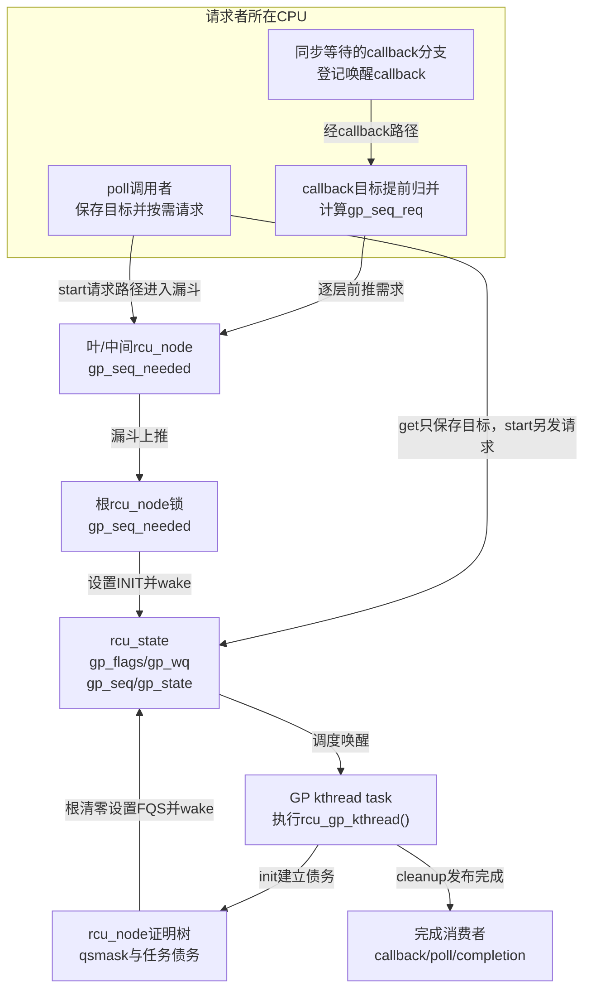
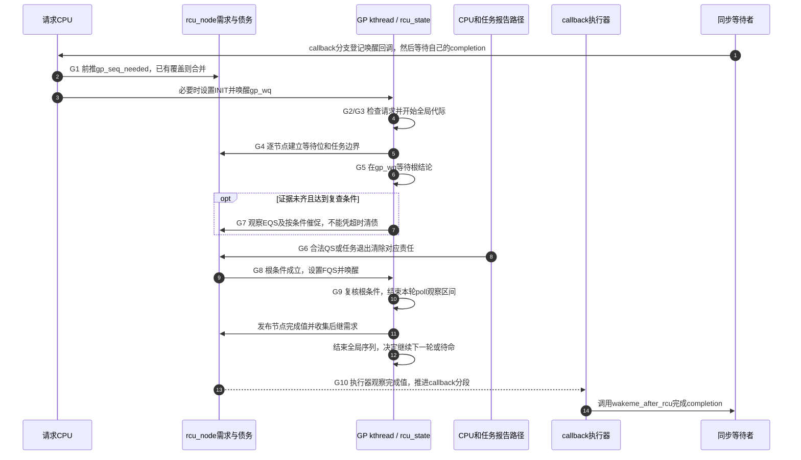

# 第3章\_Linux\_6.12\_Tree\_RCU\_GP全局生命周期模块源码概念导读

## 3.1\_模块问题与版本边界

上一篇追到了一个 CPU 或被抢占任务怎样交出读侧证据，但每个更新者都有自己的回收需求：如果每次调用都启动独立的全树扫描，同一批 CPU 会反复证明同一个安全边界。普通 Tree RCU 因而把需求合并到目标代际，由一个长期 GP kthread 串行组织普通轮次，再把结果交给不同等待者消费。本章沿源码追踪这个请求、证明和交付过程。

源码基线为 NXP Linux 6.12.20、提交 `dfaf2136deb2af2e60b994421281ba42f1c087e0`。展开 `CONFIG_TREE_RCU=y` 的公共控制路径，任务债务部分以 `CONFIG_PREEMPT_RCU=y` 条件分支说明；这不是对当前目标配置的现场核验。固定来源及本轮核对限制见 [源码基线](../../linux/SOURCE_BASELINE.md#1.5.1_RCU家族证据)。

先读稳定机制正文的 [GP 究竟是什么](../../../../knowledge/linux/synchronization_and_asynchrony/synchronization/rcu/P08_Tree_RCU_GP请求与全局生命周期.md#8.1_本章先回答GP究竟是什么)，再用本章定位文件、对象、状态和阅读顺序。具体宏体与函数体只在 [GP 全局生命周期源码实现](../source_explanations/P05_Linux_6.12_Tree_RCU_GP全局生命周期源码实现.md#5.2_源码符号覆盖账本) 唯一展开。

本章不讲 SRCU GP。SRCU 的 reader 是指定 `srcu_struct` 私有域中的双 index 计数，不读写普通 `rcu_state.gp_kthread`；应转入 [Tree SRCU 模块源码概念导读](P09_Linux_6.12_Tree_SRCU模块源码概念导读.md#9.1_先分清Tree_RCU与Tree_SRCU)。

## 3.2\_先把四个对象摆到源码现场

假设两个 CPU 都排入回调，它们可能需要同一个尚未完成的代际。请求者只需记录“我等到哪里”，不必各自创建线程。执行者完成一轮安全证明后，两个回调都可能取得执行资格，之后是否已被调用仍由各自的执行队列决定。带着这个场景再区分四个源码对象：

| 对象 | 源码身份 | 生命周期 | 作用 |
| --- | --- | --- | --- |
| GP 请求 | `gp_seq_needed` 与 `gp_flags` 中的目标/命令 | 从请求产生到目标代际满足 | 声明“至少需要完成到哪里” |
| 物理 GP | 一次 `rcu_seq_start()` 到 `rcu_seq_end()` | 单轮 | 执行全局安全证明 |
| GP kthread 任务 | `rcu_state.gp_kthread` 指向的 `task_struct` | 初始化后长期存在 | 串行推进许多物理 GP |
| GP kthread 入口 | `rcu_gp_kthread()` 函数 | 创建时作为入口，函数内部长期循环 | 等请求、init、FQS、cleanup |

所以 `gp_kthread` 既可能指一个字段中的任务指针，也可能出现在入口函数名中。阅读时必须写清“任务对象”还是“执行函数”。源码没有每个 GP 一个 `gp_thread` 的对象模型。

## 3.3\_源码文件与状态所有权

| 上游相对位置 | 关键对象或函数 | 本模块职责 |
| --- | --- | --- |
| [`init/main.c`](../../linux/init/main.c) | `start_kernel()`、`rest_init()`、`kernel_init()`、`do_pre_smp_initcalls()` | 区分早期 `rcu_init()`、`kthreadd` 就绪、early initcall 分派和 SMP bring-up |
| [`include/linux/init.h`](../../linux/include/linux/init.h) | `early_initcall()`、`__define_initcall()` | 把创建函数登记到链接期 initcall 段，而不是立即调用 |
| [`kernel/rcu/tree.h`](../../linux/kernel/rcu/tree.h) | `struct rcu_state`、`RCU_GP_FLAG_*`、`RCU_GP_*` | 全局线程指针、等待队列、命令和观察阶段 |
| [`kernel/rcu/rcu.h`](../../linux/kernel/rcu/rcu.h) | `rcu_seq_start/end/snap/done()` | 代际开始、完成和目标判断 |
| [`kernel/rcu/tree.c`](../../linux/kernel/rcu/tree.c) | `rcu_state`、spawn、request、wake、init、FQS、cleanup、主循环 | 普通 Tree RCU GP 控制主线 |
| [`kernel/rcu/update.c`](../../linux/kernel/rcu/update.c) | `__wait_rcu_gp()`、`wakeme_after_rcu()` | 默认同步等待怎样接入 callback 完成边界 |
| [`include/linux/rcu_segcblist.h`](../../linux/include/linux/rcu_segcblist.h) | callback 分段结构 | callback 怎样保存目标代际；继续读 [回调与NOCB模块](P07_Linux_6.12_Tree_RCU_回调与NOCB模块源码概念导读.md) |

全局 `gp_seq/gp_kthread/gp_wq/gp_flags/gp_state` 位于 `rcu_state`。根 `rcu_node` 锁协调全局代际和命令的关键更新，请求漏斗中的每层 `gp_seq_needed` 由对应节点锁保护；不能把这一组织说明外推为每个字段的每次访问都持根锁，例如 `gp_state` 有单写者的诊断更新，等待队列还使用自己的等待协议。GP kthread 不是唯一写者：请求 CPU 写需求和 INIT 命令，根完成报告写 FQS 命令，GP kthread 消费命令并推进物理代际。

### 3.3.1\_先通过rcu\_state阅读门再追字段

`struct rcu_state` 还包含 `rcu_barrier()`、expedited GP、FQS/stall、CPU hotplug、同步等待者批处理和 NOCB 配置字段。它是多个子机制的全局汇合地址，不是一轮普通 GP 的单一状态机。阅读本模块时按下面的门分流：

| 当前看到的字段 | 先回答的问题 | 去向 |
| --- | --- | --- |
| `gp_seq/gp_kthread/gp_wq/gp_flags/gp_state` | 普通物理 GP 怎样被请求和推进 | 本模块与 [GP实现讲解](../source_explanations/P05_Linux_6.12_Tree_RCU_GP全局生命周期源码实现.md#5.2_源码符号覆盖账本) |
| `node[]/level[]/ncpus/n_online_cpus` | 树和 CPU 集合怎样建立 | [拓扑与热插拔导读](P04_Linux_6.12_Tree_RCU_拓扑与CPU热插拔模块源码概念导读.md) |
| `gp_seq_polled*`、`srs_*` | poll 或同步等待者怎样消费 GP 完成 | [同步等待导读](P08_Linux_6.12_Tree_RCU_同步等待与rcu_barrier模块源码概念导读.md) |
| `cbovld*`、`jiffies_*`、`gp_activity*` | FQS 节奏、过载与 stall 怎样观察活性 | [FQS与Stall导读](P05_Linux_6.12_Tree_RCU_force_QS与Stall模块源码概念导读.md) |
| `barrier_*` | 怎样等待此前 callback 实际执行 | [同步等待与barrier导读](P08_Linux_6.12_Tree_RCU_同步等待与rcu_barrier模块源码概念导读.md) |
| `exp_*`、`expedited_*` | 加速 GP 的独立证明通道 | [Expedited导读](P06_Linux_6.12_Tree_RCU_Expedited_GP模块源码概念导读.md) |
| `nocb_*` | callback offload 配置怎样协调 | [回调与NOCB导读](P07_Linux_6.12_Tree_RCU_回调与NOCB模块源码概念导读.md) |

完整逐字段读写账本和几处源码短注释的误读纠正，见 [`rcu_state` 完整字段域与权威去向](../source_explanations/P05_Linux_6.12_Tree_RCU_GP全局生命周期源码实现.md#5.3.1_完整字段域与权威去向)。模块导读只沿普通 GP 所需字段前进，不把其他子状态机重新展开一遍。



图中的 callback 目标归并对应源码所称的 acceleration，不等于 expedited GP。同步等待还存在直接登记批次的 SRS 分支，后文给出它的唯一实现入口；图中画的是经过唤醒回调的分支。`get_state_synchronize_rcu()` 保存目标不主动发起新轮，`start_poll_synchronize_rcu()` 则还会推动请求。

## 3.4\_G0到G10\_源码调用阶段

**讲解层次：机制阶段到固定源码的映射。** 沿用知识正文 [G0～G10](../../../../knowledge/linux/synchronization_and_asynchrony/synchronization/rcu/P08_Tree_RCU_GP请求与全局生命周期.md#8.9_G0到G10_一轮物理GP的统一生命周期)，线程的一次性创建放在下一节，不再占用周期编号。

| 阶段 | 主要函数 | 状态流 | 阅读问题 |
| --- | --- | --- | --- |
| G0 待命 | `rcu_gp_kthread()` 的等待 | `gp_state=WAIT_GPS`，等待 `gp_wq` | 任务为何无需每轮重建 |
| G1 提交与唤醒 | `rcu_start_this_gp()`、`rcu_gp_kthread_wake()` | 前推节点 `gp_seq_needed`，设置 INIT 后 wake | 多个请求怎样合并 |
| G2 检查 | 主循环进入 `rcu_gp_init()` | `WAIT_GPS→DONE_GPS`，重新检查命令 | 为什么唤醒不等于成功开轮 |
| G3 开始 | `rcu_gp_init()` 的全局序列更新 | `rcu_seq_start(&rcu_state.gp_seq)` | 全局开始与逐节点初始化为何分开 |
| G4 建债 | 同函数协调hotplug并遍历节点 | 建立 `qsmask`、任务边界和节点序列 | 初始化结束后才返回true |
| G5 等待 | `rcu_gp_fqs_loop()` | `WAIT_FQS↔DOING_FQS` | 唤醒后重查什么条件 |
| G6 正常清债 | CPU报告与任务退出路径 | per-CPU/任务证据 → 节点位和任务边界 | 怎样形成根结论 |
| G7 FQS复查 | `rcu_gp_fqs()` 与远端观察 | 采样或复查EQS，按条件催促 | 超时为何不是完成证据 |
| G8 根通知 | `rcu_report_qs_rsp()` | `gp_flags|=FQS` → wake | 为什么这里只通知而不cleanup |
| G9 发布与后继安排 | `rcu_gp_cleanup()`、`rcu_future_gp_cleanup()` | 先结束poll观察区间，再写节点完成值、结束全局序列；保留后继需求 | 本轮完成怎样与下一轮衔接 |
| G10 各消费者交付 | core、callback、poll或SRS等待路径 | 消费完成值，执行回调或唤醒调用者 | 为何可与下一轮GP重叠 |

这些阶段只有一条物理 GP 控制主线，但它们依赖请求、证明和交付三组外围状态。不要把函数调用顺序误读成所有状态都由 GP kthread 私有保存。



第 3、9 步都叫醒 GP 线程，理由却分别是“有需求”与“证明可能完成”；真实条件保存在共享状态中。第 10～12 步发布完成，第 13～14 步才把资格变成回调执行和调用者唤醒。新一轮可在第 12 步后推进，不必等待所有第 14 步结束。

## 3.5\_线程怎样创建并安全发布

先区分两个启动事件。`start_kernel()` 中较早的 `rcu_init()` 建立 Tree RCU 拓扑、boot CPU 状态和执行基础设施，但不创建普通 GP kthread。`tree.c` 末尾的 `early_initcall(rcu_spawn_gp_kthread)` 只是把创建函数登记到 early initcall 段；真正调用发生在 `rest_init()` 已建立 `kthreadd` 以后：

```text
start_kernel()
    → rcu_init()                         先建立RCU基础设施，不创建GP任务
    → rest_init()
        → 创建kernel_init与kthreadd
        → complete(kthreadd_done)
    → kernel_init等待kthreadd_done
        → kernel_init_freeable()
            → do_pre_smp_initcalls()    遍历early initcall段
                → rcu_spawn_gp_kthread()
                    → kthread_create(rcu_gp_kthread, ...)
                    → 可选设置SCHED_FIFO优先级
                    → 根节点锁下更新活动时间
                    → smp_store_release(&rcu_state.gp_kthread, task)
                    → wake_up_process(task)
            → smp_init()
```

所以这里的次序保证不是“宏名字看起来很早”推测出来的：`kernel_init()` 先等待 `kthreadd_done`，`kernel_init_freeable()` 再调用 `do_pre_smp_initcalls()`，随后才进入 `smp_init()`。`tree.c` 因而可以在该 initcall 中预期只有一个 online CPU，`kthread_create()` 也已经具备创建基础设施。

源码在发布指针前先重置 `gp_activity/gp_req_activity`，再用 release store 写 `gp_kthread`，明确约束这些写入不能跑到任务指针发布之后。请求路径读取指针主要用于判断任务是否已经存在并可唤醒；不能只凭一个 `READ_ONCE(gp_kthread)` 擅自扩张成对任意初始化字段的 acquire 契约。线程创建后会一直存在，后续每轮 GP 只改变它处理的状态，不重新分配任务对象。

这段初始化还会创建 NOCB、boost/core 与 expedited 执行者。它们的名字都与 RCU 有关，但职责不同；不能把 `rcu_spawn_gp_kthread()` 理解为“创建一个线程执行全部 RCU 工作”。

创建函数标记为 `__init`，以后会随 init memory 释放；被创建的 `task_struct`、`rcu_state.gp_kthread` 指针和 `rcu_gp_kthread()` 主循环不随它消失。具体启动分派见 [从内核启动链定位 `early_initcall`](../source_explanations/P05_Linux_6.12_Tree_RCU_GP全局生命周期源码实现.md#5.5.1_先从内核启动链定位early_initcall)，创建与发布语句见 [`rcu_spawn_gp_kthread()` 怎样创建并发布任务](../source_explanations/P05_Linux_6.12_Tree_RCU_GP全局生命周期源码实现.md#5.5.2_rcu_spawn_gp_kthread怎样创建并发布任务)。

## 3.6\_请求漏斗为什么不是全局热锁

`rcu_start_this_gp()` 从请求 CPU 的叶节点开始。每到一层，它都先判断：

1. 这一层是否已经记录相同或更远的 `gp_seq_needed`；
2. 请求的代际是否已经开始；
3. 沿父链取得的节点是否已经观察到一轮进行中的 GP。

前两种条件表示需求已被记录或目标已开始。第三种条件则依赖起始叶已保留需求，当前轮 cleanup 会扫描它；此外，刚写完起始节点需求后若发现该节点已有进行中的GP，也可直接退出。只有仍需推动开轮的请求才继续向根并按条件设置 INIT。因此许多 CPU 请求同一代际时，后来的请求往往停在叶或中间节点，不必全部写根缓存行。代价是维护分层需求和cleanup扫描；它减少集中争用，不消除节点锁和共享缓存行访问。

请求路径返回 true 只表示“调用者有理由唤醒 GP kthread”，不表示 GP 已经开始。具体实现见 [`rcu_start_this_gp()` 漏斗记录未来需求](../source_explanations/P05_Linux_6.12_Tree_RCU_GP全局生命周期源码实现.md#5.6_rcu_start_this_gp漏斗记录未来需求)。

## 3.7\_一次唤醒怎样进入主循环和初始化

`rcu_gp_kthread_wake()` 先检查任务指针、命令状态和是否需要避免普通进程上下文中的自唤醒，再写调试时间并唤醒 `gp_wq`。等待队列只负责把线程从睡眠改成可运行；何时真正运行由调度器决定，所以“wake”与“立即开始 GP”不是同一事件。

主循环有内外两层：内层等待 INIT 并调用 `rcu_gp_init()`，只有返回 true 才进入本轮 FQS 与 cleanup。该函数在根锁下看到无命令时返回 false；若异常发现已有普通 GP 进行中，也告警并拒绝再开一轮。不能把这描述成另一个普通 GP 线程已替它完成工作，因为普通轮本就由这一个线程串行推进。

`rcu_gp_init()` 随后：

1. 在根锁下消费 `gp_flags` 并确认没有普通 GP 正在进行；
2. `rcu_seq_start(&rcu_state.gp_seq)` 发布新代际开始；
3. 协调 hotplug，把下一轮在线集合转成本轮稳定集合；
4. 广度优先遍历节点，在节点锁下先检查/设置该节点已有被阻塞任务的本轮边界；
5. 从 `qsmaskinit` 建立 `qsmask`，将节点 `gp_seq` 与全局代际对齐；
6. 处理初始化期间CPU离线等边界，遍历完成后返回true。

全局代际先开始，hotplug集合再逐叶协调，并不是一个瞬间冻结所有CPU在线状态的快照。广度优先初始化期间，其他 CPU 主要从叶节点观察代际。同一个 GP kthread 同时负责完成整个初始化和后续等待，因此初始化尚未结束时不会有另一条普通GP控制主线越过它完成本轮。

具体实现见 [`rcu_gp_kthread()` 串联一轮物理 GP](../source_explanations/P05_Linux_6.12_Tree_RCU_GP全局生命周期源码实现.md#5.8_rcu_gp_kthread串联一轮物理GP)和 [`rcu_gp_init()` 开始代际并建立证明债务](../source_explanations/P05_Linux_6.12_Tree_RCU_GP全局生命周期源码实现.md#5.9_rcu_gp_init开始代际并建立证明债务)。

## 3.8\_FQS循环和根完成通知怎样协作

`rcu_gp_fqs_loop()` 在 `gp_wq` 上进行带超时等待，唤醒原因可能是：

- 根节点已经没有 CPU/任务债务；
- 到了下一次 FQS 扫描时机；
- 外部路径设置 `RCU_GP_FLAG_FQS`；
- callback 过载要求更快扫描；
- 信号或伪唤醒等需要重新检查的事件。

每次醒来都重新读取根条件。FQS 只能观察 EQS、设置 urgent/resched、发送必要探测或启动 boost，不能凭超时把未知参与者判为安全。

当 `rcu_report_qs_rnp()` 清到根时，它调用 `rcu_report_qs_rsp()`：设置 FQS 位、释放根锁、唤醒 GP kthread。这里不直接调用 cleanup，是因为最后报告者可能处在中断、softirq 或其他不适合执行全树 cleanup 的上下文，而且全局发布仍必须由串行控制线程完成。

具体实现见 [FQS 循环与根完成通知](../source_explanations/P05_Linux_6.12_Tree_RCU_GP全局生命周期源码实现.md#5.10_FQS循环与根完成通知)。

## 3.9\_cleanup为什么先写节点再结束全局序列

根债务清零以后，外部 CPU 仍暂时看到全局 GP 处于进行中。`rcu_gp_cleanup()` 先计算完成后的 `new_gp_seq`，再广度优先写入各 `rcu_node.gp_seq`，使各 CPU 有机会推进 callback，并检查每个节点是否还记录更远需求。

全树节点都发布完成值以后，函数才在根锁下对 `rcu_state.gp_seq` 执行真正的 `rcu_seq_end()`。这样下一轮开始不可能出现在某个节点仍保留上一轮进行中值之前。

各节点遍历中已经检查 `gp_seq_needed`，回到根后还会复查晚到需求；若仍有需求，保留或重建 INIT，主循环下一次迭代处理后继 GP。节点完成值一旦发布，相应消费者就可以观察它，不必等整轮cleanup函数返回才开始动作。poll公共序列在节点遍历前已按自身契约结束观察区间；SRS同步批次则在全局序列结束后交给专用cleanup路径。这些是不同结果交付点，不能合并成一个“最后广播完成”。

具体实现见 [`rcu_gp_cleanup()` 发布完成并承接下一代](../source_explanations/P05_Linux_6.12_Tree_RCU_GP全局生命周期源码实现.md#5.11_rcu_gp_cleanup发布完成并承接下一代)。

## 3.10\_明确不属于普通GP\_kthread的工作

| 工作 | 实际执行者 | GP kthread提供的只是什么 |
| --- | --- | --- |
| reader 进入/退出 | 当前任务/CPU 的读侧接口 | 无逐 reader 调用 |
| 记录普通调度 QS | scheduler 钩子与本 CPU 状态 | 预先建立该 CPU 的本轮债务 |
| 逐层上报 QS | 本 CPU `rcu_core()` 与节点汇聚路径 | 等待根结论 |
| 实际调用普通 callback | softirq、`rcuc` 或 NOCB CB kthread 等 | 发布 callback 所需 GP 已完成 |
| 执行业务 `kfree(old)` | 同步 writer 返回后或业务 callback | 提供安全时间边界 |
| SRCU 双 index 扫描 | 指定 SRCU 域的 work/状态机 | 不参与 |

这张边界表可以防止“看到 RCU 线程就把所有异步动作归给它”的阅读错误。

## 3.11\_建议阅读顺序

1. 在 `init/main.c` 与 `include/linux/init.h` 追踪 `rcu_init()`、`kthreadd_done`、`do_pre_smp_initcalls()` 和 `early_initcall()`，先证明创建发生在哪个启动窗口。
2. 在 `tree.h` 区分 `gp_kthread` 任务指针、`gp_wq`、`gp_flags`、`gp_state` 和 `gp_seq`。
3. 在 `rcu.h` 阅读 `rcu_seq_start/end/snap/done()`，先理解序列契约，再看具体低位布局。
4. 阅读 `rcu_spawn_gp_kthread()`，确认线程只创建一次并 release 发布。
5. 阅读 `rcu_start_this_gp()` 与 `rcu_gp_kthread_wake()`，画出请求 CPU 到全局线程的通信方向。
6. 阅读 `rcu_gp_kthread()`，确认 `rcu_gp_init()` 返回 true 的分支才进入 FQS/cleanup。
7. 阅读 `rcu_gp_init()`，把 hotplug 集合、CPU `qsmask` 与抢占任务边界放在同一阶段。
8. 阅读 `rcu_gp_fqs_loop()` 和 `rcu_report_qs_rsp()`，区分催促、根通知与安全证明。
9. 阅读 `rcu_gp_cleanup()`，确认节点完成发布、全局结束和下一代请求的顺序。
10. 若调用路径使用 poll 或 `rcu_normal_wake_from_gp`，继续阅读 [poll 公共序列](../source_explanations/P05_Linux_6.12_Tree_RCU_GP全局生命周期源码实现.md#5.12_poll公共序列怎样由普通与expedited_GP共同推进)、[SRS 请求划批](../source_explanations/P14_Linux_6.12_Tree_RCU_同步等待批处理源码实现.md#14.3_请求登记与dummy节点怎样划定本轮)和 [SRS 完成交付](../source_explanations/P14_Linux_6.12_Tree_RCU_同步等待批处理源码实现.md#14.4_cleanup与workqueue怎样分担交付)，不要从字段名字猜交付模型。
11. 最后进入 [回调与NOCB导读](P07_Linux_6.12_Tree_RCU_回调与NOCB模块源码概念导读.md)，观察完成代际怎样变成 callback 实际执行。

## 3.12\_源码阅读验收

先用同一条周期检验理解：若根等待位和任务边界都清空，但GP线程尚未获调度，能否断言同步调用者已返回？不能，G8的证明和通知还未兑现为G9的完成发布，更没有保证G10的回调或批次交付。若回调执行器被其他工作延迟，下一轮GP仍可继续，而该调用者可能仍在等自己的completion。

1. 能区分 `start_kernel()` 中的 `rcu_init()` 与后来 early initcall 创建 GP kthread 的两个启动事件。
2. 能证明 `rcu_spawn_gp_kthread()` 为什么晚于 `kthreadd` 就绪、早于 `smp_init()`，而不是只背 `early_initcall` 名字。
3. 能说明 GP、GP 请求、物理 GP 和 GP kthread 是四个什么对象。
4. 能指出 GP kthread 的 `task_struct` 指针、等待队列、命令和阶段分别保存在哪里。
5. 能解释为什么多个 callback 请求可以在叶/中间节点提前合并。
6. 能说明 `gp_flags` 为什么不是完成证明，`gp_state` 为什么不是安全债务。
7. 能画出请求唤醒、根完成唤醒和 callback 唤醒三条不同通信路径。
8. 能解释 cleanup 为什么先发布节点完成值，再结束全局 `gp_seq`。
9. 能说明普通与 expedited GP 怎样共同推进 `gp_seq_polled`，又不会互相错误结束观察区间。
10. 能说明 `srs_wait_nodes[]` 为什么是批次分隔节点，而不是同步调用者对象池。
11. 能明确普通 Tree RCU GP kthread不拥有 SRCU、Tasks、NOCB callback 执行状态机。

总阅读索引：[Linux 6.12 RCU 源码总阅读索引](P01_Linux_6.12_RCU源码总阅读索引.md#1.6_建议的源码阅读顺序)。
