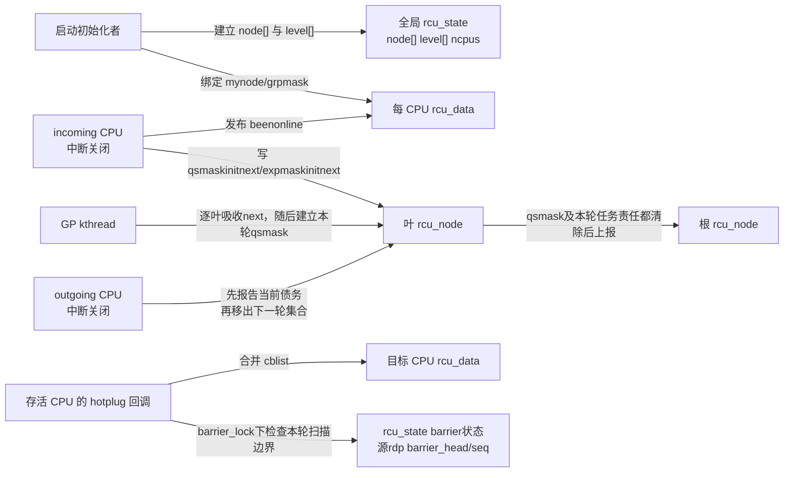
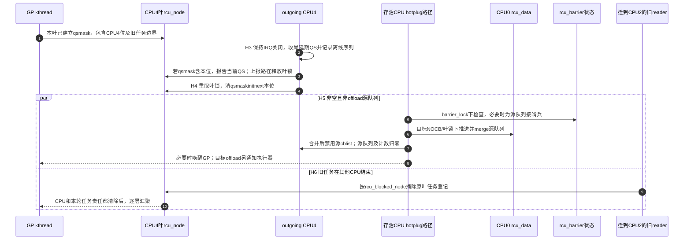

# 第4章\_Linux\_6.12\_Tree\_RCU\_拓扑与CPU热插拔模块源码概念导读

## 4.1\_本模块究竟解决什么问题

普通 Tree RCU 要把很多 CPU 的局部 QS 证据汇聚成一次全局 GP 完成结论。源码首先必须回答三个问题：

1. 每个 CPU 的证据应该写入哪一个叶 `rcu_node`、哪一位；
2. 当前 GP 已建立的等待责任，与 CPU 上下线准备的参与集合怎样隔离；
3. CPU 离线以后，留在该 CPU 上的 callback、barrier 哨兵和被抢占 reader 债务由谁继续承担。

这三个问题共同构成 **Tree RCU 拓扑与 CPU 参与生命周期**。它不是普通 GP 主线程的一个小分支，也不是“热插拔时把一个位清零”这么简单。拓扑在启动阶段建立；CPU 参与集合在每次上线、下线和 GP 初始化之间交接；callback 所有权还要在 CPU 真正死亡以后迁移。

稳定机制模型先读 [Tree RCU 初始化、拓扑与执行上下文](../../../../knowledge/linux/synchronization_and_asynchrony/synchronization/rcu/P07_Tree_RCU_初始化_拓扑与执行上下文.md#7.1_具体问题_CPU的QS究竟要写进哪一个节点) 和 [Tree RCU CPU 热插拔与回调迁移](../../../../knowledge/linux/synchronization_and_asynchrony/synchronization/rcu/P17_Tree_RCU_CPU热插拔与回调迁移.md#17.1_场景_CPU4在GP中途下线)。本章只负责 Linux 6.12.20 的模块边界、状态地址和源码阅读顺序。

本篇核对 NXP 发布标签 `lf-6.12.20-2.0.0`、固定提交 `dfaf2136deb2af2e60b994421281ba42f1c087e0`，分析 `CONFIG_TREE_RCU` 与 `CONFIG_HOTPLUG_CPU` 分支，任务债务另需 `CONFIG_PREEMPT_RCU`。这是源码条件，不是当前目标配置验证；来源和缓存身份见 [源码基线](../../linux/SOURCE_BASELINE.md#1.5.1_RCU家族证据)。

## 4.2\_先定义六个容易被默认理解的名词

设 CPU4 已在本轮等待集合中，它的队列还有未执行回调，而一个曾在它上面运行的旧reader已经迁往CPU2。此时让CPU4离线，不能简单删除“CPU4”的全部记录：CPU等待位可以按退出协议清除，回调需要接管执行，CPU2上的任务则仍须自己结束读区。下面这些名称分别定位这三种责任，不能当作同一个online状态的别名。

| 名词 | 在本模块中的准确含义 | 不能误解成 |
| --- | --- | --- |
| RCU topology | `rcu_state.node[]` 及 `level[]` 构成的固定汇聚树 | Linux 调度域或 NUMA 拓扑的直接镜像 |
| possible CPU | 启动配置允许存在、因而预先拥有 `rcu_data` 与叶节点位的 CPU | 当前正在运行的 CPU |
| online CPU | CPU热插拔框架中的在线身份；RCU另在starting/dead等边界维护自己的参与状态 | online mask、RCU私有计数和当前GP等待集合完全相同 |
| current-GP mask | GP 初始化建立、随后随合法报告逐位清除的 `qsmask` | 不变的快照，或实时复制的在线掩码 |
| next-GP mask | `qsmaskinitnext` 等为未来 GP 保存的参与集合 | 当前 GP 尚未报告 QS 的 CPU 集合 |
| callback migration | 把非offload源队列合入接管CPU，保留DONE资格，未成熟部分重新归并等待 | 保留全部原分段标签，或直接执行所有callback |

`ncpus` 与 `n_online_cpus` 也必须分开：固定版本中，前者由 CPU starting 路径以 release 语义发布“expedited 初始化树是否见过新 CPU”的变化；后者在 prepare 增加、dead 减少，是 RCU 维护的生命周期计数，不是随时等于 `cpu_online_mask` 的实时位数。它们都不是当前普通 GP 的权威完成条件。

## 4.3\_参与者状态地址与所有权

| 状态地址 | 主要写入者 | 主要读取者 | 同步边界 |
| --- | --- | --- | --- |
| `rcu_state.node[]/level[]` | `rcu_init_one()` | 所有树遍历与每 CPU 绑定路径 | 启动期建立，运行期拓扑形状不变 |
| `rdp->mynode/grpmask` | `rcu_init_one()`、boot per-CPU 初始化 | QS、FQS、hotplug、callback 路径 | CPU 启动前确定 |
| `rnp->qsmaskinitnext` | CPU starting/dead 路径 | 下一次 `rcu_gp_init()` | `ofl_lock`、叶锁；barrier 交界还用 `barrier_lock` |
| `rnp->qsmaskinit/qsmask` | GP初始化吸收初始参与关系；合法报告清除 `qsmask` 位 | QS 上报、FQS、stall | 节点锁；本轮剩余责任不能由online mask覆盖 |
| `rnp->expmaskinitnext/expmaskinit/expmask` | CPU starting 只增 ever-online 基础位；expedited reset/报告推进后两者 | expedited CPU 选择和报告 | 各节点锁，另由 `ncpus` 检测是否出现从未加入过的新 CPU |
| `rdp->cblist` | `call_rcu()`、GP 推进、执行与迁移路径 | core、NOCB、barrier | 本地 IRQ/NOCB 锁、节点锁、`barrier_lock` 按操作组合 |
| `rnp->blkd_tasks` | 抢占式 reader 阻塞/解阻路径 | 普通与 expedited GP | 叶节点锁；CPU 离线不能删除任务债务 |

## 4.4\_它是三组相互交接的状态机

固定 `rcu_node` 拓扑、每轮 CPU 参与集合和 callback 执行所有权分别由不同路径维护。CPU 上下线时三者必须按顺序交接，但不能合并成一个 online 布尔值，否则当前 GP、下一轮 GP 和队列迁移会互相污染。

### 4.4.1\_拓扑构造状态机

`rcu_init_one()` 从叶层向根层初始化每个 `rcu_node`，但 `node[]` 在内存中采用紧密数组的“heap form”，不是动态分配堆。`level[i]` 指向第 `i` 层在 `node[]` 中的首节点；每个节点保存自己覆盖的 CPU 范围 `grplo..grphi`、父指针、在父节点中的 `grpmask`。

随后所有 possible CPU 取得一个固定的 `rdp->mynode` 和 `rdp->grpmask`。运行期 CPU 上下线不会重建整棵树，只改变参与位和 per-CPU 生命周期。

### 4.4.2\_CPU参与集合状态机

普通参与集合这一侧，CPU starting 先将本位加入 `qsmaskinitnext`，不直接向已有的 `qsmask` 添加等待责任。必须进一步区分全局开始和叶节点吸收：`rcu_gp_init()` 先推进全局序列，再逐叶把next吸收到init，最后建立各节点本轮等待位。如果starting先于本叶的吸收，新位可以被这次初始化看到；如果晚于本叶吸收，则留给后续轮次。不能仅拿全局 `rcu_seq_start()` 的时刻判断“本轮还是下一轮”。

CPU dead 在这份实现中先处理当前债务，再删除next位：如果 `qsmask` 仍在等它，先调用上报函数；该函数会释放叶锁，返回后重新取得叶锁，才修改 `qsmaskinitnext`。整个交接还由 `ofl_lock` 与GP初始化协调。最后阶段持续关闭IRQ，防止已经退出参与集合后又由中断进入新读区。只删next而不履行当前报告会留下无人偿还的等待位；反过来，starting也不能随意修改已建立的current位。

一片叶的CPU都离线时，还可能有已经迁走的被抢占任务。`wait_blkd_tasks` 让后续初始化保留这条有任务责任的分支；任务按原登记节点退出以后，再由初始化协调未来参与关系。CPU位清零、任务责任清零和未来拓扑参与位调整是不同动作。

Expedited 的基础位采用另一策略：`expmaskinitnext` 不在 CPU offline 时清除，而保存“曾经 online 的 CPU”并集；每轮 CPU selection 再识别当前 offline CPU并直接报告。这样重新上线不必反复向上重建初始化树。`ncpus` 也只在首次把一个 CPU 位加入这个并集时增长。

### 4.4.3\_回调所有权状态机

非 NOCB CPU 离线后，`rdp->cblist` 不能留在不再运行 core 的 CPU 上。迁移路径先与 `rcu_barrier()` 的扫描边界协调，必要时把哨兵接到源队列，再尝试利用可知代际推进队列并执行 `rcu_segcblist_merge()`。这里“推进源和目标”是职责概括，不能伪造为两个函数必定无条件依次执行：源码用短路 `||` 合并唤醒需求，源推进返回true时可以跳过同一表达式中的目标推进；合并后还有按条件执行的目标推进。

合并把源DONE接入目标DONE，保留它们已经取得的执行资格；源尚未成熟的回调重新进入目标NEXT，不能提前执行，也不保证保留原有WAIT/NEXT_READY标签。代价可能是额外等待，换来无需让两个独立队列的所有代际标签一一对应。目标若由NOCB执行器管理，迁入后还要走相应唤醒路径。

barrier哨兵解决一个具体窗口：barrier已经扫描了目标CPU，却尚未扫描源CPU，此时若直接迁走源回调，扫描者可能两边都漏掉它们。迁移在 `barrier_lock` 下检查并为该批责任安排哨兵，使回调移动后仍计入这次等待；不是每次迁移都无条件插一个哨兵，也不是用普通GP替代回调完成证明。

NOCB CPU 的 callback 本来就由 offload kthread 管理，因此 hotplug 迁移路径直接返回；这不表示 callback 被丢弃，而是其执行所有权没有随物理 CPU 下线消失。

## 4.5\_H0到H9\_从固定位置追踪CPU离线周期

启动前提是 `rcu_init_one()` 为possible CPU绑定固定叶节点及本位，prepare建立本地执行数据，starting发布参与信息。下面沿用正文的 [H0～H9](../../../../knowledge/linux/synchronization_and_asynchrony/synchronization/rcu/P17_Tree_RCU_CPU热插拔与回调迁移.md#17.6_H0到H9_CPU4离线周期) 追踪离线；H6任务退出可以与队列迁移交错，H8/H9是后续吸收和再次上线，不是必须逐行串行发生。

| 阶段 | 触发 | 写入地址 | 后续读取者 | 退出条件 |
| --- | --- | --- | --- | --- |
| H0 在线运行 | 完成上线协议 | next集合含CPU；可能还有当前 `qsmask` 位 | GP/QS路径 | 收到offline请求 |
| H1 早期offline | `rcutree_offline_cpu()` | 清 `ffmask` 位，调整线程affinity，设置tick依赖 | FQS、hotplug | 后续stop-machine可推进；此时CPU仍然活跃 |
| H2 dying | `rcutree_dying_cpu()` | trace记录当前是否仍被等待 | 诊断者 | 不靠trace清除任何债务 |
| H3 最后本地报告 | outgoing CPU、IRQ关闭 | 延后唤醒/QS收尾，记录诊断序列并报告当前位 | 当前GP | CPU责任已处理，任务责任独立 |
| H4 删除未来参与 | 同一report-dead路径 | 清普通next位、`cpu_started=false` | 后续GP初始化 | IRQ持续关闭到CPU死亡；expedited ever-online位保留 |
| H5 接管回调 | 存活CPU执行迁移 | 源/目标 `cblist`、必要barrier哨兵 | core/NOCB/barrier | 非空非offload源完成合并并禁用；空源或NOCB提前返回 |
| H6 任务退出 | 迁走任务最外层unlock及必要延期 | 原叶任务登记与本轮边界 | 节点汇聚 | 本任务不再阻塞当前轮 |
| H7 dead收尾 | 其他CPU进程上下文 | `n_online_cpus` 减一，解除tick依赖 | RCU诊断/策略 | 本次控制路径完成 |
| H8 后续吸收 | `rcu_gp_init()` | next→init，按任务情况调整父位及 `wait_blkd_tasks` | 后续GP | 形成一致参与关系 |
| H9 再上线 | prepare/starting/online | 重建所需本地状态、发布next位 | 后续GP及本地读者 | 不重建静态树 |

## 4.6\_端到端时序\_GP中途CPU4下线

第 2～4 步只处理 CPU4 对当前/未来集合的责任，第 5～8 步另行迁移 callback 所有权；迁移在 `kernel/cpu.c` 等到CPU死亡的相应边界后执行，不是发出offline请求就能搬走队列。第 9～10 步说明独立任务分支：CPU位清除不会替这个任务退出读侧。实际调度可使H6更早或更晚，图中par表示它不必等待H5结束；最终仍以原叶的全部本轮责任为准。

## 4.7\_正常路径特殊路径与强制慢路径

| 路径 | 发生频率 | 通信方式 | 不变量 |
| --- | --- | --- | --- |
| 启动拓扑构造 | 每次启动一次 | 直接初始化共享数组和 per-CPU 指针 | 运行期树形状稳定 |
| CPU 上线/下线 | 稀有控制路径 | `ofl_lock`、节点锁、release 发布 | current 与 next 集合不混用 |
| callback 迁移 | CPU 下线慢路径 | `barrier_lock`、NOCB/节点锁、链表合并、GP 唤醒 | 已排队 callback 不丢、不提前执行 |
| expedited 新 CPU 接入 | 下一次 expedited reset | `ncpus` acquire/release、节点锁 | 只传播真正新增的 CPU 位 |
| 异常旧代际/计数回绕 | hotplug 交界 | GP 序列修正辅助 | 不能把旧代际误报成当前 QS |

## 4.8\_源码文件地图与唯一实现入口

| 阅读目标 | 源文件 | 唯一实现讲解 |
| --- | --- | --- |
| `start_kernel()` 中 `rcu_init()` 的完整启动事务、配置分派和后继阶段 | [`init/main.c`](../../linux/init/main.c)、[`kernel/rcu/tree.c`](../../linux/kernel/rcu/tree.c) | [P12：`rcu_init()` I0～I13](../source_explanations/P12_Linux_6.12_Tree_RCU_rcu_init启动初始化源码实现.md#12.6_I0到I13的初始化阶段账本) |
| `node[]/level[]`、父子关系与 CPU 绑定 | [`kernel/rcu/tree.c`](../../linux/kernel/rcu/tree.c)、[`tree.h`](../../linux/kernel/rcu/tree.h) | [P06：`rcu_init_one()`](../source_explanations/P06_Linux_6.12_Tree_RCU_拓扑与CPU热插拔源码实现.md#6.4_rcu_init_one建立固定汇聚树并绑定每CPU叶节点) |
| boot per-CPU 初值与 CPU prepare | [`kernel/rcu/tree.c`](../../linux/kernel/rcu/tree.c) | [P06：boot 与 prepare](../source_explanations/P06_Linux_6.12_Tree_RCU_拓扑与CPU热插拔源码实现.md#6.5_boot初始化与prepare为何仍未让CPU加入当前GP) |
| CPU starting/dead 的 current/next 交接 | [`kernel/rcu/tree.c`](../../linux/kernel/rcu/tree.c) | [P06：starting/dead](../source_explanations/P06_Linux_6.12_Tree_RCU_拓扑与CPU热插拔源码实现.md#6.6_report_cpu_starting与report_cpu_dead怎样隔离当前轮和下一轮) |
| callback 迁移与 barrier 交界 | [`kernel/rcu/tree.c`](../../linux/kernel/rcu/tree.c) | [P06：callback migration](../source_explanations/P06_Linux_6.12_Tree_RCU_拓扑与CPU热插拔源码实现.md#6.7_rcutree_migrate_callbacks保持成熟边界与barrier证明) |
| GP init 如何消费 next 集合 | [`kernel/rcu/tree.c`](../../linux/kernel/rcu/tree.c) | [P05：`rcu_gp_init()`](../source_explanations/P05_Linux_6.12_Tree_RCU_GP全局生命周期源码实现.md#5.9_rcu_gp_init开始代际并建立证明债务) |
| `rcu_barrier()` 如何与迁移互锁 | [`kernel/rcu/tree.c`](../../linux/kernel/rcu/tree.c) | [P10：barrier 与 hotplug 交界](../source_explanations/P10_Linux_6.12_Tree_RCU_同步等待与rcu_barrier源码实现.md#10.7_barrier_lock怎样封住CPU热插拔与迁移竞态) |

## 4.9\_建议阅读顺序与验收

1. 先读 `start_kernel()` 中的 [`rcu_init()` 完整启动事务](../source_explanations/P12_Linux_6.12_Tree_RCU_rcu_init启动初始化源码实现.md#12.4_进入rcu_init以前内核已经保证了什么)，确定调用现场和后半程尚未发生的动作；
2. 在 `tree.h` 找到 `rcu_state.node[]/level[]`、`rcu_node.qsmask*` 和 `rcu_data.mynode/grpmask`；
3. 再读 `rcu_init_one()`，只回答静态地址怎样建立；
4. 沿 `rcutree_prepare_cpu()` 到 `rcutree_report_cpu_starting()`，区分“数据准备好”和“加入未来参与集合”；
5. 回到普通 GP `rcu_gp_init()`，观察 next 集合何时变成 current 债务；
6. 最后沿 `rcutree_report_cpu_dead()` 与 `rcutree_migrate_callbacks()`，分别追踪证明债务和 callback 所有权。

先推演两个边界题。若全局GP已开始、但本叶尚未吸收next，CPU4此时starting，会不会进入此次初始化？可以，关键是本叶吸收与starting的锁序。如果本叶已建立本轮等待位，再发生starting，就不能直接补入current位。

再设CPU4源队列有一项DONE和一项尚未成熟回调，目标CPU0已经被barrier扫描。迁移后DONE保留执行资格，未成熟项进入NEXT重新安排，必要的barrier哨兵使源批次仍被本次等待覆盖；这些动作都不能消除迁往CPU2的旧任务债务。能分别沿三种责任指出写入者、状态位置和退出条件，才算读懂这次离线。

总入口：[Linux 6.12 RCU 源码总阅读索引](P01_Linux_6.12_RCU源码总阅读索引.md#1.4_模块概念导读入口)。
