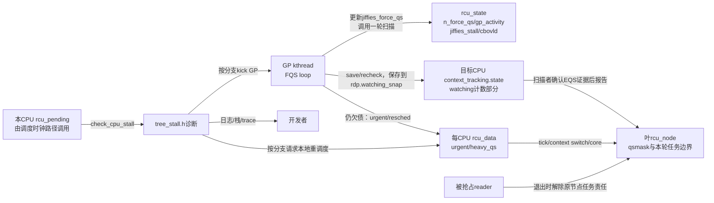
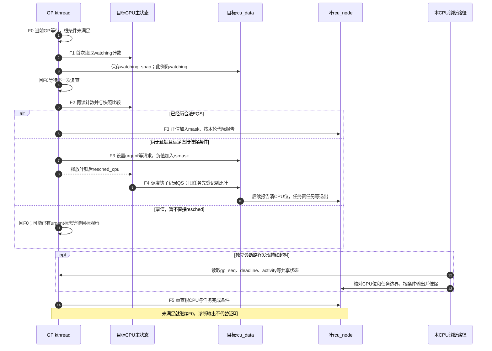

# 第5章\_Linux\_6.12\_Tree\_RCU\_force\_QS与Stall模块源码概念导读

## 5.1\_为什么GP已经在等还要有force\_QS

普通 GP 开始以后，CPU和本轮任务责任都消除才具备完成条件。但“等待迟迟没有结束”至少可能来自四类不同原因，不能都解释成根 `qsmask` 非零：

- CPU 已经进入 idle/user/EQS，只是本地没有走普通主动上报路径；
- CPU 尚未经历 QS，需要设置 urgent 标志或请求 reschedule；
- CPU 位已经清空，但被抢占 reader 仍挂在 `blkd_tasks`；
- QS 证据已经齐全，GP kthread、timer 或唤醒链本身却长期没有运行。

`force-QS` 的职责是 **重新检查、催促并汇聚已有的合法 QS 证据**。它不能宣布一个仍在旧 reader 中的 CPU 已安全。Stall 子系统则在等待超过阈值后对“谁还欠债、哪一个执行者不动、timer 是否失效”做诊断和有限催促；它也不能绕过 GP 正确性条件。

稳定机制见 [Tree RCU force-QS、迟延与 Stall](../../../../knowledge/linux/synchronization_and_asynchrony/synchronization/rcu/P14_Tree_RCU_force_QS迟延与Stall.md#14.1_安全证明成立以后为什么还需要活性慢路径)。普通 GP 主循环本体仍由 [GP 全局生命周期模块导读](P03_Linux_6.12_Tree_RCU_GP全局生命周期模块源码概念导读.md#3.1_模块问题与版本边界)负责，本章不复制 `rcu_gp_fqs_loop()`。

源码范围为NXP Linux 6.12.20固定提交 `dfaf2136deb2af2e60b994421281ba42f1c087e0` 的Tree RCU分支；任务boost、NO_HZ_FULL和诊断入口还受各自配置约束。来源见 [源码基线](../../linux/SOURCE_BASELINE.md#1.5.1_RCU家族证据)，本篇不将历史配置视为当前运行配置。

## 5.2\_六个专有名词先消歧

| 名词 | 准确定义 | 常见误读 |
| --- | --- | --- |
| FQS | force quiescent state，一轮“检查隐式证据并必要时催促”的扫描 | 强制把任意 CPU 直接标记为 QS |
| implicit QS | 按context-tracking协议观察到EQS或其合法跨越，排除CPU仍承载本轮旧读区 | 任意状态值变化都安全；已迁出的任务债务也一并消失 |
| watching snapshot | 对目标 `context_tracking.state` 屏蔽低位上下文分类后得到的watching计数部分取样 | reader嵌套计数或一个独立的 `RCU_WATCHING` 字段 |
| urgent QS | 在 `rcu_data` 上请求目标 CPU 尽快经过可报告点 | 立即产生一条完成消息 |
| self-detected stall | 欠债CPU在本地 `rcu_pending()` 的检查中发现自己的叶位仍未清除 | GP kthread主动扫描所有 CPU 后统一报告 |
| other-CPU stall | 某个 CPU 发现其他 CPU/任务仍欠债 | 一定说明欠债 CPU 死锁 |

Stall 是 **症状分类器**，不是原因判决器。日志里的 `kthread starved`、`timer wakeup didn't happen`、CPU/任务列表、callback 数量分别来自不同状态地址；不能把所有 stall 都归结为“reader 太长”。

## 5.3\_状态地址和通信关系

| 状态 | 写入者 | 读取者 | 语义 |
| --- | --- | --- | --- |
| `rcu_state.n_force_qs` | 每轮 `rcu_gp_fqs()` | per-CPU 积压节流与 trace | FQS 轮数，不是 QS 数量 |
| `gp_activity/gp_req_activity` | GP、请求与 FQS 路径 | GP-start stall 与 starvation 检查 | 最近“机器有动作”的时间证据 |
| `jiffies_force_qs` | `rcu_gp_fqs_loop()` | wait timer 与 stall timer 检查 | 下一次 FQS 目标时刻 |
| `gp_start/gp_end/gp_max` | GP init/cleanup | stall、trace、统计 | GP 时间边界，不参与正确性证明 |
| `jiffies_stall/nr_fqs_jiffies_stall` | GP 初始化、FQS、stall reset | `check_cpu_stall()` | 防陈旧 jiffies 与下一次诊断阈值 |
| `cbovld/cbovldnext` | 叶扫描与 callback 过载检查 | FQS 节奏、urgent QS | callback 压力信号，不是 callback 完成证据 |
| `rdp->watching_snap` | 第一次 FQS 保存 | 后续 FQS recheck | 目标 CPU 是否经过 EQS 的比较基准 |
| `rdp->rcu_urgent_qs/rcu_need_heavy_qs` | FQS | tick、调度与 cond_resched 路径 | 请求目标 CPU 尽快协作 |

目标CPU维护 `context_tracking.state` 主状态，GP扫描者写目标对应的 `rdp->watching_snap`，叶节点锁保护等待位的清除；没有给目标发送消息时，信息仍通过共享内存和有序远端读取传播。扫描与节点锁会付出缓存一致性成本，只是并非每次读取都需要IPI。`cbovldnext` 则在一次叶扫描中累积，到下一次扫描开头才交给 `cbovld`，不能把尚未完成的局部汇总当作完整一轮结果。

## 5.4\_FQS是两阶段远端观察而不是无条件IPI

第一次 FQS 对仍欠债CPU用acquire读取watching计数并保存快照：若CPU此刻已在EQS，可立即报告；否则保留比较基准。后续复查读取同一计数部分，确认自基准以来经过了合法EQS边界即可报告，CPU此刻不必仍留在EQS。这里只比较协议定义的计数，不比较任意字段；普通本地QS、IRQ/NMI嵌套及任务退出仍要遵守各自规则。

一次叶扫描将结果分到两个局部掩码，随后采取不同动作：

| 检查结果 | 局部记录 | 解锁前后怎样处理 |
| --- | --- | --- |
| 正值 | `mask` 加入目标CPU位 | 按节点代际调用上报函数清位；上报会释放叶锁 |
| 零 | 不加入两种掩码 | 继续等待；函数仍可能已设置urgent/heavy标志 |
| 负值 | `rsmask` 加入目标CPU位 | 释放叶锁后调用 `resched_cpu()`，该动作本身不清等待位 |

固定版本还有一个必须单列的异常分支：若复查发现CPU在RCU看来已经离线，却仍在当前等待集合中，先 `WARN_ON_ONCE` 并打印参与集合与上线/离线记录，再返回正值解除残留等待。它用于暴露离线、GP初始化或最后任务退出协议中的遗漏；正常离线应在那些路径处理完成，不能把这里写成“离线CPU一律等FQS捞走”的常规设计。

因此正常 FQS 不等于每轮向所有 CPU 广播 IPI：

- 首选共享 context-tracking 状态的远端读取；
- 对已进入或跨过EQS的CPU，可用远端证据报告；正常离线已由热插拔协议处理；
- 对长期在内核态运行的 CPU设置 per-CPU urgent/heavy 标志；
- 必要时才通过 reschedule IPI/调度请求形成未来 QS；
- 对被抢占reader，在相应配置和条件下请求boost，否则继续等任务退出，不能靠CPU位替代任务债务。

直接resched也有条件，例如NO_HZ_FULL CPU长期在内核运行，或超过相应重调度门槛。设置urgent并不必然返回负值，`resched_cpu()` 也不保证立刻切换：目标仍要能处理请求，并在合法位置报告。如果普通读区被抢占，必须先转移任务债务，不能凭切换动作跳过旧reader。

## 5.5\_Stall检测由三条时间线组成

“RCU stall”不是单一故障名。源码分别判断进行中的 GP 债务不归零、请求存在但 GP 未启动，以及 GP kthread 或 timer 没有获得运行机会；三条路径读取不同时间戳和状态，诊断结论不能互换。

### 5.5.1\_GP已经开始但证明债务不归零

固定调用链是调度时钟路径 `rcu_sched_clock_irq()` → `rcu_pending()` → `check_cpu_stall()`，检查发生在本CPU、IRQ关闭的现场。它读取两次 `gp_seq`，中间读取 `jiffies_stall` 与 `gp_start`，配合发布端顺序排除跨代际拼接的样本。若本CPU叶位仍欠债，可能self-detect；否则等待额外报告延迟后可走other分支。`cmpxchg` 争取报告窗口，避免多个CPU同时重复输出同一轮诊断；这不是给GP完成投票。

### 5.5.2\_有人请求GP但GP根本没有开始

`rcu_check_gp_start_stall()` 比较根 `gp_seq` 与 `gp_seq_needed`，检查 `gp_req_activity/gp_activity`，并在锁下复查。这个固定版本入口要求 `CONFIG_PROVE_RCU`，还有静态 `warned` 的一次报告限制；它回答“需求已登记，为什么迟迟没有开轮”，与GP进行中欠QS是两种故障。没有输出不能自动证明请求推进正常，还要确认该诊断路径实际被调用。

### 5.5.3\_GP执行者或timer没有获得运行机会

`rcu_check_gp_kthread_starvation()` 根据 `gp_activity` 和GP线程状态报告饥饿并可唤醒线程；`rcu_check_gp_kthread_expired_fqs_timer()` 结合 `gp_state == RCU_GP_WAIT_FQS`、超出容差的 `jiffies_force_qs`、线程存在且不在运行队列等条件提示timer唤醒问题。它们诊断控制执行者，不能据此直接认定某个reader死锁。

## 5.6\_F0到F5\_观察催促与合法完成

沿用 [迟延正文的F周期](../../../../knowledge/linux/synchronization_and_asynchrony/synchronization/rcu/P14_Tree_RCU_force_QS迟延与Stall.md#14.4_普通GP的等待与扫描节奏)。Stall检查是旁观这些状态的独立诊断路径，不是运行到第几次扫描后必然进入的下一阶段。

| 阶段 | 进入触发 | 状态动作 | 通信 | 退出条件 |
| --- | --- | --- | --- | --- |
| F0 等待 | GP已建立债务 | 设置FQS期限，等待根条件或扫描请求 | `gp_wq`、timer及共享标志 | 根条件满足或需要检查 |
| F1 首次扫描 | 到期、显式FQS或过载等条件 | 保存 `watching_snap`，已在EQS可直接形成正值 | acquire远端读取 | 进入F3处理结果 |
| F2 后续复查 | 等待后仍有责任 | 对比watching计数，按阈值写urgent/heavy；诊断残留offline位 | 远端读取及per-CPU写入 | 产生正/零/负三种结果 |
| F3 消费扫描结果 | save/recheck返回 | 正值进入报告mask；负值进入resched mask；零值继续等待 | 叶锁内报告，锁外resched | 等目标响应或回F0 |
| F4 参与者响应 | 目标观察催促或自然前进 | CPU合法QS、或任务最终退出原叶登记 | 本地状态、节点锁、按需IPI/调度 | 贡献真实证据；CPU清位不替任务退出 |
| F5 根条件满足 | CPU与任务责任齐全 | FQS循环退出，交给GP cleanup | 根状态及GP线程 | 回到公共GP完成发布 |

## 5.7\_正常路径与慢路径时序

这张图选择了首次未在EQS的案例，第2～5步表示跨两次扫描的观察，不是第一次和后续扫描互斥。第6步可直接形成证据；第7～10步只有请求和目标实际响应配合才推进等待位；第11步说明零返回仍可能有异步催促状态。第12～13步的诊断可发生在多次等待之间，最后第14步仍以根条件为准。若CPU自然上报，则可在F0等待时直接推进节点，无须先经历所有催促阶段。

## 5.8\_源码入口与唯一实现标题

| 问题 | 源文件 | 唯一实现讲解 |
| --- | --- | --- |
| GP 主循环如何安排 FQS | [`kernel/rcu/tree.c`](../../linux/kernel/rcu/tree.c) | [P05：`rcu_gp_fqs_loop()`](../source_explanations/P05_Linux_6.12_Tree_RCU_GP全局生命周期源码实现.md#5.10_FQS循环与根完成通知) |
| 第一次 save 与后续 recheck | [`kernel/rcu/tree.c`](../../linux/kernel/rcu/tree.c) | [P07：watching 快照](../source_explanations/P07_Linux_6.12_Tree_RCU_force_QS与Stall源码实现.md#7.4_watching快照怎样把EQS变成隐式QS证据) |
| 叶节点扫描、boost、清位与 resched | [`kernel/rcu/tree.c`](../../linux/kernel/rcu/tree.c) | [P07：`force_qs_rnp()`](../source_explanations/P07_Linux_6.12_Tree_RCU_force_QS与Stall源码实现.md#7.5_force_qs_rnp把远端观察任务债务和resched放进同一轮) |
| FQS 全局节奏字段 | [`kernel/rcu/tree.c`](../../linux/kernel/rcu/tree.c) | [P07：`rcu_gp_fqs()`](../source_explanations/P07_Linux_6.12_Tree_RCU_force_QS与Stall源码实现.md#7.6_rcu_gp_fqs更新节奏并选择save或recheck) |
| GP 未启动、GP kthread 饥饿、timer 过期 | [`kernel/rcu/tree_stall.h`](../../linux/kernel/rcu/tree_stall.h) | [P07：三类控制故障](../source_explanations/P07_Linux_6.12_Tree_RCU_force_QS与Stall源码实现.md#7.7_三类stall为什么必须读取不同状态) |
| self/other CPU stall | [`kernel/rcu/tree_stall.h`](../../linux/kernel/rcu/tree_stall.h) | [P07：`check_cpu_stall()`](../source_explanations/P07_Linux_6.12_Tree_RCU_force_QS与Stall源码实现.md#7.8_check_cpu_stall怎样避免跨GP拼出假阳性) |

## 5.9\_验收边界

读完应能解释：第一次 FQS 为什么不能只检查一个布尔值；watching counter 变化为什么可证明旧 reader 不存在；negative recheck 返回为何只触发 resched 而不清位；CPU 位归零为何仍可能等待 blocked task；GP 未启动 stall、QS stall、GP kthread starvation 和 timer 失效分别读取哪些状态。

例如复查返回零，但看到 `rcu_urgent_qs=true`，是否矛盾？不矛盾，零表示本次没有足以清位的正值证据，也没有要求直接resched的负值；目标仍可稍后读到urgent并协作。若日志中没有stall，也不能反推读侧已经结束：尚未到阈值、诊断抑制、时钟检查路径未运行、虚拟机暂停过滤或一次报告限制，都可能影响观测。应先核对相关配置、参数、路径与采集窗口。

最重要的不变量是：**任何催促和诊断最终都必须回到真实 QS/任务解阻证据，force 与 stall 不拥有绕过证明条件的通道。**

总入口：[Linux 6.12 RCU 源码总阅读索引](P01_Linux_6.12_RCU源码总阅读索引.md#1.4_模块概念导读入口)。
