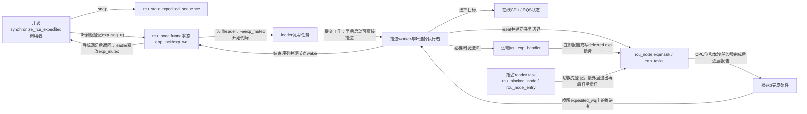
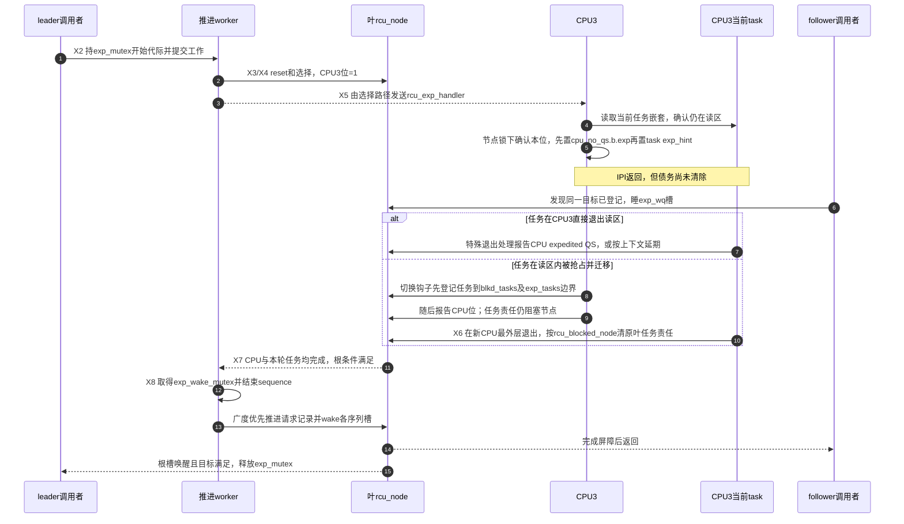

# 第6章\_Linux\_6.12\_Tree\_RCU\_Expedited\_GP模块源码概念导读

## 6.1\_Expedited不是普通GP的加速档

普通GP通过已有QS和周期复查推进，能合并大量回收需求，但控制路径有时愿意主动打扰其他CPU来减少等待。例如设备关闭已完成入口封闭，只差旧读区退出；此时要改变的是取得证据的节奏，不能降低保护条件。`synchronize_rcu_expedited()` 与 `synchronize_rcu()` 提供相同类型的普通RCU reader覆盖保证；Linux 6.12.20在采用加速策略时使用一条 **独立的控制与证明通道**：

- 独立全局序列 `rcu_state.expedited_sequence`；
- 独立节点债务 `rcu_node.expmask` 和被抢占任务边界 `exp_tasks`；
- 独立 leader/follower 漏斗锁、等待队列和 wake mutex；
- 主动选择 CPU，并在需要时发送 IPI 或迫使 tick/reschedule；
- 不等待普通 GP kthread 把 `gp_seq` 推进一轮。

它改变的是取得 QS 证据的控制路径与等待延迟，不改变“所有调用前旧 reader 必须结束”的语义。稳定模型先读 [Tree RCU Expedited GP](../../../../knowledge/linux/synchronization_and_asynchrony/synchronization/rcu/P15_Tree_RCU_Expedited_GP.md#15.1_场景_控制路径愿意用系统扰动换更短等待)；若普通 GP 控制主线还不清楚，先用 [普通 GP 端到端源码时序](../source_explanations/P05_Linux_6.12_Tree_RCU_GP全局生命周期源码实现.md#5.16_端到端源码时序)建立比较基线，再读本章的独立 sequence、worker 和 IPI 路径。

源码固定为NXP提交 `dfaf2136deb2af2e60b994421281ba42f1c087e0` 的Tree RCU分支；下文IPI遇到reader的案例采用 `CONFIG_PREEMPT_RCU=y`。非抢占、早期启动和normal策略分支在对应位置另行说明，不代表当前目标已启用这些配置。来源见 [源码基线](../../linux/SOURCE_BASELINE.md#1.5.1_RCU家族证据)。

## 6.2\_八个必须先知道的词

若多个调用者同时需要加速等待，让每个人独立扫描和发送IPI会重复打扰同一批CPU。实现让请求合并成一个推进责任，其他调用者等待足以覆盖自己的完成代际。由此才需要区分发起者、跟随者、请求合并和真实CPU/任务责任：

| 名词 | 精确定义 | 不能理解成 |
| --- | --- | --- |
| expedited sequence | 此实现自己的一轮开始/结束序列 | 普通 `gp_seq` 的别名 |
| leader | 取得 `exp_mutex` 并开始代际的调用任务，通常委托worker推进 | 与扫描worker是同一个对象，或固定的expedited线程 |
| follower | 发现同一或更新一轮正在进行、等待并复用其证明的调用者 | 不参与同步的无条件早退者 |
| funnel lock | 从叶到根登记请求、局部等待，最终串行 leader 的分层合并协议 | 一把普通全局 spinlock |
| `expmaskinitnext` | CPU starting 单调加入的 ever-online 候选位，offline 时不清除 | 当前轮债务或实时 online mask |
| `expmask` | 本轮 expedited 仍欠 CPU/QS 的节点位 | 普通 GP `qsmask` |
| `exp_tasks` | 本轮仍可能阻塞 expedited 完成的抢占 reader 分界 | 节点全部 blocked task 的副本链表 |
| selection | 根据在线、idle、NO_HZ、任务状态选择直接报告、IPI 或延后报告 | 向所有 possible CPU 无条件广播 |

固定提交里的 `rcu_state.expedited_need_qs` 只有字段声明，没有活动读写路径。当前完成条件不能从这个字段注释推导；权威证据是节点 `expmask/exp_tasks` 与根等待条件。

## 6.3\_角色状态与通信

| 状态地址 | 写入者 | 读取者 | 同步方式 |
| --- | --- | --- | --- |
| `rcu_state.expedited_sequence` | leader开始；推进者结束 | 所有调用者与 poll 公共序列 | `rcu_seq_*`、内存屏障 |
| `rcu_state.exp_mutex` | leader 候选 | leader/follower | mutex，串行真实 expedited 轮 |
| `rcu_state.exp_wake_mutex` | 各轮完成与节点唤醒路径 | 后续完成路径 | 串行化结束/唤醒，允许下一轮开始与上一轮剩余唤醒重叠 |
| `rnp->exp_seq_rq` | 漏斗登记者/结束路径 | follower | `exp_lock`、`exp_wq[4]` |
| `rnp->expmaskinitnext` | CPU starting 单调加位 | expedited hotplug reset | 节点锁；离线 CPU 留给每轮 selection 识别 |
| `rnp->expmaskinit` | hotplug reset | 每轮 reset | 节点锁、`ncpus` 快速判断 |
| `rnp->expmask` | reset建立CPU或子树等待位，CPU/子树报告清位 | wait/diagnosis | 节点锁；叶上的任务边界独立存在 |
| `rnp->exp_tasks` | 叶选择与任务入队划界，任务退出前推边界 | 节点完成检查 | 与 `blkd_tasks` 共用容器，节点锁保护 |
| `rdp->cpu_no_qs.b.exp` | handler/报告路径 | unlock、context switch | per-CPU 状态与节点锁交接 |
| `task->rcu_read_unlock_special.b.exp_hint` | PREEMPT handler | reader unlock 特殊路径 | 提示退出时做特殊处理；跨CPU任务责任实际由原叶登记承载 |

## 6.4\_为什么需要漏斗而不是只有exp\_mutex

如果所有并发调用者都直接争用一把全局mutex，同一锁及其等待状态会成为集中访问点，即使他们本可复用一次证明。源码首先保留低争用快速路径：叶/根尚未覆盖请求且能trylock `exp_mutex` 时直接成为候选；否则才沿调用CPU的叶节点向上登记目标：

1. 若该序列已经完成，直接以完成屏障返回；
2. 若本节点已有等于或更新的请求，调用者睡在该节点按序列槽选择的 `exp_wq`；
3. 否则把 `exp_seq_rq` 推进并向父节点继续；
4. 慢路径穿过根后取得 `exp_mutex`，还要再次检查目标是否已完成；
5. 开轮并由推进者完成证明后，逐节点推进请求记录并唤醒follower。

这减少了全局 mutex 竞争，但增加了节点状态、四槽等待队列、序列回绕处理和完成唤醒复杂度。Follower 复用的前提不是“同时调用”，而是已完成的那一轮确实覆盖它取得 snapshot 时点。

## 6.5\_CPU选择不是无条件广播IPI

推进者先按新增ever-online信息更新初始化树，再把 `expmaskinit` 复制到 `expmask`，随后按叶节点检查CPU并设置已有blocked-task边界。叶工作可交给独立kthread worker；没有对应worker、尚在启动阶段或处理最后一片叶时可直接调用，已提交的叶工作随后要flush。这个分工避免一个worker等待自己队列里的子工作而卡死。

- 选择执行者当前所在CPU、按RCU参与状态已离线的CPU，或可证明处于EQS的CPU：按对应合法条件直接报告位；
- CPU 在线且需要远端动作：尝试 `smp_call_function_single()`；
- NO_HZ_FULL CPU 可能需要强制 tick 以提供进展点；
- IPI 到达时若不在普通 reader 且上下文允许，立即清 expedited 债务；
- 若当前处于普通 reader，记录 `cpu_no_qs.b.exp` 与 task `exp_hint`，由未来 unlock/调度路径报告；
- IPI 竞争中 CPU 下线，选择路径重新检查并报告离线位。

所以 IPI 是 **促使目标 CPU 建立可验证状态转换** 的消息，不是“收到 IPI 就代表旧 reader 已结束”的确认包。

“不在reader”也不足以无条件立即报告。抢占分支的handler还检查抢占/BH状态或是否从idle被中断，条件不满足时设置延期位和重调度需求。非抢占分支没有任务嵌套计数这条判断，而按idle及相应抢占计数条件决定立即报告或调用 `rcu_exp_need_qs()` 请求后续QS；两套条件不能合写为同一段伪源码。

## 6.6\_X0到X8\_一次expedited生命周期

沿用知识正文的 [X0～X8](../../../../knowledge/linux/synchronization_and_asynchrony/synchronization/rcu/P15_Tree_RCU_Expedited_GP.md#15.3_X0到X8_一次expedited_GP)，以worker已创建、调度器正常运行且无normal策略覆盖为主线。X5的CPU报告与X6的任务清理可以交错。

| 阶段 | 触发与执行者 | 写入状态 | 通信/等待 | 退出条件 |
| --- | --- | --- | --- | --- |
| X0 取票 | 每个调用者 | 保存目标 `s` | sequence snapshot | 得到所需完成值 |
| X1 合并请求 | 调用者 | `exp_seq_rq` | trylock快速路径或节点漏斗/等待 | 已完成、成为follower或取得mutex |
| X2 开始 | leader调用任务 | 开始 `expedited_sequence`，提交工作 | 持 `exp_mutex` | 推进者取得本轮任务 |
| X3 重置 | 推进者 | 必要时更新init树，建立 `expmask` | `ncpus` acquire、节点锁 | 本轮CPU/子树等待位建立 |
| X4 选择 | 叶选择执行者 | 目标集合、`exp_tasks` | 直接执行或叶worker，随后flush | 可报告位与需远端动作位分开 |
| X5 请求与CPU报告 | IPI handler及本地后续路径 | `cpu_no_qs.b.exp`、特殊退出提示或清CPU位 | IPI、重调度、节点锁 | CPU位有真实证据可清 |
| X6 任务退出 | 被抢占reader与清理路径 | 原叶登记及 `exp_tasks` | 最外层退出，必要时延期处理 | 本轮任务责任解除 |
| X7 根完成 | 汇聚路径与推进者 | 根CPU/任务条件满足 | 唤醒 `expedited_wq` | 可以发布完成序列 |
| X8 交付 | 推进者；随后leader与followers | end sequence、节点请求记录和wake | `exp_wake_mutex`；leader返回前释放 `exp_mutex` | 覆盖目标的调用者可返回，后续轮可开始 |

## 6.7\_端到端时序\_IPI遇到被抢占reader

第4～5步留下未来处理的提示，并未完成证明。第7步是直接退出分支；第8～10步是被抢占分支，关键是 **先保存任务责任，再允许CPU报告**。迁移后的持久责任由 `rcu_blocked_node` 和原叶任务登记承载，`exp_hint` 只是触发特殊退出检查的提示，不能独自替原CPU清位。

第12步在 `exp_wake_mutex` 内结束序列，第13步按广度顺序唤醒节点。根槽先被访问，leader可在第15步释放 `exp_mutex`，从而下一轮开始与上一轮剩余叶唤醒重叠；`exp_wake_mutex` 防止两轮结束/唤醒过程重叠，并不禁止这种开始与收尾的重叠。图中第14、15步的实际返回先后不固定，取决于各任务被调度的时机。

## 6.8\_与普通GP共享什么不共享什么

| 维度 | 普通 GP | Expedited GP | 是否共享 |
| --- | --- | --- | --- |
| reader 语义 | 普通 RCU reader | 同一类 reader | 共享契约 |
| 权威序列 | `gp_seq` | `expedited_sequence` | 不共享 |
| CPU 债务 | `qsmask` | `expmask` | 不共享 |
| 抢占任务 | `blkd_tasks` 的普通 GP 边界 | 同一链表上的 `exp_tasks` 边界 | 共享任务容器，不共享轮次边界 |
| 控制执行者 | 长期 GP kthread | leader + exp kworker/远端 handler | 不共享 |
| poll API | `gp_seq_polled_snap` | `gp_seq_polled_exp_snap` | 共同推进公共 poll 观察序列 |
| 内存安全结果 | 覆盖调用前旧 reader | 覆盖调用前旧 reader | 同语义，不同证明通道 |

## 6.9\_源码入口与唯一实现标题

| 阅读目标 | 源文件 | 唯一实现讲解 |
| --- | --- | --- |
| expedited sequence 与公共 poll 交接 | [`kernel/rcu/tree_exp.h`](../../linux/kernel/rcu/tree_exp.h) | [P08：sequence](../source_explanations/P08_Linux_6.12_Tree_RCU_Expedited_GP源码实现.md#8.4_expedited_sequence怎样独立计代并共同推进poll观察) |
| funnel leader/follower | [`kernel/rcu/tree_exp.h`](../../linux/kernel/rcu/tree_exp.h) | [P08：`exp_funnel_lock()`](../source_explanations/P08_Linux_6.12_Tree_RCU_Expedited_GP源码实现.md#8.5_exp_funnel_lock怎样合并并发调用者) |
| hotplug reset 与本轮 `expmask` | [`kernel/rcu/tree_exp.h`](../../linux/kernel/rcu/tree_exp.h) | [P08：reset tree](../source_explanations/P08_Linux_6.12_Tree_RCU_Expedited_GP源码实现.md#8.6_sync_exp_reset_tree怎样建立本轮债务) |
| CPU selection 与并行 leaf work | [`kernel/rcu/tree_exp.h`](../../linux/kernel/rcu/tree_exp.h) | [P08：select CPUs](../source_explanations/P08_Linux_6.12_Tree_RCU_Expedited_GP源码实现.md#8.7_sync_rcu_exp_select_cpus为什么不是无条件广播) |
| PREEMPT_RCU 远端 handler | [`kernel/rcu/tree_exp.h`](../../linux/kernel/rcu/tree_exp.h) | [P08：`rcu_exp_handler()`](../source_explanations/P08_Linux_6.12_Tree_RCU_Expedited_GP源码实现.md#8.8_rcu_exp_handler把IPI转换为立即或延期证明) |
| 完成、wake follower 与公开 API | [`kernel/rcu/tree_exp.h`](../../linux/kernel/rcu/tree_exp.h) | [P08：wait/wake/API](../source_explanations/P08_Linux_6.12_Tree_RCU_Expedited_GP源码实现.md#8.9_wait_wake与公开API怎样关闭一轮) |

## 6.10\_代价边界与验收

Expedited 用 IPI、强制 tick/reschedule、额外节点锁、work/kworker 和系统范围扫描换取更短的典型等待；它不提供固定 deadline，也不适合普通热路径循环调用。`rcu_gp_is_normal()` 还可能把公开 expedited API 回退到普通等待，因此 API 名字不能代替运行策略检查。

早期调度初始化或worker尚未建立时，调用任务直接执行选择/等待/唤醒，不经通常的worker委托；特定单CPU非抢占条件还存在合法调用现场本身足以构成GP的快速返回分支。两者都不应伪装成“所有调用必然发IPI”。需要睡眠的等待接口也不能放到普通RCU读区里。

做一个交错检查：IPI已到达CPU3，紧接着CPU3切走旧reader并报告本位，此时能否让leader返回？若旧任务仍在原叶本轮 `exp_tasks` 区间中，就不能。待任务最外层退出、根条件满足且目标序列发布完成，调用者才能按各自等待协议返回。把IPI或CPU清位当作全部reader退出，会在这个分支提前回收。

读完应能回答：为什么 follower 可以复用 leader；`exp_wake_mutex` 为什么在 sequence end 周围；CPU 收到 IPI 后为何可能仍欠债；`expmask` 与 `qsmask` 为什么不能相互清位；`ncpus_snap` 为什么只用于新增 CPU 的 expedited 初始化传播。

总入口：[Linux 6.12 RCU 源码总阅读索引](P01_Linux_6.12_RCU源码总阅读索引.md#1.4_模块概念导读入口)。
