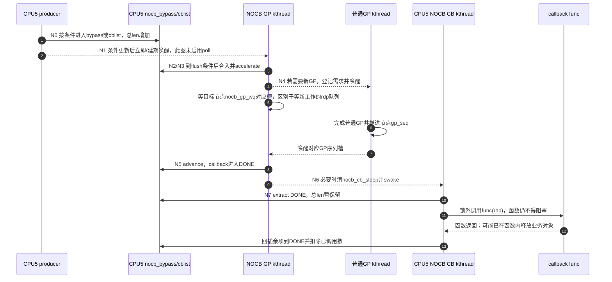

# 第7章\_Linux\_6.12\_Tree\_RCU\_回调与NOCB模块源码概念导读

## 7.1\_GP完成为什么还不等于callback执行

`call_rcu(head, func)` 建立的是一条异步生命周期：先把 callback 加入某个每 CPU 队列，之后为它绑定目标 GP；目标 GP 完成以后，它才从“等待证明”变成“允许执行”；最后还要由 softirq、`rcuc` 或 NOCB callback kthread 真正调用 `func()`。

因此必须区分登记、资格和实际执行这些事件：

1. enqueue：节点交给RCU，调用者随后不能凭 `call_rcu()` 返回继续使用待回收对象；
2. classified：callback 已绑定需要等待的 GP 代际；
3. ready：该 GP 已完成，callback 移到 DONE 段；
4. invoked：执行者已经实际调用 `func()`。

还要区别函数开始执行与函数返回：回调内可能释放对象，实际返回以后才能证明该次回调已经结束。这些事件的顺序不等于生产者一定先从 `call_rcu()` 返回、其他CPU才允许运行回调；交出节点后就应遵守所有权边界。

普通GP提供从第2到第3步所需的安全证明，实际advance仍由队列管理路径执行，第4步还取决于执行者得到运行机会。NOCB改变推进和执行者，不改变目标GP条件。普通GP的开始到cleanup见 [全局生命周期源码时序](../source_explanations/P05_Linux_6.12_Tree_RCU_GP全局生命周期源码实现.md#5.14_端到端源码时序)；本章从其完成值继续追callback。

稳定机制分别见 [rcu_segcblist 回调状态机](../../../../knowledge/linux/synchronization_and_asynchrony/synchronization/rcu/P11_Tree_RCU_rcu_segcblist回调状态机.md#11.1_场景_三个callback对应哪一轮GP)、[回调执行、批处理与限流](../../../../knowledge/linux/synchronization_and_asynchrony/synchronization/rcu/P12_Tree_RCU_回调执行_批处理与限流.md#12.1_场景_一次GP后突然成熟五万个callback) 和 [NOCB 回调卸载](../../../../knowledge/linux/synchronization_and_asynchrony/synchronization/rcu/P16_Tree_RCU_NOCB回调卸载.md#16.1_场景_隔离CPU不希望执行回调批次)。

本篇核对NXP Linux 6.12.20固定提交 `dfaf2136deb2af2e60b994421281ba42f1c087e0` 的Tree路径，NOCB部分要求对应构建配置；lazy、poll及执行上下文还受各自选项影响。来源见 [源码基线](../../linux/SOURCE_BASELINE.md#1.5.1_RCU家族证据)，不据此宣称当前目标已采用offload。

## 7.2\_十个术语先建立地址感

设同一CPU先后登记三个回调，其中前两个已经被一轮GP覆盖，第三个登记太晚、还需要后续证明。队列必须同时记住“哪些可执行”和“哪些仍等待哪个代际”，否则只看总长度无法决定能调用谁。分段链用边界和少量序列值表达这些批次；NOCB再改变谁来推进和执行它们。

| 术语 | 精确定义 | 不是 |
| --- | --- | --- |
| callback | 嵌入对象中的 `rcu_head` 加函数指针 | 独立分配的 RCU 线程任务 |
| `rcu_segcblist` | 一条链表加四个指向指针槽的尾边界及代际元数据 | 四条互不相关链表，或四个最后节点地址 |
| NEXT | 新 enqueue、尚未完成精确代际分类的段 | 下一轮 GP 一定执行的段 |
| NEXT_READY | 已分配目标 GP、等待该 GP 的段 | 已可调用函数的段 |
| WAIT | 已等待一个确定 GP 但还未成熟的段 | 睡眠等待队列 |
| DONE | GP 证明已满足、允许执行的 callback 段 | 函数已经调用完的 callback |
| accelerate | 给新 callback 绑定尽可能早的安全 GP，并提出 GP 请求 | 跳过 GP |
| advance | 用已完成的节点 GP 序列把 callback 推入 DONE，再重新分类剩余项 | 执行 callback |
| NOCB | no-CBs/offloaded callback 处理模式 | CPU 不参与普通 RCU GP |
| bypass | callback 洪峰时绕开高竞争 `cblist/nocb_lock` 的暂存队列 | 第二套权威 GP 代际队列 |

`rcu_state.nocb_mutex/nocb_is_setup` 只协调 NOCB 配置和动态转换；callback 的高频状态主要位于每 CPU `rcu_data`，不是全局 `rcu_state`。

## 7.3\_三条数据流必须同时看

数据流一是 callback 节点从 producer 到队列；数据流二是 GP 代际从全局/节点序列进入 callback 分段；数据流三是执行权从本地 core 或 NOCB GP 线程交给 callback 执行者。只追 `call_rcu()` 调用链会漏掉后两条。

## 7.4\_状态所有权表

| 状态地址 | 所有者/写入者 | 读取者 | 保护与通信 |
| --- | --- | --- | --- |
| `rcu_head.next/func` | callback producer，随后转交 RCU | 队列与最终执行者 | 排队期间不得重复登记；回调开始后按业务协议释放或重新交付 |
| `rdp->cblist` | 对应 CPU 的 callback 子系统 | core、NOCB、barrier、hotplug | 本地 IRQ 禁用；offload 时加 `nocb_lock` |
| `rdp->nocb_bypass` | offloaded CPU producer | NOCB GP kthread/flush 路径 | `nocb_bypass_lock` 与长度计数 |
| `rnp->gp_seq` | 普通GP init/cleanup | `rcu_advance_cbs()`、NOCB wait | 区分开始值与完成值，节点锁或规定的有序读取 |
| `rnp->gp_seq_needed` | accelerate/request 路径 | GP kthread | 节点树需求漏斗 |
| `rdp_gp->nocb_gp_wq` | 新工作/延期通知及模式交接路径 | 管理该组的NOCB GP线程 | 等 `nocb_gp_sleep` 改变，表示需要重新扫描工作 |
| `rnp->nocb_gp_wq[2]` | GP cleanup/wait path | 等待目标代际的NOCB GP线程 | 节点的两个swait槽，按GP计数选择 |
| `rdp->nocb_cb_wq` | NOCB GP kthread | NOCB callback kthread | swait + `nocb_cb_sleep` |
| `rdp->cblist.len` | 登记增加、实际调用后的批次结算减少 | barrier、过载和诊断 | 包含bypass及已提取但尚未结算的回调，不等于当前主链可见节点数 |
| `rdp->blimit`、全局批次时间参数 | core/调优接口 | `rcu_do_batch()` | 限制一次执行占用，不改变安全资格 |
| `rcu_state.cbovld*` | callback 压力聚合/FQS | GP/FQS/diagnostics | 活性反馈，不是 callback 代际 |

## 7.5\_普通callback状态机

普通路径把登记、GP需求传播、成熟资格更新和函数执行分开。最小链表入队不需要每次获取根锁，但 `call_rcu()` 的外围路径仍可能检查过载、推进已完成代际或催促GP；不能把整个接口宣称为绝对不访问共享树状态。

### 7.5.1\_enqueue只进入NEXT

`__call_rcu_common()` 在配置支持的debug检查后保存 `func/next`，关闭本地IRQ并取得当前CPU的 `rcu_data`。普通路径经 `call_rcu_core()` → `rcutree_enqueue()` 入主链NEXT；offload改走NOCB入口，再按条件选择主链或旁路。debug检查不能取代调用者不重复排队的契约：检测到重复时源码可能改用泄漏回调并告警，并不是把非法重复自动修成两次正确调用。

### 7.5.2\_accelerate把局部callback需求送到GP树

`rcu_accelerate_cbs()` 在叶节点锁下取得 `rcu_state.gp_seq` snapshot，把未分类 callback 绑定到最早安全目标；若这个目标比节点已知需求更远，调用 `rcu_start_this_gp()` 沿 `gp_seq_needed` 漏斗登记并请求唤醒 GP kthread。

### 7.5.3\_advance只改变资格不执行函数

当 `rnp->gp_seq` 前进，`rcu_advance_cbs()` 先用 `rcu_segcblist_advance()` 把已满足目标的 callback 推到 DONE，再调用 accelerate 给仍在 NEXT 的项分类。它是幂等的，因此 local core、GP cleanup、NOCB GP thread、hotplug migration 都可在适当锁下调用。

### 7.5.4\_batch在锁外执行

`rcu_do_batch()` 先在 IRQ/NOCB 锁保护下抽取 DONE 段，释放队列锁后逐项清 debug 状态并调用 `func()`，最后重新加锁把因数量/时间限额未执行完的项插回 DONE。锁外执行防止任意 callback 函数把高频队列锁长期占住，也允许 callback 自己继续 `call_rcu()`；相应代价是必须单独维护抽取列表、长度和 requeue 不变量。

抽取时保留总 `len`，回调实际调用后才结算数量。假设没有新登记，DONE原有A、B两项：抽取后主链可见DONE为空，但 `len` 仍是2；执行A后把尚未执行的B回插DONE，再扣除已调用数1，总数变为1。若提取时直接把len归零，barrier等观察者就可能漏掉正在执行的责任。

锁外不等于允许睡眠：这些普通RCU回调仍须遵守不阻塞契约；线程执行器可以在两次回调之间临时开放BH并重调度，不授权单个 `func()` 自行等待mutex或I/O。数量、时间和重调度检查也不能抢占已经开始的某一个长回调，只能约束批次后续推进。

## 7.6\_NOCB为何拆成GP线程与CB线程

NOCB GP kthread 负责一组 `rcu_data`：刷新 bypass、advance callback、找出最早尚需等待的 GP 序列、睡在节点 NOCB GP waitqueue，成熟后唤醒各 CPU callback kthread。每 CPU NOCB callback kthread 只负责 `rcu_do_batch()` 和再次睡眠。

这样callback批次由线程承担；要让它们真正不在隔离CPU上运行，还需配置并核验线程affinity和调度条件，NOCB选中一个CPU不等于这些线程自动搬到别处。被选中的CPU仍可能：

- 运行普通 RCU reader；
- 产生 QS/EQS 证据；
- 调用 `call_rcu()` 成为 producer；
- 接受必要的 GP/expedited 催促。

所以 NOCB 是 **callback execution offload**，不是 reader offload 或 GP participant removal。

## 7.7\_bypass把什么成本挪到哪里

高callback速率下，某offloaded CPU的生产者与管理/执行线程会反复争用该 `rdp->nocb_lock`，队列缓存行可能在它们运行的CPU间往返。旁路让生产者在符合条件时把节点暂存到由 `nocb_bypass_lock` 保护的短路径，减少每次都与整段分类/提取互斥的需要；它仍有锁和共享计数，不是零通信队列。旁路不能无限期独立存在，因为：

- GP 代际仍由 `cblist` 分段表达；
- `rcu_barrier()` 必须看见所有 callback；
- 如果 `cblist` 为空而 GP thread 无限睡眠，bypass callback 会被搁浅。

因此源码按每 jiffy 速率、bypass 年龄、长度和 lazy/non-lazy 组合选择直接 cblist、flush 后入 cblist、或继续 bypass；首次 bypass 项、lazy 转 non-lazy、队列过载还要唤醒或设置 timer。被移除的 producer 锁竞争，换成了 flush、计数一致性、deferred wake 和 timer 状态机。

进入bypass时已经计入 `cblist.len`，flush只搬链表归属，不能再次增加这批总数。启用 `rcu_nocb_poll` 后，管理线程按周期检查工作，省去部分生产者唤醒但换来空闲检查成本；没有poll时则依靠条件更新、唤醒及延期timer避免工作搁浅。读取队列、等待新工作和等待GP完成是三种动作，后两者使用上表不同的等待队列。

## 7.8\_N0到N7\_把分段资格与卸载执行接起来

普通分段沿用知识正文C0～C5；这里用NOCB正文的 [N0～N7](../../../../knowledge/linux/synchronization_and_asynchrony/synchronization/rcu/P16_Tree_RCU_NOCB回调卸载.md#16.6_N0到N7_一次offload_callback生命周期) 放大offload路径，并明确对应关系。分段成熟与线程调度是正交状态，不要求每个节点都存一份“当前阶段编号”。

| 阶段 / 分段对应 | 状态地址 | 写入者 | 完成条件 |
| --- | --- | --- | --- |
| N0 登记 / C0前端 | `func/next`、NEXT或bypass、总len | 生产者 | RCU接管节点 |
| N1 通知判断 | 组首sleep条件、deferred wake、timer | 生产者及通知路径 | 已有立即、延期或poll检查途径 |
| N2 flush / C0落主链 | bypass→本rdp主链NEXT | 受保护的flush路径 | 节点可进入分段分类，总数不重复计入 |
| N3 分配 / C1 | 段边界、目标序列、节点 `gp_seq_needed` | NOCB管理路径 | 绑定安全目标并提出/维持需求 |
| N4 等GP / C2 | WAIT/NEXT_READY与节点完成值 | 普通GP推进，NOCB管理者等待或poll | 目标代际可被观察为完成 |
| N5 advance / C3 | DONE边界 | 管理/执行路径在规定保护下推进 | 回调具备执行资格 |
| N6 交付执行者 | `nocb_cb_sleep/nocb_cb_wq` | NOCB GP线程 | 执行线程复查条件并获得运行机会 |
| N7 批次 / C4～C5 | 临时链、DONE及总len | CB线程 | 锁外调用，回插余项，结算已调用数；业务释放可发生在回调内部 |

## 7.9\_端到端时序\_offloaded\_CPU产生callback

第1～3步负责把节点交给分段链，第4～8步把GP完成变成DONE资格；第9步只是取得运行机会。第10～13步才执行并结算责任，若函数已释放对象，执行器后续不能再依赖该对象的内容。下一批和新的GP可以与这些动作交错，不能把整个图读成全系统暂停等待某个回调。

## 7.10\_配置切换与热插拔边界

`rcu_nocb_cpu_offload()/deoffload()` 在固定版本只允许目标 CPU offline 时转换，使用 `cpus_read_lock()`、全局 `nocb_mutex`、组 GP kthread mutex、per-CPU `nocb_lock` 和 `nocb_state_wq` 完成所有权交接。它不是简单翻转 `SEGCBLIST_OFFLOADED`：转换必须确保 producer 看到新模式以前，旧执行者已停止访问该 `rdp`，还要 park/unpark callback kthread。

CPU hotplug 的普通 callback 迁移见 [拓扑与 CPU 热插拔模块导读](P04_Linux_6.12_Tree_RCU_拓扑与CPU热插拔模块源码概念导读.md#4.4.3_回调所有权状态机)。NOCB `rdp` 不走普通迁移，因为其 kthread 所有权仍存在。

## 7.11\_源码入口与唯一实现标题

| 阅读目标 | 源文件 | 唯一实现讲解 |
| --- | --- | --- |
| `call_rcu()` 分流与普通 enqueue | [`kernel/rcu/tree.c`](../../linux/kernel/rcu/tree.c) | [P09：enqueue](../source_explanations/P09_Linux_6.12_Tree_RCU_回调与NOCB源码实现.md#9.4_call_rcu怎样把所有权交给每CPU队列) |
| callback accelerate/advance | [`kernel/rcu/tree.c`](../../linux/kernel/rcu/tree.c)、[`rcu_segcblist.c`](../../linux/kernel/rcu/rcu_segcblist.c) | [P09：代际推进](../source_explanations/P09_Linux_6.12_Tree_RCU_回调与NOCB源码实现.md#9.5_accelerate与advance怎样连接callback和GP) |
| 普通 GP cleanup 怎样发布可供 callback 消费的完成代际 | [`kernel/rcu/tree.c`](../../linux/kernel/rcu/tree.c) | [P05：cleanup 与下一代](../source_explanations/P05_Linux_6.12_Tree_RCU_GP全局生命周期源码实现.md#5.11_rcu_gp_cleanup发布完成并承接下一代) |
| DONE 抽取、锁外执行与限流 | [`kernel/rcu/tree.c`](../../linux/kernel/rcu/tree.c) | [P09：`rcu_do_batch()`](../source_explanations/P09_Linux_6.12_Tree_RCU_回调与NOCB源码实现.md#9.6_rcu_do_batch为何先抽取再锁外执行) |
| normal core 选择 softirq/rcuc | [`kernel/rcu/tree.c`](../../linux/kernel/rcu/tree.c) | [P09：core 执行者](../source_explanations/P09_Linux_6.12_Tree_RCU_回调与NOCB源码实现.md#9.7_普通CPU怎样选择softirq或rcuc执行者) |
| bypass/flush/wake | [`kernel/rcu/tree_nocb.h`](../../linux/kernel/rcu/tree_nocb.h) | [P09：NOCB producer](../source_explanations/P09_Linux_6.12_Tree_RCU_回调与NOCB源码实现.md#9.8_nocb_bypass怎样降低生产者锁竞争又避免搁浅) |
| NOCB GP 与 callback kthread | [`kernel/rcu/tree_nocb.h`](../../linux/kernel/rcu/tree_nocb.h) | [P09：GP 线程](../source_explanations/P09_Linux_6.12_Tree_RCU_回调与NOCB源码实现.md#9.9_NOCB_GP线程怎样推进队列并等待最早目标代际)、[P09：CB 线程](../source_explanations/P09_Linux_6.12_Tree_RCU_回调与NOCB源码实现.md#9.10_NOCB_CB线程只执行成熟批次) |
| 动态 offload/deoffload | [`kernel/rcu/tree_nocb.h`](../../linux/kernel/rcu/tree_nocb.h) | [P09：转换](../source_explanations/P09_Linux_6.12_Tree_RCU_回调与NOCB源码实现.md#9.11_动态offload为何只允许offline_CPU并等待状态交接) |

## 7.12\_验收不变量

读完应能从任意 `rcu_head` 指出：当前所有者是谁、位于 bypass 还是 cblist 哪个段、目标 GP 从哪里读取、谁提出 GP 请求、谁把它推进 DONE、谁实际调用函数。还应能说明 NOCB 没有移除哪些 CPU 职责、bypass 为什么必须 flush、`rcu_do_batch()` 为什么要在锁外调用未知函数、批次限流为什么只影响延迟不影响安全资格。

用两项回调检查计数：若A仍在bypass，B已提取且正在执行，两项都尚未结算，则主链可能看起来为空，总len仍要覆盖A、B。把“主链为空”当成“所有回调都完成”，会同时漏掉暂存节点和在途执行。反过来，总数非零也不能证明其中哪一项已经满足GP，仍需检查分段和执行现场。

总入口：[Linux 6.12 RCU 源码总阅读索引](P01_Linux_6.12_RCU源码总阅读索引.md#1.4_模块概念导读入口)。
