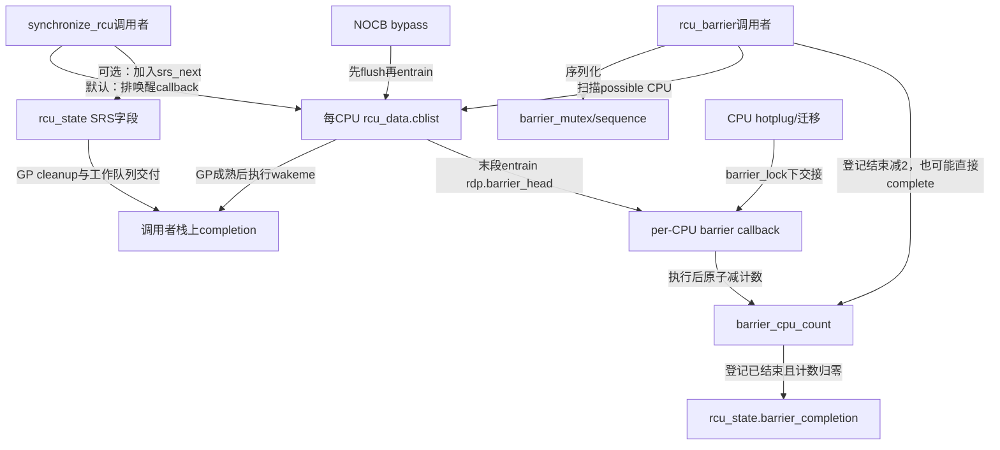
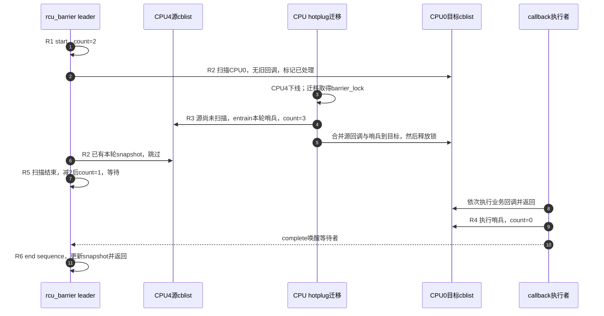

# 第8章\_Linux\_6.12\_Tree\_RCU\_同步等待与rcu\_barrier模块源码概念导读

## 8.1\_等RCU至少有三种不同对象

上一模块已经把回调的排队、GP 成熟和实际执行分开。现在设想卸载一个模块：它先前用 `call_rcu()` 排入回收函数，函数体就在模块代码里。即使旧读者已经退出，回收函数也可能尚未得到执行机会；这时卸载代码，执行者随后就会跳进已经失效的地址。因此，退出路径除了等读者，还可能需要等回调函数 **执行完毕**。

调用者说“等 RCU 完成”时，要先确定自己缺少哪种完成证据，再选择接口：

| 接口/机制 | 等待对象 | 返回时能证明 | 不能证明 |
| --- | --- | --- | --- |
| `synchronize_rcu()` | 调用前存在的普通 RCU reader | 一轮合格 GP 覆盖调用点 | 之前排队的 callback 都已执行 |
| poll synchronize API | cookie 对应的 GP 完成状态 | 调用者检查到目标序列已完成 | 自动阻塞、callback 已执行 |
| `rcu_barrier()` | 调用前已经排队的普通 `call_rcu()` callback | 被覆盖的业务 callback 已执行完毕 | 必然新启动一轮 GP、未来不会再排回调 |

模块退出必须先关闭新的回调生产入口，再用 `rcu_barrier()` 收尾。若回调还会排工作项或重新排回调，这些后续活动也要纳入停止协议；barrier 不替模块关闭生产者，也不等任意下游 workqueue。

本章核对 [Linux 源码基线](../../linux/SOURCE_BASELINE.md) 中 NXP Linux 6.12.20 固定提交 `dfaf2136deb2af2e60b994421281ba42f1c087e0` 的 Tree RCU 分支。可选配置与启动参数按源码条件说明，不把它们当作当前目标机已启用的配置；本次未重新取得目标工作树与运行结果。

稳定机制见 [Tree RCU 同步等待与 rcu_barrier](../../../../knowledge/linux/synchronization_and_asynchrony/synchronization/rcu/P13_Tree_RCU_同步等待与rcu_barrier.md#13.2_模块卸载场景暴露三种不同等待)。

## 8.2\_同步等待的两个实现分支

固定版本中 `synchronize_rcu_normal()` 有两个内部分支：

- 默认 `rcu_normal_wake_from_gp=0`：在调用者栈上建立 `struct rcu_synchronize`，通过 `call_rcu_hurry()` 排入一个唤醒 callback，调用者睡在自己的 completion；callback 执行 `wakeme_after_rcu()` 后唤醒它。
- 可选直接 GP wake 分支：调用者把栈上请求无锁加入 `rcu_state.srs_next`，GP init 用 dummy wait-head 划定本轮截止点，GP cleanup/工作队列完成对应请求。

两者等待的 API 语义相同，但“谁唤醒调用者”不同：默认分支必须等专用 callback 执行唤醒动作；可选分支由 GP cleanup 与后续工作队列分担交付，不能理解成 cleanup 当场完成所有请求。调用者等待的仍是 **自己栈上对象中的 completion**，不是直接睡到 GP 线程的等待队列上。栈对象要一直活到对应完成通知到达。

SRS 的[请求划批](../source_explanations/P14_Linux_6.12_Tree_RCU_同步等待批处理源码实现.md#14.3_请求登记与dummy节点怎样划定本轮)和 [cleanup/workqueue 交付](../source_explanations/P14_Linux_6.12_Tree_RCU_同步等待批处理源码实现.md#14.4_cleanup与workqueue怎样分担交付)已由 P05 唯一展开，本章不复制其函数体。

## 8.3\_rcu\_barrier的哨兵证明

`rcu_barrier()` 不逐个记录所有业务 callback。它对每个仍有 callback 责任的 `rcu_data.cblist` **entrain 一个专用 barrier callback**。这里 entrain 表示把哨兵接到已有工作的末端，并沿用那批工作的成熟资格：从最后一个非空段接入，不是无条件当作新业务回调放进 NEXT 段。

1. 队列是 FIFO 且分段语义保持顺序；
2. 同一执行链上的前序 callback 必须先执行返回，执行者才能轮到哨兵；
3. 每个实际排入的哨兵把全局计数加一；
4. 哨兵执行时计数减一；登记结束后计数归零者完成全局 completion；
5. 调用者等 completion，所以取得“所有被覆盖队列的前序业务 callback 已执行完毕”的证明。

上一模块解释过，总长度包含已提取、尚未结算的回调。因此，共享主链为空也不能直接跳过：只要总长度还非零，entrain 就能把哨兵接入 DONE 段，由同一回调执行责任保证它排在在途业务之后。反过来，总长度为零时没有需要覆盖的旧回调，可以不插哨兵。

这是一种 **把全局集合完成问题转换成每队列尾哨兵完成问题** 的算法。它依赖 callback 队列顺序、hotplug 迁移不丢哨兵、NOCB bypass 先 flush，以及 barrier 本轮序列不会与另一轮混淆。

## 8.4\_角色状态与地址

| 状态 | 写入者 | 读取者 | 作用 |
| --- | --- | --- | --- |
| 调用者栈上 `rcu_synchronize` | `synchronize_rcu_normal()` | `wakeme_after_rcu()` 或 SRS cleanup/worker | 单个等待者生命周期 |
| `barrier_mutex` | barrier 调用者 | 其他 barrier 调用者 | 串行全局 barrier 轮次，允许 follower early exit |
| `barrier_sequence` | 当前 barrier leader | barrier 调用者、per-CPU snapshot | 轮次开始/结束与覆盖检查 |
| `barrier_lock` | barrier、handler、migration/hotplug | 同上 | 让扫描、哨兵登记和队列迁移形成原子交界 |
| `barrier_cpu_count` | leader 初始化、entrain、哨兵 callback | completion 判定 | 登记期间等于尚未报告的哨兵数加 2；登记结束撤去这 2 个引用 |
| `barrier_completion` | leader 初始化，归零的哨兵或扫描收尾者完成 | barrier leader | 等全部前序业务回调完成 |
| `rdp->barrier_head` | entrain | callback 执行者 | 每 CPU 预分配哨兵，避免 barrier 临时分配 |
| `rdp->barrier_seq_snap` | barrier/entrain | barrier 扫描 | 该 CPU 队列是否已处理本轮 |

表中的 `barrier_mutex`、`barrier_sequence`、`barrier_lock`、`barrier_cpu_count` 和 `barrier_completion` 位于全局 `rcu_state`；`barrier_seq_snap`、`barrier_head` 位于各 CPU 的 `rcu_data`。`barrier_lock` 的全局性来自它要同时保护全局轮次与所有 per-CPU snapshot/队列交界，具体队列操作还须遵守 NOCB 等局部锁协议。

## 8.5\_为什么计数初始值是2

Barrier leader 初始化 completion 后把 `barrier_cpu_count` 设为 2，而不是 0。扫描期间，新排入的哨兵可能立即执行；如果从 0 开始，它可能在 leader 尚未遍历完其他 CPU 时把计数减到 0 并错误完成。

两个临时引用让“扫描者尚未结束登记阶段”本身也计入未完成工作。全部 CPU 扫描完后 leader 一次性 `atomic_sub_and_test(2)`：

- 若没有尚未报告的哨兵，计数从 2 到 0，由扫描收尾者完成；这既可能因为从未插入哨兵，也可能因为插入的哨兵都已提前执行；
- 若还有 N 个尚未报告的哨兵，计数从 `N+2` 到 N，等它们各减一后才到 0。

这里的 2 不是 CPU 数，也不是两个固定 callback，而是登记阶段的防过早完成护栏。

## 8.6\_在线离线与NOCB为何不能分开处理

在线 CPU 的队列可能正由该 CPU 的中断/core 修改，barrier 先释放 `barrier_lock`，再用同步的 `smp_call_function_single(..., 1)` 让目标 CPU 在 IRQ 禁用的本地 handler 中重新拿锁登记哨兵。不能持锁发起并等待这个 handler，否则接收方会等调用者释放同一把锁。若 CPU 状态变化导致发送失败，调用者等待一个 tick 后重试并重新判断状态。

按 RCU 在线状态判断已经离线但仍有回调责任的 CPU，无论是否 offload，都由当前 CPU 在 `barrier_lock` 下直接 entrain。这个版本靠该锁和重试协议交接，不能把它描述成一次全程冻结 CPU 热插拔的扫描。

CPU 此时还可能与 callback migration 交错。危险窗口是 **目标队列已经扫描，源队列尚未扫描**：若直接把源的旧回调移到目标，随后扫描源只看见空队列，而目标又不会重扫，这批回调就穿过了扫描边界。迁移路径因此也拿 `barrier_lock`，搬运前对源队列调用 `rcu_barrier_entrain()`，将本轮证明随回调一起搬走。

如果源队列已经登记本轮，entrain 会依据 `barrier_seq_snap` 早退，不会再插一枚哨兵。没有正在进行的 barrier、代次不匹配等条件也会早退；“迁移调用 entrain”不等于“迁移每次都新增哨兵”。

NOCB 的 callback 可能暂存在 bypass，哨兵若直接进 cblist 尾部而旧 callback 仍在 bypass，FIFO 证明会颠倒。`rcu_barrier_entrain()` 在 NOCB 锁协议下先 flush bypass，再 entrain 哨兵。若 flush 让主链从没有待 GP 回调变成有待 GP 回调，还要唤醒 NOCB GP thread；这不是简单判断整条链从空变非空，主链此前可以已有 DONE 回调。

## 8.7\_R0到R6\_一轮rcu\_barrier

沿用 [正文的 R0～R6](../../../../knowledge/linux/synchronization_and_asynchrony/synchronization/rcu/P13_Tree_RCU_同步等待与rcu_barrier.md#13.6_barrier怎样在分散队列后放哨兵)，把抽象阶段落实到本版本的写入点。R4 可以穿插在 R2/R3 扫描期间，不是必须等到扫描结束才发生。

| 阶段 | 动作 | 状态/通信 | 退出条件 |
| --- | --- | --- | --- |
| R0 取得串行权 | snapshot 后获取 `barrier_mutex`，再查 sequence | 已有轮次覆盖本 cookie 则屏障后返回 | 成为 leader 或复用已有证明 |
| R1 开始轮次 | 在 `barrier_lock` 下 start sequence、初始化 completion、count=2 | 全局身份和登记保护引用 | 可以扫描 |
| R2 逐 CPU 检查 | 遍历 possible CPU，检查 snapshot 与总长度 | 已处理则跳过；长度为零则标记已处理 | 找到需要登记的队列 |
| R3 插入哨兵 | 在线 handler 或离线直接路径，flush bypass 后 entrain | 加计数、记录 per-CPU snapshot | 本队列旧工作已受覆盖 |
| R4 执行报告 | callback 执行者完成业务回调后执行哨兵 | 原子减计数，归零则 complete | 本队列证据加入全局结果 |
| R5 结束登记并等待 | leader 减 2，归零则自己 complete；等待 completion | 剩余计数只代表未报告哨兵 | 覆盖范围内业务回调均已完成 |
| R6 发布完成 | end sequence、更新 per-CPU snapshot，释放 mutex | 后继调用者可检查覆盖关系 | 本调用返回 |

## 8.8\_端到端时序\_扫描期间CPU下线并迁移

第 2 步与第 4 步之间才是需要补证明的窗口：目标已经扫描，而源尚未扫描。第 4 步把哨兵先挂在源的旧工作之后，第 5 步一同搬运，因而即使第 6 步不再扫描这些回调，也不会漏等。第 7～10 步画的是哨兵晚执行的分支；若第 9 步提前到扫描收尾之前，计数仍有两个保护引用，最终由第 7 步归零并完成等待。

## 8.9\_源码入口与唯一实现标题

| 阅读目标 | 源文件 | 唯一实现讲解 |
| --- | --- | --- |
| 公开 `synchronize_rcu()` 分流 | [`kernel/rcu/tree.c`](../../linux/kernel/rcu/tree.c) | [P10：同步等待分流](../source_explanations/P10_Linux_6.12_Tree_RCU_同步等待与rcu_barrier源码实现.md#10.4_synchronize_rcu怎样选择普通expedited或早期空GP) |
| 默认 callback wake bridge | [`kernel/rcu/update.c`](../../linux/kernel/rcu/update.c)、[`tree.c`](../../linux/kernel/rcu/tree.c) | [P02：`wakeme_after_rcu()`](../source_explanations/P02_Linux_6.12_Tree_RCU_等待桥_QS与节点汇聚关键函数源码实现.md#2.3_同步调用怎样借回调等待GP结束) 与 [P10：默认等待对象](../source_explanations/P10_Linux_6.12_Tree_RCU_同步等待与rcu_barrier源码实现.md#10.5_默认分支为何等待调用者自己的completion) |
| SRS 直接 GP wake | [`kernel/rcu/tree.c`](../../linux/kernel/rcu/tree.c) | [P05：SRS 完成交付](../source_explanations/P14_Linux_6.12_Tree_RCU_同步等待批处理源码实现.md#14.4_cleanup与workqueue怎样分担交付) |
| barrier callback 与 entrain | [`kernel/rcu/tree.c`](../../linux/kernel/rcu/tree.c) | [P10：哨兵证明](../source_explanations/P10_Linux_6.12_Tree_RCU_同步等待与rcu_barrier源码实现.md#10.6_barrier_callback与entrain如何证明队列前序已执行) |
| 全局 barrier 扫描与计数 | [`kernel/rcu/tree.c`](../../linux/kernel/rcu/tree.c) | [P10：`rcu_barrier()`](../source_explanations/P10_Linux_6.12_Tree_RCU_同步等待与rcu_barrier源码实现.md#10.8_rcu_barrier怎样扫描所有队列并等待真实执行) |
| hotplug/migration 竞态 | [`kernel/rcu/tree.c`](../../linux/kernel/rcu/tree.c) | [P10：`barrier_lock`](../source_explanations/P10_Linux_6.12_Tree_RCU_同步等待与rcu_barrier源码实现.md#10.7_barrier_lock怎样封住CPU热插拔与迁移竞态) |

## 8.10\_选择边界与验收

- 需要让调用前 reader 退出：`synchronize_rcu()`；
- 需要把 GP 等待拆到多个时点：poll synchronize API。`get_state_synchronize_rcu()` 只取快照，`start_poll_synchronize_rcu()` 还请求 GP；取得 cookie 不授权回收，必须等相应 poll 返回完成；
- 需要确保已排队 callback 函数不再引用模块代码/资源：`rcu_barrier()`；
- 批量对象可以同步等待一次后直接释放：不要再为同一批对象同时排回收 callback；
- 任何同步接口都不能在它自身等待的普通 RCU reader 临界区内调用。

验收时应能解释：多等一轮 GP 为什么不等于旧 callback 已执行；barrier 哨兵为什么必须在每条队列尾部；count=2 解决什么竞态；NOCB bypass 为何先 flush；CPU 迁移为何必须与 barrier 扫描共享一把锁；并发 barrier follower 如何利用 sequence 早退。

先手算一个交错：计数从 2 开始，插入 A，A 立即执行，然后插入 B，扫描结束，最后 B 执行。计数依次是 **2 → 3 → 2 → 3 → 1 → 0**。只有最后一步允许完成；如果 B 也在扫描结束前执行，则先回到 2，扫描者减 2 后完成。由此也能看出，完成者不必总是“最后一个 callback”。

再检查模块退出：如果 barrier 返回后，仍有一个生产者可能调用模块的回调函数，能否卸载？不能。barrier 的前序完成证明没有覆盖未来生产；需要先关闭该入口并等在途生产操作退出，再建立这里的覆盖边界。下一模块将转向 SRCU，看等待范围怎样由一个独立实例定义。

总入口：[Linux 6.12 RCU 源码总阅读索引](P01_Linux_6.12_RCU源码总阅读索引.md#1.4_模块概念导读入口)。
