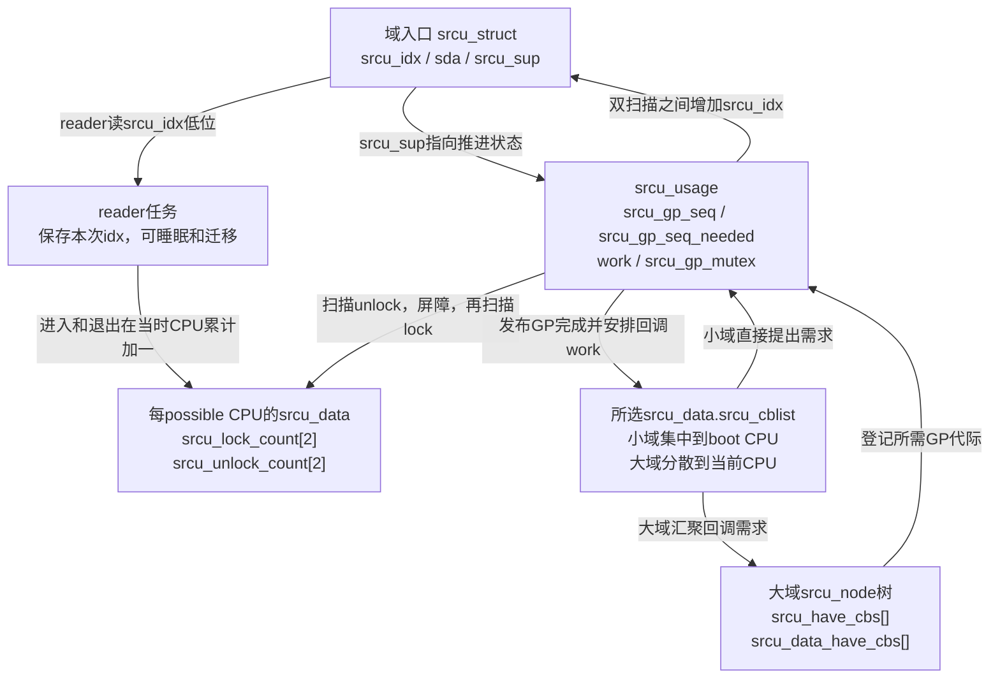
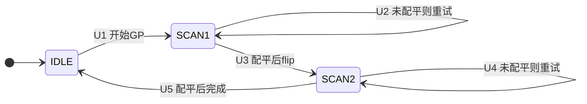
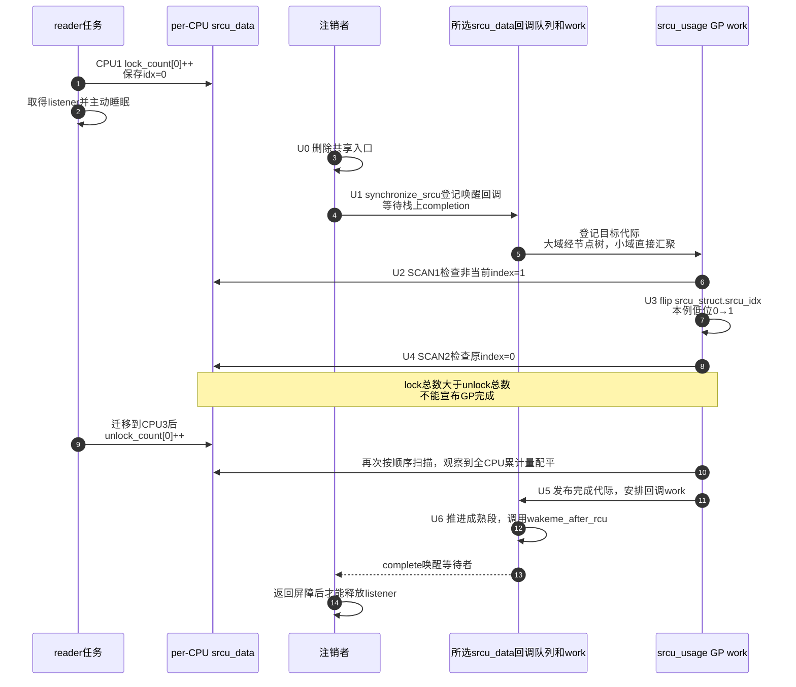

# 第9章\_Linux\_6.12\_Tree\_SRCU模块源码概念导读

## 9.1\_先分清Tree\_RCU与Tree\_SRCU

上一模块的等待桥把 GP 结论送到调用者，但还没有改变读侧的使用契约。假设通知线程取得 listener 后要等待 I/O，注销线程又必须等这次通知结束才能释放 listener。普通 RCU 的“可被抢占”不能授权这种主动睡眠；需要另一套允许 reader 暂停、迁移而不丢失退出责任的登记方式。

SRCU 为一个 `struct srcu_struct` 建立独立的读侧保护域，用累计进入和退出计数跟踪这种责任。名字里都有 `Tree`，不表示它们共享同一套 reader 或 GP 状态机。先按这个 listener 场景比较：

| 问题 | 普通 Tree RCU | Tree SRCU |
| --- | --- | --- |
| 保护域 | 系统普通 RCU 域 | 每个 `struct srcu_struct` 定义一个私有域 |
| 读侧接口 | `rcu_read_lock()/unlock()` | `srcu_read_lock(ssp)` 返回 `idx`，退出必须带回同一 `ssp/idx` |
| 主动睡眠 | 普通读侧禁止 | 允许 |
| 读者证明 | CPU QS/EQS，加必要的被抢占任务债务 | 所有 CPU 上指定 index 的累计进入/退出总数相等 |
| GP 控制 | 全局 `rcu_state` 与长期 `rcu_gp_kthread()` | 每个域的 `srcu_usage`、延迟 work 与双扫描状态 |
| 等待范围 | 普通 RCU 域中的旧 reader | 只等待指定 `srcu_struct` 中的旧 reader |

`CONFIG_PREEMPT_RCU` 只表示普通 Tree RCU reader 可以被调度器抢占，并由任务债务继续跟踪；它不允许 reader 主动等待 mutex、I/O 或 completion。源码注释中的 Sleepable RCU 指的是 SRCU 的调用契约。表中普通 Tree RCU 一列的长期控制任务和每轮 GP 状态机统一见 [普通 GP 全局生命周期源码实现](../source_explanations/P05_Linux_6.12_Tree_RCU_GP全局生命周期源码实现.md#5.14_端到端源码时序)，本章不借用该实现充当 SRCU 证据。

稳定机制、应用代码和双 index 推导见 [SRCU 私有域与双 index 状态机](../../../../knowledge/linux/synchronization_and_asynchrony/synchronization/rcu/P18_SRCU_私有域与双_index_状态机.md#18.1_问题场景_注销监听器时不能释放正在睡眠的回调对象)。本章按 [源码基线](../../linux/SOURCE_BASELINE.md) 的 NXP Linux 6.12.20、提交 `dfaf2136deb2af2e60b994421281ba42f1c087e0` 组织 Tree SRCU 对象和阅读顺序，不展开完整函数体。配置条件来自固定源码，本次未验证当前目标机配置与执行轨迹。

## 9.2\_为什么SRCU不能复用普通GP证明

假设任务在 CPU1 调用 `srcu_read_lock()`，在临界区内等待 I/O，随后被唤醒并迁移到 CPU3 退出。普通 Tree RCU 的 CPU QS 只能说明 CPU1 或 CPU3 经过了某个执行边界，不能凭该边界判断这个可睡眠逻辑 reader 已退出。

SRCU 把证明改为：

```text
CPU1：lock_count[idx] += 1
        ↓ 任务睡眠、被唤醒并迁移
CPU3：unlock_count[idx] += 1

GP扫描：先取Σunlock_count[idx] → 内存屏障 → 再取Σlock_count[idx]
        在规定的扫描阶段比较两个累计总数
```

所以 SRCU 每次读侧进入/退出都写指定域的 per-CPU 累计计数。这里扫描 **所有 possible CPU**，离线 CPU 上也可能留下由迁移读者写入的历史账本。它用读侧记账、屏障和更新侧跨 CPU 扫描换取睡眠、迁移和私有域能力，不能只看接口名称推断成本。

求和也不是无序拍照。若先取 lock 总数，读者随后完成一次进入和退出，再取 unlock 总数，两个数可能来自不匹配的观察窗口。源码先读 unlock、执行屏障，再读 lock，使已经计入的退出不能漏掉对应进入；这仍须放到双 index 协议中使用，单次相等不是“此刻绝无读者”的通用断言。

## 9.3\_源码文件和对象层次

| 上游相对位置 | 主要对象 | 阅读任务 |
| --- | --- | --- |
| [`include/linux/srcu.h`](../../linux/include/linux/srcu.h) | `srcu_read_lock/unlock()`、`srcu_dereference()`、同步接口 | 先确定调用契约、同域和 `idx` 配对 |
| [`include/linux/srcutree.h`](../../linux/include/linux/srcutree.h) | `srcu_struct`、`srcu_usage`、`srcu_data`、`srcu_node` | 区分域入口、域级 GP、每 CPU 计数与回调需求树 |
| [`kernel/rcu/srcutree.c`](../../linux/kernel/rcu/srcutree.c) | 初始化、读计数、双扫描、GP work、callback 与同步等待 | 追踪一轮私有域 GP |

`srcu_struct` 是调用者持有的域入口，自己的 `srcu_idx` 决定新读者使用哪组计数，`sda` 指向 per-CPU 数据，`srcu_sup` 指向 `srcu_usage`。后者保存域级 GP 序列、目标、互斥和 `work`；每 CPU `srcu_data` 保存两组累计计数与 callback；`srcu_node` 主要汇聚 callback GP 需求和归属，不是普通 Tree RCU 的 `qsmask` 证明树。



## 9.4\_SRCU也是多组正交状态

| 状态轴 | 地址 | 写入者 | 读取者 | 含义 |
| --- | --- | --- | --- | --- |
| 域当前 index | `srcu_struct.srcu_idx` | GP work | 新 reader | 新进入读者选哪组计数 |
| reader 进入/退出 | `srcu_data.srcu_lock_count[2]`、`srcu_unlock_count[2]` | reader 当前 CPU | GP 扫描 | 每组累计进入与退出 |
| 域级 GP | `srcu_usage.srcu_gp_seq`、`srcu_gp_seq_needed` | GP work与请求漏斗 | callback、poll、同步等待 | 当前代际与未来目标 |
| callback 需求 | `srcu_data.srcu_cblist`、`srcu_node.srcu_have_cbs[]` | `call_srcu()` 与漏斗路径 | GP work | 哪些 callback 等哪一代 |
| GP 串行执行 | `srcu_usage.srcu_gp_mutex`、work | SRCU GP work | 同域推进路径 | 同一域双扫描不能并行交错 |

`srcu_idx` 是递增计数，低位选择数组，不是 reader 数量；某一 CPU 的 lock/unlock 差也不一定单独归零，因为 reader 可以迁移。必须在同一 index 上跨所有 possible CPU 求和。图中的小域与大域是 `srcu_size_state` 控制的实现规模：小域尚无需求树，不能要求每次调用都经过 `srcu_node`。

## 9.5\_读侧调用链怎样支持睡眠和迁移

阅读 `srcu_read_lock()` 时按下列顺序追踪：

```text
srcu_read_lock(ssp)
    → __srcu_read_lock(ssp)
    → 读取srcu_idx低位
    → 当前CPU的srcu_lock_count[idx]累计加一
    → 内存屏障
    → 返回idx

srcu_read_unlock(ssp, idx)
    → __srcu_read_unlock(ssp, idx)
    → 内存屏障
    → 当前CPU的srcu_unlock_count[idx]累计加一
```

进入和退出都是累计加一，而不是要求在进入 CPU 的同一个变量上加一/减一。这是迁移后仍能全局配平的关键。`idx` 必须由当前这次 lock 返回，并传给同一域的 unlock；用错域或 index 会破坏证明。

普通 `srcu_read_lock()` 还有执行上下文配对约束：不能由一个任务进入、让另一个任务或 IRQ handler 代为退出。NMI-safe 变体另有明确接口，不能仅凭计数实现猜测普通接口也跨上下文安全。

## 9.6\_双index为什么要扫描两次

一组计数无法把删除前 reader 与删除后不断到来的 reader 分开。SRCU 用两组累计计数，并把一轮 GP 分成：

```text
SCAN1：排空当前非活动index
    → flip srcu_idx，让新reader改用另一组
SCAN2：排空翻转前的活动index
    → 本轮旧reader全部退出
```

第一遍不能删除，因为 reader 可能已经读取旧 `srcu_idx`，却在增加计数之前被长时间延迟，当前时刻的两个 index 都可能还有责任。SCAN1 检查即将重新启用的非当前组；配平后，flip 增加 `srcu_idx`，让后续读者逐步转向新低位；SCAN2 再检查翻转前的当前组。翻转不使所有旧 index 的读取瞬间失效，安全性来自两次规定顺序的扫描、读侧屏障和翻转屏障共同成立。

例如低位起初为 0：先扫描 1，翻转后低位变 1，再扫描 0。只检查 0 会漏掉先前已经取得 1 而延迟登记的读者；只检查 1 又没有覆盖当前使用 0 的主要读者。计数不能清零重用，累计值及其观察顺序是证明的一部分。



这里的 `SCAN1/SCAN2` 属于 SRCU 域级 GP 状态。flip 是二者之间的动作，并无独立 `FLIP` 状态编码；也不能把二者映射成普通 Tree RCU 的 `WAIT_FQS/DOING_FQS` 或 `rcu_node.qsmask` 清位。未配平时 GP work 释放 `srcu_gp_mutex`，按策略重试或重新调度，并不是持有该锁一直忙等到睡眠读者醒来。

图与下文沿用 [正文 U0～U6](../../../../knowledge/linux/synchronization_and_asynchrony/synchronization/rcu/P18_SRCU_私有域与双_index_状态机.md#18.4_为什么一组计数不够)：U0 撤销入口；U1 登记回调和目标；U2 SCAN1；U3 翻转；U4 SCAN2；U5 发布安全代次；U6 执行回调并交付等待者。源码里的状态编码只覆盖其中的 GP 部分，业务撤销与最后的唤醒不在该编码中。

## 9.7\_callback需求树不等于reader证明树

`call_srcu()` 经 `srcu_gp_start_if_needed()` 选择 `srcu_data.srcu_cblist`：`srcu_size_state` 尚未到 `SRCU_SIZE_WAIT_CALL` 时使用 boot CPU 队列，达到该阶段后才使用当前 CPU 队列。大域的 `srcu_funnel_gp_start()` 沿节点汇聚目标；小域保留直接提出域级需求的路径。

这棵 `srcu_node` 树让多个 CPU 先在局部节点合并已知需求，减少把同一代请求反复带到域级状态的竞争，代价是节点内存、锁和尺寸转换协议。reader 是否退出仍通过扫描所有 possible CPU 的累计计数判断。树优化的是回调需求与交付组织，没有消除读者扫描。

`synchronize_srcu()` 也借用回调：正常调度运行时，它在调用者栈上建立 completion，登记 `wakeme_after_rcu()`，等待该回调通知，然后执行返回屏障。`call_srcu()` 则把回调责任交出后返回，不同步等待 GP；不应假定执行一定晚于生产者返回。

GP 完成并不表示所有旧 callback 已经执行；域销毁前要关闭新使用者、等待在途读侧和调用路径，并用 `srcu_barrier()` 收尾已排回调。SRCU 允许 **reader** 睡眠，但 `call_srcu()` 的 **callback** 即使在进程上下文执行也必须快速且不阻塞。本版本执行单个回调时还禁用本地 BH，不能把二者的契约混用。

## 9.8\_端到端时序\_睡眠reader怎样阻止注销



步骤 9 的退出写计数，不直接唤醒注销者；步骤 10 的再次扫描取得完成证据，步骤 11 只是发布安全代际，步骤 12～14 才把结果交付给同步等待者。源码定位时应分别找 `srcu_advance_state()`、`srcu_gp_end()` 和 `srcu_invoke_callbacks()`，否则会把 GP work 错当成直接唤醒每个调用者的执行者。

## 9.9\_源码阅读顺序与证据边界

1. 先读 `srcu.h` 的接口注释，确认可睡眠、`ssp/idx` 配对和等待调用上下文。
2. 再读 `srcutree.h`，画出 `srcu_struct→srcu_usage/srcu_data/srcu_node` 所有权。
3. 阅读 `__srcu_read_lock()` 与 `__srcu_read_unlock()`，确认迁移后为何还能累计配平。
4. 阅读扫描辅助函数，找出全 CPU lock/unlock 求和，而不是寻找 `qsmask`。
5. 阅读 `srcu_gp_start()`、`srcu_flip()`、`srcu_advance_state()` 与 `srcu_gp_end()`，把 SCAN1/flip/SCAN2 放进统一周期。
6. 阅读 `call_srcu()`、`srcu_gp_start_if_needed()` 和 `srcu_funnel_gp_start()`，区分 callback 需求树与 reader 计数证明。
7. 最后阅读 `synchronize_srcu()` 的普通、idle heuristic 和 expedited 分支，不把一个分支写成永远固定的调用链。

对应的唯一函数体讲解是 [Linux 6.12 Tree SRCU 源码实现](../source_explanations/P11_Linux_6.12_Tree_SRCU源码实现.md#11.2_源码符号覆盖账本)：

- 读侧进入/退出和全 CPU 求和见 [reader 累计账本](../source_explanations/P11_Linux_6.12_Tree_SRCU源码实现.md#11.4_reader进入退出写的是累计账本)与 [零 reader 证据](../source_explanations/P11_Linux_6.12_Tree_SRCU源码实现.md#11.5_GP怎样从分散累计值构造零reader证据)；
- `SCAN1→flip→SCAN2` 见 [双扫描 GP 状态机](../source_explanations/P11_Linux_6.12_Tree_SRCU源码实现.md#11.6_双扫描GP状态机怎样推进)；
- callback 入队、目标序列与 `srcu_node` 漏斗见 [callback 请求实现](../source_explanations/P11_Linux_6.12_Tree_SRCU源码实现.md#11.7_callback怎样登记并提出GP需求)；
- GP 完成、callback work、同步等待与 barrier 见 [完成交付](../source_explanations/P11_Linux_6.12_Tree_SRCU源码实现.md#11.8_GP完成怎样交付callback并承接下一代)、[同步等待](../source_explanations/P11_Linux_6.12_Tree_SRCU源码实现.md#11.9_synchronize_srcu怎样把异步callback变成同步等待)和 [SRCU barrier](../source_explanations/P11_Linux_6.12_Tree_SRCU源码实现.md#11.10_srcu_barrier为什么要在每条非空队列后追加哨兵)。

核心实现保留所展开函数的完整控制分支。实例初始化、静态声明、争用驱动的布局扩展与销毁另见 [SRCU 生命周期实现](../source_explanations/P16_Linux_6.12_Tree_SRCU实例建立扩展与销毁源码实现.md#16.1_一轮GP之外还有实例寿命)；其 L0～L7 描述整个实例寿命，不与本章 U0～U6 的单次业务注销混为同一轮状态。

这些链接让模块问题直达唯一实现标题，外部源码用于继续核验；不能临时借用普通 Tree RCU GP 实现充当 SRCU 证据。

## 9.10\_源码阅读验收

1. 能解释普通 Tree RCU 可抢占 reader 与 SRCU 可睡眠 reader 的区别。
2. 能指出 SRCU 私有域、域级 GP、每 CPU 计数和 callback 需求树分别保存在哪里。
3. 能说明 reader 迁移后为什么用累计进入/退出求和仍能配平。
4. 能说明为什么需要 SCAN1、flip、SCAN2，而不是只扫描当前 index 一次。
5. 能解释 `srcu_node` 为什么不承担普通 `qsmask` 那种 reader 证明。
6. 能说明 `synchronize_rcu()` 为什么不能替代 `synchronize_srcu(ssp)`。
7. 能从 `__call_srcu()` 一直追到 `srcu_gp_end()`、`srcu_invoke_callbacks()` 和同步等待者被唤醒。

试着判断两个改动。其一，把求和循环改成只看 online CPU：若 reader 在 CPU1 进入后迁到 CPU3，CPU1 随即下线，它的进入账本会被漏掉，所以不能这样改。其二，看到 `srcu_gp_seq` 完成就宣称同步调用已经返回：唤醒回调可能仍在队列，调用者的 completion 尚未完成，也不能这样推断。

本章现在能沿域入口、累计账本、GP work 和回调 work 找到一次注销的全部交接点。后面的 Tasks RCU 将改变“什么算一个读者”的定义；不要把本章的计数配平复制成所有 RCU 家族的完成条件。

总阅读索引：[Linux 6.12 RCU 源码总阅读索引](P01_Linux_6.12_RCU源码总阅读索引.md#1.6_建议的源码阅读顺序)。

唯一实现讲解：[Linux 6.12 Tree SRCU 源码实现](../source_explanations/P11_Linux_6.12_Tree_SRCU源码实现.md#11.1_实现所有权与版本边界)。
