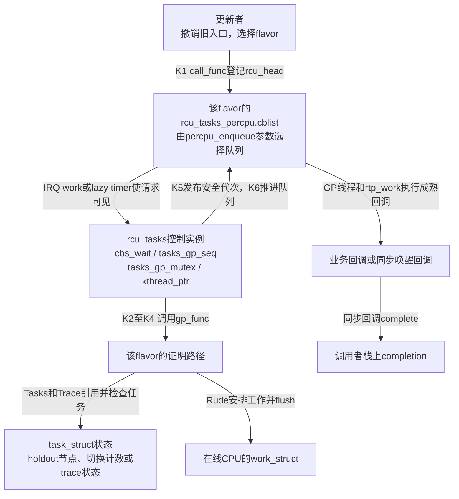
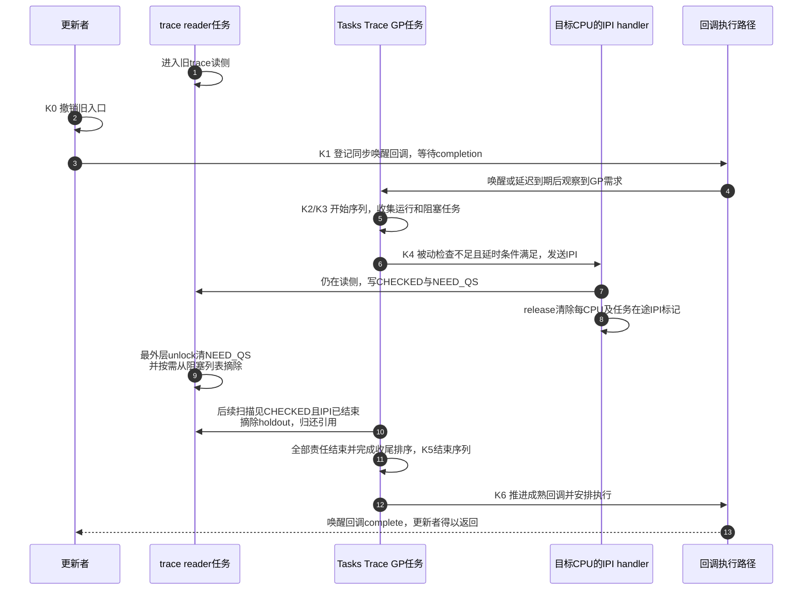

# 第10章\_Linux\_6.12\_Tasks\_RCU模块源码概念导读

## 10.1\_模块问题与三个flavor

前一模块用显式 SRCU 读侧保护一个可能睡眠的 listener。现在换成代码更新：子系统已经让新调用走新入口，但某任务可能还停在旧函数的中间，稍后继续执行旧指令。释放旧代码前，需要证明旧执行已经离开。若该执行没有参加普通 RCU 读侧协议，普通对象 GP 不能替它作证。

Tasks 家族提供几种定义这种执行边界的方法。源码中的 **flavor** 就是具有独立保护契约和完成条件的变体；它们共用控制骨架，但不是同一个 GP 的快慢档。本篇阅读 `kernel/rcu/tasks.h`，重点回答谁保存未完成责任、谁观察退出，以及结论如何交给更新者。稳定推导见 [任务轨迹宽限期](../../../../knowledge/linux/synchronization_and_asynchrony/synchronization/rcu/P19_Tasks_RCU_任务轨迹宽限期.md#19.1_为什么普通对象GP不能直接证明旧代码轨迹消失)。

| flavor | 旧集合 | 主要完成证据 |
| --- | --- | --- |
| Tasks | GP 边界前可能仍在旧代码轨迹中的任务 | 自愿切换、user、idle 等任务边界 |
| Tasks Rude | 按该契约不能跨相关调度边界的旧执行 | 在在线 CPU 上安排工作并等待完成 |
| Tasks Trace | 显式 `rcu_read_lock_trace()` 读侧 | 每任务嵌套与检查/待退出状态、必要的 IPI 探测 |

三者都不替调用方撤销旧入口，也不判断任意函数地址是否已无人使用。本章依据 [源码基线](../../linux/SOURCE_BASELINE.md) 的 NXP Linux 6.12.20，固定提交 `dfaf2136deb2af2e60b994421281ba42f1c087e0`；分别受 `CONFIG_TASKS_RCU`、`CONFIG_TASKS_RUDE_RCU`、`CONFIG_TASKS_TRACE_RCU` 等条件控制。本次未验证当前目标机配置，不把三种线程都写成必然存在。

## 10.2\_共享对象与函数插槽

更新者先需要一个地方提交回调和目标，推进者则需要知道采用哪套证明规则。三种静态控制实例 `rcu_tasks`、`rcu_tasks_rude`、`rcu_tasks_trace` 都采用 `struct rcu_tasks`：它保存 `tasks_gp_seq`、`tasks_gp_mutex`、`cbs_wait`、`kthread_ptr` 和函数插槽。`rtpcpu` 指向该 flavor 自己的 per-CPU 队列对象，不是普通 Tree RCU 的 `rcu_data`。

`gp_func` 选择整个取证入口。经典 Tasks 与 Trace 使用 `rcu_tasks_wait_gp()`，再通过准备、扫描和收尾插槽分工；Rude 直接选择 `rcu_tasks_rude_wait_gp()`。因此阅读时应区分：

- 共享骨架负责接收需求、启动 GP、周期扫描和交付 callback；
- flavor 钩子负责定义旧集合、holdout 检查和完成条件；
- 每 CPU callback 队列不等于普通 Tree RCU 的 `rcu_data.cblist`；
- 同名“GP kthread”只说明长期执行者形态相似，不说明保护域相同。



图中队列采用 per-CPU 存储，但实际入队范围可由 `percpu_enqueue_shift/lim` 调整，并非每次都独占当前 CPU 队列。延迟回调还可能先等 lazy timer；队列非空不等于 GP 线程已立即运行。`rcu_tasks_one_gp()` 在需要新 GP 时开始序列、执行 `gp_func`、结束序列，然后推进回调；只有成熟回调待执行时，也可能不新开 GP。

## 10.3\_经典Tasks的扫描链

建议沿下面问题读，而不是逐个搜索 `tasks` 名字：

```text
同步/异步调用提出需求
    → 对应rcu_tasks控制对象唤醒GP任务
    → 扫描边界前既有任务
    → 建立仍不能排除的holdout
    → 周期检查自然任务边界
    → holdout归零后发布完成并推进callback
```

这里的 **holdout** 是“暂时还不能证明已经越过边界的任务”，并不是源码识别出了该任务正执行哪段业务代码。`rcu_tasks_pertask()` 按调度状态保守选取任务，取得任务引用，将 `nvcsw` 快照保存到 `task_struct.rcu_tasks_nvcsw`，设置 `rcu_tasks_holdout`，把 `rcu_tasks_holdout_list` 接到本轮 GP 栈上的 `holdouts` 链表。当前 GP 任务、已自愿阻塞和符合排除条件的 idle 任务不用这样等待。

后续 `check_holdout_task()` 观察 holdout 标记、`nvcsw` 是否变化、任务是否还符合保留条件，以及 `NO_HZ_FULL` 的 idle 证据。证据成立才摘链并归还任务引用；否则保留责任，必要时请求 urgent QS。这里不能把“被抢占发生了切换”换成“自愿切换”：任务被抢占后仍可能恢复到旧代码中。

扫描前后的普通 `synchronize_rcu()` 用来约束调度字段更新和退出路径的顺序，并不把整个 Tasks GP 化简成一次普通 GP。任务退出还可能在从全局任务表消失后继续执行，因此 `rcu_tasks_postscan()` 要处理退出列表与退出 SRCU 协议。这些补充路径解释了为什么不能只拿一次任务表快照就宣布集合完整。

## 10.4\_Tasks\_Rude的主动路径

Tasks Rude 通过 `schedule_on_each_cpu(rcu_tasks_be_rude)` 制造边界。`rcu_tasks_be_rude()` 的函数体为空，但安排它运行的过程不为空：工作队列框架分配 per-CPU `work_struct`，在 CPU 热插拔读锁保护下向每个在线 CPU 排工作，再逐个 `flush_work()` 等执行结束。工作线程得到调度这件事提供了边界；不是空函数自己执行了某种神秘屏障。

它会打扰原本空闲或正在执行别的工作的 CPU，用调度成本换取主动边界，不能作为经典 Tasks 的无条件快路径，也不能覆盖允许跨这种边界保持活动的任意 reader。

这个固定版本还有必须保留的错误路径：`schedule_on_each_cpu()` 分配失败会返回 `-ENOMEM`，而 `rcu_tasks_rude_wait_gp()` 没有检查返回值。因此，“返回前各 CPU 工作都完成”描述的是该辅助函数成功分支，不能据此声称此版本所有失败路径都有完整证明。这里只记录已核对的实现边界，没有在外部源码树中修改它。

## 10.5\_Tasks\_Trace的每任务状态与探测

Tasks Trace reader 可以跨阻塞，所以普通“发生过自愿切换”不能自动清债。读侧用 `task_struct.trc_reader_nesting` 记录嵌套；切换路径把尚未退出的任务挂到 `rcu_tasks_trace.rtpcpu` 对应的 `rtp_blkd_tasks`，并用任务的 `trc_blkd_node/trc_blkd_cpu` 保存归属。

本版本的初始集合由 `rcu_tasks_trace_pregp_step()` 建立：先在热插拔读锁下快照各在线 CPU 当前任务，再检查 **所有 possible CPU** 的阻塞读者列表。Trace 没有安装通用的 `pertask_func` 全任务表扫描钩子，不能照抄经典 Tasks 的遍历来解释它。先收运行任务、再看阻塞列表，使切换中的 reader 也有接续的登记位置。

`trc_wait_for_one_reader()` 先尝试借助调度器锁定任务来检查。若远端正在运行且不能安全取得证据，则保留在 `trc_holdout_list`；达到 IPI 延时条件后，可以向它所在 CPU 发送 `trc_read_check_handler()`。handler 若发现任务已换走，清除在途 IPI 标记并留待重查；若仍在读侧，则将 `trc_reader_special.b.need_qs` 标成 `TRC_NEED_QS_CHECKED | TRC_NEED_QS`，要求最外层退出留下完成状态。

下面取“远端运行任务需要 IPI，之后退出”的分支。阶段沿用 [公共周期 K0～K6](../../../../knowledge/linux/synchronization_and_asynchrony/synchronization/rcu/P19_Tasks_RCU_任务轨迹宽限期.md#19.2.1_K0到K6_同一请求的公共交付周期)。K0 是业务撤销入口，K1 是登记；K2 开始 GP，K3 建立观察集合，K4 等待证明，K5 发布代次，K6 执行回调。



第 9 步修改任务状态，第 10 步才由 GP 扫描者收集证据。不要沿旧注释把特殊 unlock 画成直接唤醒 GP 任务：本版本函数体没有那条通知，它用共享状态加后续扫描衔接。若第 8 步的 IPI 仍在途，即使退出状态看似完成，也不能直接丢弃任务责任。`rcu_tasks_trace_postgp()` 还检查残留 IPI 并完成排序后，共享骨架才发布 GP 结束。

## 10.6\_模块状态与通信表

| 状态地址 | 写入者 | 读取者 | 通信方式 |
| --- | --- | --- | --- |
| 各 `rcu_tasks` 实例的 `tasks_gp_seq`、`cbs_wait` | GP 推进者、需求唤醒路径 | 队列推进者、GP 任务 | 序列与等待队列；`gp_state` 另用于调试，不替代完成序列 |
| `rcu_tasks_percpu.cblist`、`rtp_work` | 回调生产者、GP/工作队列执行者 | 同 flavor 的推进与执行路径 | 持队列锁登记、提取和结算；执行回调时释放队列锁 |
| `task_struct.rcu_tasks_nvcsw/rcu_tasks_holdout`、`rcu_tasks_holdout_list` | 经典 Tasks 扫描者、任务 QS 路径 | GP holdout 扫描者 | 任务字段和本轮引用列表；不要求每次边界都直接唤醒 GP |
| `task_struct.trc_reader_nesting`、`trc_reader_special`、`trc_holdout_list` | reader、调度/IPI 检查与 GP 扫描者 | Trace GP 扫描者 | 嵌套、CHECKED/NEED_QS、原子更新与扫描 |
| `rcu_tasks_percpu.rtp_blkd_tasks`，任务 `trc_blkd_node/trc_blkd_cpu` | Trace 切换登记与特殊退出 | Trace 初始扫描 | 锁保护的阻塞列表；与本轮 holdout 列表职责不同 |
| 任务与每 CPU 的 `trc_ipi_to_cpu` | 发送者登记，handler release 清除 | GP acquire 检查 | 在途探测生命周期，不能只看 reader nesting |
| Rude 临时 per-CPU `work_struct` | `schedule_on_each_cpu()` 与 worker | 发起者 `flush_work()` | 等待工作完成，成功路径受热插拔读锁保护 |

K5 安全发布后，`rcu_tasks_invoke_cbs()` 从成熟段提取回调，由 GP 线程和 `rtp_work` 扩展执行。调用单个回调时禁用 BH，回调必须快速、不阻塞；`cond_resched()` 在回调之间提供让出机会。正常同步接口通过 `wait_rcu_gp_state()` 登记唤醒回调，最终完成调用者的 completion。

线程已建立是这条常态路径的条件。中期启动、调度器可用但该线程尚未就绪时，调用者可经 `rcu_tasks_one_gp(..., true)` 直接推进；调度器尚未启动的过早调用会告警并返回，不能把这种返回解释为已取得合格 GP 证明。

## 10.7\_源码位置与证据边界

- [`kernel/rcu/tasks.h`](https://github.com/nxp-imx/linux-imx/blob/dfaf2136deb2af2e60b994421281ba42f1c087e0/kernel/rcu/tasks.h)：三种 flavor 的控制实例、`rcu_tasks_one_gp()`、扫描与 callback 管理；
- [`include/linux/rcupdate.h`](../../linux/include/linux/rcupdate.h) 与 [`rcupdate_trace.h`](https://github.com/nxp-imx/linux-imx/blob/dfaf2136deb2af2e60b994421281ba42f1c087e0/include/linux/rcupdate_trace.h)：公开 Tasks API 和 Trace 嵌套/退出路径；
- [`include/linux/sched.h`](../../linux/include/linux/sched.h)：相关每任务状态；
- [`kernel/workqueue.c`](../../linux/kernel/workqueue.c)：Rude 所用 `schedule_on_each_cpu()` 的分配、排队、等待和错误返回。

仓库当前没有为 `tasks.h` 的每个函数体建立独立实现讲解。本导读只组织模块职责和阅读顺序，不把未建立的逐行证据伪装成精确锚点。

具体 BPF/ftrace 调用方是否选对 flavor，还须沿该子系统撤销入口、禁止新执行和释放代码的完整路径检查；本章没有凭子系统名字认定其所有更新都使用同一种 Tasks RCU。与前文共享的同步回调桥，可继续读 [等待桥实现](../source_explanations/P02_Linux_6.12_Tree_RCU_等待桥_QS与节点汇聚关键函数源码实现.md#2.3_同步调用怎样借回调等待GP结束)。

## 10.8\_建议阅读顺序与验收

1. 从调用方确认它等待的是对象 reader 还是旧代码轨迹；
2. 识别调用的是 Tasks、Rude 还是 Trace；
3. 阅读共享 `rcu_tasks` 控制骨架；
4. 只进入对应 flavor 的扫描、holdout 和完成函数；
5. 回到 callback 交付，确认 GP 完成怎样通知等待者。

完成后应能解释三种 flavor 共享什么、仅在哪些证明模块分叉，以及为什么任何一种都不能替代普通 RCU、SRCU 或 kref 的生命周期条件。

试预测三个变化：经典 Tasks 的任务只被抢占，没有自愿边界，能否仅凭切换完成等待？不能；Trace 的最外层 unlock 已清 NEED_QS，但 IPI 标记还在途，能否立即释放任务引用？不能；Rude 的工作分配失败，能否仍用“所有 CPU 均执行过工作”解释该次返回？不能。三题分别检查执行契约、探测生命周期和实现错误路径。

本章已经把 K3/K4 的三种取证方法和 K6 的公共交付接起来。下一篇 Tiny RCU 将利用单 CPU 约束简化普通 RCU；它简化的是普通读者证明，不能按名称归入 Tasks 的三种 flavor。

总入口：[Linux 6.12 RCU 源码总阅读索引](P01_Linux_6.12_RCU源码总阅读索引.md#1.4_模块概念导读入口)。

上一篇：[Tree SRCU 模块源码概念导读](P09_Linux_6.12_Tree_SRCU模块源码概念导读.md)。

下一篇：[Tiny RCU 模块源码概念导读](P11_Linux_6.12_Tiny_RCU模块源码概念导读.md)。
