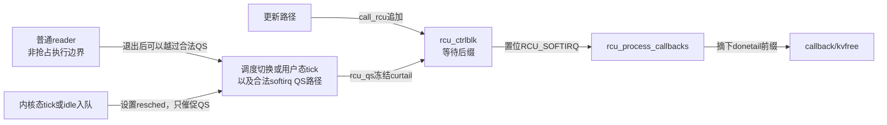
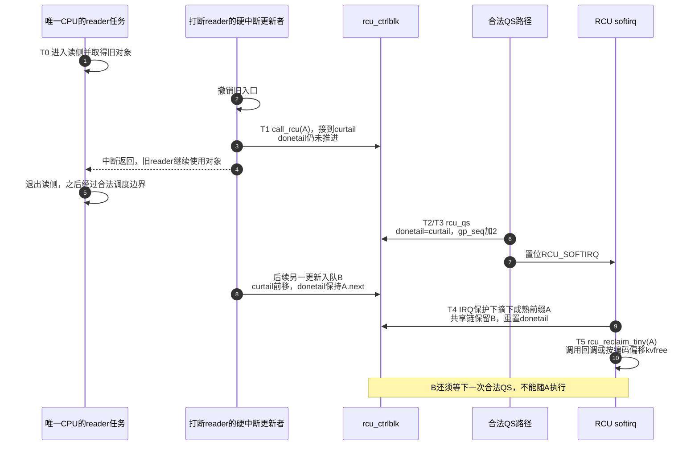

# 第11章\_Linux\_6.12\_Tiny\_RCU模块源码概念导读

## 11.1\_模块问题与当前配置前提

前面的 Tree RCU 要汇聚多个 CPU 的证据；如果构建只支持一个 CPU，还需要那棵树吗？跨 CPU 汇聚可以省掉，但延迟回收不能省：任务正用旧对象时，硬中断可以打断它、撤销入口并排入回收回调。中断返回后任务仍要继续使用旧对象，所以入队不能立即执行回收。

Tiny 用单 CPU 的非抢占执行约束证明读者结束，再用一个链表区分等待回调和成熟回调。本篇组织 `kernel/rcu/tiny.c` 的角色、状态、通信和阅读顺序；逐句实现统一进入 [Tiny RCU 源码实现](../source_explanations/P13_Linux_6.12_Tiny_RCU源码实现.md#13.1_实现所有权与本章读者任务)，稳定推导见 [Tiny RCU 正文](../../../../knowledge/linux/synchronization_and_asynchrony/synchronization/rcu/P20_Tiny_RCU_单CPU实现.md)。

Tiny 是普通 RCU 的构建期后端，不是 Tasks flavor，也不是应用运行时选择的轻量模式。它删除的是跨 CPU 证明汇聚，保留的是旧 reader 时间边界、callback 成熟和结果交付。

下列 `CONFIG_` 名称是 Kconfig 配置符号，其生成值分别约束抢占模型、CPU 数量、普通 RCU 后端和检查能力。这里继续使用前文的 QS（静止态）概念：足以排除本轮旧 reader 的执行边界。控制块与函数在进入运行过程时再逐项定位。

[源码基线](../../linux/SOURCE_BASELINE.md) 保存了 2026-09-05 的历史核对：当时检查目标工作树的 `.config`、`include/config/auto.conf` 与 `include/generated/autoconf.h`，生成结果来自当时尚未提交的 `arch/arm/configs/imx_v7_test_defconfig` 差量：

```text
CONFIG_PREEMPT_NONE_BUILD=y
CONFIG_PREEMPT_NONE=y
CONFIG_TINY_RCU=y
# CONFIG_SMP is not set
CONFIG_PROVE_LOCKING=y
CONFIG_PROVE_RCU=y
```

这些是当时实际选择 Tiny 的证据，不是本次对当前构建的再次确认。本章现在核对 NXP Linux 6.12.20 固定提交 `dfaf2136deb2af2e60b994421281ba42f1c087e0` 的源码分支；目标工作树及运行配置本次未重新取得。`imx_v7_test_defconfig` 不必直接写隐藏符号 `CONFIG_TINY_RCU`，实际选择仍须看 Kconfig 求解后的生成配置。[`CONFIG_SMP` 的构建含义](../../../../knowledge/foundations/computer_architecture/cache_coherence/P01_缓存一致性问题与缓存行.md#1.1.3_Linux中的CONFIG_SMP表示构建能力)是理解该前提的入口。

## 11.2\_公共接口怎样落到Tiny

应用仍从 `include/linux/rcupdate.h` 使用普通 `rcu_read_lock()`、`call_rcu()` 和 `synchronize_rcu()`。读侧经过公共头文件的配置展开；Kconfig 与 Makefile 让 `tiny.o` 提供 `call_rcu()`、`synchronize_rcu()` 等后端符号，不是每个公共接口都在 `tiny.c` 定义，也不是某个对象在运行时选择 Tiny。

阅读时先从公共 API 确认语义，再进入 Tiny 的本地回调控制状态，避免把实现短小误读为契约为空。配置与链接选择的唯一实现讲解见 [13.3 配置怎样在链接期选择 Tiny](../source_explanations/P13_Linux_6.12_Tiny_RCU源码实现.md#13.3_配置怎样在链接期选择Tiny)。

## 11.3\_角色状态与通信关系

| 状态地址 | 所有者 | 写入事件 | 后续读取者 |
| --- | --- | --- | --- |
| 当前执行轨迹与构建的非抢占约束 | 当前任务/中断上下文 | 读侧代码遵守不得主动阻塞的契约 | 合法调度/QS 路径据此证明旧 reader 已结束；没有另建功能性 reader 名单 |
| `rcu_ctrlblk.rcucblist` | Tiny 全局控制块 | `call_rcu()` 间接追加；softirq 改写共享头 | `rcu_process_callbacks()` |
| `rcu_ctrlblk.donetail` | Tiny 全局控制块 | 合法 QS 冻结当前队尾；softirq 摘链后重置 | `rcu_qs()` 与 `rcu_process_callbacks()` |
| `rcu_ctrlblk.curtail` | Tiny 全局控制块 | 每次 callback 入队后前移；队列被取空时由 softirq 重置 | 后续 `call_rcu()`、`rcu_qs()` 与 `rcu_process_callbacks()` |
| `rcu_ctrlblk.gp_seq` | Tiny 全局控制块 | `rcu_qs()`、`synchronize_rcu()` | poll API |
| 本 CPU `RCU_SOFTIRQ` pending 位 | softirq 核心 | `rcu_qs()` 置位 | softirq 调度与 `rcu_process_callbacks()` |



没有 `rcu_node` 树不等于没有状态机。Tiny 把 reader 证明放在本地执行约束，把 callback 代际放在两个二级指针，把完成交付放在 softirq pending 位。

`curtail` 与 `donetail` 的类型都是 `struct rcu_head **`：它们指向存放指针的槽位，而不是最后一个回调对象本身。空链时二者都指向 `&rcucblist`。A 入队后，`rcucblist=&A`、`curtail=&A.next`，`donetail` 仍指向 `&rcucblist`；一次 QS 才把 `donetail` 推到 `&A.next`。这个差别让“队列有 A”和“A 已成熟”可以分别表示。

入队、冻结与摘链在本地 IRQ 禁用区间修改这些共享指针，防止硬中断与任务/softirq 交错破坏链。真正调用业务回调前恢复原 IRQ 状态，执行者使用已经摘下的私有链；这不授权回调睡眠，它仍处于 RCU softirq 处理路径。

## 11.4\_一次callback完整周期

| 阶段 | 本模块发生什么 | 不能提前得出的结论 |
| --- | --- | --- |
| T0 | 唯一 CPU 上的旧 reader 正在使用旧对象 | 单 CPU 不等于没有旧 reader |
| T1 | `call_rcu()` 只把 callback 追加到 `curtail` | callback 尚未成熟 |
| T2 | 旧 reader 退出后，合法调度切换、用户态 tick 等路径调用 `rcu_qs()` | 不能把任意内核态 tick 当成 QS |
| T3 | `donetail=curtail` 并置位 `RCU_SOFTIRQ` | callback 还没实际执行 |
| T4 | softirq 摘下 `donetail` 之前的成熟前缀 | QS 后新入队项仍留在等待后缀 |
| T5 | `rcu_reclaim_tiny()` 调用 callback 或 `kvfree()` | 现在才完成异步回收结果交付 |

端到端函数与指针变化见 [13.11 一次异步回收的统一阶段](../source_explanations/P13_Linux_6.12_Tiny_RCU源码实现.md#13.11_一次异步回收的统一阶段)。



第 3 步只有队尾变化，第 6 步才得到成熟边界，第 10 步才产生回收效果。第 8 步特意让 B 晚于 QS 入队：摘链时应得到私有链 A、共享链 B，`donetail=&rcucblist`，`curtail=&B.next`。如果把两个尾槽合成一个，就无法表达这一边界。

同步路径的退化也要按契约理解：合法的 `synchronize_rcu()` 调用已经不在旧读侧，单 CPU 非抢占条件使它无需等待别的 CPU。本版本函数体进行非法读侧调用检查并增加 `gp_seq`，并未调用 `might_sleep()`，也没有推进 `donetail` 或执行回调。`rcu_barrier()` 则登记一个排在旧回调之后的唤醒回调，仍要等 softirq 执行到它；二者的完成条件不同。

## 11.5\_只看Tiny时的源码阅读顺序

1. [13.3 配置与链接选择](../source_explanations/P13_Linux_6.12_Tiny_RCU源码实现.md#13.3_配置怎样在链接期选择Tiny)：先确认当前构建确实链接 `tiny.o`；
2. [13.4 单 CPU 的真实交错](../source_explanations/P13_Linux_6.12_Tiny_RCU源码实现.md#13.4_单CPU仍然会出现旧reader与更新者的时间交错)：先看到为什么 callback 不能立即运行；
3. [13.5 reader 边界](../source_explanations/P13_Linux_6.12_Tiny_RCU源码实现.md#13.5_reader不登记名单但不能跨过调度边界)：确认非抢占执行约束怎样变成 QS 前提；
4. [13.6 控制块](../source_explanations/P13_Linux_6.12_Tiny_RCU源码实现.md#13.6_一个链表和两个二级指针怎样表达三种状态)：画出 `rcucblist`、`donetail` 和 `curtail`；
5. [13.7～13.10 入队、QS 与 softirq](../source_explanations/P13_Linux_6.12_Tiny_RCU源码实现.md#13.7_call_rcu只入队不宣布安全)：沿实际运行链追一次 callback；
6. [13.12 同步与 poll](../source_explanations/P13_Linux_6.12_Tiny_RCU源码实现.md#13.12_synchronize_rcu立即返回不等于没有宽限期语义)：解释同步路径为何能退化；
7. [13.13 barrier](../source_explanations/P13_Linux_6.12_Tiny_RCU源码实现.md#13.13_rcu_barrier等待的是旧callback实际执行)：区分等 reader 与等 callback；
8. [13.14 初始化](../source_explanations/P13_Linux_6.12_Tiny_RCU源码实现.md#13.14_rcu_init的三个动作不是Tiny的全部实现)：最后再看为什么 `rcu_init()` 很短。

## 11.6\_Bear跳转与验收

若已经为同一配置完成一次由 Bear 捕获的有效构建，可以在 `compile_commands.json` 检查 `kernel/rcu/tiny.c`，并结合配置和链接产物确认后端。数据库来自另一配置、只捕获增量编译或保留旧条目时，单凭某文件出现/缺失不能作证。本轮没有重新构建或生成该数据库；使用命令及预期见 [13.16 用 Bear 和构建产物核对实际编译路径](../source_explanations/P13_Linux_6.12_Tiny_RCU源码实现.md#13.16_用Bear和构建产物核对实际编译路径)。源码跳转仍可按 `call_rcu()` → `curtail` → `rcu_qs()` → `donetail` → `rcu_process_callbacks()` 追踪。

完成后应能独立回答：

1. 硬中断为什么能让单 CPU 上仍然出现“更新者已经入队、旧 reader 尚未结束”的交错；
2. `donetail` 和 `curtail` 各自指向哪个槽位，为什么不能合成一个布尔标志；
3. 内核态 tick 为什么只请求调度而不能直接报告 QS；
4. 为什么 `synchronize_rcu()` 可以立即返回，而 `rcu_barrier()` 仍要等待 softirq；
5. 为什么 `rcu_init()` 中的 early test 只是辅助动作，不是 Tiny RCU 的运行主体。

再做一个边界判断：A 已入队，内核态时钟中断到来，旧 reader 尚未退出；此时可以把 A 变成熟吗？不能。`rcu_sched_clock_irq()` 的该分支只在有未成熟回调时设置 resched 请求，催促以后出现合法 QS；请求调度和已经获得静止态证据是两件事。

这一篇已把单 CPU 下的证明、链表成熟边界和 softirq 交付接起来。下一篇将检查 RCU 怎样接入 Lockdep；检查器字段应与这里真正推进回收的状态分开。

总入口：[Linux 6.12 RCU 源码总阅读索引](P01_Linux_6.12_RCU源码总阅读索引.md#1.4_模块概念导读入口)。

上一篇：[Tasks RCU 模块源码概念导读](P10_Linux_6.12_Tasks_RCU模块源码概念导读.md)。

下一篇：[RCU Lockdep 适配模块源码概念导读](P12_Linux_6.12_RCU_Lockdep适配模块源码概念导读.md)。
