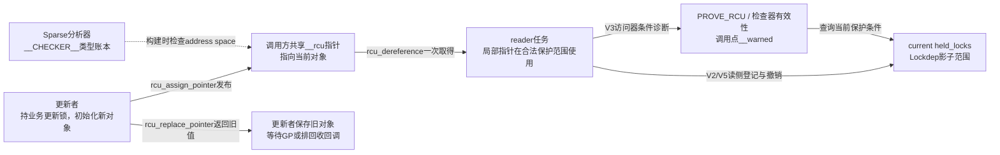
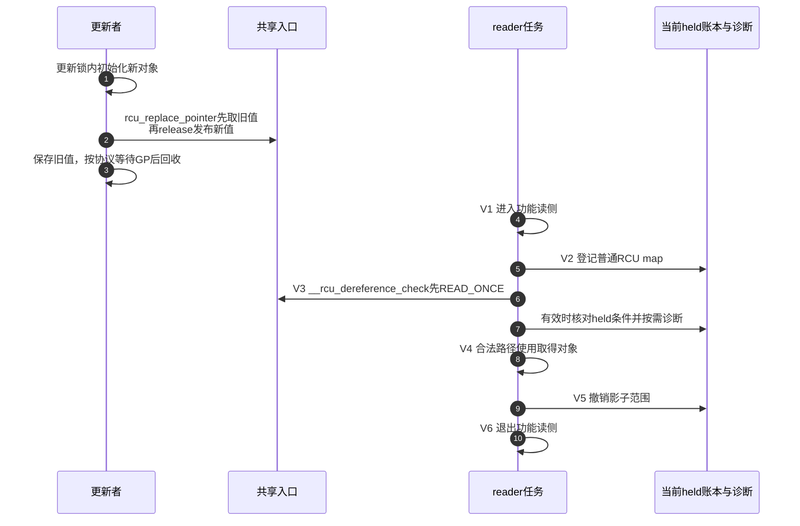

# 第1章\_Linux\_6.12\_RCU\_公共接口与检查机制源码详解

## 1.1\_源码详解边界与引用入口

更新者已经在互斥锁下初始化新对象，准备替换共享入口；读者要取得它，旧对象还要等旧读者退出后回收。此时 `rcu_replace_pointer()`、`rcu_dereference()` 和检查宏虽然出现在相邻几行，却分别承担发布、取得和诊断。若把它们看成同一把“RCU 锁”，就会误以为替换宏等待了 GP，或者诊断宏会阻止不安全访问。

本章沿这个替换场景拆开 Linux 6.12.20 的公共宏，说明每个参数何时被使用、改变哪种状态，以及哪些保证仍由调用者建立。navigation 文档组织模块与调用链；这里保存宏体、配置分支、中文 Doxygen 阅读说明和可修改性边界。

| 引用入口 | 本次使用范围 |
| --- | --- |
| [P01 RCU 源码阅读索引](../navigation/P01_Linux_6.12_RCU源码总阅读索引.md#1.6_建议的源码阅读顺序) | 先区分 RCU 家族，再按功能类别进入具体接口 |
| [Tree RCU 公共问题现场](../../../../knowledge/linux/synchronization_and_asynchrony/synchronization/rcu/P05_Tree_RCU_公共骨架与完整周期.md#5.1_固定问题现场) | 替换入口、等待旧 reader 并回收旧对象 |
| [P23 RCU 类型语义、Sparse 与 Lockdep](../../../../knowledge/linux/synchronization_and_asynchrony/synchronization/rcu/P23_RCU_类型语义_Sparse与Lockdep.md#23.6_Lockdep检查的是哪一个运行时条件) | 区分静态类型检查、动态上下文检查与功能保证 |
| [Tree RCU GP 全局生命周期模块导读](../navigation/P03_Linux_6.12_Tree_RCU_GP全局生命周期模块源码概念导读.md#3.1_模块问题与版本边界) | 把普通同步/callback 请求接到长期 GP kthread、物理 GP 和完成发布 |
| [P02 公共接口与读侧模型模块源码概念导读](../navigation/P02_Linux_6.12_RCU公共接口与读侧模型模块源码概念导读.md#2.2_先固定公共调用场景) | 把公共接口接回 CPU QS、任务债务、树形汇聚和等待者唤醒主线 |

下面代码依据 [源码基线](../../linux/SOURCE_BASELINE.md) 的 NXP Linux 6.12.20、固定提交 `dfaf2136deb2af2e60b994421281ba42f1c087e0` 裁剪。`/** ... */` 是本仓库补充的中文 Doxygen 阅读说明，不是上游原注释；完整原文和许可证边界以链接的源码文件为准。本次核对固定源码，未重新取得目标构建配置或运行轨迹。

## 1.2\_接口与源码索引

| 接口或检查点 | 仓库中的版本化源码 | 调用场景中的作用 | 使用到的机制 |
| --- | --- | --- | --- |
| [`rcu_replace_pointer()`](#1.3_rcu_replace_pointer接口实现) | [`include/linux/rcupdate.h`](../../linux/include/linux/rcupdate.h) | 取得旧入口并发布新入口 | 更新侧受保护读取、release 发布、GNU statement expression |
| [`rcu_assign_pointer()`](#1.3.1_rcu_assign_pointer发布实现) | [`include/linux/rcupdate.h`](../../linux/include/linux/rcupdate.h) | 发布新入口 | 常量 `NULL` 的 `WRITE_ONCE()` 快路、其他值的 release store |
| [`rcu_dereference()`](#1.3.2_rcu_dereference取得实现) | [`include/linux/rcupdate.h`](../../linux/include/linux/rcupdate.h) | 在读侧取得被 RCU 保护的入口 | `READ_ONCE()`、依赖顺序、Sparse 与 Lockdep 检查 |
| [`rcu_check_sparse()`](#1.3.3_rcu_check_sparse静态类型桥接) | [`include/linux/rcupdate.h`](../../linux/include/linux/rcupdate.h) | 把 RCU 宏参数送入 Sparse address-space 类型检查 | `__CHECKER__` 配置分支、`typeof()`、`__rcu`；普通编译器分支为空 |
| [`rcu_dereference_protected()`](#1.5_rcu_dereference_protected功能与检查路径) | [`include/linux/rcupdate.h`](../../linux/include/linux/rcupdate.h) | 在更新锁已阻止并发修改时读取旧值 | Lockdep 条件、Sparse address-space 检查；刻意省略 `READ_ONCE()` |
| [`synchronize_rcu()`](#1.4_synchronize_rcu接口实现) | [`kernel/rcu/tree.c`](../../linux/kernel/rcu/tree.c) | 等待边界前的普通 RCU reader 结束 | 阻塞式 GP、普通/加速分支、读侧自等待检查 |
| [`RCU_LOCKDEP_WARN()`](#1.6_RCU_LOCKDEP_WARN检查适配层) | [`include/linux/rcupdate.h`](../../linux/include/linux/rcupdate.h) | 把 RCU 调用约束接入 Lockdep 诊断 | `CONFIG_PROVE_RCU`、一次性告警、动态路径覆盖 |
| [RCU Lockdep适配层](P04_Linux_6.12_RCU_Lockdep适配层源码实现.md#4.2_源码符号覆盖账本) | [`rcupdate.h`](../../linux/include/linux/rcupdate.h)、[`update.c`](../../linux/kernel/rcu/update.c) 与 [`tree.c`](../../linux/kernel/rcu/tree.c) | 分别解释普通/BH/sched/callback四个逻辑身份 | 声明、定义、key、wait type、事件配对、查询、配置退化与修改边界 |

若省略这张索引，读者容易把 `rcu_replace_pointer()`、GP 等待和 Lockdep 告警误认为一个不可分割的动作。实际上它们分别承担入口更新、旧读者边界和调试诊断。

先把状态位置放到同一张图里。宏展开产生的局部指针只保存一次取得的地址，真正跨 CPU 传播的是调用方共享入口；检查器账本也不会替共享入口保留对象引用。



本页使用到的底层 `READ_ONCE/WRITE_ONCE` 在 [单次读取](../../memory_ordering/source_explanations/include/asm-generic/rwonce.h.md#1.3_READ_ONCE与内部读取)和 [单次写入](../../memory_ordering/source_explanations/include/asm-generic/rwonce.h.md#1.4_WRITE_ONCE与内部写入)唯一展开：它们约束对应访问，不提供业务互斥或对象引用。`smp_store_release` 承担发布排序；涉及实际 ARM 指令时再进入 [ARM 屏障实现边界](../../memory_ordering/source_explanations/arch/arm/include/asm/barrier.h.md#1.3_从展开结果回到接口契约)，不能把某条机器指令写成所有架构的公共宏定义。

## 1.3\_rcu\_replace\_pointer接口实现

[`include/linux/rcupdate.h`](../../linux/include/linux/rcupdate.h) 中的核心实现为：

```c
/**
 * @brief 在更新侧保护条件下取得旧指针，再按 RCU 发布契约写入新指针。
 * @param rcu_ptr 被 RCU 保护的入口指针。
 * @param ptr 要发布的新指针。
 * @param c 调用者已阻止并发更新的可检查条件。
 * @return 替换前的旧指针。
 */
#define rcu_replace_pointer(rcu_ptr, ptr, c)                         \
({                                                                   \
	typeof(ptr) __tmp =                                               \
		rcu_dereference_protected((rcu_ptr), (c)); /* 更新锁内取旧值。 */ \
	rcu_assign_pointer((rcu_ptr), (ptr));          /* release发布新值。 */ \
	__tmp;                                        /* 表达式结果为旧值。 */ \
})
```

**实现原理：** 这个宏组合了三件事：

1. `rcu_dereference_protected()` 在调用者提供的保护条件下取得旧指针；
2. `rcu_assign_pointer()` 发布新指针，使后来 reader 能按 RCU 发布/取得契约观察新对象初始化；
3. GNU C statement expression 让最后的 `__tmp` 成为宏返回值。

它 **没有** 等待宽限期，也没有释放旧对象。调用者仍须在取消发布后执行 `synchronize_rcu()` 或安排合适的 RCU callback，并确保旧对象只有一个最终释放出口。

这也是“受锁保护的先读后写”，不是原子交换或 CAS。若两个更新者没有共同串行化，它们仍可能读到同一个旧入口、互相覆盖新入口并重复回收旧对象。宏只使用调用者已经持有的锁，不会为 `c` 中写出的锁自动加锁。

第三个参数不是同步原语，而是一条可检查的声明：

```c
lockdep_is_held(&update_lock)
```

表示“这里之所以允许更新侧受保护读取，是因为当前路径持有 `update_lock`”。写成常量 `1` 仍然要求调用者自己证明安全，但放弃了 Lockdep 对该理由的动态核对。

**可修改性说明：** 保持“先取旧值、再发布新值、最后返回旧值”的顺序；`rcu_ptr` 应是稳定入口左值，不能假定整个组合只定位它一次，因为受保护读取和发布各使用一次。不要把加锁、引用计数或清理动作塞进 `c`，关闭诊断后它可能根本不求值。调整宏展开时要同时复核更新锁范围、旧值唯一回收、临时变量类型及传入表达式的求值次数。

### 1.3.1\_rcu\_assign\_pointer发布实现

```c
/**
 * @brief 按 RCU 发布契约写入新指针。
 * @param p 带 __rcu 标注的入口指针。
 * @param v 要发布的新值。
 * @note 本 Doxygen 说明由仓库补充；宏体裁剪自 include/linux/rcupdate.h。
 */
#define rcu_assign_pointer(p, v)                                      \
do {                                                                  \
	uintptr_t _r_a_p__v = (uintptr_t)(v);                           \
	/* 静态检查入口是否带 RCU 类型标注。 */                         \
	rcu_check_sparse(p, __rcu);                                     \
	                                                                    \
	/* 常量 NULL 不需要发布对象初始化；其他值使用 release store。 */ \
	if (__builtin_constant_p(v) && (_r_a_p__v) == (uintptr_t)NULL)   \
		WRITE_ONCE((p), (typeof(p))(_r_a_p__v));                  \
	else                                                              \
		smp_store_release(&p, RCU_INITIALIZER((typeof(p))_r_a_p__v)); \
} while (0)
```

**实现原理：** `_r_a_p__v` 先保存新值，`__builtin_constant_p(v)` 只问编译器是否为常量，不再执行业务表达式。只有编译期常量且值为 `NULL` 才走 `WRITE_ONCE()` 快路；运行时算出的零值仍可能走 release 分支。发布新对象时，release store 把此前初始化排在入口发布之前，但不会替读者创建保护范围或引用。

`RCU_INITIALIZER` 在这里承担类型桥接，不初始化对象内容：

```c
/**
 * @brief 仓库补充：把同一指针值标为RCU地址空间供赋值使用。
 * @param v 已具有相应指针类型的值；不分配或初始化所指对象。
 */
#define RCU_INITIALIZER(v) (typeof(*(v)) __force __rcu *)(v)
```

`typeof(*(v))` 在这里取得所指类型，`__rcu` 表示 Sparse 地址空间，`__force` 允许这个有意的类型桥接；普通编译器下这些检查标注不产生发布屏障。它与名字相近的 `RCU_INIT_POINTER()` 也不是同一职责：后者用于满足初始化等特定前提的赋值，不能代替并发发布新对象所需的 release。

**可修改性说明：** 保留新值单次业务求值、Sparse 类型核对和非常量空值的分支语义。不能因为只测了常量 `NULL` 就把所有发布改成 `WRITE_ONCE()`；验证应分别覆盖新对象发布、常量空入口和运行时计算的指针，并检查读者的取得协议。宏只负责入口发布，不等待旧 reader 或回收旧对象。

### 1.3.2\_rcu\_dereference取得实现

```c
/**
 * @brief 在普通 RCU 读侧取得入口，并执行类型和动态上下文检查。
 * @param p 要读取的 __rcu 指针。
 * @return 一次读取到的普通内核指针值。
 * @note 本 Doxygen 说明由仓库补充；宏体裁剪自 include/linux/rcupdate.h。
 */
#define __rcu_dereference_check(p, local, c, space)                   \
({                                                                     \
	/* READ_ONCE 防止编译器合并或重新取值，并保留依赖顺序的起点。 */ \
	typeof(*p) *local = (typeof(*p) *__force)READ_ONCE(p);          \
	RCU_LOCKDEP_WARN(!(c), "suspicious rcu_dereference_check() usage"); \
	rcu_check_sparse(p, space);                                     \
	((typeof(*p) __force __kernel *)(local));                        \
})

#define rcu_dereference_check(p, c)                                  \
	__rcu_dereference_check((p), __UNIQUE_ID(rcu),                \
				(c) || rcu_read_lock_held(), __rcu)

#define rcu_dereference(p) rcu_dereference_check(p, 0)
```

**实现原理：** `rcu_dereference()` 把显式附加条件固定为 0，因而动态检查依赖 `rcu_read_lock_held()`；真正取得指针的是一次 `READ_ONCE()`。它既不复制对象也不增加引用计数，返回后的对象生命期仍由调用者所在的 RCU 读侧临界区约束。

`local` 由 `__UNIQUE_ID(rcu)` 提供展开局部名，避免调用点名称冲突。`typeof` 和末尾 `__force __kernel` 只负责类型，末尾表达式仍返回先前加载的同一地址。尤其注意，宏体先加载 `p`，然后执行动态诊断：告警不把加载回滚，也不阻止返回。`__kernel` 在 Sparse 视角把结果交回普通内核地址空间，不意味着取得任何所有权。

**可修改性说明：** 保持单次加载、取得后的地址依赖和类型转换边界，不改成普通重复读取，也不把它无条件等同于完整 acquire load。后续代码若打断依赖、把指针带出保护区或在无引用情况下跨阻塞使用，需要重新建立正确协议；增加一个 held 查询不能补回这些保证。

### 1.3.3\_rcu\_check\_sparse静态类型桥接

[`include/linux/rcupdate.h`](../../linux/include/linux/rcupdate.h) 用预处理分支把同一个 RCU 公共宏交给两种完全不同的构建环境：

```c
#ifdef __CHECKER__
/**
 * @brief 把参数的实际指针类型与调用者要求的 address space 放进同一表达式。
 * @param p RCU 公共宏正在检查的指针入口。
 * @param space 期望的 Sparse address space，例如 __rcu。
 * @note 本 Doxygen 说明由仓库补充；宏体裁剪自 include/linux/rcupdate.h。
 */
#define rcu_check_sparse(p, space) \
	((void)(((typeof(*p) space *)p) == p))
#else
/**
 * @brief 普通编译器构建中的空分支，不生成运行时代码。
 */
#define rcu_check_sparse(p, space)
#endif
```

**实现原理：** 调用 Sparse 分析器时，它会定义 `__CHECKER__` 并解析预处理后的 C 翻译单元。调用 `rcu_check_sparse(p, __rcu)` 后，`typeof(*p) __rcu *` 构造期望类型，比较表达式迫使 Sparse 核对它与 `p` 的实际 address space 是否兼容，最外层 `(void)` 再丢弃没有业务意义的比较结果。工具识别的是 `__rcu` 展开的 `noderef`、`address_space` 和表达式类型，不是 `rcu_check_sparse` 这个名字。

| 构建环境 | 宏展开 | 状态变化 | 能形成的证据 |
| --- | --- | --- | --- |
| Sparse 定义 `__CHECKER__` | address-space 类型比较表达式 | 只产生分析器内部类型约束，不修改目标程序状态 | 已分析调用点的 RCU 指针类型是否兼容 |
| 普通 GCC/Clang 构建 | 空宏 | 无运行时状态、无指令、无链接对象 | 不能声称已经运行 Sparse |

`__CHECKER__` 不是 Kconfig，`rcu_check_sparse()` 也不是静态断言的运行时版本。它不能确认 current 是否处于 RCU 读侧、对象是否仍存活或 GP 是否完成；这些问题分别交给 Lockdep 运行时条件、对象所有权和 RCU 功能协议。

**可修改性说明：** 这段桥接被 `rcu_assign_pointer()`、`RCU_INIT_POINTER()`、`rcu_dereference*()` 和 `unrcu_pointer()` 等公共入口复用。修改 `space` 的施加位置、删除比较表达式或在普通编译器分支求值参数，都会同时改变大量调用方的诊断或生成代码边界。复核时至少准备一个正确的 `__rcu` 入口和一个故意缺少 `__rcu` 的入口，运行 `make C=2 M=<目标目录>`，确认前者通过、后者出现 different address spaces 诊断；普通 `make` 或运行时无告警不能替代这项验证。稳定语义与实验命令见 [RCU 类型语义、Sparse 与 Lockdep](../../../../knowledge/linux/synchronization_and_asynchrony/synchronization/rcu/P23_RCU_类型语义_Sparse与Lockdep.md#23.5_Sparse具体检查什么)。

### 1.3.4\_rcu\_dereference\_raw的无检查取得

hlist 的 RCU 遍历需要沿 `head.first` 和 `node.next` 逐步取得节点。它把上下文检查放在循环入口，因此这里使用不自行执行动态上下文警告的 raw 取得。raw 省去的是这层检查，不是读侧区间、依赖顺序或对象寿命约束。

```c
/**
 * __rcu_dereference_raw - 仓库补充阅读说明：对 p 进行一次 READ_ONCE 取得，以独立局部量返回同一地址。
 * @p: 调用方已经按 RCU 协议保护的指针表达式。
 * @local: 外层宏生成的局部名字，避免与调用点变量冲突。
 */
#define __rcu_dereference_raw(p, local) \
({ \
	/* 保留来自p的依赖顺序起点。 */ \
	typeof(p) local = READ_ONCE(p); \
	((typeof(*p) __force __kernel *)(local)); \
})
#define rcu_dereference_raw(p) __rcu_dereference_raw(p, __UNIQUE_ID(rcu))
```

`__UNIQUE_ID(rcu)` 只生成展开所需的局部标识符；它不创建全局对象。GNU C 的语句表达式先用 `typeof(p)` 确定局部指针类型，再执行一次 `READ_ONCE(p)`。末尾转换中的 `__force`、`__kernel` 是 Sparse 类型标注桥接，返回的仍是所取得的地址，没有分配副本、增加引用或获取业务锁。相比上节的普通取得路径，这里不调用 `rcu_check_sparse` 或 `RCU_LOCKDEP_WARN`；不能据此推断调用方没有检查。

[哈希节点导读](../../hash_table/navigation/P03_节点连接与并发边界导读.md#3.2_普通修改与RCU发布的分界)的 S2 展示其调用位置；[rculist.h 遍历实现](../../hash_table/source_explanations/include/linux/rculist.h.md#1.3_遍历的取得与检查分开)解释循环入口的 `__list_check_rcu`、可选条件和配置退化。取得之后的成员恢复只改变地址表达方式，受保护区间仍由调用者建立。

**可修改性说明：** 不要因名称带 raw 而替换为普通指针读取，也不要在调用方尚未建立独立引用时把结果带出读侧。调整展开必须检查表达式求值次数、局部名字冲突、Sparse 标注、地址依赖以及所有使用者的独立检查位置；上述调用图复用 hlist 的 S1 发布、S2 取得、S3 摘除到 S5 回收周期，本原语不推进宽限期。

## 1.4\_synchronize\_rcu接口实现

`synchronize_rcu()` 同时包含接口检查、运行策略、早期启动退化、普通等待和 expedited 分流。为了避免公共接口文档与 Tree RCU 状态机各维护一份函数体，本章只保留检查层职责边界：入口用 `RCU_LOCKDEP_WARN()` 检查调用者是否正在受本次等待覆盖的普通 RCU 读侧中；告警与否不改变 GP 的安全条件，关闭检查配置也不放宽“可阻塞且不得自等待”的 API 契约。

完整入口、`rcu_blocking_is_gp()`、普通/expedited 分流和 boot-only sequence 推进由 [同步等待与 rcu_barrier 源码实现：`synchronize_rcu()`](P10_Linux_6.12_Tree_RCU_同步等待与rcu_barrier源码实现.md#10.4_synchronize_rcu怎样选择普通expedited或早期空GP)唯一展开。普通 GP 请求、长期 GP kthread 和完成发布见 [Tree RCU GP 全局生命周期模块导读](../navigation/P03_Linux_6.12_Tree_RCU_GP全局生命周期模块源码概念导读.md#3.6_请求漏斗为什么不是全局热锁)；CPU/任务证明再按配置进入 P02/P03。不能因为入口附近出现 Lockdep 宏，就把动态检查描述成宽限期算法的一部分。

修改本章的发布或取得宏时，应保持这一职责边界：宏不偷偷引入 GP 等待，等待接口也不替调用者关闭更新入口。特别是旧对象的克隆、修改和发布若是一笔业务事务，更新锁必须覆盖整笔事务，不能只围住最后一次指针赋值。

## 1.5\_rcu\_dereference\_protected功能与检查路径

[`include/linux/rcupdate.h`](../../linux/include/linux/rcupdate.h) 把受保护读取、动态条件检查和 Sparse 类型检查并列放进同一个宏：

```c
/**
 * @brief 在调用者声明的更新侧保护条件下取得 __rcu 指针。
 * @param p 要读取的 RCU 指针。
 * @param local 为内部接口形式保留的局部名参数；此宏体实际未使用。
 * @param c 并发更新已被阻止的可检查条件。
 * @param space Sparse address space 标记。
 * @return 受调用者保护的指针值。
 */
#define __rcu_dereference_protected(p, local, c, space)              \
({                                                                   \
	RCU_LOCKDEP_WARN(!(c),                                            \
		"suspicious rcu_dereference_protected() usage"); /* 动态检查。 */ \
	rcu_check_sparse(p, space);                         /* 静态类型检查。 */ \
	((typeof(*p) __force __kernel *)(p));               /* 返回受保护指针。 */ \
})

#define rcu_dereference_protected(p, c) \
	__rcu_dereference_protected((p), __UNIQUE_ID(rcu), (c), __rcu)
```

**实现原理：** 这三条路径的职责不能互换：

| 路径 | 直接作用 | 不提供的保证 |
| --- | --- | --- |
| 返回 `(p)` | 在更新被阻止时取得指针；本原语刻意不做 `READ_ONCE()` | 不会阻止并发更新，也不延长对象生命期 |
| `rcu_check_sparse()` | Sparse 在编译期核对 `__rcu` address space | 不知道当前任务是否真的持锁 |
| `RCU_LOCKDEP_WARN(!(c), ...)` | 在启用检查且运行到该路径时验证调用者声明 | 不建立发布顺序、GP 或最终释放关系 |

调用方与检查框架之间的连接如下：


`local` 虽由外层传入唯一名字，但这个内部宏没有声明或使用它，不能把它解释成实际存储状态。与普通 `rcu_dereference_check()` 不同，protected 版本的源码先进行诊断，再返回 `(p)`；两种宏都不会由诊断结果授予保护。

**可修改性说明：** 只有调用者已经阻止并发修改，才能省略 `READ_ONCE()` 和依赖取得要求；不能靠把 `c` 改为 1 来满足这个前提。增删参数时应检查普通编译器与 Sparse 展开、条件关闭后的求值行为及所有更新侧调用方。`c` 应是无业务副作用的证据谓词，不能是需要必定执行的功能步骤。

## 1.6\_RCU\_LOCKDEP\_WARN检查适配层

`CONFIG_PROVE_RCU` 与 Lockdep 证明配置的选择关系见 [`kernel/rcu/Kconfig.debug`](../../linux/kernel/rcu/Kconfig.debug)。`CONFIG_PROVE_RCU=y` 时，[`include/linux/rcupdate.h`](../../linux/include/linux/rcupdate.h) 中的实现会在检查框架可用、条件为真且本调用点尚未告警时报告：

```c
/**
 * @brief 将一条 RCU 调用约束接入 Lockdep 诊断路径。
 * @param c 运行时判定为真时应报告的违规条件。
 * @param s 告警文本。
 * @note 它只报告已执行到的违规路径，不建立任何同步保证。
 */
#define RCU_LOCKDEP_WARN(c, s)                                      \
	do {                                                             \
		static bool __section(".data..unlikely") __warned;             \
		if (debug_lockdep_rcu_enabled() && (c) &&                     \
		    debug_lockdep_rcu_enabled() && !__warned) {               \
			__warned = true;                                           \
			lockdep_rcu_suspicious(__FILE__, __LINE__, s);              \
		}                                                              \
	} while (0)
```

**实现原理：** 两次 `debug_lockdep_rcu_enabled()` 检查分别避免早期启动/检查器未就绪和检查过程中 Lockdep 被并发关闭造成的误报。`kernel/rcu/update.c` 中该函数还要求 RCU scheduler 已进入可检查阶段、`debug_locks` 仍开启，且当前任务没有处于 Lockdep 递归路径。每个宏展开点还有自己的静态 `__warned`；首次命中后将其置位，因此后续同一调用点不重复打印，`lockdep_rcu_suspicious()` 只负责输出报告。

`__section(".data..unlikely")` 把这个静态状态放进指定数据节；它是全局静态存储，不是每任务状态，也不因离开本次读侧自动复位。`__FILE__`、`__LINE__` 和 `s` 定位告警来源。`__warned` 是普通布尔值，不是跨 CPU 的原子去重协议，并发首次命中不能据此保证严格只打印一条。

`CONFIG_PROVE_RCU=n` 时，同名宏变为：

```c
/**
 * @brief CONFIG_PROVE_RCU 关闭时的零运行时诊断开销实现。
 */
#define RCU_LOCKDEP_WARN(c, s) do { } while (0 && (c))
```

常量假的短路表达式使条件不在运行时执行，因此没有相应诊断开销；同一调用点的功能实现仍由宏后面的代码继续完成。这个空操作分支表达的是“关闭动态检查”，不是“调用约束消失”。

**可修改性说明：** 保留条件前后的有效性检查，避免告警检查自身递归或与停检交错时误判。不要把 `__warned` 改成每次调用的栈变量而无意恢复无限重复报告，也不要从“没有新报告”推出错误已修复。测试必须区分配置关闭、检查器停用、条件未求值、同一点已报告和实际正确五种情况；告警文本应准确指出被检查的调用契约。

因此应把源码分成两条并行证据链：

```text
功能机制：发布新入口 → 等待旧reader → 允许回收旧对象
检查机制：记录锁/读侧状态 → 核对调用条件 → 对已覆盖违规路径报警
```

Lockdep 是动态检查：未执行到的错误路径不会被观察；`rcu_replace_pointer(..., 1)` 也不会凭空得到保护证明。类型、运行时上下文和对象生命周期仍分别需要 Sparse、Lockdep/`CONFIG_PROVE_RCU`、KASAN/KCSAN、压力测试以及人工所有权与 GP 证明共同覆盖。稳定的能力边界见 [RCU 类型语义、Sparse 与 Lockdep](../../../../knowledge/linux/synchronization_and_asynchrony/synchronization/rcu/P23_RCU_类型语义_Sparse与Lockdep.md#23.6_Lockdep检查的是哪一个运行时条件)，故障诊断组合见 [RCU 调试、验证与集成误用](../../../../knowledge/linux/synchronization_and_asynchrony/synchronization/rcu/P24_RCU_调试验证与集成误用.md#24.5.5_D4_根据状态链选择动态检查器)。

以一次普通读侧访问收束本章的宏展开。这里沿用类型检查正文的 V 阶段，V0 的 Sparse 分析在构建时，运行中从 V1 开始：



第 2 步发布不等待第 10 步；第 3 步的回收等待可以与读者执行交错，图中不表示回收已经完成。第 6 步可能取得并发替换前或后的入口，安全性要求两种对象都符合各自的发布与生命周期协议。第 7 步没有给指针增加引用，也没有通知 GP 读者已经退出。


## 1.7\_复核问题

1. `rcu_check_sparse()` 为什么不是 Sparse 关键字，普通编译器分支又为什么不能形成静态检查证据？
2. `rcu_replace_pointer()` 的第三个参数表达什么，为什么优先使用可检查条件而不是常量 `1`？
3. `RCU_LOCKDEP_WARN()` 关闭后，哪些功能路径仍然执行，哪些诊断能力消失？
4. Lockdep 通过为什么仍不能证明旧对象已经安全回收？

参考判断：Sparse 检查展开后的类型表达式；第三参数只是调用者的保护声明；关闭告警后发布、取得和 GP 契约仍在；无告警最多是给定有效性和执行覆盖下的诊断证据。再找两处易误改点：运行时算出的 NULL 不保证走常量快路，protected 的 `local` 参数也没有对应局部变量。这些差异必须从展开结果确认，不能只按宏名推断。

阅读索引：[Linux 6.12 RCU 源码总阅读索引](../navigation/P01_Linux_6.12_RCU源码总阅读索引.md#1.6_建议的源码阅读顺序)。

关联模块概念导读：[Linux 6.12 RCU 公共接口与读侧模型模块源码概念导读](../navigation/P02_Linux_6.12_RCU公共接口与读侧模型模块源码概念导读.md#2.2_先固定公共调用场景)。
