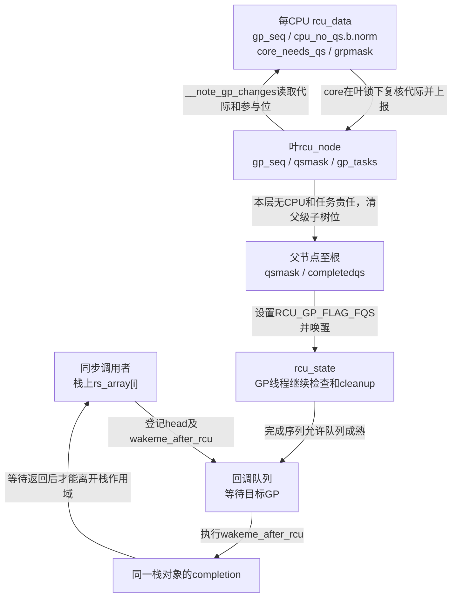
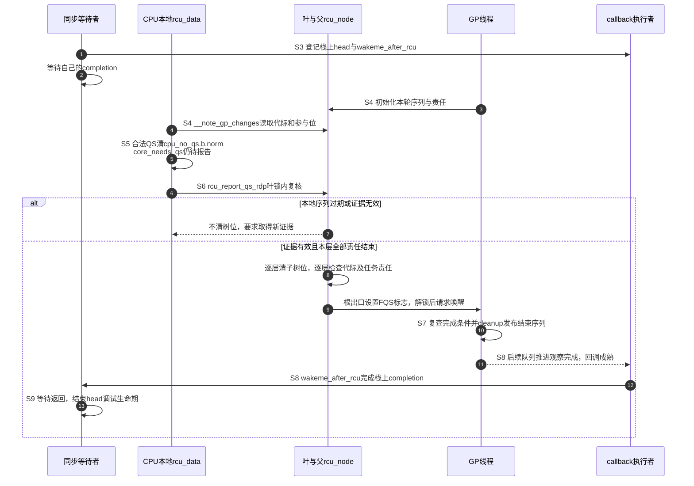

# 第2章\_Linux\_6.12\_Tree\_RCU\_等待桥\_QS与节点汇聚关键函数源码实现

## 2.1\_实现讲解边界与入口

更新者已经撤销旧入口并调用同步等待。某个 CPU 随后经过静止态，但等待者仍不能立刻返回：本地证据必须属于正确的 GP，还要与其他 CPU、被抢占任务的责任合并，最终由回调把完成结果送回调用者。这里最容易误读的是，把一次本地清位、根节点归零和 completion 唤醒当成同一件事。

本章唯一展开三个交接点：同步等待怎样用栈上 callback 进入完成链，CPU 怎样识别代际并锁存 QS，节点怎样把局部结论逐层汇聚。读完应能沿具体状态地址追踪证据，并判断延迟报告能否用于新一轮 GP。

非抢占分支提供最直接的 CPU QS 证明；抢占分支在报告 CPU 位之前增加任务债务，并复用这里的公共节点出口。普通 GP kthread、`rcu_gp_init()`、FQS 与 `rcu_gp_cleanup()` 已收敛到独立的 GP 实现文档。

| 阅读入口 | 职责 |
| --- | --- |
| [RCU 源码总导航](../navigation/P01_Linux_6.12_RCU源码总阅读索引.md#1.6_建议的源码阅读顺序) | 先区分保护域和功能模块，再选择实现标题 |
| [RCU 分类坐标与内核配置](../../../../knowledge/linux/synchronization_and_asynchrony/synchronization/rcu/P04_RCU_分类坐标与内核配置.md#4.2_七条正交坐标轴) | 解释 Tree、PREEMPT_RCU 和等待策略分别属于哪条轴 |
| [Tree RCU 读侧执行模型与配置差异](../../../../knowledge/linux/synchronization_and_asynchrony/synchronization/rcu/P06_Tree_RCU_读侧执行模型与配置差异.md#6.2_非抢占模型为什么可以把任务问题压缩成CPU问题) | 在进入函数前建立 CPU QS 与任务债务的比较模型 |
| [Tree RCU GP 全局生命周期源码实现](P05_Linux_6.12_Tree_RCU_GP全局生命周期源码实现.md#5.2_源码符号覆盖账本) | 唯一展开 GP 请求、长期线程、init、FQS 与 cleanup |
| [公共接口与读侧模型模块导读](../navigation/P02_Linux_6.12_RCU公共接口与读侧模型模块源码概念导读.md#2.3_源码文件与实现所有权) | 说明 CPU QS 路径与 PREEMPT_RCU 增量怎样重新合流 |
| [Tree RCU 公共骨架与完整周期](../../../../knowledge/linux/synchronization_and_asynchrony/synchronization/rcu/P05_Tree_RCU_公共骨架与完整周期.md#5.5_S0到S9的一次完整周期) | 解释等待桥、证明和 callback 交付在完整周期中的位置 |

下列 `/** ... */` 块是本仓库为阅读补充的中文 Doxygen 说明，不是上游文件原注释。代码只裁剪支撑本章结论的语句，省略处明确标记；完整实现以链接的版本化源文件为准。

本次依据 [源码基线](../../linux/SOURCE_BASELINE.md) 的 NXP Linux 6.12.20、固定提交 `dfaf2136deb2af2e60b994421281ba42f1c087e0` 核对。2.5 节读侧与 QS 摘录限定 `!CONFIG_PREEMPT_RCU` 的 Tree 分支；等待桥和节点出口被更多分支复用。当前目标构建和运行配置未重新验证。

## 2.2\_函数实现索引

| 实现点 | 上游相对位置 | 本章解释的原理 |
| --- | --- | --- |
| [`wakeme_after_rcu()` / `__wait_rcu_gp()`](#2.3_同步调用怎样借回调等待GP结束) | [`kernel/rcu/update.c`](../../linux/kernel/rcu/update.c) | 用栈上 `completion` 和 callback 把阻塞任务接到 GP 完成边界 |
| [`__note_gp_changes()`](#2.4_CPU怎样观察节点的代际变化) | [`kernel/rcu/tree.c`](../../linux/kernel/rcu/tree.c) | 把节点代际和 CPU 本地债务对齐 |
| [`__rcu_read_lock()` / `__rcu_read_unlock()`](#2.5_rcu_note_context_switch与rcu_qs记录静止态) | [`include/linux/rcupdate.h`](../../linux/include/linux/rcupdate.h) | 非抢占读侧为什么能使用调度边界作为 QS |
| [`rcu_note_context_switch()` / `rcu_qs()`](#2.5_rcu_note_context_switch与rcu_qs记录静止态) | [`kernel/rcu/tree_plugin.h`](../../linux/kernel/rcu/tree_plugin.h) | 调度钩子如何只锁存本 CPU 的 QS 证据 |
| [`rcu_report_qs_rdp()` / `rcu_report_qs_rnp()`](#2.6_rcu_report_qs_rdp与rcu_report_qs_rnp汇聚证据) | [`kernel/rcu/tree.c`](../../linux/kernel/rcu/tree.c) | 本地证据如何校验代际并逐层清位 |



图中的两条本地布尔量不能合并：`cpu_no_qs.b.norm` 回答“本地是否还没观察到普通 QS”，`core_needs_qs` 回答“core 是否还需把本 CPU 的责任向共享树结清”。观察到 QS 后前者可以先变假，后者仍为真，直至叶锁内的报告完成。序列则标明这份证据属于哪一轮。

## 2.3\_同步调用怎样借回调等待GP结束

阻塞等待需要一个可保存完成结果的对象；即使回调先完成、调用者尚未开始睡眠，结果也不能丢。[`include/linux/rcupdate_wait.h`](https://github.com/nxp-imx/linux-imx/blob/dfaf2136deb2af2e60b994421281ba42f1c087e0/include/linux/rcupdate_wait.h) 把回调头与 completion 放在同一个栈对象中：

```c
/** @brief 仓库补充：同一个等待请求的异步入口和完成状态。 */
struct rcu_synchronize {
	struct rcu_head head;          /* 回调执行者持有这个内嵌入口。 */
	struct completion completion; /* 等待者消费完成结果。 */
};
```

头文件的 `_wait_rcu_gp()` 用函数指针列表创建 `crcu_array` 和同长度的 `rs_array`，再调用下面的实现。`wait_rcu_gp()` 固定不可中断等待，`wait_rcu_gp_state()` 允许指定 `state`；它们都传入 `checktiny=false`。`synchronize_rcu_mult()` 才按 Tiny 配置传入跳过标志，所以不能看到 `checktiny` 分支就认为所有 Tiny barrier 都不排回调。

```c
/**
 * @brief 在 RCU 回调可执行时唤醒对应的同步等待者。
 * @param head 嵌在栈上 struct rcu_synchronize 中的 rcu_head。
 * @return 无返回值。
 * @note 本 Doxygen 说明由仓库补充；函数体裁剪自 kernel/rcu/update.c。
 */
void wakeme_after_rcu(struct rcu_head *head)
{
	struct rcu_synchronize *rcu;

	/* 从回调头找回调用者栈上的等待对象。 */
	rcu = container_of(head, struct rcu_synchronize, head);
	/* callback 能执行已证明相关 GP 边界被跨过。 */
	complete(&rcu->completion);
}

/**
 * @brief 为一组 RCU flavor 排队回调，并等待每个唯一回调完成。
 * @param checktiny 是否应用 Tiny RCU 的特殊跳过规则。
 * @param state 等待 completion 时使用的任务状态。
 * @param n 回调函数数组的元素数量。
 * @param crcu_array call_rcu 类型的函数数组。
 * @param rs_array 调用者栈上的等待对象数组。
 */
void __wait_rcu_gp(bool checktiny, unsigned int state, int n,
		   call_rcu_func_t *crcu_array,
		   struct rcu_synchronize *rs_array)
{
	int i;
	int j;

	for (i = 0; i < n; i++) {
		/* 仅调用者允许Tiny跳过且函数指针恰为call_rcu时应用。 */
		if (checktiny &&
		    (crcu_array[i] == call_rcu)) {
			might_sleep();
			continue;
		}
		/* 按注册函数指针去重；不比较其所指向协议的语义。 */
		for (j = 0; j < i; j++)
			if (crcu_array[j] == crcu_array[i])
				break;
		if (j == i) {
			init_rcu_head_on_stack(&rs_array[i].head);
			init_completion(&rs_array[i].completion);
			(crcu_array[i])(&rs_array[i].head, wakeme_after_rcu);
		}
	}

	for (i = 0; i < n; i++) {
		if (checktiny &&
		    (crcu_array[i] == call_rcu))
			continue;
		for (j = 0; j < i; j++)
			if (crcu_array[j] == crcu_array[i])
				break;
		if (j == i) {
			/* 回调在 GP 后 complete()，这里才能继续。 */
			wait_for_completion_state(&rs_array[i].completion, state);
			destroy_rcu_head_on_stack(&rs_array[i].head);
		}
	}
}
```

**实现原理：** 对采用此等待桥的路径，调用者不用直接挂到 GP 线程等待队列。先初始化 completion 和回调头的调试生命期，再登记回调；回调执行者通过 `container_of()` 从内嵌 `head` 找回同一 `rs_array[i]`，用 `complete()` 发布完成结果。等待者消费后，才调用 `destroy_rcu_head_on_stack()` 结束调试登记，并允许栈对象退场。

这里两轮循环各有目的：第一轮先把所有不同注册函数的请求提交出去，让多个保护域有机会并行推进；第二轮才逐个等。若合成“登记一个就等一个”，会把原本可重叠的等待串行化。重复项按函数地址去重，不是按 flavor 名字去重；两个不同包装即使最终调用同一后端，也不会自动合并。Tiny 特判同样只识别 `call_rcu` 这个函数指针。

`complete()` 先于 wait 到达不会丢通知，其完成计数由等待者随后消费，具体见 [completion 发布](../../waiting_notification/source_explanations/kernel/sched/completion.c.md#1.3_complete计数发布)和 [等待消费](../../waiting_notification/source_explanations/kernel/sched/completion.c.md#1.4_do_wait_for_common等待与消费)。`init/destroy_rcu_head_on_stack()` 服务于回调头调试，不会分配或释放这个 C 栈对象。`might_sleep()` 是 Tiny 跳过路径保留的上下文检查/调度提示，不是完成一轮 GP 的循环。

**可修改性说明：** 不得在排队前漏初始化 completion，不得在回调仍可能引用 `head` 时因超时或错误返回释放栈空间。改变 `state` 必须核对 completion 等待接口的返回契约；改变去重和 Tiny 条件必须同时检查两个循环，否则可能等待未初始化的重复项或漏等已登记项。同步回调只传递本请求的完成结果，不证明全部业务回调已经执行完毕。

## 2.4\_CPU怎样观察节点的代际变化

GP 线程更新叶节点序列后，各 CPU 不必在同一时刻观察到它。`rcu_data.gp_seq` 是本 CPU 已知代际，`rcu_node.gp_seq` 是叶节点公布代际；`__note_gp_changes()` 在叶锁保护下对齐二者，并先处理已结束的旧 GP，再处理新 GP 的本地责任。

```c
/**
 * @brief 把叶 rcu_node 的 GP 状态同步到当前 CPU 的 rcu_data。
 * @param rnp 当前 CPU 所属的叶节点，调用者必须持有 rnp->lock。
 * @param rdp 当前 CPU 的 per-CPU RCU 状态。
 * @return 回调推进/目标加速是否产生需要唤醒GP线程的需求。
 */
static bool __note_gp_changes(struct rcu_node *rnp, struct rcu_data *rdp)
{
	bool ret = false;
	bool need_qs;
	const bool offloaded = rcu_rdp_is_offloaded(rdp);

	raw_lockdep_assert_held_rcu_node(rnp);
	if (rdp->gp_seq == rnp->gp_seq)
		return false; /* CPU 已经观察到同一节点代际。 */

	/* 必须先处理旧 GP 结束，才能把回调推进到正确分段。 */
	if (rcu_seq_completed_gp(rdp->gp_seq, rnp->gp_seq) ||
	    unlikely(READ_ONCE(rdp->gpwrap))) {
		if (!offloaded)
			ret = rcu_advance_cbs(rnp, rdp);
		rdp->core_needs_qs = false;
	} else {
		if (!offloaded)
			ret = rcu_accelerate_cbs(rnp, rdp);
		if (rdp->core_needs_qs)
			rdp->core_needs_qs = !!(rnp->qsmask & rdp->grpmask);
	}
	/* 省略：上一轮结束和新一轮开始的 trace。 */

	if (rcu_seq_new_gp(rdp->gp_seq, rnp->gp_seq) ||
	    unlikely(READ_ONCE(rdp->gpwrap))) {
		/* 只有本 CPU 的叶掩码位尚未清零时，它才欠本轮 QS。 */
		need_qs = !!(rnp->qsmask & rdp->grpmask);
		rdp->cpu_no_qs.b.norm = need_qs;
		rdp->core_needs_qs = need_qs;
		zero_cpu_stall_ticks(rdp);
	}
	rdp->gp_seq = rnp->gp_seq;
	if (ULONG_CMP_LT(rdp->gp_seq_needed, rnp->gp_seq_needed) || rdp->gpwrap)
		WRITE_ONCE(rdp->gp_seq_needed, rnp->gp_seq_needed);
	/* 省略：CONFIG_PROVE_RCU 下记录 last_sched_clock。 */
	WRITE_ONCE(rdp->gpwrap, false);
	rcu_gpnum_ovf(rnp, rdp);
	return ret;
}
```

**实现原理：** 普通 GP 不要求开始时逐 CPU 发一条专用消息。RCU core 等路径可以主动比较本地序列与叶序列；只有叶 `qsmask` 仍包含 `rdp->grpmask` 时，才把两项本地责任置为待偿。完成旧 GP 时调用 `rcu_advance_cbs()` 推进成熟资格，没有完成时可调用 `rcu_accelerate_cbs()` 给回调更准确的目标；这里的 accelerate 不等于 expedited GP，算法见 [队列目标与成熟推进](P09_Linux_6.12_Tree_RCU_回调与NOCB源码实现.md#9.5_accelerate与advance怎样连接callback和GP)。offload 队列由 NOCB 路径处理，因而跳过这两项普通队列操作。

`ret` 被普通包装 `note_gp_changes()` 用于解锁后决定是否唤醒 GP 线程，并非表示“可以立即调用某个 callback”。该包装先禁用本地 IRQ，再尝试叶锁，失败可以留待下次处理；GP init/cleanup 等持锁场景也会直接调用内部函数，不能把内部函数的所有调用者都写成当前 CPU 的 core。

其他保留符号的作用是：`rcu_seq_completed_gp/new_gp` 按序列编码识别完成和开始，`ULONG_CMP_LT` 支持无符号回绕比较，`gp_seq_needed` 保存后续请求；`gpwrap` 表示本地观察可能跨越过长序列范围，不能当普通数值比较处理。`zero_cpu_stall_ticks()` 清诊断采样；`last_sched_clock` 的省略语句属于 `PROVE_RCU` 下的时钟诊断；`rcu_gpnum_ovf()` 维护回绕标志和 IRQ-work 序列界限，不是完成一个 GP。trace 省略项只记录观察事件，不能用日志顺序代替锁内状态判断。

**可修改性说明：** 保持旧代完成处理先于新代责任建立，不把 `gpwrap` 路径删成普通相等比较。调整 offload 分支时要核对队列所有权，调整返回值要核对调用者的解锁与唤醒顺序；仅让本地序号变新而未同步责任位，会使下一次 QS 被归到错误代次。

## 2.5\_rcu\_note\_context\_switch与rcu\_qs记录静止态

```c
/**
 * @brief 进入非抢占 RCU 读侧临界区。
 * @note 禁止抢占使普通调度切换不可能发生在合法读侧内部。
 */
static inline void __rcu_read_lock(void)
{
	preempt_disable(); /* 读侧与当前 CPU 绑定，不产生共享登记。 */
}

/**
 * @brief 退出非抢占 RCU 读侧临界区。
 */
static inline void __rcu_read_unlock(void)
{
	preempt_enable(); /* 恢复抢占；默认路径不直接上报 QS。 */
	if (IS_ENABLED(CONFIG_RCU_STRICT_GRACE_PERIOD))
		rcu_read_unlock_strict(); /* 严格测试配置的额外慢路径。 */
}

/**
 * @brief 在非抢占配置中锁存“本 CPU 已经越过 QS”的证据。
 * @pre 调用者必须已禁止抢占。
 */
static void rcu_qs(void)
{
	RCU_LOCKDEP_WARN(preemptible(),
			  "rcu_qs() invoked with preemption enabled!!!");
	if (!__this_cpu_read(rcu_data.cpu_no_qs.s))
		return; /* 本 CPU 当前没有待偿债务。 */
	trace_rcu_grace_period(TPS("rcu_sched"),
			       __this_cpu_read(rcu_data.gp_seq), TPS("cpuqs"));
	/* 普通GP先只清本地证据；expedited另有下面的报告分支。 */
	__this_cpu_write(rcu_data.cpu_no_qs.b.norm, false);
	if (__this_cpu_read(rcu_data.cpu_no_qs.b.exp))
		rcu_report_exp_rdp(this_cpu_ptr(&rcu_data));
}

/**
 * @brief 在普通调度切换边界为非抢占 RCU 记录 QS。
 * @param preempt 调度切换标志；普通非抢占证明不使用它，省略的Tasks钩子仍消费它。
 * @pre 调用者已关闭本地中断。
 */
void rcu_note_context_switch(bool preempt)
{
	rcu_qs(); /* 合法的调度切换证明旧普通 reader 已结束。 */
	/* 省略：紧急 QS、Tasks RCU 与 trace 处理。 */
}
```

**实现原理：** 读侧结合构建的非抢占规则和不得主动阻塞的契约，使合法调度边界不能穿过尚未结束的普通 reader。`preempt_disable/enable` 的实际指令随抢占计数配置展开，不能据函数名断言每种构建都执行同一套计数操作。`RCU_STRICT_GRACE_PERIOD` 是额外强制检查/慢路径条件，不是默认退出必经的上报流程。

对 **普通 GP**，`rcu_qs()` 清 `cpu_no_qs.b.norm`，共享树清位留给后续 `rcu_core()` 等路径。但代码也检查 `.exp`，并可调用 `rcu_report_exp_rdp()`；不能把整个函数绝对描述成“永不报告、只写本地”。加速分支的不同责任在 [Expedited 证明与上报](P08_Linux_6.12_Tree_RCU_Expedited_GP源码实现.md#8.3_权威完成条件)继续阅读。

`rcu_note_context_switch()` 位于调度器准备切换的钩子位置，早于真正底层切换，不是切换完成后给新任务发通知。摘录省去了 urgent/heavy QS 催促、Tasks QS 和 trace：它们不改变这里普通 `.norm` 位的直接写入，但仍是完整函数的真实支路。`__this_cpu_*` 访问本地 `rcu_data`；`TPS()` 与 trace 只提供事件记录，告警宏检查上下文，不替调用者禁用抢占。

**可修改性说明：** 不要把调度钩子移到尚有非法读侧的任意调用点，也不要用一次读侧 unlock 代替普通 GP 的 QS 检查。若改 `.s` 的联合判断或删除 `.exp` 分支，必须连同加速 GP 复核。公共上报入口应继续区分“本地观察到”与“节点已经接收”，否则无法解释延迟上报与跨代交错。

## 2.6\_rcu\_report\_qs\_rdp与rcu\_report\_qs\_rnp汇聚证据

本地 `.norm=false` 还不足以直接清叶位：CPU 记录证据后可能推迟执行，而叶节点已经进入下一代。`rcu_report_qs_rdp()` 因而在叶锁内重新核对 `.norm`、`gp_seq` 和 `gpwrap`。只有同代、有效的本地证据才交给树形汇聚。

```c
/**
 * @brief 把当前 CPU 已锁存的 QS 证据提交到它的叶 rcu_node。
 * @param rdp 当前 CPU 的 per-CPU RCU 状态。
 * @pre 必须在 rdp 所属 CPU 上调用。
 */
static void rcu_report_qs_rdp(struct rcu_data *rdp)
{
	unsigned long flags;
	unsigned long mask;
	struct rcu_node *rnp;

	WARN_ON_ONCE(rdp->cpu != smp_processor_id());
	rnp = rdp->mynode;
	raw_spin_lock_irqsave_rcu_node(rnp, flags);
	/* 本地仍欠 QS、代际已变或发生回绕时，不能把旧证据上报到新 GP。 */
	if (rdp->cpu_no_qs.b.norm || rdp->gp_seq != rnp->gp_seq || rdp->gpwrap) {
		rdp->cpu_no_qs.b.norm = true;
		raw_spin_unlock_irqrestore_rcu_node(rnp, flags);
		return;
	}
	mask = rdp->grpmask;
	rdp->core_needs_qs = false;
	if ((rnp->qsmask & mask) == 0) {
		raw_spin_unlock_irqrestore_rcu_node(rnp, flags);
	} else {
		/* 省略：非 NOCB CPU 先加速本地 callback。 */
		rcu_disable_urgency_upon_qs(rdp);
		rcu_report_qs_rnp(mask, rnp, rnp->gp_seq, flags);
	}
}

/**
 * @brief 在 rcu_node 树中清除一个参与者位，并在节点归零时逐层向上汇聚。
 * @param mask 本层应清除的 CPU 位或子节点位。
 * @param rnp 当前节点，进入时已持有它的锁。
 * @param gps 证据所属的 GP 代际。
 * @param flags 最终释放节点锁时恢复的中断状态。
 */
static void rcu_report_qs_rnp(unsigned long mask, struct rcu_node *rnp,
			      unsigned long gps, unsigned long flags)
	__releases(rnp->lock)
{
	unsigned long oldmask = 0;
	struct rcu_node *rnp_c;

	raw_lockdep_assert_held_rcu_node(rnp);
	for (;;) {
		/* 位已清或代际不匹配，说明这份证据已被消费或已过期。 */
		if ((!(rnp->qsmask & mask) && mask) || rnp->gp_seq != gps) {
			raw_spin_unlock_irqrestore_rcu_node(rnp, flags);
			return;
		}
		WARN_ON_ONCE(oldmask);
		WARN_ON_ONCE(!rcu_is_leaf_node(rnp) &&
			     rcu_preempt_blocked_readers_cgp(rnp));
		WRITE_ONCE(rnp->qsmask, rnp->qsmask & ~mask);
		/* 省略：记录本层掩码变化的 trace。 */
		/* 本层还有位或抢占 reader 债务时，不得清父节点位。 */
		if (rnp->qsmask != 0 || rcu_preempt_blocked_readers_cgp(rnp)) {
			raw_spin_unlock_irqrestore_rcu_node(rnp, flags);
			return;
		}
		rnp->completedqs = rnp->gp_seq;
		mask = rnp->grpmask;
		if (rnp->parent == NULL) {
			break;
		}
		/* 先释放子节点锁，再获取父节点锁；同一时刻不持有整条路径。 */
		raw_spin_unlock_irqrestore_rcu_node(rnp, flags);
		rnp_c = rnp;
		rnp = rnp->parent;
		raw_spin_lock_irqsave_rcu_node(rnp, flags);
		oldmask = READ_ONCE(rnp_c->qsmask);
	}
	rcu_report_qs_rsp(flags); /* 根节点归零，唤醒 GP 推进。 */
}
```

**实现原理：** `rcu_report_qs_rdp()` 先在叶节点锁下复核“本地证据仍属于当前 GP”；`rcu_report_qs_rnp()` 再把一个局部结论变成父节点的一个子树结论。这两层校验防止延迟上报把旧 GP 的 QS 错认为新 GP 证据。

`mask` 在叶层可代表 CPU 位，在父层则改为已完成子节点的 `grpmask`。`completedqs` 记下本节点完成证据；`parent` 决定向哪一级继续。非零 `mask` 已经被清时可直接退出，但 `mask=0` 特例故意跳过“位已清”的早退，允许被恢复任务等路径在没有新 CPU 位可清时重新检查节点完成条件。抢占分支的 `rcu_preempt_blocked_readers_cgp()` 检查本轮任务边界，非抢占分支返回 0，不能无条件删去它。

每次上行先解子锁并恢复 IRQ，再取得父锁和新的 flags；不同时拿整条树路径。`oldmask` 是对子节点仍保持清零的诊断，代际有效性仍要由下一层自己的检查确认。`__releases(rnp->lock)` 是静态上下文说明，与各个早退实际释放锁相配，不是一条运行时解锁指令。

上报前省略的非 NOCB callback 加速只更新队列目标，不应在当前 GP 尚待本 CPU 时产生新唤醒请求。`rcu_disable_urgency_upon_qs()` 在叶锁下清 urgent/heavy 请求，并在适用时撤去强制 tick 依赖，表示这项催促已经获得回应；它不清本地读侧嵌套。

根完成后究竟做了什么，也需要在本地看见，不能把函数名直接解释成“唤醒同步调用者”：

```c
/**
 * @brief 仓库补充：请求GP线程复查根条件，并释放调用者持有的根锁。
 * @param flags 最终恢复的本地IRQ状态。
 */
static void rcu_report_qs_rsp(unsigned long flags)
	__releases(rcu_get_root()->lock)
{
	raw_lockdep_assert_held_rcu_node(rcu_get_root());
	WARN_ON_ONCE(!rcu_gp_in_progress());
	WRITE_ONCE(rcu_state.gp_flags, rcu_state.gp_flags | RCU_GP_FLAG_FQS);
	raw_spin_unlock_irqrestore_rcu_node(rcu_get_root(), flags);
	rcu_gp_kthread_wake(); /* 请求继续推进，尚未完成调用者completion。 */
}
```

这里的 FQS 标志让 GP 线程重新检查进展；根责任已清时，它可以进入 cleanup，而不必真的再催一个 CPU。节点完成、全局序列发布和 callback 被调度执行仍是不同阶段。线程等待条件与 cleanup 的唯一实现放在 [GP 全局生命周期](P05_Linux_6.12_Tree_RCU_GP全局生命周期源码实现.md#5.16_端到端源码时序)。

**可修改性说明：** 所有早退都必须释放当前持锁层并恢复匹配的 IRQ flags；不能在调用已消费锁的 `rcu_report_qs_rnp/rsp()` 后再解一次。改清位条件要同时核对零 mask、任务债务、代际变化和 hotplug 路径；改根出口不得提前完成同步者或直接执行业务回调。

下面沿公共骨架的 S3～S9 追一次等待：S3 登记，S4 建立并观察代际，S5 本地产生证据，S6 汇聚，S7 发布完成，S8 执行回调，S9 等待者继续。先前 S0～S2 的对象构造与入口撤销由子系统负责，图从已提交的回收需求开始。



第 5 步没有唤醒等待者，第 9 步也只是请求 GP 推进。第 12 步才经过等待桥交付。若第 6 步发现已换代，必须走第 7 步而重新取得证明；若代际有效但本层还有其他 CPU 或任务责任，只清自己的部分后返回，也不能进入图中第 8～13 步的全局完成分支。

## 2.7\_实现复核问题

1. `__wait_rcu_gp()` 为什么可以只排队 callback，而不需要让 GP kthread 记录等待任务？
2. `__note_gp_changes()` 怎样防止没有参与本轮 GP 的 CPU 被错设为欠 QS？
3. 为什么 `rcu_qs()` 只写 per-CPU 状态，而不立即锁叶节点？
4. `rcu_report_qs_rdp()` 为什么必须在上报前重新检查 GP 代际？
5. `rcu_report_qs_rnp()` 为什么只有本层 CPU/子树位和任务债务都清除以后才继续上报父节点？

用一个具体交错验算：CPU 本地已记录代际 A 的 QS，报告前叶节点变成 B。即使 `.norm` 仍为假，序列比较也必须拒绝清 B 的位；否则旧证据就替新读者作了担保。再看等待桥：两个相同注册函数只初始化一项，两种不同函数先都登记再等，不能把第二轮去重删掉后等待未初始化项。这两个例子分别检查代际归属和栈对象生命期。

模块概念导读：[Linux 6.12 RCU 公共接口与读侧模型模块源码概念导读](../navigation/P02_Linux_6.12_RCU公共接口与读侧模型模块源码概念导读.md)。
