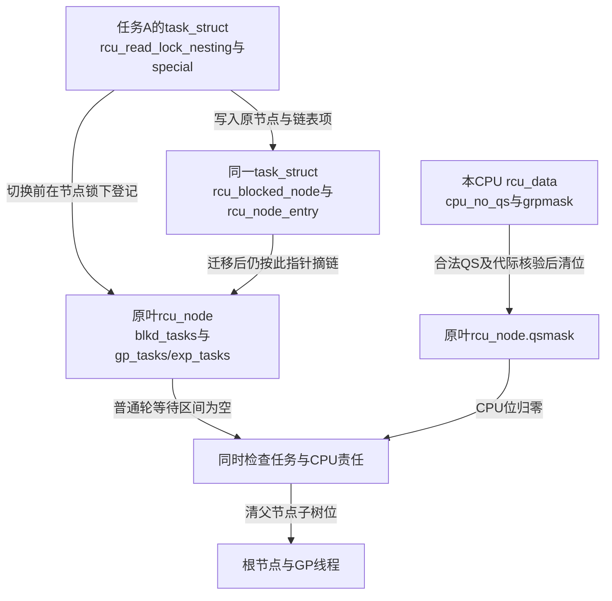
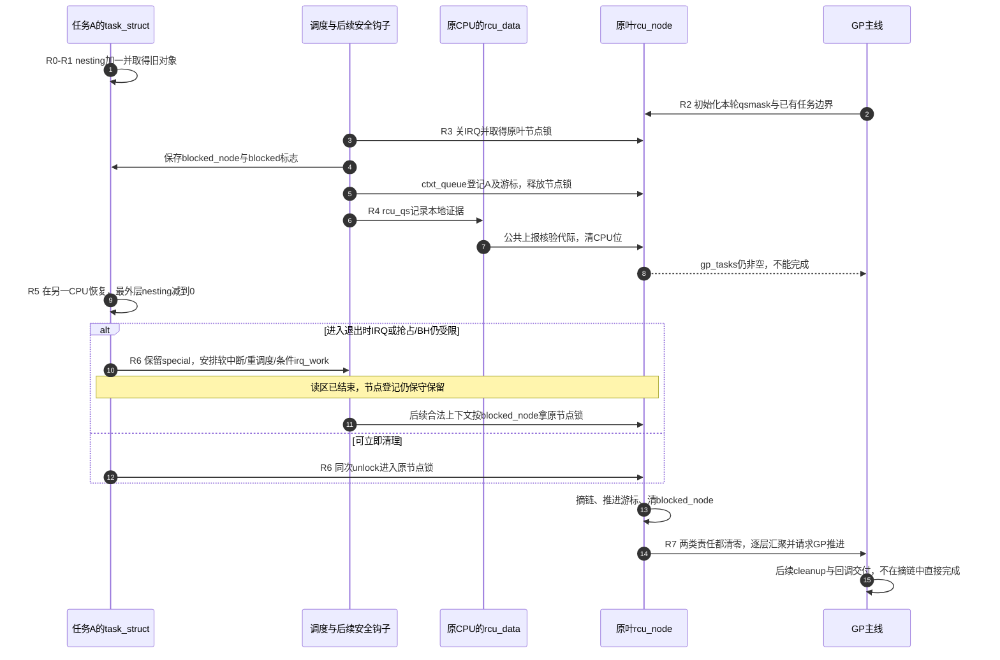

# 第3章\_Linux\_6.12\_Tree\_RCU\_抢占读者债务关键函数源码实现

## 3.1\_实现讲解边界与入口

设任务 A 已取得旧对象，GP 开始后它被高优先级任务换出。此时 CPU 可以执行别的任务并报告 QS，A 却还没用完旧对象。上一章的 CPU 位不足以单独表示这份责任：在 CPU 报告前，必须把仍活着的读区登记到共享节点；A 恢复并退出后再取消登记。本章逐函数追踪这次交接，并解释为什么“已经退出读区”与“已经从节点摘链”也可能不是同一时刻。

本篇只展开 `CONFIG_PREEMPT_RCU=y` 的增量，公共汇聚复用上一章。代码基线为 NXP `linux-imx` 标签 `lf-6.12.20-2.0.0`、提交 `dfaf2136deb2af2e60b994421281ba42f1c087e0`，详见[源码身份](../../linux/SOURCE_BASELINE.md)。这里核对固定源码分支，没有据此宣称当前运行内核启用了抢占 RCU；历史配置中的 Tiny RCU 也不能用于验证本章运行行为。

| 阅读入口 | 职责 |
| --- | --- |
| [RCU 源码总导航](../navigation/P01_Linux_6.12_RCU源码总阅读索引.md#1.6_建议的源码阅读顺序) | 先区分保护域，再选择功能模块和实现标题 |
| [RCU 分类坐标与内核配置](../../../../knowledge/linux/synchronization_and_asynchrony/synchronization/rcu/P04_RCU_分类坐标与内核配置.md#4.4_普通RCU的公共骨架与Tree内部差异) | 先确认 `CONFIG_PREEMPT_RCU` 只改变普通 Tree RCU 的读侧证明模块 |
| [Tree RCU 读侧执行模型与配置差异](../../../../knowledge/linux/synchronization_and_asynchrony/synchronization/rcu/P06_Tree_RCU_读侧执行模型与配置差异.md#6.3_一次context_switch不是永远等价于QS) | 在进入函数前建立 CPU 债务转为任务债务的抽象证明 |
| [公共接口与读侧模型模块导读](../navigation/P02_Linux_6.12_RCU公共接口与读侧模型模块源码概念导读.md#2.6_抢占分支为什么必须增加任务债务) | 说明本篇增量怎样重新接回 CPU QS 与节点公共出口 |
| [普通 GP 全局生命周期源码实现](P05_Linux_6.12_Tree_RCU_GP全局生命周期源码实现.md#5.9_rcu_gp_init开始代际并建立证明债务) | 说明 GP init 怎样接管已有 blocked task，以及根债务清零后怎样进入 cleanup；本章只展开任务侧债务 |

下列 `/** ... */` 是本仓库补充的中文 Doxygen 阅读说明，不是上游原注释。裁剪代码保留影响状态所有权、等待边界和上报顺序的语句；完整函数以链接的 Linux 6.12.20 版本化源文件为准。

## 3.2\_任务与节点的共享状态实现

先定位责任的地址。嵌套计数跟着任务走，CPU 的本地 QS 位跟着 CPU 走，登记链与等待边界则由原叶节点保管；这是三组协作状态，不是一个“任务是否阻塞”的布尔值。



任务侧声明来自固定版本 [`include/linux/sched.h`](https://github.com/nxp-imx/linux-imx/blob/dfaf2136deb2af2e60b994421281ba42f1c087e0/include/linux/sched.h)。下表把声明、初值和运行期写入放在一起，避免只凭字段名猜所有权。

| 状态 | 声明 / 初值 | 写入与消费 |
| --- | --- | --- |
| `task_struct.rcu_read_lock_nesting` | `int`，初值0 | 当前任务进入/退出增减；调度与慢退出判断是否仍在读区 |
| `rcu_read_unlock_special` | `union rcu_special`，整体 `.s=0`；`.b`含4个 `u8` 成员 | `blocked`记录已登记；`need_qs`请求退出时报告；`exp_hint`是加速提示，同一union还用于Tasks Trace的 `trc_reader_special`，其 `need_mb` 服务该分支的读者屏障协议，不能把每个成员都当普通GP债务 |
| `rcu_node_entry` | `struct list_head`，初始自环 | 在节点锁下插入/摘除；是嵌入任务对象的链表项，不是另分配的任务副本 |
| `rcu_blocked_node` | `struct rcu_node *`，初值NULL | 首次登记保存原叶；恢复退出读取它，摘链后置NULL |
| 叶节点 `blkd_tasks` 与游标 | 空链，`gp_tasks/exp_tasks`初始NULL | 调度入队、GP初始化和任务退出在节点锁下修改；普通/加速汇聚分别消费对应等待区间 |

这些任务字段位于 `CONFIG_PREEMPT_RCU` 条件内。启动任务的初值见 [`init/init_task.c`](https://github.com/nxp-imx/linux-imx/blob/dfaf2136deb2af2e60b994421281ba42f1c087e0/init/init_task.c)；普通新任务在 `copy_process()` 复制任务对象后，由 [`kernel/fork.c` 的 `rcu_copy_process()`](https://github.com/nxp-imx/linux-imx/blob/dfaf2136deb2af2e60b994421281ba42f1c087e0/kernel/fork.c)重新清零这些计数、special、节点指针并初始化链表项，不能继承父任务的活动登记。节点来自静态 `rcu_state.node[]`，空链建立见[拓扑初始化](P06_Linux_6.12_Tree_RCU_拓扑与CPU热插拔源码实现.md#6.4_rcu_init_one建立固定汇聚树并绑定每CPU叶节点)。

节点声明位于 [`kernel/rcu/tree.h`](../../linux/kernel/rcu/tree.h)，这里只摘出本章消费的部分：

```c
/**
 * @brief 叶 rcu_node 用于保存已被抢占 reader 及不同 GP 等待边界的字段。
 * @note 字段按 tree.h 中的原顺序摘录；中文注释由仓库补充。
 */
struct rcu_node {
	/* 省略：节点锁、代际、掩码、父子关系等其他字段。 */
	struct list_head blkd_tasks; /* 在 RCU 读侧内被抢占的任务集合。 */
	struct list_head *gp_tasks;  /* 当前普通 GP 等待的第一个任务，NULL 表示无债务。 */
	struct list_head *exp_tasks; /* 当前 expedited GP 的等待游标。 */
	struct list_head *boost_tasks; /* 需要优先级提升的第一个任务。 */
};
```

**实现原理：** `task_struct` 保存“这个 reader 是谁、欠的债务属于哪个叶节点”，`rcu_node` 保存“节点共享地等待哪些任务以及每类 GP 的起始游标”。任务迁移只改变运行 CPU，不改变 `rcu_blocked_node` 指向的债务所有者。`boost_tasks` 只在需要提升阻塞任务优先级时消费，本章保留其与摘链的配对边界，不展开优先级继承算法。

修改这些字段时，必须同时检查新任务初始化、调度登记、最外层退出和任务异常退出清理。不能只把链表项清零：空双向链表需要自环，已登记项还受原节点锁和游标约束。

## 3.3\_读侧嵌套怎样触发特殊退出

运行时定义在 [`kernel/rcu/tree_plugin.h`](../../linux/kernel/rcu/tree_plugin.h) 的抢占分支。`rcu_preempt_read_enter()` 用 `READ_ONCE/WRITE_ONCE` 对当前任务计数加一，`rcu_preempt_read_exit()` 减一并返回新值，`rcu_preempt_depth()`查询它。它们不是跨任务原子计数器：当前任务负责自己的嵌套变化。下面的 `barrier()` 是编译器屏障，不是等待所有CPU完成一次硬件屏障。

```c
/**
 * @brief 进入抢占式 RCU 读侧临界区。
 * @note 快路径只修改当前 task_struct，不锁 rcu_node。
 */
void __rcu_read_lock(void)
{
	rcu_preempt_read_enter(); /* current->rcu_read_lock_nesting++。 */
	if (IS_ENABLED(CONFIG_PROVE_LOCKING))
		WARN_ON_ONCE(rcu_preempt_depth() > RCU_NEST_PMAX);
	if (IS_ENABLED(CONFIG_RCU_STRICT_GRACE_PERIOD) && rcu_state.gp_kthread)
		WRITE_ONCE(current->rcu_read_unlock_special.b.need_qs, true);
	barrier(); /* 防止临界区内访问被编译器移到进入操作之前。 */
}

/**
 * @brief 退出抢占式 RCU 读侧，必要时进入任务债务清理慢路径。
 */
void __rcu_read_unlock(void)
{
	struct task_struct *t = current;

	barrier(); /* 临界区内访问必须先于退出操作。 */
	if (rcu_preempt_read_exit() == 0) {
		barrier();
		/* 最外层退出且special非零才进入慢路径；仍可能延后拿节点锁。 */
		if (unlikely(READ_ONCE(t->rcu_read_unlock_special.s)))
			rcu_read_unlock_special(t);
	}
	if (IS_ENABLED(CONFIG_PROVE_LOCKING)) {
		int rrln = rcu_preempt_depth();

		WARN_ON_ONCE(rrln < 0 || rrln > RCU_NEST_PMAX);
	}
}
```

**实现原理：** 通常进入和内层退出只维护任务嵌套。最外层退出才检查special；没有被抢占的任务也可能因 `need_qs` 请求进入报告路径，不能用“是否被抢占”完全替代这个条件。`CONFIG_RCU_STRICT_GRACE_PERIOD` 是严格GP测试配置，会主动设置need_qs并加入特殊报告/延迟行为；`CONFIG_PROVE_LOCKING` 的深度告警属于诊断，关闭它不消除读侧契约。

修改时必须保持“先结束本层访问，再减计数；最外层之后再读special”的编译顺序。把每次嵌套退出都当作读区结束，会让仍在外层使用旧指针的任务提前取消登记；把special检查删掉，则可能留下永远不消失的节点责任。

## 3.4\_rcu\_note\_context\_switch转移读侧债务

`__schedule()` 在底层 `context_switch()` 前调用这个钩子，进入时本地中断关闭。它面对的仍是将要换出的 `current`：读区未结束且尚未登记时，先锁本CPU对应叶节点，再把任务挂上去。已经登记的任务再次被换出，不另建第二份登记；`rcu_preempt_deferred_qs()` 只有在嵌套归零等条件成立时才处理延后责任。

```c
/**
 * @brief 在任务债务已经共享登记后，锁存本 CPU 的普通 QS。
 * @pre 调用者必须禁止抢占。
 * @note 本 Doxygen 说明由仓库补充；函数体裁剪自 tree_plugin.h。
 */
static void rcu_qs(void)
{
	RCU_LOCKDEP_WARN(preemptible(),
			  "rcu_qs() invoked with preemption enabled!!!\n");
	if (__this_cpu_read(rcu_data.cpu_no_qs.b.norm)) {
		/* 省略：trace；下面只修改当前 CPU 和 current 的本地状态。 */
		__this_cpu_write(rcu_data.cpu_no_qs.b.norm, false);
		barrier();
		WRITE_ONCE(current->rcu_read_unlock_special.b.need_qs, false);
	}
}

/**
 * @brief 在调度切换前，把读侧内被抢占任务从 CPU 本地债务转成叶节点共享债务。
 * @param preempt true 表示被动抢占；false 且仍在普通读侧内会触发警告。
 * @pre 调用者已关闭本地中断。
 */
void rcu_note_context_switch(bool preempt)
{
	struct task_struct *t = current;
	struct rcu_data *rdp = this_cpu_ptr(&rcu_data);
	struct rcu_node *rnp;

	/* 省略：利用率 trace 和中断关闭断言。 */
	WARN_ONCE(!preempt && rcu_preempt_depth() > 0,
		    "Voluntary context switch within RCU read-side critical section!");
	if (rcu_preempt_depth() > 0 &&
	    !t->rcu_read_unlock_special.b.blocked) {
		rnp = rdp->mynode;
		raw_spin_lock_rcu_node(rnp);
		/* 先声明任务已转为共享 blocked 状态。 */
		t->rcu_read_unlock_special.b.blocked = true;
		/* 保存原叶节点，使迁移后的 unlock 仍能找回债务所有者。 */
		t->rcu_blocked_node = rnp;
		/* 省略：CPU 在线性、链表状态和抢占事件 trace 检查。 */
		rcu_preempt_ctxt_queue(rnp, rdp);
	} else {
		rcu_preempt_deferred_qs(t);
	}
	/* 任务债务已经全局可见后，才允许本 CPU 清 QS 债务。 */
	rcu_qs();
	/* 省略：expedited CPU 报告、Tasks RCU QS 和结束 trace。 */
}
```

**实现原理：** 顺序是正确性的核心。如果先清 CPU QS，再挂 `blkd_tasks`，GP 可能在两步之间看到“CPU 已报告且没有任务债务”的伪窗口。当前实现先使共享债务可见，再清本地位，因而债务始终至少有一个载体。这里的 `rcu_qs()` 是抢占分支，普通QS只清本地norm和当前任务need_qs，expedited报告在钩子的另一支完成；不要与上一章非抢占分支同名函数混同。普通本地位清除后，还要由公共上报路径校验代际、清共享qsmask。

修改时保留节点锁交接：本函数拿锁，下面的 `rcu_preempt_ctxt_queue()` 释放它，中断仍关闭。不能在调用后再额外解锁，也不能把CPU报告移到登记前。`preempt=false`且读区内切换会告警，是非法主动睡眠的检查，不是允许抢占就允许主动阻塞。

## 3.5\_rcu\_preempt\_ctxt\_queue建立任务等待边界

为何不能只向链表尾追加？普通GP和expedited GP可能同时运行，二者要等的集合并不相同。一条链用两个游标表示两个后缀：某游标指向项以及后续所有项都被该轮等待；放到游标之前则不会扩大它的等待范围。这是保守表示，不能精确描述任意两个互不包含的集合。

`blkd_state` 用4个互不重叠的标志编码当前锁内快照：

| 标志 / 值 | 取自什么状态 | 当前含义 |
| --- | --- | --- |
| `RCU_GP_TASKS / 0x8` | `gp_tasks != NULL` | 普通轮已经有任务等待边界 |
| `RCU_EXP_TASKS / 0x4` | `exp_tasks != NULL` | 加速轮已经有任务等待边界 |
| `RCU_GP_BLKD / 0x2` | `qsmask & grpmask` | 普通轮还在等当前CPU，本任务登记需承接责任 |
| `RCU_EXP_BLKD / 0x1` | `expmask & grpmask` | 加速轮还在等当前CPU |

`grpmask` 是本CPU在叶节点的位，四项相加等价于组合这些不同位。源码完整列出16种组合，避免把“已存在任务边界”与“当前CPU仍欠报告”混为一个判断。

```c
/**
 * @brief 根据普通/expedited GP 的当前游标和 CPU 掩码，把被抢占 reader 插入 blkd_tasks 的正确位置。
 * @param rnp 当前 CPU 的叶 rcu_node，进入时已持有节点锁。
 * @param rdp 当前 CPU 的 per-CPU RCU 状态。
 * @post 函数返回前释放 rnp->lock，但保持中断关闭。
 */
static void rcu_preempt_ctxt_queue(struct rcu_node *rnp,
				   struct rcu_data *rdp)
	__releases(rnp->lock)
{
	int blkd_state = (rnp->gp_tasks ? RCU_GP_TASKS : 0) +
			 (rnp->exp_tasks ? RCU_EXP_TASKS : 0) +
			 (rnp->qsmask & rdp->grpmask ? RCU_GP_BLKD : 0) +
			 (rnp->expmask & rdp->grpmask ? RCU_EXP_BLKD : 0);
	struct task_struct *t = current;

	raw_lockdep_assert_held_rcu_node(rnp);
	WARN_ON_ONCE(rdp->mynode != rnp);
	WARN_ON_ONCE(!rcu_is_leaf_node(rnp));
	/* 省略：检查新上线 CPU 不应被当前 GP 等待。 */

	/* 上游使用完整状态表决定插入位置，不能压缩成真假二分。 */
	switch (blkd_state) {
	case 0:
	case                RCU_EXP_TASKS:
	case                RCU_EXP_TASKS + RCU_GP_BLKD:
	case RCU_GP_TASKS:
	case RCU_GP_TASKS + RCU_EXP_TASKS:
		/* 不阻塞已在等待的 GP，放到链表头。 */
		list_add(&t->rcu_node_entry, &rnp->blkd_tasks);
		break;

	case                                              RCU_EXP_BLKD:
	case                                RCU_GP_BLKD:
	case                                RCU_GP_BLKD + RCU_EXP_BLKD:
	case RCU_GP_TASKS +                               RCU_EXP_BLKD:
	case RCU_GP_TASKS +                 RCU_GP_BLKD + RCU_EXP_BLKD:
	case RCU_GP_TASKS + RCU_EXP_TASKS + RCU_GP_BLKD + RCU_EXP_BLKD:
		/* 首项或两轮均需等待等组合放到尾部；保守加入既有等待后缀。 */
		list_add_tail(&t->rcu_node_entry, &rnp->blkd_tasks);
		break;

	case                RCU_EXP_TASKS +               RCU_EXP_BLKD:
	case                RCU_EXP_TASKS + RCU_GP_BLKD + RCU_EXP_BLKD:
	case RCU_GP_TASKS + RCU_EXP_TASKS +               RCU_EXP_BLKD:
		/* 后续 expedited 阻塞者插到 exp_tasks 之后。 */
		list_add(&t->rcu_node_entry, rnp->exp_tasks);
		break;

	case RCU_GP_TASKS +                 RCU_GP_BLKD:
	case RCU_GP_TASKS + RCU_EXP_TASKS + RCU_GP_BLKD:
		/* 后续普通 GP 阻塞者插到 gp_tasks 之后。 */
		list_add(&t->rcu_node_entry, rnp->gp_tasks);
		break;

	default:
		WARN_ON_ONCE(1);
		break;
	}

	if (!rnp->gp_tasks && (blkd_state & RCU_GP_BLKD)) {
		WRITE_ONCE(rnp->gp_tasks, &t->rcu_node_entry);
		WARN_ON_ONCE(rnp->completedqs == rnp->gp_seq);
	}
	if (!rnp->exp_tasks && (blkd_state & RCU_EXP_BLKD))
		WRITE_ONCE(rnp->exp_tasks, &t->rcu_node_entry);
	WARN_ON_ONCE(!(blkd_state & RCU_GP_BLKD) !=
		     !(rnp->qsmask & rdp->grpmask));
	WARN_ON_ONCE(!(blkd_state & RCU_EXP_BLKD) !=
		     !(rnp->expmask & rdp->grpmask));
	raw_spin_unlock_rcu_node(rnp);

	/* 中断仍关闭；若 expedited GP 正等待本 CPU，在这里完成它的 CPU 报告。 */
	if (blkd_state & RCU_EXP_BLKD && rdp->cpu_no_qs.b.exp)
		rcu_report_exp_rdp(rdp);
	else
		WARN_ON_ONCE(rdp->cpu_no_qs.b.exp);
}
```

**实现原理：** `list_add(new, head)` 插在给定项之后，`list_add_tail(new, head)` 插在给定表头之前。这里表头 `blkd_tasks` 不代表任务，末尾会回到这个哨兵。四种插入位置是头部、尾部、普通游标之后、加速游标之后；游标为空且当前CPU位要求本轮等待时，再将游标设为新任务。

例如链为 `head → A → B → head`，`gp_tasks=A`、`exp_tasks=B`。仅阻塞普通轮的C插到A之后，形成 `A → C → B`，加速轮仍只等B；仅阻塞加速轮的D会插到B之后，形成 `A → C → B → D`，普通轮也保守多等D。后者不是漏记，而是共享一条链的代价。源码优先避免无谓拖长加速轮，并不声称游标区间恰好只包含按进入时间判断的必要任务。

这也说明GP开始后被抢占不等于无需等待：任务可能在GP开始前就进入读区；即使读区也较晚进入，当前CPU位和已有边界仍可能使它保守参与。修改状态表必须检查全部16组合、游标从NULL建立的时机、删链推进和两轮并存；只拿单普通GP的例子验证不够。`__releases` 是锁状态注解，真实解锁由函数体执行；诊断和trace裁剪不改变这些分支。

## 3.6\_rcu\_preempt\_check\_blocked\_tasks接管旧任务

还有另一种顺序：A已登记，新的普通GP才开始。此时不能等下一次调度来补登记；GP初始化必须在更新该节点 `gp_seq` 之前，把已有链表的首项设为本轮边界。

```c
/**
 * @brief 在新 GP 初始化时，把 GP 开始前已挂入 blkd_tasks 的任务纳入新等待边界。
 * @param rnp 正在初始化的 rcu_node。
 * @pre 调用者持有 rnp->lock，且禁止抢占。
 */
static void rcu_preempt_check_blocked_tasks(struct rcu_node *rnp)
{
	struct task_struct *t;

	RCU_LOCKDEP_WARN(preemptible(),
			  "rcu_preempt_check_blocked_tasks() invoked with preemption enabled!!!\n");
	raw_lockdep_assert_held_rcu_node(rnp);
	/* 新 GP 开始时不应遗留上一轮 gp_tasks 游标。 */
	if (WARN_ON_ONCE(rcu_preempt_blocked_readers_cgp(rnp)))
		dump_blkd_tasks(rnp, 10);
	if (rcu_preempt_has_tasks(rnp) &&
	    (rnp->qsmaskinit || rnp->wait_blkd_tasks)) {
		/* 链表中旧 reader 都早于新 GP，所以第一项就是新等待边界。 */
		WRITE_ONCE(rnp->gp_tasks, rnp->blkd_tasks.next);
		t = container_of(rnp->gp_tasks, struct task_struct,
				 rcu_node_entry);
		trace_rcu_unlock_preempted_task(TPS("rcu_preempt-GPS"),
						rnp->gp_seq, t->pid);
	}
	WARN_ON_ONCE(rnp->qsmask);
}
```

**实现原理：** `rcu_preempt_ctxt_queue()` 解决“GP 先开始、任务后被抢占”，本函数解决“任务先被抢占、GP 后开始”。两条路径共同覆盖负债转移与 GP 边界的两种时间顺序。`qsmaskinit` 表示初始化时的CPU参与集合，`wait_blkd_tasks` 保留离线节点仍须等待任务的条件，不能因CPU都离线就丢弃旧任务。这里 `WARN_ON_ONCE(rnp->qsmask)` 检查上一轮位已清；新轮位在GP初始化的其他语句建立。`container_of`只是由链表项还原任务地址供trace，`dump_blkd_tasks`是异常诊断，不是消债动作。

修改时要同时检查 [GP初始化](P05_Linux_6.12_Tree_RCU_GP全局生命周期源码实现.md#5.9_rcu_gp_init开始代际并建立证明债务) 与热插拔的等待标志；不能仅因 `gp_tasks=NULL` 就初始化整条blkd_tasks链，那会遗失尚存任务。

## 3.7\_节点汇聚同时等待CPU与任务

CPU位清完只能回答“没有尚未汇报的CPU责任”，不能回答链上旧任务是否退出。下面这个查询把第二个条件交给公共汇聚函数；需要可靠判断的调用者必须持有节点锁，`READ_ONCE` 本身不冻结链表变化。

```c
/**
 * @brief 查询指定节点是否仍有阻塞当前普通 GP 的 reader 任务。
 * @param rnp 要检查的 rcu_node。
 * @return gp_tasks 非空返回真。
 */
static int rcu_preempt_blocked_readers_cgp(struct rcu_node *rnp)
{
	return READ_ONCE(rnp->gp_tasks) != NULL;
}
```

共享的 `rcu_report_qs_rnp()` 已在[CPU QS与公共节点汇聚实现](P02_Linux_6.12_Tree_RCU_等待桥_QS与节点汇聚关键函数源码实现.md#2.6_rcu_report_qs_rdp与rcu_report_qs_rnp汇聚证据)逐行展开，本章不复制同一函数。该实现清除当前 `qsmask` 位以后，只有 `rnp->qsmask == 0` 且这里的 `rcu_preempt_blocked_readers_cgp(rnp)` 也为假，才继续清父节点位。

**实现原理：** `qsmask` 表示 CPU/子树债务，`gp_tasks` 表示任务 reader 债务。抢占式 RCU 不把两者强行编码进同一掩码；它们通过 `rcu_report_qs_rnp()` 的同一个退出条件汇合，同时保持具体函数只在一个文档中展开。修改完成条件时必须保留两个方向的唤醒机会：CPU先清完时等任务摘链，任务先清完时等CPU上报；不能只在其中一条路径检查。

## 3.8\_最外层退出删除任务并恢复传播

最外层unlock已把嵌套减到0，接下来能否直接拿节点锁？若在不适合执行特殊清理的上下文中退出，必须保留登记并安排稍后重查。否则可能破坏锁顺序或在受限上下文中触发不允许的调度相关动作。先看入口如何选择时机，再看摘链。

### 3.8.1\_特殊退出怎样选择立即处理或延后处理

`rcu_read_unlock_special()` 先保存进入时的IRQ、抢占和BH条件，而不是把自己临时关IRQ后的状态误当作原始约束。下面保留所有主要分支；irq_work初始化的RT配置差异由注释说明。

```c
/**
 * @brief 在普通读区结束后，选择特殊责任的处理时机。
 * @param t 当前任务；嵌套已由外层退出减到0。
 * @note NMI直接返回；受限上下文保留special供后续处理。
 */
static void rcu_read_unlock_special(struct task_struct *t)
{
	unsigned long flags;
	bool irqs_were_disabled;
	bool preempt_bh_were_disabled =
			!!(preempt_count() & (PREEMPT_MASK | SOFTIRQ_MASK));

	if (in_nmi())
		return;
	local_irq_save(flags);
	irqs_were_disabled = irqs_disabled_flags(flags);
	if (preempt_bh_were_disabled || irqs_were_disabled) {
		bool expboost;
		struct rcu_data *rdp = this_cpu_ptr(&rcu_data);
		struct rcu_node *rnp = rdp->mynode;

		expboost = (t->rcu_blocked_node && READ_ONCE(t->rcu_blocked_node->exp_tasks)) ||
			   (rdp->grpmask & READ_ONCE(rnp->expmask)) ||
			   (IS_ENABLED(CONFIG_RCU_STRICT_GRACE_PERIOD) &&
			   ((rdp->grpmask & READ_ONCE(rnp->qsmask)) || t->rcu_blocked_node)) ||
			   (IS_ENABLED(CONFIG_RCU_BOOST) && irqs_were_disabled &&
			    t->rcu_blocked_node);
		if (use_softirq && (in_hardirq() || (expboost && !irqs_were_disabled))) {
			raise_softirq_irqoff(RCU_SOFTIRQ);
		} else {
			set_tsk_need_resched(current);
			set_preempt_need_resched();
			if (IS_ENABLED(CONFIG_IRQ_WORK) && irqs_were_disabled &&
			    expboost && !rdp->defer_qs_iw_pending && cpu_online(rdp->cpu)) {
				/* 省略：初始化defer_qs_iw；STRICT_GP且PREEMPT_RT时用HARD形式。 */
				rdp->defer_qs_iw_pending = true;
				irq_work_queue_on(&rdp->defer_qs_iw, rdp->cpu);
			}
		}
		local_irq_restore(flags);
		return;
	}
	rcu_preempt_deferred_qs_irqrestore(t, flags);
}
```

`expboost` 综合加速等待、严格GP或可能解除boost的条件，决定是否需要更积极地促成后续处理，不是一个“任务仍在读区”的标志。`use_softirq`选择RCU core运行方式，`raise_softirq_irqoff`安排软中断；另一支设置任务和本CPU的重调度需求。符合条件时再排一个本CPU irq_work，`defer_qs_iw_pending`避免重复排入。它的handler只清pending标志，让调度器重新评估并走相关钩子，**不直接替任务摘链**。无IRQ_WORK时，FQS等后续催促路径仍可带来检查机会。

这几种通知都不把读侧“重新打开”。任务逻辑读区已结束，只是登记还保守存在。后续 `rcu_preempt_deferred_qs()` 先检查当前嵌套为0，并且special非零或本CPU仍有exp请求，再保存IRQ、进入下面的核心清理；它不能独自判断所有上下文安全性，调度、tick等调用者还须保证各自条件。

### 3.8.2\_在原节点锁下摘链并推进游标

```c
/**
 * @brief 在安全的上下文中清理任务的 deferred QS 和 blocked-reader 债务。
 * @param t 刚退出最外层 RCU 读侧的任务。
 * @param flags 恢复本地中断状态所需的标志。
 */
static notrace void
rcu_preempt_deferred_qs_irqrestore(struct task_struct *t, unsigned long flags)
{
	bool empty_norm;
	struct list_head *np;
	struct rcu_data *rdp;
	struct rcu_node *rnp;
	union rcu_special special;

	/* 先快照并清除 special；中断关闭保证快照期间不会被并发改写。 */
	special = t->rcu_read_unlock_special;
	rdp = this_cpu_ptr(&rcu_data);
	if (!special.s && !rdp->cpu_no_qs.b.exp) {
		local_irq_restore(flags);
		return;
	}
	t->rcu_read_unlock_special.s = 0;

	/* 省略：need_qs 与 expedited CPU 报告，保留 blocked reader 清理主线。 */
	if (special.b.blocked) {
		/* 使用入队时保存的原叶节点，不使用当前 CPU 的叶节点。 */
		rnp = t->rcu_blocked_node;
		raw_spin_lock_rcu_node(rnp);
		WARN_ON_ONCE(rnp != t->rcu_blocked_node);
		WARN_ON_ONCE(!rcu_is_leaf_node(rnp));
		empty_norm = !rcu_preempt_blocked_readers_cgp(rnp);
		smp_mb(); /* 使 expedited fast path 观察到读侧已结束。 */
		np = rcu_next_node_entry(t, rnp);
		list_del_init(&t->rcu_node_entry);
		t->rcu_blocked_node = NULL;
		/* 若游标正指向本任务，把它推进到下一个债务。 */
		if (&t->rcu_node_entry == rnp->gp_tasks)
			WRITE_ONCE(rnp->gp_tasks, np);
		if (&t->rcu_node_entry == rnp->exp_tasks)
			WRITE_ONCE(rnp->exp_tasks, np);
		/* 省略：CONFIG_RCU_BOOST 的 boost_tasks 游标处理。 */
		/* 该任务是最后一个普通 GP 债务，且 CPU 位已清时，恢复树形传播。 */
		if (!empty_norm && !rcu_preempt_blocked_readers_cgp(rnp)) {
			rcu_report_unblock_qs_rnp(rnp, flags);
		} else {
			raw_spin_unlock_irqrestore_rcu_node(rnp, flags);
		}
		/* 省略：expedited 层级上报与解除 priority boost。 */
	} else {
		local_irq_restore(flags);
	}
}

/**
 * @brief 在节点的最后一个 blocked reader 退出后，把“子树已完成”恢复上报到父节点。
 * @param rnp 任务债务刚归零的叶节点。
 * @param flags 最终释放锁时恢复的中断状态。
 */
static void __maybe_unused
rcu_report_unblock_qs_rnp(struct rcu_node *rnp, unsigned long flags)
	__releases(rnp->lock)
{
	unsigned long gps;
	unsigned long mask;
	struct rcu_node *rnp_p;

	raw_lockdep_assert_held_rcu_node(rnp);
	/* 任务债务或 CPU 债务任一存在，都不能恢复上报。 */
	if (WARN_ON_ONCE(!IS_ENABLED(CONFIG_PREEMPT_RCU)) ||
	    WARN_ON_ONCE(rcu_preempt_blocked_readers_cgp(rnp)) ||
	    rnp->qsmask != 0) {
		raw_spin_unlock_irqrestore_rcu_node(rnp, flags);
		return;
	}

	rnp->completedqs = rnp->gp_seq;
	rnp_p = rnp->parent;
	if (rnp_p == NULL) {
		rcu_report_qs_rsp(flags);
		return;
	}

	/* 释放子节点锁，转而持有父节点锁，再复用普通树形汇聚函数。 */
	gps = rnp->gp_seq;
	mask = rnp->grpmask;
	raw_spin_unlock_rcu_node(rnp);
	raw_spin_lock_rcu_node(rnp_p);
	rcu_report_qs_rnp(mask, rnp_p, gps, flags);
}
```

**实现原理：** 退出任务必须在原债务节点锁下同时完成“删链、游标推进、所有权指针清空”。如果这是最后一个任务债务，`rcu_report_unblock_qs_rnp()` 才把先前被任务截断的节点传播接回树形汇聚主线。`rcu_next_node_entry()` 在删除前取任务的next；若next已经是表头哨兵就返回NULL。删掉非游标项无需改游标；删掉游标项才推进，因而链前方仍可能留有不阻塞本轮的任务。

核心清理在关IRQ后快照special并将其整体清零；这针对当前CPU会改写该任务状态的路径，不是“关本地IRQ就排除了所有远端CPU”。节点链和游标仍必须用节点锁保护。裁剪掉的need_qs分支在普通配置下调用rcu_qs，严格GP配置下直接清norm、调用上报并执行测试用延迟；exp CPU请求独立报告。摘链中省略的boost分支在锁内快照mutex所有权、推进boost游标，解锁后必要时解除提升；expedited条件也在锁内取快照，随后调用对应上报。不能在实际修改时一起删去这些配对。

`empty_norm`保存删除前是否已无普通任务责任，仅在“此前有、现在无”时尝试恢复传播。恢复函数还要检查qsmask；若CPU责任仍在，它只解锁返回，稍后的CPU上报会接手。单节点树直接进入根出口，多层树先释放子锁再取父锁并携带 `gp_seq/grpmask`，公共汇聚继续检查代际。根出口只请求GP线程推进，不直接运行应用callback。

修改时要测试游标首项/中间项/最后项删除、迁移后退出、CPU先完成和任务先完成、normal与expedited并存，以及受限上下文延后。任务退出内核时的 `exit_rcu()` 还会对异常遗留读区做清理，它不使“带着普通读锁结束任务”成为合法用法。

### 3.8.3\_把一次抢占与延后退出接回完整周期

下面沿模块导读的R0～R7走一次普通轮。CPU报告和任务恢复可以交错；图选择CPU先结清的情况，以显示为何还要等待任务登记。



高频正常读区主要付每任务计数与编译顺序成本；实际被换出或特殊报告才涉及共享节点、锁和通知。节点锁在不同CPU登记/退出间传递也有缓存一致性成本，不能把这种读侧实现概括成整个系统“零通信”。

## 3.9\_实现复核问题

先尝试按源码回答，再核对下面的推演。

1. A在GP开始前进入，开始后被换出，CPU已报告。GP能结束吗？不能；切换前A已按当前等待位转入任务边界，CPU位清零不清任务责任。
2. A已最外层unlock但当时IRQ关闭，看到 `gp_tasks!=NULL` 能断言它仍访问旧对象吗？不能；可能只是延后摘链。应追special与后续安全钩子，不能据此提前替它清游标。
3. A迁移后能用新CPU的mynode摘链吗？不能；链和游标在 `rcu_blocked_node` 指向的原节点，改错节点既破坏链表又留下旧责任。
4. 普通边界A、加速边界B，链为A→B；仅加速轮需要等待D，插在B后会怎样？两轮都将等D。普通轮保守多等是该表示允许的成本，不是完美的按时间分类。
5. 新GP开始时链上已有任务怎么办？在节点新代际发布前由 `rcu_preempt_check_blocked_tasks()` 接管首项为边界；不能只靠未来的调度登记。
6. 最后任务摘链而qsmask仍非零怎么办？恢复传播函数返回，CPU以后上报时重新检查；反过来CPU先归零，则最后任务摘链接回公共传播。
7. 哪些修改最容易制造过早完成？把CPU报告移到任务登记前、内层unlock提前摘链、只查qsmask、按恢复CPU选错节点，或删除游标首项却不推进边界。分别画出错误窗口，比只观察一次实验“没有崩溃”更能暴露问题。

现在可以从任务声明、初始化、登记一直追到延后退出与公共汇聚。GP线程何时发布完成、回调何时真正执行，继续由GP生命周期与回调队列实现承担；本章的摘链不是它们的替代证明。

模块概念导读：[Linux 6.12 RCU 公共接口与读侧模型模块源码概念导读](../navigation/P02_Linux_6.12_RCU公共接口与读侧模型模块源码概念导读.md)。
