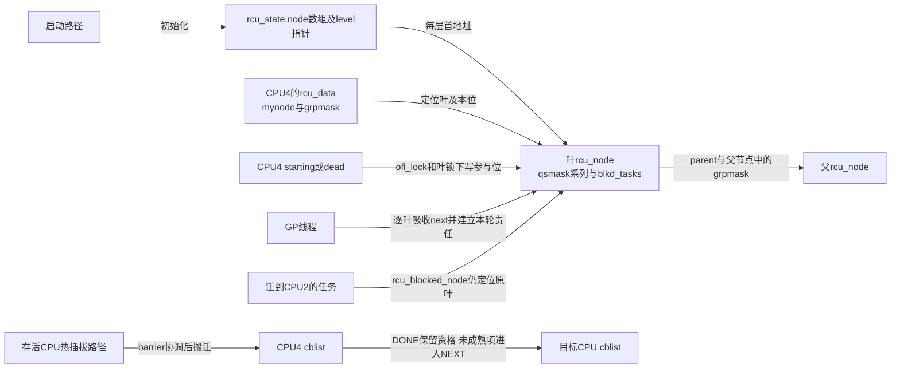
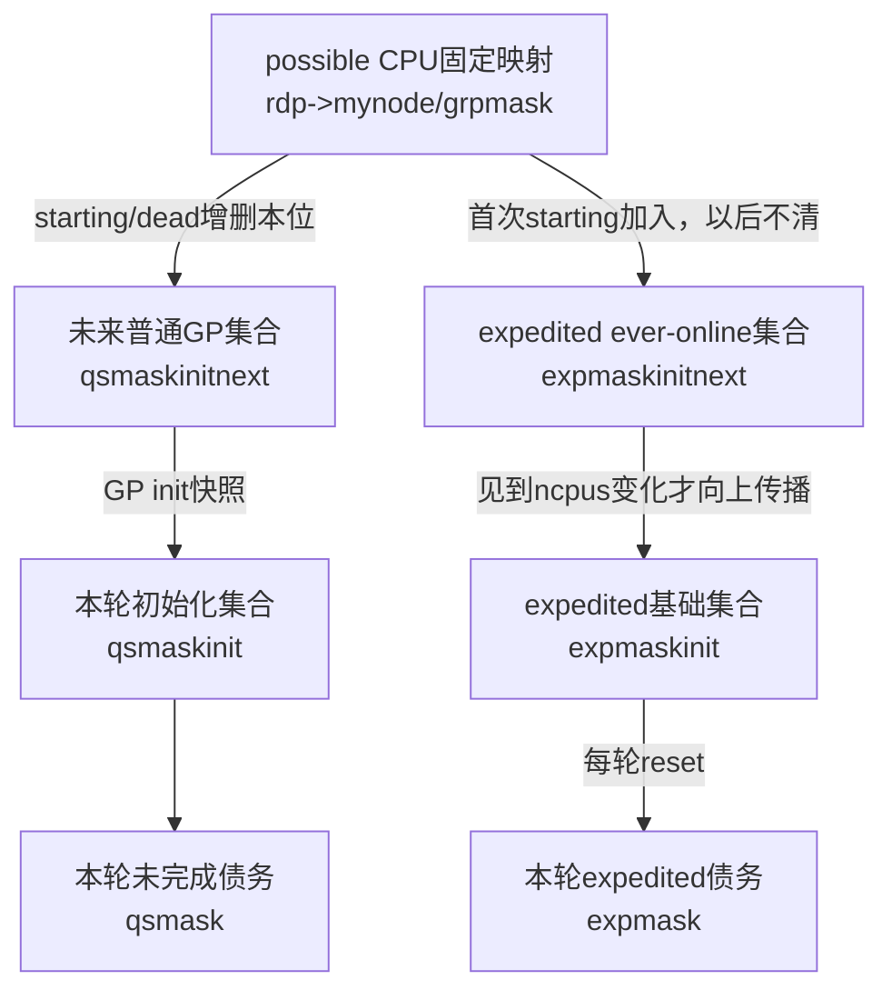
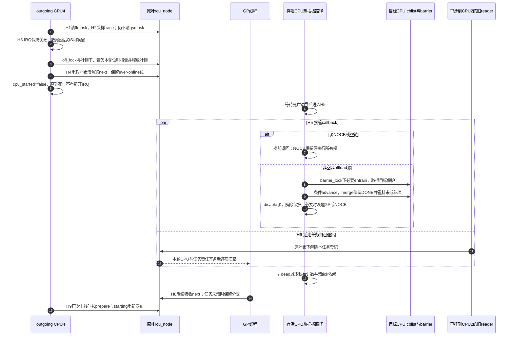

# 第6章\_Linux\_6.12\_Tree\_RCU\_拓扑与CPU热插拔源码实现

## 6.1\_实现所有权与版本边界

设CPU4正在被本轮GP等待，它的队列还有未执行callback，曾在它上面被抢占的旧reader已经迁到CPU2。现在关闭CPU4，删除一个online位不够：本轮CPU责任必须交接，callback需要接管者，CPU2上的任务仍须自己退出。反过来，再次上线CPU4也不能凭空把新责任塞进已经建立的当前等待集合。

本章沿固定地址的建立、参与位交接和队列迁移追踪这些动作，是 Linux 6.12.20 Tree RCU **静态汇聚树建立、CPU 参与集合交接与非 NOCB callback 迁移** 的唯一函数体讲解。普通 GP 如何把 `qsmaskinitnext` 冻结为本轮 `qsmask` 由 [P05 `rcu_gp_init()`](P05_Linux_6.12_Tree_RCU_GP全局生命周期源码实现.md#5.9_rcu_gp_init开始代际并建立证明债务)展开；`rcu_barrier()` 自己的扫描算法由 [P10 同步等待与 barrier 源码实现](P10_Linux_6.12_Tree_RCU_同步等待与rcu_barrier源码实现.md#10.8_rcu_barrier怎样扫描所有队列并等待真实执行)展开。本章只在 callback 迁移处说明为何调用其入口，不重复函数体。

源码基线：NXP `linux-imx`，标签 `lf-6.12.20-2.0.0`，提交 `dfaf2136deb2af2e60b994421281ba42f1c087e0`，本篇分析 `CONFIG_TREE_RCU` 与 `CONFIG_HOTPLUG_CPU` 分支，被抢占任务还以 `CONFIG_PREEMPT_RCU` 为条件；这不是当前目标配置核验。中文Doxygen与行内中文说明均由仓库补充。上游相对位置为 [`kernel/rcu/tree.c`](../../linux/kernel/rcu/tree.c)、[`kernel/rcu/tree.h`](../../linux/kernel/rcu/tree.h) 和 [`include/linux/rcutree.h`](../../linux/include/linux/rcutree.h)。

先读模块模型：[拓扑与 CPU 热插拔模块源码概念导读](../navigation/P04_Linux_6.12_Tree_RCU_拓扑与CPU热插拔模块源码概念导读.md#4.1_本模块究竟解决什么问题)。稳定知识正文：[P07 初始化与拓扑](../../../../knowledge/linux/synchronization_and_asynchrony/synchronization/rcu/P07_Tree_RCU_初始化_拓扑与执行上下文.md#7.3_B0到B6_拓扑建立的统一阶段)、[P17 CPU 热插拔](../../../../knowledge/linux/synchronization_and_asynchrony/synchronization/rcu/P17_Tree_RCU_CPU热插拔与回调迁移.md#17.6_H0到H9_CPU4离线周期)。

## 6.2\_源码符号覆盖账本

| 唯一展开符号 | 上游位置 | 本章标题 | 关键副作用 |
| --- | --- | --- | --- |
| `rcu_init_one()` | `kernel/rcu/tree.c` | [6.4](#6.4_rcu_init_one建立固定汇聚树并绑定每CPU叶节点) | 建 `level[]`、初始化每个节点、绑定所有 possible CPU |
| `rcu_boot_init_percpu_data()` | 同上 | [6.5](#6.5_boot初始化与prepare为何仍未让CPU加入当前GP) | 建 per-CPU 位、barrier/GP 快照与 NOCB 初值 |
| `rcutree_prepare_cpu()` | 同上 | [6.5](#6.5_boot初始化与prepare为何仍未让CPU加入当前GP) | 恢复 cblist、本地 GP/core 状态、创建相关 kthread |
| `rcutree_report_cpu_starting()` | 同上 | [6.6](#6.6_report_cpu_starting与report_cpu_dead怎样隔离当前轮和下一轮) | 加入未来普通/expedited 参与集合并发布 online 初值 |
| `rcutree_report_cpu_dead()` | 同上 | [6.6](#6.6_report_cpu_starting与report_cpu_dead怎样隔离当前轮和下一轮) | 还清当前债务、移出未来集合、记录 offline 边界 |
| `rcutree_migrate_callbacks()` | 同上 | [6.7](#6.7_rcutree_migrate_callbacks保持成熟边界与barrier证明) | entrain barrier、推进并合并分段队列、必要时唤醒 GP |
| `rcutree_dead_cpu()`、`rcutree_dying_cpu()`、`rcutree_offline_cpu()` | 同上 | [6.8](#6.8_CPUHP其余回调分别更新什么) | 计数、trace、FQS mask/tick 依赖收尾 |

`rcu_gp_init()`沿前述P05入口阅读；其余跨模块被调用者分别链接[QS逐层汇聚](P02_Linux_6.12_Tree_RCU_等待桥_QS与节点汇聚关键函数源码实现.md#2.6_rcu_report_qs_rdp与rcu_report_qs_rnp汇聚证据)、[barrier队尾entrain](P10_Linux_6.12_Tree_RCU_同步等待与rcu_barrier源码实现.md#10.6.2_队尾entrain)、[callback代际推进](P09_Linux_6.12_Tree_RCU_回调分段与批处理源码实现.md#9.5_accelerate与advance怎样连接callback和GP)。本篇保留它们在热插拔中的交接含义，不复制函数体。

## 6.3\_实现前先把三套位图摆在一起

拓扑、每轮参与状态、callback所有权是相互交接的三组状态，不是一个online状态机。拓扑地址先建立并长期保持；每次GP冻结自己的责任；队列执行归属则在CPU死亡后另行转移。先把对象放回地址，再比较同一节点里的位图：





普通 GP 的 CPU online/offline 路径会增删 `qsmaskinitnext`；expedited 的 `expmaskinitnext` 只在 CPU 首次 online 时加位，offline 不清，形成 ever-online 并集。普通/expedited 各自的轮次初始化再建立本轮债务，expedited selection 会把当前 offline CPU 作为已满足处理。这里不向已经建立的current集合随意增加新责任；合法离线报告仍会清除当前qsmask位。不能把它概括为热插拔完全不影响当前GP。

## 6.4\_rcu\_init\_one建立固定汇聚树并绑定每CPU叶节点

```c
/**
 * @brief 建立 Tree RCU 固定 rcu_node 汇聚树并绑定每个 possible CPU。
 * @note 中文 Doxygen 与行内说明由本仓库补充；源码裁剪自 kernel/rcu/tree.c。
 * @post level[] 指向各层首节点；每个 rcu_data 拥有固定 mynode/grpmask。
 */
static void __init rcu_init_one(void)
{
	static const char * const buf[] = RCU_NODE_NAME_INIT;
	static const char * const fqs[] = RCU_FQS_NAME_INIT;
	static struct lock_class_key rcu_node_class[RCU_NUM_LVLS];
	static struct lock_class_key rcu_fqs_class[RCU_NUM_LVLS];
	int levelspread[RCU_NUM_LVLS];
	int cpustride = 1;
	int i;
	int j;
	struct rcu_node *rnp;

	BUILD_BUG_ON(RCU_NUM_LVLS > ARRAY_SIZE(buf));
	if (rcu_num_lvls <= 0 || rcu_num_lvls > RCU_NUM_LVLS)
		panic("rcu_init_one: rcu_num_lvls out of range");

	/* level[i] 不是独立分配，而是指向 node[] 内第 i 层首元素。 */
	for (i = 1; i < rcu_num_lvls; i++)
		rcu_state.level[i] =
			rcu_state.level[i - 1] + num_rcu_lvl[i - 1];
	rcu_init_levelspread(levelspread, num_rcu_lvl);

	/* 从叶到根计算每个节点覆盖的 CPU 范围和父节点位。 */
	for (i = rcu_num_lvls - 1; i >= 0; i--) {
		cpustride *= levelspread[i];
		rnp = rcu_state.level[i];
		for (j = 0; j < num_rcu_lvl[i]; j++, rnp++) {
			raw_spin_lock_init(&ACCESS_PRIVATE(rnp, lock));
			lockdep_set_class_and_name(&ACCESS_PRIVATE(rnp, lock),
						   &rcu_node_class[i], buf[i]);
			raw_spin_lock_init(&rnp->fqslock);
			lockdep_set_class_and_name(&rnp->fqslock,
						   &rcu_fqs_class[i], fqs[i]);
			rnp->gp_seq = rcu_state.gp_seq;
			rnp->gp_seq_needed = rcu_state.gp_seq;
			rnp->completedqs = rcu_state.gp_seq;
			rnp->qsmask = 0;
			rnp->qsmaskinit = 0;
			rnp->grplo = j * cpustride;
			rnp->grphi = (j + 1) * cpustride - 1;
			if (rnp->grphi >= nr_cpu_ids)
				rnp->grphi = nr_cpu_ids - 1;
			if (i == 0) {
				rnp->grpnum = 0;
				rnp->grpmask = 0;
				rnp->parent = NULL;
			} else {
				rnp->grpnum = j % levelspread[i - 1];
				rnp->grpmask = BIT(rnp->grpnum);
				rnp->parent = rcu_state.level[i - 1] +
					      j / levelspread[i - 1];
			}
			rnp->level = i;
			INIT_LIST_HEAD(&rnp->blkd_tasks);
			/* 为可选NOCB GP协调建立节点等待队列。 */
			rcu_init_one_nocb(rnp);
			/* expedited代数rcu_seq_ctr(s)的低两位选择四个等待槽。 */
			init_waitqueue_head(&rnp->exp_wq[0]);
			init_waitqueue_head(&rnp->exp_wq[1]);
			init_waitqueue_head(&rnp->exp_wq[2]);
			init_waitqueue_head(&rnp->exp_wq[3]);
			spin_lock_init(&rnp->exp_lock);
			/* 后续boost/expedited线程创建和亲和性修改共用。 */
			mutex_init(&rnp->kthread_mutex);
			raw_spin_lock_init(&rnp->exp_poll_lock);
			rnp->exp_seq_poll_rq = RCU_GET_STATE_COMPLETED;
			INIT_WORK(&rnp->exp_poll_wq, sync_rcu_do_polled_gp);
		}
	}

	init_swait_queue_head(&rcu_state.gp_wq);
	init_swait_queue_head(&rcu_state.expedited_wq);
	rnp = rcu_first_leaf_node();
	for_each_possible_cpu(i) {
		while (i > rnp->grphi)
			rnp++;
		per_cpu_ptr(&rcu_data, i)->mynode = rnp;
		per_cpu_ptr(&rcu_data, i)->barrier_head.next =
			&per_cpu_ptr(&rcu_data, i)->barrier_head;
		rcu_boot_init_percpu_data(i);
	}
}
```

实现原理：`node[]` 的数组位置保存树形层次，`parent/grpmask` 保存向上一层报告所需的地址和位。CPU 本地 QS 不需要搜索整棵树：`rdp->mynode` 直接定位叶，`rdp->grpmask` 直接给出本节点位；叶节点完成以后再用 `rnp->parent/rnp->grpmask` 逐层传播。

`for_each_possible_cpu()` 在启动时为尚未 online 的 CPU也建立映射，因此 hotplug 不需要运行期分配节点或改父子拓扑。代价是 `node[]` 与全部 `rcu_data` 按 possible CPU 规模预留。`exp_wq[4]`、poll work、NOCB 等状态也在此时预埋，但相应 kthread/worker 仍要等 `kthreadd` 与 workqueue 进入后续阶段；初始化承载地址不等于启动执行者。

进入本函数前，几何初始化已经算出各层节点数和运行期层数；`rcu_state.level[0]` 的静态初值指向 `node[0]`。两者由[启动事务实现](P12_Linux_6.12_Tree_RCU_rcu_init启动初始化源码实现.md#12.10_I5从编译期容量中裁出本次启动真正使用的树)负责。假设教学几何为8个CPU、每叶4个CPU、根连接2片叶，CPU5的 `mynode` 指向覆盖4～7的叶，本位是 `BIT(5-4)=BIT(1)`；该叶在根中的 `grpmask` 也可能为 `BIT(1)`，但它表示一整片叶，二者不能互换。实际范围以 `levelspread` 和 `nr_cpu_ids` 为准。

`RCU_NODE_NAME_INIT/RCU_FQS_NAME_INIT` 和静态key数组给节点锁按层分类命名；它们服务于锁诊断，不决定CPU路由。`ACCESS_PRIVATE`取出节点锁，`BUILD_BUG_ON`与panic检查容量和层数不变量。`barrier_head.next`先指向自己，作为尚未接入回调链的初始化状态。四个expedited等待槽按 `rcu_seq_ctr(s) & 3` 选择，使用的是去掉状态位后的代数，不能直接取完整序列的最低两位。

修改拓扑时，必须同时检查 `num_rcu_lvl`、每层跨度、叶覆盖范围、possible CPU映射和父位容量；只改数组大小不足以证明报告仍能到根。这里预留静态地址换取热插拔快路径不分配树节点，不意味着可在运行期任意新增超出possible集合的CPU。

## 6.5\_boot初始化与prepare为何仍未让CPU加入当前GP

```c
/**
 * @brief 为一个 possible CPU 建立启动期本地 RCU 初值。
 * @param cpu 目标 CPU 编号。
 * @note 本说明由仓库补充；源码裁剪自 kernel/rcu/tree.c。
 */
static void __init rcu_boot_init_percpu_data(int cpu)
{
	struct context_tracking *ct = this_cpu_ptr(&context_tracking);
	struct rcu_data *rdp = per_cpu_ptr(&rcu_data, cpu);

	rdp->grpmask = leaf_node_cpu_bit(rdp->mynode, cpu);
	INIT_WORK(&rdp->strict_work, strict_work_handler);
	WARN_ON_ONCE(ct->nesting != 1);
	WARN_ON_ONCE(rcu_watching_snap_in_eqs(ct_rcu_watching_cpu(cpu)));
	rdp->barrier_seq_snap = rcu_state.barrier_sequence;
	rdp->rcu_ofl_gp_seq = rcu_state.gp_seq;
	rdp->rcu_ofl_gp_state = RCU_GP_CLEANED;
	rdp->rcu_onl_gp_seq = rcu_state.gp_seq;
	rdp->rcu_onl_gp_state = RCU_GP_CLEANED;
	rdp->last_sched_clock = jiffies;
	rdp->cpu = cpu;
	rcu_boot_init_nocb_percpu_data(rdp);
}

/**
 * @brief 在 CPU 真正进入前重建其本地 core、callback 与 GP 观察状态。
 * @return 成功返回 0。
 * @note 本函数不把 CPU 直接加入正在进行的 GP。
 */
int rcutree_prepare_cpu(unsigned int cpu)
{
	unsigned long flags;
	struct context_tracking *ct = per_cpu_ptr(&context_tracking, cpu);
	struct rcu_data *rdp = per_cpu_ptr(&rcu_data, cpu);
	struct rcu_node *rnp = rcu_get_root();

	/* 先借根锁取得一致的全局FQS快照并恢复CPU初始watching状态。 */
	raw_spin_lock_irqsave_rcu_node(rnp, flags);
	rdp->qlen_last_fqs_check = 0;
	rdp->n_force_qs_snap = READ_ONCE(rcu_state.n_force_qs);
	rdp->blimit = blimit;
	ct->nesting = 1;
	raw_spin_unlock_rcu_node(rnp); /* IRQ仍保持关闭。 */

	/* 保留NOCB或早期call_rcu()已经启用并装入的回调链。 */
	if (!rcu_segcblist_is_enabled(&rdp->cblist))
		rcu_segcblist_init(&rdp->cblist);

	rnp = rdp->mynode;
	raw_spin_lock_rcu_node(rnp);
	rdp->gp_seq = READ_ONCE(rnp->gp_seq);
	rdp->gp_seq_needed = rdp->gp_seq;
	rdp->cpu_no_qs.b.norm = true;
	rdp->core_needs_qs = false;
	rdp->rcu_iw_pending = false;
	rdp->rcu_iw = IRQ_WORK_INIT_HARD(rcu_iw_handler);
	rdp->rcu_iw_gp_seq = rdp->gp_seq - 1;
	trace_rcu_grace_period(rcu_state.name, rdp->gp_seq, TPS("cpuonl"));
	raw_spin_unlock_irqrestore_rcu_node(rnp, flags);

	rcu_spawn_rnp_kthreads(rnp);
	rcu_spawn_cpu_nocb_kthread(cpu);
	ASSERT_EXCLUSIVE_WRITER(rcu_state.n_online_cpus);
	WRITE_ONCE(rcu_state.n_online_cpus, rcu_state.n_online_cpus + 1);
	return 0;
}
```

实现原理：prepare 解决“该 CPU 的本地对象现在可以被后续路径使用”，starting 才解决“该 CPU 何时进入未来 RCU 参与集合”。二者分开是因为 prepare 在控制 CPU 上、incoming CPU 尚未出现；starting 在 incoming CPU 自己、精确的 IRQ-disabled 位置执行。把两者合并会让参与位发布早于 CPU 上下文和内存顺序准备完成。

boot辅助函数里的 `ct` 用 `this_cpu_ptr` 指向当前启动CPU，后一个watching检查才按参数cpu取快照；不能把两个访问都读成目标CPU的同一对象。`strict_work`预备严格GP工作，`barrier_seq_snap`及onl/ofl快照初始化后分别供barrier和诊断消费；trace只观察，不替代参与位发布。

启动 CPU 调用 prepare 时，`rcu_scheduler_fully_active` 仍为假，两个 spawn 辅助函数不会实际创建 boost/expedited/NOCB 线程；它们要在 pre-SMP early initcall 建立 GP kthread 后补建。末尾递增的 `rcu_state.n_online_cpus` 是 RCU 私有初始化门闩，令 `rcu_init_invoked()` 开始为真，不是通用 CPU hotplug 的 `num_online_cpus()`。

修改prepare时须保留已启用队列的内容，以及根锁释放后IRQ仍关闭、随后叶锁恢复原IRQ状态的配对。每CPU初值和线程创建有不同就绪条件；不能因为容器已经存在就提前唤醒尚未建立的执行者。

## 6.6\_report\_cpu\_starting与report\_cpu\_dead怎样隔离当前轮和下一轮

上线 CPU 写入缓冲的 next 集合，由 GP 初始化按锁保护的先后吸收，不直接给已经建立的当前 `qsmask` 增加欠位。全局代次启动先于逐叶吸收，所以不能把“next”机械解释为全局序号已经加一后的再下一轮。下线 CPU 若仍欠当前轮债务，则先报告当前位，再退出未来集合。两个方向的写入顺序分别核对如下。

### 6.6.1\_starting先写缓冲集合再由GP吸收

```c
/**
 * @brief incoming CPU 在启用中断前加入未来普通/expedited GP 集合。
 * @note 本说明由仓库补充；源码裁剪自 kernel/rcu/tree.c。
 */
void rcutree_report_cpu_starting(unsigned int cpu)
{
	unsigned long mask;
	struct rcu_data *rdp;
	struct rcu_node *rnp;
	bool newcpu;

	lockdep_assert_irqs_disabled();
	rdp = per_cpu_ptr(&rcu_data, cpu);
	if (rdp->cpu_started)
		return;
	rdp->cpu_started = true;

	rnp = rdp->mynode;
	mask = rdp->grpmask;
	arch_spin_lock(&rcu_state.ofl_lock);
	rcu_watching_online();
	raw_spin_lock(&rcu_state.barrier_lock);
	raw_spin_lock_rcu_node(rnp);
	WRITE_ONCE(rnp->qsmaskinitnext, rnp->qsmaskinitnext | mask);
	raw_spin_unlock(&rcu_state.barrier_lock);

	newcpu = !(rnp->expmaskinitnext & mask);
	rnp->expmaskinitnext |= mask;
	smp_store_release(&rcu_state.ncpus, rcu_state.ncpus + newcpu);
	ASSERT_EXCLUSIVE_WRITER(rcu_state.ncpus);
	rcu_gpnum_ovf(rnp, rdp); /* 长期离线后修正本地代际回绕观察。 */

	rdp->rcu_onl_gp_seq = READ_ONCE(rcu_state.gp_seq);
	rdp->rcu_onl_gp_state = READ_ONCE(rcu_state.gp_state);
	/* 若异常发现当前 qsmask 含 incoming 位，真实源码保存 flags 后报告。 */
	if (WARN_ON_ONCE(rnp->qsmask & mask)) {
		unsigned long flags;

		local_irq_save(flags);
		rcu_disable_urgency_upon_qs(rdp);
		rcu_report_qs_rnp(mask, rnp, rnp->gp_seq, flags);
	} else {
		raw_spin_unlock_rcu_node(rnp);
	}
	arch_spin_unlock(&rcu_state.ofl_lock);

	smp_store_release(&rdp->beenonline, true);
	smp_mb(); /* 后续 reader 使用不得越过上述初始化。 */
}
```

`barrier_lock` 在这里保护的是 per-CPU callback/barrier 生命周期交界，不是普通 QS 汇聚的常规锁。`ofl_lock` 与GP逐叶吸收next的区间互斥，不是从全局序列开始一直持有到所有节点建债结束。若starting先于本叶吸收，其位可以进入此次初始化；若晚于吸收，就留给后续轮次。`rcu_gpnum_ovf()`修正长期离线造成的本地序列观察边界，不完成GP。末尾 `beenonline=true` 是曾上线标记，不在离线时清回false；expedited用 `ncpus` 观察首次加入的变化。

### 6.6.2\_dead先还当前债务再移出未来集合

```c
/**
 * @brief outgoing CPU 在中断保持关闭的精确死亡点报告 RCU 状态。
 * @note 本说明由仓库补充；源码裁剪自 kernel/rcu/tree.c。
 */
void rcutree_report_cpu_dead(void)
{
	unsigned long flags;
	unsigned long mask;
	struct rcu_data *rdp = this_cpu_ptr(&rcu_data);
	struct rcu_node *rnp = rdp->mynode;

	lockdep_assert_irqs_disabled();
	do_nocb_deferred_wakeup(rdp);
	rcu_preempt_deferred_qs(current);

	mask = rdp->grpmask;
	arch_spin_lock(&rcu_state.ofl_lock);
	raw_spin_lock_irqsave_rcu_node(rnp, flags);
	rdp->rcu_ofl_gp_seq = READ_ONCE(rcu_state.gp_seq);
	rdp->rcu_ofl_gp_state = READ_ONCE(rcu_state.gp_state);

	if (rnp->qsmask & mask) {
		rcu_disable_urgency_upon_qs(rdp);
		/* 先清本轮债务；该调用会释放节点锁。 */
		rcu_report_qs_rnp(mask, rnp, rnp->gp_seq, flags);
		raw_spin_lock_irqsave_rcu_node(rnp, flags);
	}

	/* 再从未来普通 GP 集合移除。expedited ever-online 位不在这里清除。 */
	WRITE_ONCE(rnp->qsmaskinitnext, rnp->qsmaskinitnext & ~mask);
	raw_spin_unlock_irqrestore_rcu_node(rnp, flags);
	arch_spin_unlock(&rcu_state.ofl_lock);
	rdp->cpu_started = false;
}
```

report-dead先收尾NOCB延后唤醒与当前任务的延后QS，再处理CPU位。`rcu_report_qs_rnp()`会释放节点锁，因此返回后必须重取锁才能清next。barrier协调另在迁移入口发生；不能将它添加到这段函数里并声称是上游顺序。

实现原理：中断从进入这段路径到 CPU死亡都必须保持关闭，否则 CPU 已经从普通 next mask 移除后，中断仍可能开启一个新的普通 RCU reader，破坏“离线 CPU 不再产生新旧 reader”的证明。当前 `qsmask` 位先报告，是为了让正在进行的 GP 不等待一个即将消失的执行者；普通 next 位随后删除，是为了未来普通 GP 不再纳入它。Expedited 的 `expmaskinitnext` 刻意不清，selection 会按实时 online 状态消除离线位。

## 6.7\_rcutree\_migrate\_callbacks保持成熟边界与barrier证明

```c
/**
 * @brief 把已死亡非 NOCB CPU 的 callback 队列迁移到当前存活 CPU。
 * @param cpu 源 CPU。
 * @note 本说明由仓库补充；源码裁剪自 kernel/rcu/tree.c。
 */
void rcutree_migrate_callbacks(int cpu)
{
	unsigned long flags;
	struct rcu_data *my_rdp;
	struct rcu_node *my_rnp;
	struct rcu_data *rdp = per_cpu_ptr(&rcu_data, cpu);
	bool needwake;

	if (rcu_rdp_is_offloaded(rdp))
		return; /* NOCB执行所有权没有依赖源CPU本地core。 */

	raw_spin_lock_irqsave(&rcu_state.barrier_lock, flags);
	if (rcu_segcblist_empty(&rdp->cblist)) {
		raw_spin_unlock_irqrestore(&rcu_state.barrier_lock, flags);
		return;
	}

	rcu_barrier_entrain(rdp); /* 迁移前封住正在进行的barrier扫描。 */
	my_rdp = this_cpu_ptr(&rcu_data);
	my_rnp = my_rdp->mynode;
	rcu_nocb_lock(my_rdp);
	WARN_ON_ONCE(!rcu_nocb_flush_bypass(my_rdp, NULL, jiffies, false));
	raw_spin_lock_rcu_node(my_rnp);

	/* 条件推进；|| 有短路。合并保留DONE，源未成熟项进入NEXT。 */
	needwake = rcu_advance_cbs(my_rnp, rdp) ||
		   rcu_advance_cbs(my_rnp, my_rdp);
	rcu_segcblist_merge(&my_rdp->cblist, &rdp->cblist);
	raw_spin_unlock(&rcu_state.barrier_lock); /* IRQ 仍关闭。 */
	needwake = needwake || rcu_advance_cbs(my_rnp, my_rdp);
	rcu_segcblist_disable(&rdp->cblist);

	check_cb_ovld_locked(my_rdp, my_rnp);
	if (rcu_rdp_is_offloaded(my_rdp)) {
		raw_spin_unlock_rcu_node(my_rnp); /* IRQ 仍关闭。 */
		__call_rcu_nocb_wake(my_rdp, true, flags);
	} else {
		rcu_nocb_unlock(my_rdp); /* IRQ 仍关闭。 */
		raw_spin_unlock_rcu_node(my_rnp); /* IRQ 仍关闭。 */
	}
	local_irq_restore(flags);
	if (needwake)
		rcu_gp_kthread_wake();
}
```

实现原理：`rcu_segcblist_merge()` 保留源 DONE 的成熟资格，把源未成熟部分加入目标 NEXT；源未成熟项的原目标代际不会逐项原样保存，后续须重新取得安全的等待目标。推进调用受 `||` 短路影响，并非每次都先推进两边。源 `cblist` 随后 disable，阻止后续路径误用死亡 CPU 的普通队列；迁移协议同时要求源已不再接受普通生产者。

`rcu_barrier_entrain(rdp)` 在搬运前且持 `barrier_lock` 执行：若本轮 barrier 尚未登记源 CPU，而迁移把 callback 搬到已扫描过的目标 CPU，就需要先在源链上接入本轮哨兵，再连同业务 callback 一起搬走。函数用全局代次和源 CPU 快照判断是否需要登记；源已有本轮哨兵时不会重复计数。

迁移摘录省略了源在线状态、目标长度与链表是否一致、返回IRQ状态和源是否清空的诊断语句；功能性的锁、推进、合并和唤醒顺序保留。修改迁移时应恢复并运行这些诊断，同时检查源DONE、未成熟段、barrier哨兵和目标bypass；只验证指针最终接上，不能证明等待资格和计数也被正确交接。

## 6.8\_CPUHP其余回调分别更新什么

| 函数 | 生命周期时点 | 关键动作 | 不负责 |
| --- | --- | --- | --- |
| `rcutree_offline_cpu()` | 离线早期，CPU仍可运行 | 清 `ffmask`、设置 tick 依赖、调整 affinity | 清 current GP 债务 |
| `rcutree_dying_cpu()` | 接近死亡 | 根据 `qsmask` 记录 `cpuofl`/`cpuofl-bgp` trace | callback 迁移 |
| `rcutree_report_cpu_dead()` | outgoing CPU 精确死亡点 | 延期唤醒/QS、当前位报告、普通next位清除 | 全局 online 数收尾 |
| `rcutree_migrate_callbacks()` | stop-machine 后由存活 CPU执行 | 搬迁非 NOCB callback | NOCB callback 搬迁 |
| `rcutree_dead_cpu()` | CPU 完全移除后的 process context | `n_online_cpus--`、清 tick 依赖 | 改静态 `node[]` 拓扑 |

```c
/** @brief H1离线早期撤销ffmask位并为stop-machine保留tick。 本中文说明由仓库补充。 */
int rcutree_offline_cpu(unsigned int cpu)
{
	unsigned long flags;
	struct rcu_data *rdp;
	struct rcu_node *rnp;

	rdp = per_cpu_ptr(&rcu_data, cpu);
	rnp = rdp->mynode;
	raw_spin_lock_irqsave_rcu_node(rnp, flags);
	rnp->ffmask &= ~rdp->grpmask;
	raw_spin_unlock_irqrestore_rcu_node(rnp, flags);

	rcutree_affinity_setting(cpu, cpu);


	tick_dep_set(TICK_DEP_BIT_RCU);
	return 0;
}

/** @brief H2仅记录当前轮是否仍等待该CPU。 本中文说明由仓库补充。 */
int rcutree_dying_cpu(unsigned int cpu)
{
	bool blkd;
	struct rcu_data *rdp = per_cpu_ptr(&rcu_data, cpu);
	struct rcu_node *rnp = rdp->mynode;

	blkd = !!(READ_ONCE(rnp->qsmask) & rdp->grpmask);
	trace_rcu_grace_period(rcu_state.name, READ_ONCE(rnp->gp_seq),
			       blkd ? TPS("cpuofl-bgp") : TPS("cpuofl"));
	return 0;
}

/** @brief H7由存活CPU完成RCU私有计数和tick依赖收尾。 本中文说明由仓库补充。 */
int rcutree_dead_cpu(unsigned int cpu)
{
	ASSERT_EXCLUSIVE_WRITER(rcu_state.n_online_cpus);
	WRITE_ONCE(rcu_state.n_online_cpus, rcu_state.n_online_cpus - 1);

	tick_dep_clear(TICK_DEP_BIT_RCU);
	return 0;
}
```

`ffmask`用于FQS检查的加速线索，清它与清当前 `qsmask` 不是同一动作。offline调整相关线程affinity，并设置tick依赖以帮助stop-machine推进；dead解除这个依赖，允许相应nohz_full路径再次停tick。`dying`只采样状态写trace，不能让GP完成。私有计数的加减依赖CPU热插拔控制路径串行化，`ASSERT_EXCLUSIVE_WRITER`是诊断约束，不是一把锁。

CPUHP配对可在固定版本的 [`kernel/cpu.c`](https://github.com/nxp-imx/linux-imx/blob/dfaf2136deb2af2e60b994421281ba42f1c087e0/kernel/cpu.c) 核对：prepare/dead对应 `CPUHP_RCUTREE_PREP`，dying属于 `CPUHP_AP_RCUTREE_DYING` 的teardown，online/offline属于 `CPUHP_AP_RCUTREE_ONLINE`。starting/report-dead因精确IRQ边界而直接调用。迁移在控制CPU等待dying-idle、执行CPU死亡同步之后进行，随后才能让后续teardown继续等待回调。

修改这些辅助回调时应保留配对而非按名字合并：早期offline仍有执行上下文，精确report-dead必须防止新读侧，最后dead已由其他CPU收尾。启用/关闭HOTPLUG、NOCB与nohz_full时分别核对，不能把某一配置下的空辅助操作当作所有配置都无需此阶段。

## 6.9\_锁顺序与修改边界

本模块不是靠一把“RCU 全局锁”完成：

- `ofl_lock`：把 GP pre-init 与 CPU starting/dead 的参与集合交接串行化；
- `rnp->lock`：保护具体节点 mask、序列和 blocked task；
- `barrier_lock`：保护 barrier 轮次、per-CPU snapshot 与 callback 迁移交界；
- `nocb_lock`：目标 `rdp` 处于 offload 协议时保护 cblist/bypass；
- IRQ disabled：阻止本CPU硬中断在关键交接区间插入新的普通读侧/队列操作；它不排除其他CPU，也不替代NMI、任务债务和共享锁协议。

修改 hotplug 路径至少要复核：current/next 顺序、被抢占任务不随 CPU 位消失、barrier 哨兵不漏、NOCB 不误迁移、callback segment 长度一致、`beenonline/ncpus` 的 release/acquire 配对，以及节点锁与 `ofl_lock/barrier_lock` 的既有顺序。

## 6.10\_源码时序总图

沿用模块导读的H0～H9，下表将离线周期回扣到本篇函数；启动绑定和prepare是进入H0的前提。H6任务退出可以早于或晚于H5，H8/H9属于后续吸收或再次上线，不是必须连续执行的一段函数。

| 阶段 | 执行者与触发 | 修改及后续消费 |
| --- | --- | --- |
| H0 在线 | 已完成starting/online | 未来集合含CPU，当前qsmask可能仍欠位 |
| H1 早期offline | CPUHP offline回调 | 清ffmask、调affinity、保留tick，不清当前债务 |
| H2 dying | outgoing CPU | 诊断是否欠位，不推进功能状态 |
| H3 当前责任 | outgoing CPU、IRQ关闭 | report-dead收尾延后QS，必要时报告本位 |
| H4 未来责任 | 同一report-dead | 重取叶锁清next，清cpu_started，保持IRQ关闭到死亡 |
| H5 队列接管 | 存活CPU | 必要entrain、合并、禁用非空非offload源；目标负责执行 |
| H6 任务退出 | 迁走reader | 按rcu_blocked_node清原叶任务责任，独立于CPU位 |
| H7 控制收尾 | dead回调 | 私有计数减一并清tick依赖 |
| H8 后续吸收 | GP init | next吸收到init；全叶离线但有任务时保留wait_blkd_tasks分支 |
| H9 再上线 | prepare、starting、online | 重建所需状态，再发布参与位，不重建拓扑 |



图中report只清CPU责任，不能替H6的旧任务退出。H5回调迁移也不等于回调已经执行：DONE有资格，未成熟项还要等待，目标core或NOCB线程另行消费。源队列为空时直接返回，不执行后面的disable；下次prepare按实际enabled状态决定是否初始化。最后一片叶的CPU全部离线时，已有任务仍可能使父层保持责任，直到任务退出和后续初始化完成相应调整。

## 6.11\_验证清单

1. `node[]`、`level[]`、`parent/grpmask` 能形成从 CPU 到根的确定路径；
2. possible CPU 在启动期都有 `mynode/grpmask`，上线不重建树；
3. starting 正常路径只加普通 next，不给 current `qsmask` 新增债务；expedited ever-online 位只增不减；
4. dead 路径在移出普通 next 前处理 current 位，且不错误清除 `expmaskinitnext`；
5. `blkd_tasks` 的任务债务没有因 CPU 位清除而丢失；
6. 非空非NOCB源在迁移前检查并必要时entrain barrier，合并后disable；空源提前返回；
7. NOCB `rdp` 不进入普通迁移；
8. 新 CPU 对 expedited 初始化的发布由 `ncpus` release/acquire 观察，而不是从 `n_online_cpus` 猜测；
9. 文档未把本机路径写成源码身份，也未重复 P02/P05/P09/P10 的函数体。

先预测两个修改后果：把starting的位直接OR进当前qsmask，会把尚未按本轮时序建证的新CPU插入当前证明；只删除离线CPU的next而不报告当前位，则可能留下无人还清的责任。再把源WAIT直接当DONE合并，会让callback早于所需GP执行。三者分别破坏参与截止、责任交接和成熟边界，不能用“最终队列为空”的单一观察代替验证。上述为源码推演，本轮没有执行目标CPU热插拔压力实验。

总索引：[Linux 6.12 RCU 源码总阅读索引](../navigation/P01_Linux_6.12_RCU源码总阅读索引.md#1.4_模块概念导读入口)。
