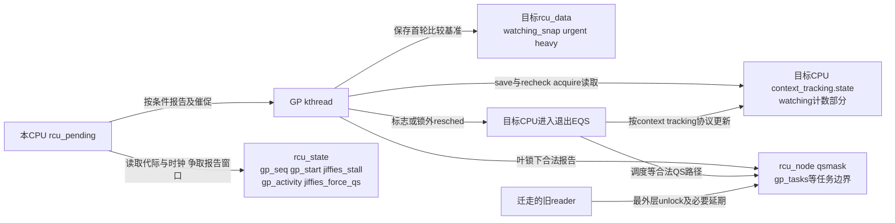
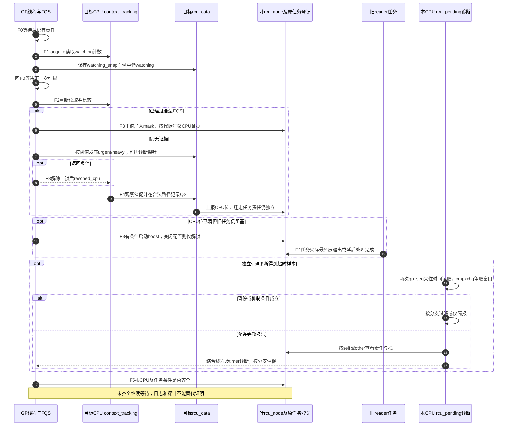

# 第7章\_Linux\_6.12\_Tree\_RCU\_force\_QS与Stall源码实现

## 7.1\_实现所有权与版本边界

普通GP已经建立等待责任，但CPU2进入idle后没有主动报告，CPU3还在长循环中，另一个旧reader被抢占后挂在任务链上。GP线程不能仅凭“等得够久”让它们通过：要先判断哪些已有可读取的证据，哪些需要催促，哪些还必须等任务退出。若GP线程本身没有得到运行机会，则连这轮观察都无法按时发生。

本章沿这几个不同的停顿点展开 FQS 的远端 watching 观察、叶扫描/催促和 stall 分类实现。`rcu_gp_fqs_loop()` 的 sleep/timer/flag 主循环已经由 [P05 GP 全局生命周期源码实现](P05_Linux_6.12_Tree_RCU_GP全局生命周期源码实现.md#5.10_FQS循环与根完成通知)负责，本章只从其调用的 `rcu_gp_fqs()` 开始，不复制主循环。

源码基线为 NXP Linux 6.12.20 固定提交 `dfaf2136deb2af2e60b994421281ba42f1c087e0`。上游相对位置：[`kernel/rcu/tree.c`](../../linux/kernel/rcu/tree.c)、[`kernel/rcu/tree_stall.h`](../../linux/kernel/rcu/tree_stall.h)、[`kernel/rcu/tree.h`](../../linux/kernel/rcu/tree.h)。本篇分析Tree RCU分支，任务责任以 `CONFIG_PREEMPT_RCU` 为条件，boost还需 `CONFIG_RCU_BOOST`；这些是源码条件，不是当前目标配置核验。stall 的部分检查还受 `CONFIG_PROVE_RCU`、`CONFIG_IRQ_WORK`、`CONFIG_RCU_CPU_STALL_CPUTIME` 等控制。

概念入口：[force-QS 与 Stall 模块源码概念导读](../navigation/P05_Linux_6.12_Tree_RCU_force_QS与Stall模块源码概念导读.md#5.1_为什么GP已经在等还要有force_QS)。稳定正文：[Tree RCU force-QS、迟延与 Stall](../../../../knowledge/linux/synchronization_and_asynchrony/synchronization/rcu/P14_Tree_RCU_force_QS迟延与Stall.md#14.1_安全证明成立以后为什么还需要活性慢路径)。

## 7.2\_源码符号覆盖账本

| 唯一展开符号 | 源文件 | 本章标题 | 状态副作用 |
| --- | --- | --- | --- |
| `rcu_watching_snap_in_eqs()`、`rcu_watching_snap_stopped_since()` | `tree.c` | [7.4](#7.4_watching快照怎样把EQS变成隐式QS证据) | 判断watching位及合法跨EQS比较 |
| `rcu_iw_handler()` | `tree_stall.h` | [7.4.2](#7.4.2_后续比较与催促) | 完成IRQ-work诊断探针 |
| `rcu_initiate_boost()` | `tree_plugin.h` | [7.5](#7.5_force_qs_rnp把远端观察任务债务和resched放进同一轮) | 请求boost或按配置只解锁 |
| `rcu_is_gp_kthread_starving()` | `tree_stall.h` | [7.7.2](#7.7.2_GP_kthread长期未运行) | 比较活动时间，不修改GP责任 |
| `rcu_watching_snap_save()` | `tree.c` | [7.4](#7.4_watching快照怎样把EQS变成隐式QS证据) | 保存远端 watching counter，识别已在 EQS 的 CPU |
| `rcu_watching_snap_recheck()` | `tree.c` | [7.4](#7.4_watching快照怎样把EQS变成隐式QS证据) | 比较 EQS、设置 urgent/heavy，返回是否 resched |
| `force_qs_rnp()` | `tree.c` | [7.5](#7.5_force_qs_rnp把远端观察任务债务和resched放进同一轮) | 遍历叶、清隐式 QS 位、boost task、发 resched |
| `rcu_gp_fqs()` | `tree.c` | [7.6](#7.6_rcu_gp_fqs更新节奏并选择save或recheck) | 更新 FQS/activity/stall 时间并清 FQS flag |
| `rcu_check_gp_start_stall()` | `tree_stall.h` | [7.7](#7.7_三类stall为什么必须读取不同状态) | 检测已请求但 GP 未启动 |
| `rcu_check_gp_kthread_starvation()` | `tree_stall.h` | [7.7](#7.7_三类stall为什么必须读取不同状态) | 检测 GP kthread 长期未获运行 |
| `rcu_check_gp_kthread_expired_fqs_timer()` | `tree_stall.h` | [7.7](#7.7_三类stall为什么必须读取不同状态) | 检测 WAIT_FQS timer 到期却未唤醒 |
| `check_cpu_stall()` | `tree_stall.h` | [7.8](#7.8_check_cpu_stall怎样避免跨GP拼出假阳性) | 一致性快照、自检/他检分类、报告节流 |

`print_cpu_stall()`、`print_other_cpu_stall()`在本地解释报告、恢复及抑制契约，不逐行复制日志排版。QS上报见[节点汇聚实现](P02_Linux_6.12_Tree_RCU_等待桥_QS与节点汇聚关键函数源码实现.md#2.6_rcu_report_qs_rdp与rcu_report_qs_rnp汇聚证据)；被抢占任务仍按[原节点退出实现](P03_Linux_6.12_Tree_RCU_抢占读者债务关键函数源码实现.md#3.8_最外层退出删除任务并恢复传播)交还责任。下文补boost请求入口的配置分支；请求boost不等于任务已经退出。

## 7.3\_返回值是扫描协议不是普通布尔值

本篇有两条并行控制链：FQS推进合法证据与催促，stall读取诊断状态并控制报告窗口；后者的日志、节流和停检状态不属于GP完成证明。状态地址如下：



| 状态 | 写入者与消费者 | 不代表什么 |
| --- | --- | --- |
| `context_tracking.state` 的watching计数部分 | 目标CPU按EQS/IRQ/NMI协议写，GP远端读 | 不是远端reader嵌套数 |
| `rdp->watching_snap` | GP首轮保存、后续比较 | 不由目标CPU主动发送回复 |
| `rcu_urgent_qs/rcu_need_heavy_qs` | 扫描者发布、目标调度/tick等路径观察 | 标志写入不完成QS |
| `rnp->qsmask/gp_tasks` | 合法CPU报告/任务退出在节点锁下推进 | 不由stall日志直接清除 |
| `gp_activity/gp_req_activity` | GP及请求路径更新时间，诊断读 | 不是硬件执行轨迹或直接死锁证明 |
| `rcu_iw_pending/rcu_iw_gp_seq` | FQS登记irq_work探针，handler清pending | 探针执行不等于旧reader结束 |
| `jiffies_stall`与静态 `warned` | 前者控制当前报告窗口，后者限制未启动告警次数 | 不是同一对象，也不是GP的功能状态 |

`tree_stall.h`与 `tree_plugin.h`由Tree实现包含，这些static辅助函数不是跨模块公开API。per-CPU诊断容器在启动/prepare时建立，watching_snap每轮首次扫描覆盖；GP开始重新建立本轮等待位和时间基准。读取到一个旧字段值必须结合代际，不能把静态零初值当成任意运行阶段都有效的快照。

`force_qs_rnp()` 接收 `int (*f)(struct rcu_data *)`，回调结果有三值语义：

| 返回值 | `force_qs_rnp()` 动作 | 正确性含义 |
| --- | --- | --- |
| `> 0` | 把 CPU 位加入 `mask`，稍后调用 `rcu_report_qs_rnp()` | 已有合法隐式 QS/离线证据 |
| `0` | 保留 `qsmask` 位 | 尚无证据，也暂不发 resched |
| `< 0` | 把 CPU 位加入 `rsmask`，释放节点锁后 `resched_cpu()` | 仅请求未来调度；当前债务仍保留 |

把 `<0` 误当“失败即清位”会破坏 GP 安全，把 `>0` 误当“远端 CPU 主动回复”则会掩盖共享 context-tracking 状态的被动证明方式。

## 7.4\_watching快照怎样把EQS变成隐式QS证据

第一次扫描保存远端 watching counter 并识别已经处于 EQS 的 CPU；后续扫描比较watching计数是否经过EQS边界，并只对仍无证据但可运行的 CPU 设置催促状态。save 与 recheck 不能合并成一次无历史的读取。

### 7.4.1\_第一次保存

```c
/**
 * @brief 保存目标 CPU 的 RCU_WATCHING counter，并识别已经处于 EQS 的 CPU。
 * @return 已在 EQS 返回 1，否则返回 0。
 * @note 中文 Doxygen 与注释由仓库补充；源码裁剪自 kernel/rcu/tree.c。
 */
static int rcu_watching_snap_save(struct rcu_data *rdp)
{
	/* acquire 与 GP 开始、节点锁链共同建立跨 CPU 内存顺序。 */
	rdp->watching_snap = ct_rcu_watching_cpu_acquire(rdp->cpu);
	if (rcu_watching_snap_in_eqs(rdp->watching_snap)) {
		trace_rcu_fqs(rcu_state.name, rdp->gp_seq,
			      rdp->cpu, TPS("dti"));
		rcu_gpnum_ovf(rdp->mynode, rdp);
		return 1;
	}
	return 0;
}
```

如果snapshot表示目标CPU处于EQS，按协议它不再承载GP开始前的旧普通读区，可报告这个CPU位。已迁出的被抢占reader仍由原叶任务链维护，不能随CPU位一起消失。EQS可来自idle，也可在相应上下文跟踪配置下来自用户态；实际读取的是 `context_tracking.state` 的watching计数部分。低位上下文分类已由访问辅助函数屏蔽，不是比较整个state是否任意变化。

两个小辅助函数明确了比较的对象与前提：

```c
/** @brief 检查watching位；中文说明由仓库补充。 */
static bool rcu_watching_snap_in_eqs(int snap)
{
	return !(snap & CT_RCU_WATCHING);
}

/** @brief 从先前watching状态复查是否经过EQS；中文说明由仓库补充。 */
static bool rcu_watching_snap_stopped_since(struct rcu_data *rdp, int snap)
{

	if (WARN_ON_ONCE(rcu_watching_snap_in_eqs(snap)))
		return true;

	return snap != ct_rcu_watching_cpu_acquire(rdp->cpu);
}
```

`CT_RCU_WATCHING`选择计数中的watching位，`ct_rcu_watching_cpu_acquire(cpu)`读取屏蔽上下文分类后的计数并提供acquire顺序。save已经处于EQS就报告，不再为该位进入recheck；因此stopped-since正常输入应为watching快照。后续计数不同足以说明经历过合法EQS边界，不要求目标此刻仍留在EQS。异常传入EQS快照会WARN并返回true，这是源码防误用分支，不应拿它代替正确的首轮协议。

修改时要保留GP开始经节点锁链传递的顺序，以及远端离开/进入EQS的配对；只把acquire换成普通读或把整个state的任意变化当QS，都会丢失证明前提。

### 7.4.2\_后续比较与催促

```c
/**
 * @brief 重查目标 CPU 是否自 snapshot 以后进入过 EQS，并必要时催促。
 * @return 正值表示已有 QS；零表示继续等；负值表示需要 resched。
 * @note 本说明由仓库补充；源码裁剪自 kernel/rcu/tree.c。
 */
static int rcu_watching_snap_recheck(struct rcu_data *rdp)
{
	unsigned long jtsq;
	int ret = 0;
	struct rcu_node *rnp = rdp->mynode;

	if (rcu_watching_snap_stopped_since(rdp, rdp->watching_snap)) {
		trace_rcu_fqs(rcu_state.name, rdp->gp_seq, rdp->cpu, TPS("dti"));
		rcu_gpnum_ovf(rnp, rdp);
		return 1;
	}

	/* 异常离线残留：先留下诊断，再返回正值。 */
	if (WARN_ON_ONCE(!rcu_rdp_cpu_online(rdp))) {
		struct rcu_node *rnp1;

		pr_info("%s: grp: %d-%d level: %d ->gp_seq %ld ->completedqs %ld\n",
			__func__, rnp->grplo, rnp->grphi, rnp->level,
			(long)rnp->gp_seq, (long)rnp->completedqs);
		for (rnp1 = rnp; rnp1; rnp1 = rnp1->parent)
			pr_info("%s: %d:%d ->qsmask %#lx ->qsmaskinit %#lx ->qsmaskinitnext %#lx ->rcu_gp_init_mask %#lx\n",
				__func__, rnp1->grplo, rnp1->grphi, rnp1->qsmask, rnp1->qsmaskinit, rnp1->qsmaskinitnext, rnp1->rcu_gp_init_mask);
		pr_info("%s %d: %c online: %ld(%d) offline: %ld(%d)\n",
			__func__, rdp->cpu, ".o"[rcu_rdp_cpu_online(rdp)],
			(long)rdp->rcu_onl_gp_seq, rdp->rcu_onl_gp_state,
			(long)rdp->rcu_ofl_gp_seq, rdp->rcu_ofl_gp_state);
		return 1;
	}

	jtsq = READ_ONCE(jiffies_to_sched_qs);
	if (!READ_ONCE(rdp->rcu_need_heavy_qs) &&
	    (time_after(jiffies, rcu_state.gp_start + jtsq * 2) ||
	     time_after(jiffies, rcu_state.jiffies_resched) ||
	     rcu_state.cbovld)) {
		/* heavy先于urgent的release发布。 */
		WRITE_ONCE(rdp->rcu_need_heavy_qs, true);

		smp_store_release(&rdp->rcu_urgent_qs, true);
	} else if (time_after(jiffies, rcu_state.gp_start + jtsq)) {
		WRITE_ONCE(rdp->rcu_urgent_qs, true);
	}

	if (tick_nohz_full_cpu(rdp->cpu) &&
	    (time_after(jiffies, READ_ONCE(rdp->last_fqs_resched) + jtsq * 3) ||
	     rcu_state.cbovld)) {
		WRITE_ONCE(rdp->rcu_urgent_qs, true);
		WRITE_ONCE(rdp->last_fqs_resched, jiffies);
		ret = -1;
	}

	if (time_after(jiffies, rcu_state.jiffies_resched)) {
		if (time_after(jiffies,
			       READ_ONCE(rdp->last_fqs_resched) + jtsq)) {
			WRITE_ONCE(rdp->last_fqs_resched, jiffies);
			ret = -1;
		}
		if (IS_ENABLED(CONFIG_IRQ_WORK) &&
		    !rdp->rcu_iw_pending && rdp->rcu_iw_gp_seq != rnp->gp_seq &&
		    (rnp->ffmask & rdp->grpmask)) {
			rdp->rcu_iw_pending = true;
			rdp->rcu_iw_gp_seq = rnp->gp_seq;
			irq_work_queue_on(&rdp->rcu_iw, rdp->cpu);
		}

		if (rcu_cpu_stall_cputime && rdp->snap_record.gp_seq != rdp->gp_seq) {
			int cpu = rdp->cpu;
			struct rcu_snap_record *rsrp;
			struct kernel_cpustat *kcsp;

			kcsp = &kcpustat_cpu(cpu);

			rsrp = &rdp->snap_record;
			rsrp->cputime_irq     = kcpustat_field(kcsp, CPUTIME_IRQ, cpu);
			rsrp->cputime_softirq = kcpustat_field(kcsp, CPUTIME_SOFTIRQ, cpu);
			rsrp->cputime_system  = kcpustat_field(kcsp, CPUTIME_SYSTEM, cpu);
			rsrp->nr_hardirqs = kstat_cpu_irqs_sum(rdp->cpu);
			rsrp->nr_softirqs = kstat_cpu_softirqs_sum(rdp->cpu);
			rsrp->nr_csw = nr_context_switches_cpu(rdp->cpu);
			rsrp->jiffies = jiffies;
			rsrp->gp_seq = rdp->gp_seq;
		}
	}

	return ret;
}
```

实现原理：watching counter 通过进入/退出 EQS 的状态转换形成可比较代际。若 counter 自第一次 snapshot 后发生足以证明“停止 watching”的变化，那么 GP 开始前的 reader 不可能跨过该 EQS 仍然存活；若没变化，只能请求未来调度/EQS，不能伪造完成。

`rcu_need_heavy_qs` 先写、`rcu_urgent_qs` 再 release 发布，使目标 CPU观察 urgent 时不会错过前者。NO_HZ_FULL CPU可能长期内核态且没有 scheduler tick，仅设置普通标志未必被及时观察，所以返回 `-1` 让上层发 resched。

recheck还包含三个不能并入“已完成”的动作：超过resched门槛后更频繁请求调度；每GP有条件排一次IRQ-work探针；按参数采集CPU时间/中断数快照。`jtsq`、`gp_start`、`jiffies_resched`和`last_fqs_resched`均按jiffies比较，`time_after`的严格比较与回绕语义也应保留。过载 `cbovld` 可以提前催促，因此这里没有一个对所有负载都固定的等待时长。

| 条件 | 动作 | 是否立即清qsmask |
| --- | --- | --- |
| 已经历EQS | 正值交给上层汇聚 | 上层按节点代际报告 |
| RCU认为已离线却仍欠位 | WARN并打印mask/onl/ofl记录，正值解开残留等待 | 属于异常兜底，正常离线应更早报告 |
| 超普通门槛 | 设urgent；更久或过载设heavy后release发布urgent | 否 |
| NO_HZ_FULL或更晚resched门槛 | 更新last_fqs_resched并返回负值 | 否，锁外调度请求仍需响应 |
| IRQ_WORK配置、ffmask允许且本轮尚未探测 | 设pending/代际并排远端irq_work | 否 |
| cputime记录启用且尚无本轮快照 | 保存IRQ/softirq/system时间及次数、切换数、jiffies和代际 | 否，仅供后续日志作差 |

探针的接收端如下。它在叶锁下更新诊断代际并清pending，不报告QS，也不强制结束读区。因而看到探针完成，只能说明这条IRQ-work路径获得了执行机会。

```c
/** @brief 消费FQS登记的IRQ-work探针；中文说明由仓库补充。 */
static void rcu_iw_handler(struct irq_work *iwp)
{
	struct rcu_data *rdp;
	struct rcu_node *rnp;

	rdp = container_of(iwp, struct rcu_data, rcu_iw);
	rnp = rdp->mynode;
	raw_spin_lock_rcu_node(rnp);
	if (!WARN_ON_ONCE(!rdp->rcu_iw_pending)) {
		rdp->rcu_iw_gp_seq = rnp->gp_seq;
		rdp->rcu_iw_pending = false;
	}
	raw_spin_unlock_rcu_node(rnp);
}
```

`rcu_gpnum_ovf()`更新长期不运行CPU的代际回绕观察；trace和各项pr_info只输出证据。修改watching比较与urgent发布时必须保持这两类状态的分界，不能将诊断计数当作功能确认。

## 7.5\_force\_qs\_rnp把远端观察任务债务和resched放进同一轮

```c
/**
 * @brief 对仍欠普通 QS 的所有叶节点 CPU执行一次指定观察函数。
 * @param f 首轮 save 或后续 recheck。
 * @note 本说明由仓库补充；源码裁剪自 kernel/rcu/tree.c。
 */
static void force_qs_rnp(int (*f)(struct rcu_data *rdp))
{
	int cpu;
	unsigned long flags;
	struct rcu_node *rnp;

	rcu_state.cbovld = rcu_state.cbovldnext;
	rcu_state.cbovldnext = false;
	rcu_for_each_leaf_node(rnp) {
		unsigned long mask = 0;
		unsigned long rsmask = 0;

		cond_resched_tasks_rcu_qs();
		raw_spin_lock_irqsave_rcu_node(rnp, flags);
		rcu_state.cbovldnext |= !!rnp->cbovldmask;
		if (rnp->qsmask == 0) {
			if (rcu_preempt_blocked_readers_cgp(rnp)) {

				rcu_initiate_boost(rnp, flags);

				continue;
			}
			raw_spin_unlock_irqrestore_rcu_node(rnp, flags);
			continue;
		}
		for_each_leaf_node_cpu_mask(rnp, cpu, rnp->qsmask) {
			struct rcu_data *rdp;
			int ret;

			rdp = per_cpu_ptr(&rcu_data, cpu);
			ret = f(rdp);
			if (ret > 0) {
				mask |= rdp->grpmask;
				rcu_disable_urgency_upon_qs(rdp);
			}
			if (ret < 0)
				rsmask |= rdp->grpmask;
		}
		if (mask != 0) {

			rcu_report_qs_rnp(mask, rnp, rnp->gp_seq, flags);
		} else {

			raw_spin_unlock_irqrestore_rcu_node(rnp, flags);
		}

		for_each_leaf_node_cpu_mask(rnp, cpu, rsmask)
			resched_cpu(cpu);
	}
}
```

实现原理：同一轮把三类债务分流。`qsmask != 0` 时逐 CPU寻找隐式 QS；`qsmask == 0` 但有 blocked reader 时进入 task boost；无 CPU、无 task 债务才跳过。`rcu_report_qs_rnp()` 可能沿树上报并释放叶锁，所以代码不能在其后继续当作仍持锁。

CPU位清零而任务还没退出时，扫描器转向下面的boost请求入口；它始终负责释放传入节点锁。`CONFIG_RCU_BOOST`关闭时只解锁，不会凭空创建一个提高优先级的执行者。

```c
#ifdef CONFIG_RCU_BOOST
/** @brief 在任务责任和门槛允许时唤醒节点boost线程；中文说明由仓库补充。 */
static void rcu_initiate_boost(struct rcu_node *rnp, unsigned long flags)
	__releases(rnp->lock)
{
	raw_lockdep_assert_held_rcu_node(rnp);
	if (!rnp->boost_kthread_task ||
	    (!rcu_preempt_blocked_readers_cgp(rnp) && !rnp->exp_tasks)) {
		raw_spin_unlock_irqrestore_rcu_node(rnp, flags);
		return;
	}
	if (rnp->exp_tasks != NULL ||
	    (rnp->gp_tasks != NULL &&
	     rnp->boost_tasks == NULL &&
	     rnp->qsmask == 0 &&
	     (!time_after(rnp->boost_time, jiffies) || rcu_state.cbovld ||
	      IS_ENABLED(CONFIG_RCU_STRICT_GRACE_PERIOD)))) {
		if (rnp->exp_tasks == NULL)
			WRITE_ONCE(rnp->boost_tasks, rnp->gp_tasks);
		raw_spin_unlock_irqrestore_rcu_node(rnp, flags);
		rcu_wake_cond(rnp->boost_kthread_task,
			      READ_ONCE(rnp->boost_kthread_status));
	} else {
		raw_spin_unlock_irqrestore_rcu_node(rnp, flags);
	}
}
#else
/** @brief 未启用boost时仅结束调用者的锁保护区；中文说明由仓库补充。 */
static void rcu_initiate_boost(struct rcu_node *rnp, unsigned long flags)
	__releases(rnp->lock)
{
	raw_spin_unlock_irqrestore_rcu_node(rnp, flags);
}
#endif
```

普通任务boost要求 `gp_tasks` 非空、尚未设置 `boost_tasks`、CPU位已清，并满足时间/过载/严格GP条件；expedited任务可走更急的分支。线程不存在时直接返回。`boost_tasks`保存待处理的任务边界，`rcu_wake_cond`根据线程状态决定唤醒；真正的任务调度与最终unlock仍在后续路径发生，这个入口不会摘除任务。修改扫描器时要检查每条分支都释放叶锁，且resched在锁外；不能仅用“调用了boost”证明GP会完成。

`cbovldnext`在扫描中OR各叶的callback过载位，下一次扫描开始才赋给 `cbovld`。这是分散压力到全局策略的汇总，不是把回调完成数累加；代价是扫描和共享状态访问，收益是无需对每次普通读锁执行主动通知。

## 7.6\_rcu\_gp\_fqs更新节奏并选择save或recheck

```c
/**
 * @brief 执行一轮 FQS，并维护全局活性/诊断时钟。
 * @param first_time 当前 GP 是否第一次 FQS。
 * @note 本说明由仓库补充；源码裁剪自 kernel/rcu/tree.c。
 */
static void rcu_gp_fqs(bool first_time)
{
	int nr_fqs = READ_ONCE(rcu_state.nr_fqs_jiffies_stall);
	struct rcu_node *rnp = rcu_get_root();

	WRITE_ONCE(rcu_state.gp_activity, jiffies);
	WRITE_ONCE(rcu_state.n_force_qs, rcu_state.n_force_qs + 1);

	WARN_ON_ONCE(nr_fqs > 3);

	if (nr_fqs) {
		if (nr_fqs == 1) {
			WRITE_ONCE(rcu_state.jiffies_stall,
				   jiffies + rcu_jiffies_till_stall_check());
		}
		WRITE_ONCE(rcu_state.nr_fqs_jiffies_stall, --nr_fqs);
	}

	if (first_time) {

		force_qs_rnp(rcu_watching_snap_save);
	} else {

		force_qs_rnp(rcu_watching_snap_recheck);
	}

	if (READ_ONCE(rcu_state.gp_flags) & RCU_GP_FLAG_FQS) {
		raw_spin_lock_irq_rcu_node(rnp);
		WRITE_ONCE(rcu_state.gp_flags, rcu_state.gp_flags & ~RCU_GP_FLAG_FQS);
		raw_spin_unlock_irq_rcu_node(rnp);
	}
}
```

`nr_fqs_jiffies_stall`让stall reset后暂缓报告，由后续FQS递减并在最后一次重建deadline，意图避免长时间停tick后使用陈旧jiffies。要按代码区分意图和保证：此函数只判断计数非零，没有独立比较“本次jiffies是否比上次前进”；外层也可能因显式FQS或过载请求进入，不能宣称每次递减都测得新tick。清 `RCU_GP_FLAG_FQS` 只是消费外部“尽快做一次扫描”的命令，不会清 INIT 或宣布 GP 完成。

## 7.7\_三类stall为什么必须读取不同状态

源码把“GP 未开始”“GP kthread 饥饿”和“FQS timer 到期未处理”分成独立检查点，因为它们的执行者、时间戳和恢复动作不同。下面逐条核对每种诊断消费的状态，避免从同一条 stall 文案反推同一根因。

### 7.7.1\_需求存在但GP未开始

```c
/**
 * @brief 检测根节点已有 gp_seq_needed，但 GP kthread 长期未开始新轮次。
 * @note 本说明由仓库补充；源码裁剪自 kernel/rcu/tree_stall.h。
 */
static void rcu_check_gp_start_stall(struct rcu_node *rnp, struct rcu_data *rdp,
				     const unsigned long gpssdelay)
{
	unsigned long flags;
	unsigned long j;
	struct rcu_node *rnp_root = rcu_get_root();
	static atomic_t warned = ATOMIC_INIT(0);

	if (!IS_ENABLED(CONFIG_PROVE_RCU) || rcu_gp_in_progress() ||
	    ULONG_CMP_GE(READ_ONCE(rnp_root->gp_seq),
			 READ_ONCE(rnp_root->gp_seq_needed)) ||
	    !smp_load_acquire(&rcu_state.gp_kthread))
		return;
	j = jiffies;
	if (time_before(j, READ_ONCE(rcu_state.gp_req_activity) + gpssdelay) ||
	    time_before(j, READ_ONCE(rcu_state.gp_activity) + gpssdelay) ||
	    atomic_read(&warned))
		return;

	raw_spin_lock_irqsave_rcu_node(rnp, flags);
	j = jiffies;
	if (rcu_gp_in_progress() ||
	    ULONG_CMP_GE(READ_ONCE(rnp_root->gp_seq),
			 READ_ONCE(rnp_root->gp_seq_needed)) ||
	    time_before(j, READ_ONCE(rcu_state.gp_req_activity) + gpssdelay) ||
	    time_before(j, READ_ONCE(rcu_state.gp_activity) + gpssdelay) ||
	    atomic_read(&warned)) {
		raw_spin_unlock_irqrestore_rcu_node(rnp, flags);
		return;
	}

	if (rnp_root != rnp)
		raw_spin_lock_rcu_node(rnp_root);
	j = jiffies;
	if (rcu_gp_in_progress() ||
	    ULONG_CMP_GE(READ_ONCE(rnp_root->gp_seq),
			 READ_ONCE(rnp_root->gp_seq_needed)) ||
	    time_before(j, READ_ONCE(rcu_state.gp_req_activity) + gpssdelay) ||
	    time_before(j, READ_ONCE(rcu_state.gp_activity) + gpssdelay) ||
	    atomic_xchg(&warned, 1)) {
		if (rnp_root != rnp)

			raw_spin_unlock_rcu_node(rnp_root);
		raw_spin_unlock_irqrestore_rcu_node(rnp, flags);
		return;
	}
	WARN_ON(1);
	if (rnp_root != rnp)
		raw_spin_unlock_rcu_node(rnp_root);
	raw_spin_unlock_irqrestore_rcu_node(rnp, flags);
	show_rcu_gp_kthreads();
}
```

这是request/control-path stall：根需求超前且两种activity都过旧。快速筛选以后先取调用者叶锁重查，再在不是同一节点时取根锁重查；最终 `atomic_xchg(warned,1)`争取一次告警权。单节点树必须避免重复锁自己。`warned`是启动以来保持的静态诊断状态，本函数不在下一GP清零；`rdp`参数在这份函数体内没有读取。CONFIG_PROVE_RCU关闭、GP线程尚未发布或已告警时，没日志都不能证明请求正常推进。它不通过qsmask判断，因为待诊断的新一轮还没开始。

### 7.7.2\_GP\_kthread长期未运行

```c
/** @brief 用最近GP活动时间判断是否超过饥饿门槛；中文说明由仓库补充。 */
static bool rcu_is_gp_kthread_starving(unsigned long *jp)
{
	unsigned long j = jiffies - READ_ONCE(rcu_state.gp_activity);

	if (jp)
		*jp = j;
	return j > 2 * HZ;
}

/** @brief 报告GP执行者状态并尝试唤醒；中文说明由仓库补充。 */
static void rcu_check_gp_kthread_starvation(void)
{
	int cpu;
	struct task_struct *gpk = rcu_state.gp_kthread;
	unsigned long j;

	if (rcu_is_gp_kthread_starving(&j)) {
		cpu = gpk ? task_cpu(gpk) : -1;
		pr_err("%s kthread starved for %ld jiffies! g%ld f%#x %s(%d) ->state=%#x ->cpu=%d\n",
		       rcu_state.name, j,
		       (long)rcu_seq_current(&rcu_state.gp_seq),
		       data_race(READ_ONCE(rcu_state.gp_flags)),
		       gp_state_getname(rcu_state.gp_state),
		       data_race(READ_ONCE(rcu_state.gp_state)),
		       gpk ? data_race(READ_ONCE(gpk->__state)) : ~0, cpu);
		if (gpk) {
			struct rcu_data *rdp = per_cpu_ptr(&rcu_data, cpu);

			pr_err("\tUnless %s kthread gets sufficient CPU time, OOM is now expected behavior.\n", rcu_state.name);
			pr_err("RCU grace-period kthread stack dump:\n");
			sched_show_task(gpk);
			if (cpu_is_offline(cpu)) {
				pr_err("RCU GP kthread last ran on offline CPU %d.\n", cpu);
			} else if (!(data_race(READ_ONCE(rdp->mynode->qsmask)) & rdp->grpmask)) {
				pr_err("Stack dump where RCU GP kthread last ran:\n");
				dump_cpu_task(cpu);
			}
			wake_up_process(gpk);
		}
	}
}
```

`rcu_check_gp_kthread_starvation()` 调用 `rcu_is_gp_kthread_starving()`，打印当前代际、`gp_flags`、诊断 `gp_state`、任务 `__state` 与所在 CPU，并尝试 `wake_up_process(gpk)`。如果线程最后位于offline CPU，打印离线线索；仍在线且其CPU位已不欠QS时，另抓该CPU任务栈。`gp_activity`距今超过 `2 * HZ` 是固定实现的启发式门槛，不是采样到了每次调度；`wake_up_process`只尝试唤醒，不能保证立刻获得CPU。打印分支使用 `data_race/READ_ONCE`承认诊断采样，不能将这些值拼成原子快照。

### 7.7.3\_FQS\_timer已经过期但线程仍睡

```c
/** @brief 检查WAIT_FQS超时但未入运行队列的诊断组合；中文说明由仓库补充。 */
static void rcu_check_gp_kthread_expired_fqs_timer(void)
{
	struct task_struct *gpk = rcu_state.gp_kthread;
	short gp_state;
	unsigned long jiffies_fqs;
	int cpu;

	gp_state = smp_load_acquire(&rcu_state.gp_state);
	jiffies_fqs = READ_ONCE(rcu_state.jiffies_force_qs);

	if (gp_state == RCU_GP_WAIT_FQS &&
	    time_after(jiffies, jiffies_fqs + RCU_STALL_MIGHT_MIN) &&
	    gpk && !READ_ONCE(gpk->on_rq)) {
		cpu = task_cpu(gpk);
		pr_err("%s kthread timer wakeup didn't happen for %ld jiffies! g%ld f%#x %s(%d) ->state=%#x\n",
		       rcu_state.name, (jiffies - jiffies_fqs),
		       (long)rcu_seq_current(&rcu_state.gp_seq),
		       data_race(READ_ONCE(rcu_state.gp_flags)),
		       gp_state_getname(RCU_GP_WAIT_FQS), RCU_GP_WAIT_FQS,
		       data_race(READ_ONCE(gpk->__state)));
		pr_err("\tPossible timer handling issue on cpu=%d timer-softirq=%u\n",
		       cpu, kstat_softirqs_cpu(TIMER_SOFTIRQ, cpu));
	}
}
```

这条路径需要 `gp_state`，但只把它当诊断相位。`gp_state` 不是权威 GP 代际或完成标志；只有组合 `WAIT_FQS + 超过RCU_STALL_MIGHT_MIN容差 + kthread存在且不在runqueue` 才提供timer/wakeup线索。它不在这里唤醒线程；输出仍可能与运行期状态变化交错，不能单凭文案断言硬件timer损坏。

## 7.8\_check\_cpu\_stall怎样避免跨GP拼出假阳性

```c
/**
 * @brief 在本CPU rcu_pending检查路径判断普通GP是否超过stall deadline。
 * @param rdp 当前 CPU 的 RCU 状态。
 * @note 本说明由仓库补充；源码裁剪自 kernel/rcu/tree_stall.h。
 */
static void check_cpu_stall(struct rcu_data *rdp)
{
	bool self_detected;
	unsigned long gs1;
	unsigned long gs2;
	unsigned long gps;
	unsigned long j;
	unsigned long jn;
	unsigned long js;
	struct rcu_node *rnp;

	lockdep_assert_irqs_disabled();
	if ((rcu_stall_is_suppressed() && !READ_ONCE(rcu_kick_kthreads)) ||
	    !rcu_gp_in_progress())
		return;
	rcu_stall_kick_kthreads();

	if (READ_ONCE(rcu_state.nr_fqs_jiffies_stall) > 0)
		return;

	j = jiffies;

	/* 前后代际夹住时间取样，拒绝跨轮拼接。 */
	gs1 = READ_ONCE(rcu_state.gp_seq);
	smp_rmb();
	js = READ_ONCE(rcu_state.jiffies_stall);
	smp_rmb();
	gps = READ_ONCE(rcu_state.gp_start);
	smp_rmb();
	gs2 = READ_ONCE(rcu_state.gp_seq);
	if (gs1 != gs2 ||
	    ULONG_CMP_LT(j, js) ||
	    ULONG_CMP_GE(gps, js))
		return;
	rnp = rdp->mynode;
	jn = jiffies + ULONG_MAX / 2;
	self_detected = READ_ONCE(rnp->qsmask) & rdp->grpmask;
	if (rcu_gp_in_progress() &&
	    (self_detected || ULONG_CMP_GE(j, js + RCU_STALL_RAT_DELAY)) &&
	    cmpxchg(&rcu_state.jiffies_stall, js, jn) == js) {

		/* 赢得窗口不等于必须输出：先过滤宿主暂停。 */
		if (kvm_check_and_clear_guest_paused())
			return;

		rcu_stall_notifier_call_chain(RCU_STALL_NOTIFY_NORM, (void *)j - gps);
		if (READ_ONCE(csd_lock_suppress_rcu_stall) && csd_lock_is_stuck()) {
			pr_err("INFO: %s detected stall, but suppressed full report due to a stuck CSD-lock.\n", rcu_state.name);
		} else if (self_detected) {

			print_cpu_stall(gps);
		} else {

			print_other_cpu_stall(gs2, gps);
		}

		if (READ_ONCE(rcu_cpu_stall_ftrace_dump))
			rcu_ftrace_dump(DUMP_ALL);

		if (READ_ONCE(rcu_state.jiffies_stall) == jn) {
			jn = jiffies + 3 * rcu_jiffies_till_stall_check() + 3;
			WRITE_ONCE(rcu_state.jiffies_stall, jn);
		}
	}
}
```

实现原理：检测者按 `gp_seq → deadline → gp_start → gp_seq` 取样，GP 初始化/cleanup 以相反顺序和屏障发布。如果取样中间跨过轮次，前后 sequence 不同，直接丢弃；如果 deadline 尚未到或 `gp_start` 与 deadline 组合不合理，也不报告。`cmpxchg(jiffies_stall, js, jn)` 再让同一轮并发检测者只有一个赢得报告权，避免所有 CPU同时刷屏。

这里的固定入口是调度时钟路径 `rcu_sched_clock_irq()` → `rcu_pending()` → `check_cpu_stall()`，调用现场IRQ关闭。self依据本CPU叶位，other还要等待 `RCU_STALL_RAT_DELAY` 给欠债CPU自己报告的机会；后者也可能在QS已齐但GP线程未收尾时报告，不能将other直接翻译成“另一个CPU死锁”。

赢得报告窗口后仍有分支：虚拟机暂停过滤会提前返回；notifier先获得本轮通知；配置抑制且CSD锁卡住时只输出简报；否则才进入self/other完整报告。ftrace dump与下次deadline更新发生在完整分支选择之后。`jn=jiffies+ULONG_MAX/2`是报告权哨兵，随后通常改为约三倍stall间隔后的新deadline；不能把cmpxchg解释成GP完成投票。

完整print路径还会再次检查抑制条件，读取CPU/任务责任、检查GP线程饥饿和timer线索，并按配置可能panic。未panic时，other可请求新一轮FQS，self设置本地重调度标志；两者都不能伪造QS。打印耗时又可能促使deadline延后，因此日志是分支与采集窗口内的有限证据。修改诊断时要保留序列取样屏障、报告竞争、暂停过滤和抑制顺序，不能只保留最终打印函数。

## 7.9\_端到端源码时序

沿用模块导读的F0～F5，FQS主循环是GP生命周期中的观察慢路径；旁路stall检查不必等它完成若干次才运行。

| 阶段 | 写入与读取 | 交接条件 |
| --- | --- | --- |
| F0 等待 | GP线程在gp_wq等待根条件、timer或请求标志 | 仍有责任且到期/显式FQS/过载时扫描 |
| F1 首次观察 | acquire读context_tracking，写目标rdp的watching_snap | 已在EQS产生正值，否则保留基准 |
| F2 后续比较 | 再读计数，按门槛写urgent/heavy、探针和诊断快照 | 合法证据、继续等待或需要resched |
| F3 分流 | 叶锁内mask汇聚，锁外rsmask请求调度；任务支路按条件boost | 请求不代替实际响应 |
| F4 响应 | 目标按合法QS路径报告，任务按原节点退出 | 每一类责任独立清除 |
| F5 完成判断 | GP线程读取根CPU与任务条件 | 条件齐全才进入P05的cleanup，否则回F0 |



图选择首轮未处于EQS的案例；如果首轮已有证据，F1即可进入F3，无需强行等第二次。返回零仍可能已经写urgent，返回负值仍未清位。自然QS可在F0直接推进，旧任务退出也可更早发生；图中的顺序只约束所画分支的必要前后关系。诊断路径拥有自己的过滤、节流和配置条件，没有告警不能推出GP已经完成。

## 7.10\_修改与验证边界

修改本模块至少验证：

1. save 与 recheck 必须针对同一 CPU、同一 GP 的 snapshot；
2. `>0/0/<0` 三值返回未被压缩成错误布尔语义；
3. resched 在节点锁外发送，正值才进入 QS mask；
4. CPU 位为零但 blocked reader 存在时仍进入 boost/等待；
5. urgent/heavy 的发布顺序与目标读取路径一致；
6. reset计数与deadline重建协议保留，不把注释的时间意图扩大成每次递减均验证新tick；
7. stall 取样的 sequence 屏障和 `cmpxchg` 节流没有被“简化”；
8. request-not-started、QS debt、kthread starvation、timer expiry 的日志没有混成一个原因；
9. `gp_state` 只作为诊断相位，没有替代 `gp_seq/qsmask` 权威状态；
10. force/stall 恢复动作最终仍等待合法 QS/任务退出。

可用两个反例检查理解：recheck返回零而urgent为true并不矛盾，前者没有要求直接resched，后者可等待目标自然观察；irq_work的pending清零也只证明探针被处理，不能推出旧reader已经退出。若本地没有stall日志，应先检查路径是否运行、阈值、抑制、暂停过滤和一次告警状态，再讨论证明范围。本轮仅核对固定源码及图示，没有执行目标stall注入或实时调度实验。

总索引：[Linux 6.12 RCU 源码总阅读索引](../navigation/P01_Linux_6.12_RCU源码总阅读索引.md#1.4_模块概念导读入口)。
