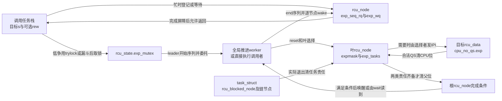
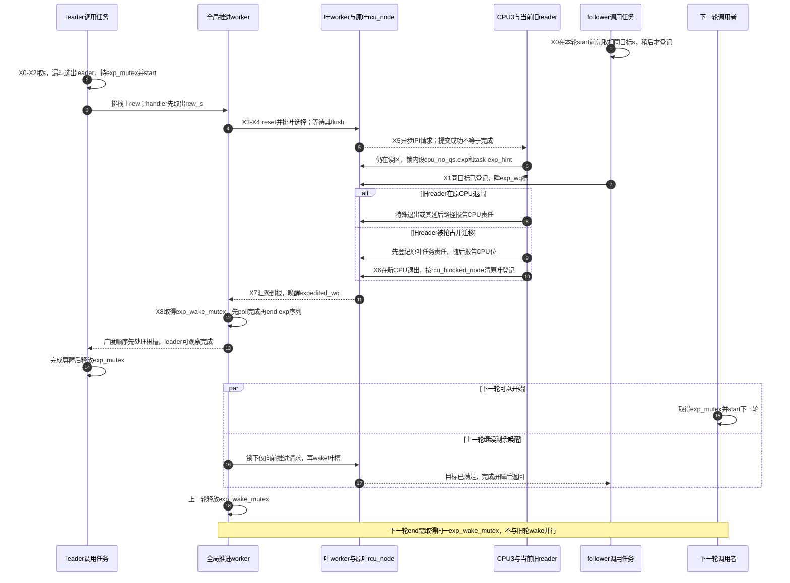

# 第8章\_Linux\_6.12\_Tree\_RCU\_Expedited\_GP源码实现

## 8.1\_实现所有权与版本边界

假设更新者刚替换一个共享对象，希望尽快等到旧读者退出。普通GP的周期性观察可能增加等待；直接向目标CPU发请求可以提前促使它们检查，但IPI到达时旧读区未必结束，并发更新者也不能各自广播一遍。于是实现必须同时解决请求合并、CPU与任务责任、执行者分工和完成通知。

本章追踪 Linux 6.12.20 普通 Tree RCU expedited GP 的 sequence、漏斗合并、树重置、CPU selection、远端 handler 和完成唤醒的唯一函数体讲解。普通 GP 的长期 `gp_kthread`、`gp_seq` 和控制主线由 [P05 GP 全局生命周期源码实现](P05_Linux_6.12_Tree_RCU_GP全局生命周期源码实现.md#5.14_端到端源码时序)负责，普通 CPU `qsmask` 汇聚由 P02负责；被抢占 reader 通用入链与解阻由 P03负责。本章只解释这些状态怎样被 expedited 的 `expmask/exp_tasks` 观察，不重复通用函数体。

源码基线：NXP `linux-imx` 固定提交 `dfaf2136deb2af2e60b994421281ba42f1c087e0`，Linux 6.12.20，分析Tree分支，并分别列出PREEMPT_RCU开启/关闭的handler；这不是当前目标运行配置核验。中文Doxygen和行内中文注释均由仓库补充。上游相对位置主要是 [`kernel/rcu/tree_exp.h`](../../linux/kernel/rcu/tree_exp.h)，状态声明在 [`kernel/rcu/tree.h`](../../linux/kernel/rcu/tree.h)，PREEMPT reader 特殊路径还与 [`kernel/rcu/tree_plugin.h`](../../linux/kernel/rcu/tree_plugin.h) 协作。

概念入口：[Expedited GP 模块源码概念导读](../navigation/P06_Linux_6.12_Tree_RCU_Expedited_GP模块源码概念导读.md#6.1_Expedited不是普通GP的加速档)。稳定正文：[Tree RCU Expedited GP](../../../../knowledge/linux/synchronization_and_asynchrony/synchronization/rcu/P15_Tree_RCU_Expedited_GP.md#15.2_它不是普通GP的超时开关)。

## 8.2\_源码符号覆盖账本

| 唯一展开符号 | 本章标题 | 核心副作用 |
| --- | --- | --- |
| `sync_rcu_exp_done/unlocked()`、`__rcu_report_exp_rnp()`、`rcu_report_exp_cpu_mult/rdp()` | [8.3](#8.3_权威完成条件) | 联合CPU与任务条件，逐层汇聚并撤销强制tick |
| `sync_exp_work_done()` | [8.4](#8.4_expedited_sequence怎样独立计代并共同推进poll观察) | 在目标完成后建立交付屏障 |
| 全局与叶worker的started/queue/flush包装 | [8.7.2](#8.7.2_并行叶work只优化扫描延迟) | 区分工作对象生命期与执行队列 |
| `rcu_exp_need_qs()`及非抢占handler | [8.8](#8.8_rcu_exp_handler把IPI转换为立即或延期证明) | 以本地exp/urgent及调度请求交接责任 |
| `rcu_exp_gp_seq_start/end/snap/done()` | [8.4](#8.4_expedited_sequence怎样独立计代并共同推进poll观察) | 推进独立 expedited sequence 和公共 poll 观察 |
| `exp_funnel_lock()` | [8.5](#8.5_exp_funnel_lock怎样合并并发调用者) | follower 局部等待或选出单 leader |
| `sync_exp_reset_tree_hotplug()`、`sync_exp_reset_tree()` | [8.6](#8.6_sync_exp_reset_tree怎样建立本轮债务) | 传播新 CPU ever-online 位并建立本轮 `expmask` |
| `__sync_rcu_exp_select_node_cpus()`、`sync_rcu_exp_select_cpus()` | [8.7](#8.7_sync_rcu_exp_select_cpus为什么不是无条件广播) | idle/offline 直接报告，其他 CPU IPI，建立 `exp_tasks` |
| `rcu_exp_handler()` | [8.8](#8.8_rcu_exp_handler把IPI转换为立即或延期证明) | 立即清 CPU 位或写 per-CPU/task 延期债务 |
| `synchronize_rcu_expedited_wait_once/wait()` | [8.9](#8.9_wait_wake与公开API怎样关闭一轮) | 等根完成、强制 tick、报告 expedited stall |
| `rcu_exp_wait_wake()`、`rcu_exp_sel_wait_wake()` | [8.9](#8.9_wait_wake与公开API怎样关闭一轮) | 结束 sequence、推进节点 request、唤醒 followers |
| `synchronize_rcu_expedited()` | [8.9](#8.9_wait_wake与公开API怎样关闭一轮) | API 分流、leader work、最终返回 |

本篇补足expedited自己的逐层汇聚；普通QS与任务通用解阻分别复用[普通节点汇聚](P02_Linux_6.12_Tree_RCU_等待桥_QS与节点汇聚关键函数源码实现.md#2.6_rcu_report_qs_rdp与rcu_report_qs_rnp汇聚证据)和[原节点任务退出](P03_Linux_6.12_Tree_RCU_抢占读者债务关键函数源码实现.md#3.8_最外层退出删除任务并恢复传播)。两类GP可等待同一条任务链，但拥有不同等待边界。

## 8.3\_权威完成条件

这是请求代际、CPU责任、任务责任和唤醒交付共同组成的状态协议，不能用一个“IPI已发送”布尔值表示。调用者栈保存目标s和可选work，节点长期保存等待位与队列，任务结构保存跨CPU仍有效的原叶归属。

| 地址 | 初始化与写入者 | 消费与完成条件 |
| --- | --- | --- |
| `rcu_state.expedited_sequence` | 静态零初值；leader开始、推进者结束 | 调用者检查是否覆盖目标s |
| `exp_mutex/exp_wake_mutex` | rcu_state静态mutex初始化器 | 前者由leader调用任务持有；后者只串行各轮结束/唤醒 |
| `rnp->exp_seq_rq/exp_lock/exp_wq[4]` | 拓扑初始化锁与队列；漏斗及交付推进请求 | follower按目标代数选槽、醒来再查sequence |
| `expmaskinitnext/expmaskinit/expmask` | starting加ever-online位、reset传播并建立本轮位 | 合法CPU/子树报告在节点锁下清本轮位 |
| `rnp->exp_tasks`与 `blkd_tasks` | 叶选择与任务入队划定本轮后缀 | 任务按原叶退出；CPU位清零仍可能阻塞 |
| `rdp->cpu_no_qs.b.exp`与task `exp_hint` | handler登记未来处理 | 本地QS及特殊退出路径消费；不是迁移责任的完整容器 |
| 节点 `rew/exp_need_flush` | 选择者登记叶工作并记录需flush | 叶worker完成后才结束选择阶段 |
| 调用者栈 `rew` | leader填目标，初始化并排全局worker | handler取出参数；调用者至少等目标完成后才返回 |




固定提交中的 `rcu_state.expedited_need_qs` 没有活动读写者，不能当完成条件。等待函数实际检查根节点 `sync_rcu_exp_done_unlocked(root)`，其依据是 `expmask` 与 `exp_tasks`。

下面将“CPU与任务都完成”落实为实际检查与汇聚。`unlocked`表示调用者不持锁，辅助函数内部仍取节点锁，并非无锁取样。

```c
/** @brief 在节点锁下检查CPU位和任务边界。 中文说明由仓库补充。 */
static bool sync_rcu_exp_done(struct rcu_node *rnp)
{
	raw_lockdep_assert_held_rcu_node(rnp);
	return READ_ONCE(rnp->exp_tasks) == NULL &&
	       READ_ONCE(rnp->expmask) == 0;
}

/** @brief 为未持锁调用者取得一致的节点完成条件。 中文说明由仓库补充。 */
static bool sync_rcu_exp_done_unlocked(struct rcu_node *rnp)
{
	unsigned long flags;
	bool ret;

	raw_spin_lock_irqsave_rcu_node(rnp, flags);
	ret = sync_rcu_exp_done(rnp);
	raw_spin_unlock_irqrestore_rcu_node(rnp, flags);

	return ret;
}

/** @brief 逐层传播完成，根按wake参数唤醒推进者。 中文说明由仓库补充。 */
static void __rcu_report_exp_rnp(struct rcu_node *rnp,
				 bool wake, unsigned long flags)
	__releases(rnp->lock)
{
	unsigned long mask;

	raw_lockdep_assert_held_rcu_node(rnp);
	for (;;) {
		if (!sync_rcu_exp_done(rnp)) {
			if (!rnp->expmask)
				rcu_initiate_boost(rnp, flags);
			else
				raw_spin_unlock_irqrestore_rcu_node(rnp, flags);
			break;
		}
		if (rnp->parent == NULL) {
			raw_spin_unlock_irqrestore_rcu_node(rnp, flags);
			if (wake)
				swake_up_one_online(&rcu_state.expedited_wq);

			break;
		}
		mask = rnp->grpmask;
		raw_spin_unlock_rcu_node(rnp);
		rnp = rnp->parent;
		raw_spin_lock_rcu_node(rnp);
		WARN_ON_ONCE(!(rnp->expmask & mask));
		WRITE_ONCE(rnp->expmask, rnp->expmask & ~mask);
	}
}

/** @brief 清一组CPU位并撤销其强制tick依赖。 中文说明由仓库补充。 */
static void rcu_report_exp_cpu_mult(struct rcu_node *rnp,
				    unsigned long mask, bool wake)
{
	int cpu;
	unsigned long flags;
	struct rcu_data *rdp;

	raw_spin_lock_irqsave_rcu_node(rnp, flags);
	if (!(rnp->expmask & mask)) {
		raw_spin_unlock_irqrestore_rcu_node(rnp, flags);
		return;
	}
	WRITE_ONCE(rnp->expmask, rnp->expmask & ~mask);
	for_each_leaf_node_cpu_mask(rnp, cpu, mask) {
		rdp = per_cpu_ptr(&rcu_data, cpu);
		if (!IS_ENABLED(CONFIG_NO_HZ_FULL) || !rdp->rcu_forced_tick_exp)
			continue;
		rdp->rcu_forced_tick_exp = false;
		tick_dep_clear_cpu(cpu, TICK_DEP_BIT_RCU_EXP);
	}
	__rcu_report_exp_rnp(rnp, wake, flags);
}

/** @brief 先清本地延期位，再报告叶节点本位。 中文说明由仓库补充。 */
static void rcu_report_exp_rdp(struct rcu_data *rdp)
{
	WRITE_ONCE(rdp->cpu_no_qs.b.exp, false);
	rcu_report_exp_cpu_mult(rdp->mynode, rdp->grpmask, true);
}

```

一片叶CPU位全清但 `exp_tasks` 非空时不能清父位；此时可调用[boost请求入口](P07_Linux_6.12_Tree_RCU_force_QS与Stall源码实现.md#7.5_force_qs_rnp把远端观察任务债务和resched放进同一轮)，该入口释放节点锁。两类责任齐全才带着子树grpmask向父传播。根的 `wake=true` 才唤醒 `expedited_wq`；selection批量直接报告使用false，因为推进者此时还在选择阶段，稍后的wait会检查现成条件。被抢占任务退出调用的 `rcu_report_exp_rnp`只是取得节点锁后转入同一汇聚函数的包装。

清CPU位同时处理 `rcu_forced_tick_exp` 与 `TICK_DEP_BIT_RCU_EXP`，将等待慢路径加上的tick依赖成对撤销。重复报告先检查与expmask是否相交，已无责任便返回；普通qsmask不能参与这组清位。修改汇聚时必须保留解锁责任和任务条件，否则会在CPU已报告但任务仍读旧对象时提前交付。

## 8.4\_expedited\_sequence怎样独立计代并共同推进poll观察

```c
/**
 * @brief 发布一轮 expedited GP 开始。
 * @note 中文 Doxygen 与注释由仓库补充；源码裁剪自 kernel/rcu/tree_exp.h。
 */
static void rcu_exp_gp_seq_start(void)
{
	rcu_seq_start(&rcu_state.expedited_sequence);
	/* 与普通 GP 共享 poll API 的“至少一轮合格GP”观察通道。 */
	rcu_poll_gp_seq_start_unlocked(
		&rcu_state.gp_seq_polled_exp_snap);
}

/** @brief 先发布公共 poll 完成，再结束独立 expedited sequence。 */
static void rcu_exp_gp_seq_end(void)
{
	rcu_poll_gp_seq_end_unlocked(
		&rcu_state.gp_seq_polled_exp_snap);
	rcu_seq_end(&rcu_state.expedited_sequence);
	smp_mb(); /* 串行连续 expedited GP。 */
}

/** @brief 取得调用点之后最早可接受的 expedited 完成值。 */
static unsigned long rcu_exp_gp_seq_snap(void)
{
	unsigned long s;

	smp_mb(); /* 调用者先前修改先于其他 CPU观察本轮。 */
	s = rcu_seq_snap(&rcu_state.expedited_sequence);
	trace_rcu_exp_grace_period(rcu_state.name, s, TPS("snap"));
	return s;
}

/** @brief 检查目标代际是否已经完成；中文说明由仓库补充。 */
static bool rcu_exp_gp_seq_done(unsigned long s)
{
	return rcu_seq_done(&rcu_state.expedited_sequence, s);
}
```

实现原理：调用者 snapshot 的不是“当前 GP 编号”，而是一个目标值；只要 sequence 已越过该目标，就存在一轮完整 expedited GP 覆盖 snapshot。`gp_seq_polled_exp_snap` 只把这次真实 GP 同步到 poll 公共观察序列，不把普通和 expedited 权威 sequence 合并。

完成判定还需要将序列观察与调用者的前后访问排序，不能把 `rcu_exp_gp_seq_done` 的布尔值单独当成完整API返回协议。

```c
/** @brief 满足目标后以完成屏障交付给等待者；中文说明由仓库补充。 */
static bool sync_exp_work_done(unsigned long s)
{
	if (rcu_exp_gp_seq_done(s)) {
		trace_rcu_exp_grace_period(rcu_state.name, s, TPS("done"));

		smp_mb();
		return true;
	}
	return false;
}
```

`rcu_seq`低位保存阶段，高位为代数；若空闲值为0，调用者取得的完成目标可为4，开轮变为1，结束变为4。若调用发生在已经进行的1阶段，snapshot会要求后续完整轮的目标8；不是所有时间相近的调用都能合并到同一轮。具体编码辅助见[GP序列实现](P05_Linux_6.12_Tree_RCU_GP全局生命周期源码实现.md#5.4_rcu_seq辅助函数怎样维护开始目标与完成)。

## 8.5\_exp\_funnel\_lock怎样合并并发调用者

```c
/**
 * @brief 沿当前 CPU 的叶节点向根登记 expedited 请求并选 leader。
 * @param s 调用者的目标 sequence。
 * @return true 表示别人已完成本调用；false 表示本调用持 exp_mutex 成为 leader。
 */
static bool exp_funnel_lock(unsigned long s)
{
	struct rcu_data *rdp = per_cpu_ptr(&rcu_data, raw_smp_processor_id());
	struct rcu_node *rnp = rdp->mynode;
	struct rcu_node *rnp_root = rcu_get_root();

	if (ULONG_CMP_LT(READ_ONCE(rnp->exp_seq_rq), s) &&
	    (rnp == rnp_root ||
	     ULONG_CMP_LT(READ_ONCE(rnp_root->exp_seq_rq), s)) &&
	    mutex_trylock(&rcu_state.exp_mutex))
		goto fastpath;

	for (; rnp != NULL; rnp = rnp->parent) {
		if (sync_exp_work_done(s))
			return true;

		spin_lock(&rnp->exp_lock);
		if (ULONG_CMP_GE(rnp->exp_seq_rq, s)) {

			spin_unlock(&rnp->exp_lock);
			trace_rcu_exp_funnel_lock(rcu_state.name, rnp->level,
						  rnp->grplo, rnp->grphi,
						  TPS("wait"));
			wait_event(rnp->exp_wq[rcu_seq_ctr(s) & 0x3],
				   sync_exp_work_done(s));
			return true;
		}
		WRITE_ONCE(rnp->exp_seq_rq, s);
		spin_unlock(&rnp->exp_lock);
		trace_rcu_exp_funnel_lock(rcu_state.name, rnp->level,
					  rnp->grplo, rnp->grphi, TPS("nxtlvl"));
	}
	mutex_lock(&rcu_state.exp_mutex);
fastpath:
	if (sync_exp_work_done(s)) {
		mutex_unlock(&rcu_state.exp_mutex);
		return true;
	}
	rcu_exp_gp_seq_start();
	trace_rcu_exp_grace_period(rcu_state.name, s, TPS("start"));
	return false;
}
```

实现原理：节点 `exp_seq_rq` 表示本子树已经有人承担至少目标 `s` 的工作。后来者在最近节点等待，避免所有 CPU直接争全局 mutex。四个 `exp_wq` 槽由 sequence counter 低位选择，允许相邻轮次等待者隔离；正确性仍由 `sync_exp_work_done(s)` 的 sequence 判断提供，槽位本身不是完成证据。

初始CPU到叶的映射允许因迁移而不精确：它在这里提供局部性，最终正确性仍由目标序列、节点锁和mutex保证，不要求整个睡眠等待期间钉住CPU。

Fastpath 的 `mutex_trylock()` 只是低竞争优化，仍在开始前二次检查 done，封住“检查后、拿锁前另一个 leader 已完成”的竞态。

## 8.6\_sync\_exp\_reset\_tree怎样建立本轮债务

reset分两层：reset的hotplug辅助函数先吸收CPU starting新增的ever-online位，每轮推进者再把基础位复制成当前expmask责任。这样上线历史与本轮完成条件不会被混成一个可变位图。

### 8.6.1\_只在出现新CPU时传播ever-online基础位

```c
/**
 * @brief 把 CPU starting 新增的 expmaskinitnext 位传播到 expedited 初始化树。
 * @note offline 不清 expmaskinitnext，因此多数调用走无工作 fastpath。
 */
static void sync_exp_reset_tree_hotplug(void)
{
	bool done;
	unsigned long flags;
	unsigned long mask;
	unsigned long oldmask;
	int ncpus = smp_load_acquire(&rcu_state.ncpus);
	struct rcu_node *rnp;
	struct rcu_node *rnp_up;

	if (likely(ncpus == rcu_state.ncpus_snap))
		return;
	rcu_state.ncpus_snap = ncpus;

	rcu_for_each_leaf_node(rnp) {
		raw_spin_lock_irqsave_rcu_node(rnp, flags);
		if (rnp->expmaskinit == rnp->expmaskinitnext) {
			raw_spin_unlock_irqrestore_rcu_node(rnp, flags);
			continue;
		}

		oldmask = rnp->expmaskinit;
		rnp->expmaskinit = rnp->expmaskinitnext;
		raw_spin_unlock_irqrestore_rcu_node(rnp, flags);

		if (oldmask)
			continue;

		mask = rnp->grpmask;
		rnp_up = rnp->parent;
		done = false;
		while (rnp_up) {
			raw_spin_lock_irqsave_rcu_node(rnp_up, flags);
			if (rnp_up->expmaskinit)
				done = true;
			rnp_up->expmaskinit |= mask;
			raw_spin_unlock_irqrestore_rcu_node(rnp_up, flags);
			if (done)
				break;
			mask = rnp_up->grpmask;
			rnp_up = rnp_up->parent;
		}
	}
}
```

关键事实是 `ncpus` 由 CPU starting 对“从未加入 ever-online 集合”的 CPU release 增长，reset acquire 观察；CPU offline 不减少，所以没有每轮重建整棵初始化树的成本。父节点一旦已有任意子树位，再新增同一非空子树中的 CPU也无需继续向上传播。

### 8.6.2\_每轮复制为当前债务

```c
/** @brief 为一轮 expedited GP 重置所有节点当前 expmask。 */
static void __maybe_unused sync_exp_reset_tree(void)
{
	unsigned long flags;
	struct rcu_node *rnp;

	sync_exp_reset_tree_hotplug();
	rcu_for_each_node_breadth_first(rnp) {
		raw_spin_lock_irqsave_rcu_node(rnp, flags);
		WARN_ON_ONCE(rnp->expmask);
		WRITE_ONCE(rnp->expmask, rnp->expmaskinit);
		raw_spin_unlock_irqrestore_rcu_node(rnp, flags);
	}
}
```

`WARN_ON_ONCE(rnp->expmask)` 检查上一轮是否真的清空；新轮不能覆盖未完成债务。Breadth-first 重置后，CPU selection 会马上消除当前 offline/idle 位。

## 8.7\_sync\_rcu\_exp\_select\_cpus为什么不是无条件广播

CPU selection 先在叶节点下分类 offline、EQS、当前 CPU 和必须远端探测的 CPU，再只给最后一类发送 IPI。并行 leaf work 优化扫描延迟，但不改变每个 CPU 位或 `exp_tasks` 债务的安全条件。

### 8.7.1\_每叶节点分类

```c
/**
 * @brief 为一个叶节点分类立即可报告 CPU、需 IPI CPU和被抢占任务债务。
 * @note 本说明由仓库补充；源码裁剪自 kernel/rcu/tree_exp.h。
 */
static void __sync_rcu_exp_select_node_cpus(struct rcu_exp_work *rewp)
{
	int cpu;
	unsigned long flags;
	unsigned long mask_ofl_test;
	unsigned long mask_ofl_ipi;
	int ret;
	struct rcu_node *rnp = container_of(rewp, struct rcu_node, rew);

	raw_spin_lock_irqsave_rcu_node(rnp, flags);

	mask_ofl_test = 0;
	for_each_leaf_node_cpu_mask(rnp, cpu, rnp->expmask) {
		struct rcu_data *rdp = per_cpu_ptr(&rcu_data, cpu);
		unsigned long mask = rdp->grpmask;
		int snap;

		if (raw_smp_processor_id() == cpu ||
		    !(rnp->qsmaskinitnext & mask)) {
			mask_ofl_test |= mask;
		} else {

			snap = ct_rcu_watching_cpu_acquire(cpu);
			if (rcu_watching_snap_in_eqs(snap))
				mask_ofl_test |= mask;
			else
				rdp->exp_watching_snap = snap;
		}
	}
	mask_ofl_ipi = rnp->expmask & ~mask_ofl_test;

	if (rcu_preempt_has_tasks(rnp))
		WRITE_ONCE(rnp->exp_tasks, rnp->blkd_tasks.next);
	raw_spin_unlock_irqrestore_rcu_node(rnp, flags);

	for_each_leaf_node_cpu_mask(rnp, cpu, mask_ofl_ipi) {
		struct rcu_data *rdp = per_cpu_ptr(&rcu_data, cpu);
		unsigned long mask = rdp->grpmask;

retry_ipi:
		if (rcu_watching_snap_stopped_since(rdp, rdp->exp_watching_snap)) {
			mask_ofl_test |= mask;
			continue;
		}
		if (get_cpu() == cpu) {
			mask_ofl_test |= mask;
			put_cpu();
			continue;
		}
		/* wait=0：提交成功不等于目标已报告QS。 */
		ret = smp_call_function_single(cpu, rcu_exp_handler, NULL, 0);
		put_cpu();

		if (!ret)
			continue;

		raw_spin_lock_irqsave_rcu_node(rnp, flags);
		if ((rnp->qsmaskinitnext & mask) &&
		    (rnp->expmask & mask)) {

			raw_spin_unlock_irqrestore_rcu_node(rnp, flags);
			trace_rcu_exp_grace_period(rcu_state.name, rcu_exp_gp_seq_endval(), TPS("selectofl"));
			schedule_timeout_idle(1);
			goto retry_ipi;
		}

		if (rnp->expmask & mask)
			mask_ofl_test |= mask;
		raw_spin_unlock_irqrestore_rcu_node(rnp, flags);
	}

	if (mask_ofl_test)
		rcu_report_exp_cpu_mult(rnp, mask_ofl_test, false);
}
```

当前选择执行者所在CPU可直接计入 `mask_ofl_test`，依赖可阻塞调用现场与当前执行上下文的合法性；该执行者此刻不得持有它正在等待的旧读区，先前已被抢占的任务另有链表责任；不能推广成任意代码只要在process context就已经经过调度QS。offline 判断使用普通 RCU 的实时 `qsmaskinitnext`，不是 ever-online 的 `expmaskinitnext`。

`exp_tasks` 指向 `blkd_tasks` 中本轮边界。后续新增 blocked task 是否阻塞本轮，还与 `expmask` 位清除时点和 PREEMPT 入链协议共同决定；它不是复制一条新任务链。

### 8.7.2\_并行叶work只优化扫描延迟

```c
/** @brief 调度各叶选择并flush已排工作；中文说明由仓库补充。 */
static void sync_rcu_exp_select_cpus(void)
{
	struct rcu_node *rnp;

	trace_rcu_exp_grace_period(rcu_state.name, rcu_exp_gp_seq_endval(), TPS("reset"));
	sync_exp_reset_tree();
	trace_rcu_exp_grace_period(rcu_state.name, rcu_exp_gp_seq_endval(), TPS("select"));

	rcu_for_each_leaf_node(rnp) {
		rnp->exp_need_flush = false;
		if (!READ_ONCE(rnp->expmask))
			continue;
		if (!rcu_exp_par_worker_started(rnp) ||
		    rcu_scheduler_active != RCU_SCHEDULER_RUNNING ||
		    rcu_is_last_leaf_node(rnp)) {

			sync_rcu_exp_select_node_cpus(&rnp->rew.rew_work);
			continue;
		}
		sync_rcu_exp_select_cpus_queue_work(rnp);
		rnp->exp_need_flush = true;
	}

	rcu_for_each_leaf_node(rnp)
		if (rnp->exp_need_flush)
			sync_rcu_exp_select_cpus_flush_work(rnp);
}
```

每叶 kworker 可以并行做 CPU 分类，但 leader 必须 flush 所有已排 work 后才进入等待。最后一个叶由当前执行者直接处理，避免把全部工作都排走后自己空等；早期启动/worker未创建时也直接调用。并行只影响 selection 延迟，不改变节点锁下的 `expmask` 权威状态。

工作对象与执行者必须分开看。`struct rcu_exp_work`包含 `rew_work` 和目标 `rew_s`：每叶 `rnp->rew`长期存在；公开调用的局部 `rew`在调用者栈上；它们都不是线程本身。排队、包装和flush如下：

```c
/** @brief 检查全局推进worker是否已发布。 中文说明由仓库补充。 */
static inline bool rcu_exp_worker_started(void)
{
	return !!READ_ONCE(rcu_exp_gp_kworker);
}

/** @brief 检查本叶的并行worker是否已发布。 中文说明由仓库补充。 */
static inline bool rcu_exp_par_worker_started(struct rcu_node *rnp)
{
	return !!READ_ONCE(rnp->exp_kworker);
}

/** @brief 从叶工作对象还原参数，执行叶选择。 中文说明由仓库补充。 */
static void sync_rcu_exp_select_node_cpus(struct kthread_work *wp)
{
	struct rcu_exp_work *rewp =
		container_of(wp, struct rcu_exp_work, rew_work);

	__sync_rcu_exp_select_node_cpus(rewp);
}

/** @brief 在独立叶worker上初始化并排选择工作。 中文说明由仓库补充。 */
static inline void sync_rcu_exp_select_cpus_queue_work(struct rcu_node *rnp)
{
	kthread_init_work(&rnp->rew.rew_work, sync_rcu_exp_select_node_cpus);

	kthread_queue_work(READ_ONCE(rnp->exp_kworker), &rnp->rew.rew_work);
}

/** @brief 等待该叶工作执行结束。 中文说明由仓库补充。 */
static inline void sync_rcu_exp_select_cpus_flush_work(struct rcu_node *rnp)
{
	kthread_flush_work(&rnp->rew.rew_work);
}

/** @brief 取出调用者的目标值后驱动本轮。 中文说明由仓库补充。 */
static void wait_rcu_exp_gp(struct kthread_work *wp)
{
	struct rcu_exp_work *rewp;

	rewp = container_of(wp, struct rcu_exp_work, rew_work);
	rcu_exp_sel_wait_wake(rewp->rew_s);
}

/** @brief 在全局推进worker上排本轮工作。 中文说明由仓库补充。 */
static inline void synchronize_rcu_expedited_queue_work(struct rcu_exp_work *rew)
{
	kthread_init_work(&rew->rew_work, wait_rcu_exp_gp);
	kthread_queue_work(rcu_exp_gp_kworker, &rew->rew_work);
}

```

全局推进worker不能把叶工作也排到自己队列后同步flush，否则当前工作等待后续工作，而后续工作又等当前工作返回。独立的叶worker避免这个依赖环。flush只保证选择工作完成，不保证所有异步IPI已经得到QS；之后仍须等根条件。`rcu_exp_gp_seq_endval()`仅为trace取得当前轮预计结束值，不负责发布完成。

修改排队路径时同时核对对象地址和worker地址，不能只看函数都带exp前缀。全局与叶worker创建失败或未创建时，started检查使对应路径直接执行；排队包装在这些前提下使用新初始化的work。它们没有在此处实现可任意重用同一work的失败恢复协议。

## 8.8\_rcu\_exp\_handler把IPI转换为立即或延期证明

```c
/**
 * @brief PREEMPT_RCU 配置下的远端 expedited IPI handler。
 * @note 本说明由仓库补充；源码裁剪自 kernel/rcu/tree_exp.h。
 */
static void rcu_exp_handler(void *unused)
{
	int depth = rcu_preempt_depth();
	unsigned long flags;
	struct rcu_data *rdp = this_cpu_ptr(&rcu_data);
	struct rcu_node *rnp = rdp->mynode;
	struct task_struct *t = current;

	if (!depth) {
		if (!(preempt_count() & (PREEMPT_MASK | SOFTIRQ_MASK)) ||
		    rcu_is_cpu_rrupt_from_idle()) {
			rcu_report_exp_rdp(rdp);
		} else {
			WRITE_ONCE(rdp->cpu_no_qs.b.exp, true);
			set_tsk_need_resched(t);
			set_preempt_need_resched();
		}
		return;
	}

	if (depth > 0) {
		raw_spin_lock_irqsave_rcu_node(rnp, flags);
		if (rnp->expmask & rdp->grpmask) {
			WRITE_ONCE(rdp->cpu_no_qs.b.exp, true);
			t->rcu_read_unlock_special.b.exp_hint = true;
		}
		raw_spin_unlock_irqrestore_rcu_node(rnp, flags);
		return;
	}

	WARN_ON_ONCE(1);
}
```

实现原理：不在 reader 中且上下文允许时，handler 直接报告 CPU 位；若 preempt/BH 上下文不允许立即作为 QS，只设置本地债务和 need-resched；若在普通 reader 中，除 per-CPU 位外还给 task 写 `exp_hint`，提示最外层退出进入特殊处理。若任务在读区中被抢占并迁移，切换钩子先把任务责任登记到原叶，再报告原CPU位；之后依靠 `rcu_blocked_node` 与原叶 `exp_tasks` 后缀等任务退出，不能仅靠exp_hint替原CPU清位。

锁内重查 `expmask` 必不可少：IPI 发出到到达之间，其他路径可能已报告该位或轮次已完成。对已完成的旧轮再写 task hint 会污染下一轮特殊处理。

非抢占配置不能直接照搬上面的任务深度判断。它先看本位是否仍被等待、是否已登记延期，再按idle或可用的抢占/BH计数判断能否立即报告；否则设置本地exp责任、release发布urgent并请求调度：

```c
/** @brief 非抢占分支请求后续合法QS；中文说明由仓库补充。 */
static void rcu_exp_need_qs(void)
{
	__this_cpu_write(rcu_data.cpu_no_qs.b.exp, true);

	smp_store_release(this_cpu_ptr(&rcu_data.rcu_urgent_qs), true);
	set_tsk_need_resched(current);
	set_preempt_need_resched();
}

/** @brief CONFIG_PREEMPT_RCU关闭时的IPI handler；中文说明由仓库补充。 */
static void rcu_exp_handler(void *unused)
{
	struct rcu_data *rdp = this_cpu_ptr(&rcu_data);
	struct rcu_node *rnp = rdp->mynode;
	bool preempt_bh_enabled = !(preempt_count() & (PREEMPT_MASK | SOFTIRQ_MASK));

	if (!(READ_ONCE(rnp->expmask) & rdp->grpmask) ||
	    __this_cpu_read(rcu_data.cpu_no_qs.b.exp))
		return;
	if (rcu_is_cpu_rrupt_from_idle() ||
	    (IS_ENABLED(CONFIG_PREEMPT_COUNT) && preempt_bh_enabled)) {
		rcu_report_exp_rdp(this_cpu_ptr(&rcu_data));
		return;
	}
	rcu_exp_need_qs();
}
```

同一源码条件下，CPU上线最后的 `sync_sched_exp_online_cleanup(cpu)`会检查仍欠位且尚未请求延期的CPU：目标为本CPU时在IRQ保护下调用need_qs，否则发送同一handler的IPI并检查发送错误。抢占分支的这个辅助函数为空。它处理上线与选择交错的剩余请求，不意味着所有CPU上线都必须发IPI。

PREEMPT handler的depth小于零只告警，不制造QS；depth大于零时在叶锁下复查本位才登记hint。处理器进入IPI并不等于普通读区结束。修改handler必须同时核对IRQ现场、抢占/BH条件、后续特殊退出和上下文切换路径，不能删掉其中一个条件来换取“更快返回”。

## 8.9\_wait\_wake与公开API怎样关闭一轮

leader 先等待根节点债务清零，必要时执行 tick/stall 慢路径；随后结束 expedited sequence、推进节点请求并唤醒 followers。公开 API 只在最外层选择普通或 expedited 分支，不能绕过这组完成交接。

### 8.9.1\_等待根条件与慢路径

```c
/** @brief 等待一次并在超时边界重新检查根条件；中文说明由仓库补充。 */
static bool synchronize_rcu_expedited_wait_once(long tlimit)
{
	int t;
	struct rcu_node *rnp_root = rcu_get_root();

	t = swait_event_timeout_exclusive(rcu_state.expedited_wq,
					  sync_rcu_exp_done_unlocked(rnp_root),
					  tlimit);

	if (t > 0 || sync_rcu_exp_done_unlocked(rnp_root))
		return true;
	WARN_ON(t < 0);
	return false;
}
```

下面保留等待策略本体。只有NO_HZ_FULL已启用且内核启动阶段结束时，才先等一个jiffy并对仍欠债CPU增加tick依赖；普通分支直接进入按stall间隔等待的循环。

```c
/** @brief 等待合法根条件，并按配置恢复tick和输出诊断；中文说明由仓库补充。 */
static void synchronize_rcu_expedited_wait(void)
{
	int cpu;
	unsigned long j;
	unsigned long jiffies_stall;
	unsigned long jiffies_start;
	unsigned long mask;
	struct rcu_data *rdp;
	struct rcu_node *rnp;
	unsigned long flags;

	trace_rcu_exp_grace_period(rcu_state.name, rcu_exp_gp_seq_endval(), TPS("startwait"));
	jiffies_stall = rcu_exp_jiffies_till_stall_check();
	jiffies_start = jiffies;
	if (tick_nohz_full_enabled() && rcu_inkernel_boot_has_ended()) {
		if (synchronize_rcu_expedited_wait_once(1))
			return;
		rcu_for_each_leaf_node(rnp) {
			raw_spin_lock_irqsave_rcu_node(rnp, flags);
			mask = READ_ONCE(rnp->expmask);
			for_each_leaf_node_cpu_mask(rnp, cpu, mask) {
				rdp = per_cpu_ptr(&rcu_data, cpu);
				if (rdp->rcu_forced_tick_exp)
					continue;
				rdp->rcu_forced_tick_exp = true;
				if (cpu_online(cpu))
					tick_dep_set_cpu(cpu, TICK_DEP_BIT_RCU_EXP);
			}
			raw_spin_unlock_irqrestore_rcu_node(rnp, flags);
		}
		j = READ_ONCE(jiffies_till_first_fqs);
		if (synchronize_rcu_expedited_wait_once(j + HZ))
			return;
	}

	for (;;) {
		unsigned long j;

		if (synchronize_rcu_expedited_wait_once(jiffies_stall))
			return;
		if (rcu_stall_is_suppressed())
			continue;

		nbcon_cpu_emergency_enter();

		j = jiffies;
		rcu_stall_notifier_call_chain(RCU_STALL_NOTIFY_EXP, (void *)(j - jiffies_start));
		trace_rcu_stall_warning(rcu_state.name, TPS("ExpeditedStall"));
		synchronize_rcu_expedited_stall(jiffies_start, j);
		jiffies_stall = 3 * rcu_exp_jiffies_till_stall_check() + 3;

		nbcon_cpu_emergency_exit();

		panic_on_rcu_stall();
	}
}
```

`wait_once`使用根锁包装的done检查；timeout到期后再检查一次，避免将到期边界上的完成当作失败。tick依赖只为仍有expmask的CPU登记，在线时才调用set_cpu；报告路径负责清除标志和依赖，形成前文配对。

超时并不返回成功。抑制报告时继续等；未抑制时调用notifier、trace和expedited stall输出，再延长后续诊断间隔，按配置可能panic。日志函数读取CPU位、任务后缀和online/初始化/deferred状态，CSD锁抑制可只输出简报；日志及栈采集不替代根条件。加速用IPI、额外扫描和tick换取通常更短等待，没有固定完成期限，不宜在热路径循环调用。

### 8.9.2\_结束sequence并唤醒follower

```c
/** @brief 等本轮完成，发布 sequence end，并唤醒所有节点 follower。 */
static void rcu_exp_wait_wake(unsigned long s)
{
	struct rcu_node *rnp;

	synchronize_rcu_expedited_wait();

	/* 串行结束/唤醒，根唤醒后可与下一轮开始重叠。 */
	mutex_lock(&rcu_state.exp_wake_mutex);
	rcu_exp_gp_seq_end();
	trace_rcu_exp_grace_period(rcu_state.name, s, TPS("end"));

	rcu_for_each_node_breadth_first(rnp) {
		if (ULONG_CMP_LT(READ_ONCE(rnp->exp_seq_rq), s)) {
			spin_lock(&rnp->exp_lock);

			if (ULONG_CMP_LT(rnp->exp_seq_rq, s))
				WRITE_ONCE(rnp->exp_seq_rq, s);
			spin_unlock(&rnp->exp_lock);
		}
		smp_mb();
		wake_up_all(&rnp->exp_wq[rcu_seq_ctr(s) & 0x3]);
	}
	trace_rcu_exp_grace_period(rcu_state.name, s, TPS("endwake"));
	mutex_unlock(&rcu_state.exp_wake_mutex);
}
```

`exp_wake_mutex`串行各轮的结束与唤醒过程，**不禁止下一轮开始与上一轮剩余叶唤醒重叠**。遍历采用广度顺序，根槽较早唤醒leader；leader观察sequence满足便可释放exp_mutex，下一调用者可开轮，而旧推进者继续访问剩余节点。下一轮到end时必须取得exp_wake_mutex，故不能叠加第二轮结束/唤醒。节点请求在wake前至少推进到s，锁内重查不会覆盖新来者更大的目标。

把选择与完成交付接起来的是这个小包装；直接执行和全局worker都调用它，而不是各自维护第二套GP逻辑。

```c
/** @brief 先选择全部叶，再等待并交付完成；中文说明由仓库补充。 */
static void rcu_exp_sel_wait_wake(unsigned long s)
{

	sync_rcu_exp_select_cpus();

	rcu_exp_wait_wake(s);
}
```

### 8.9.3\_公开API分流

```c
/**
 * @brief 等待一轮 expedited 普通 RCU GP。
 * @note 本说明由仓库补充；源码裁剪自 kernel/rcu/tree_exp.h。
 */
void synchronize_rcu_expedited(void)
{
	unsigned long flags;
	struct rcu_exp_work rew;
	struct rcu_node *rnp;
	unsigned long s;

	RCU_LOCKDEP_WARN(lock_is_held(&rcu_bh_lock_map) ||
			 lock_is_held(&rcu_lock_map) ||
			 lock_is_held(&rcu_sched_lock_map),
			 "Illegal synchronize_rcu_expedited() in RCU read-side critical section");

	if (rcu_blocking_is_gp()) {

		rcu_poll_gp_seq_start_unlocked(&rcu_state.gp_seq_polled_exp_snap);
		rcu_poll_gp_seq_end_unlocked(&rcu_state.gp_seq_polled_exp_snap);

		local_irq_save(flags);
		WARN_ON_ONCE(num_online_cpus() > 1);
		rcu_state.expedited_sequence += (1 << RCU_SEQ_CTR_SHIFT);
		local_irq_restore(flags);
		return;
	}

	if (rcu_gp_is_normal()) {
		synchronize_rcu_normal();
		return;
	}

	s = rcu_exp_gp_seq_snap();
	if (exp_funnel_lock(s))
		return;

	if (unlikely((rcu_scheduler_active == RCU_SCHEDULER_INIT) || !rcu_exp_worker_started())) {

		rcu_exp_sel_wait_wake(s);
	} else {

		rew.rew_s = s;
		synchronize_rcu_expedited_queue_work(&rew);
	}

	rnp = rcu_get_root();
	wait_event(rnp->exp_wq[rcu_seq_ctr(s) & 0x3],
		   sync_exp_work_done(s));

	mutex_unlock(&rcu_state.exp_mutex);
}
```

公开调用者成为leader后不一定自己做scan/wait：运行期把栈上rew排给全局worker，handler先还原对象并取出rew_s，后续推进只使用这个按值参数。调用者等目标满足再返回，但这不等于逐叶唤醒已经全部结束；不能因为源码使用栈上对象，就在修改时让worker在唤醒之后又回头读取rew。

最前面的诊断只提示非法读区调用，不把等待接口变成可在读区使用。`rcu_blocking_is_gp()`的合法快速分支依赖特定非抢占单CPU/启动条件，由[同步等待实现](P10_Linux_6.12_Tree_RCU_同步等待与rcu_barrier源码实现.md#10.4_synchronize_rcu怎样选择普通expedited或早期空GP)解释，不是任意“当前只在线一个CPU”都能省去GP。normal策略会调用[普通等待分支](P14_Linux_6.12_Tree_RCU_同步等待批处理源码实现.md#14.3_请求登记与dummy节点怎样划定本轮)。早期调度初始化或worker未建立时，leader直接执行选择/等待/交付。完成真实expedited路径的调用者最终观察自己的snapshot后释放exp_mutex；follower则无需取得该mutex也可返回。

## 8.10\_源码端到端时序

沿模块导读X0～X8追踪一次有worker、遇到旧reader的调用。这里有三类执行者：leader调用任务负责开轮并持exp_mutex，全局worker推进选择/等待/交付，叶worker只完成相应叶的选择。不能把它们都标成“leader线程”。

| 阶段 | 写入地址与执行者 | 交接条件 |
| --- | --- | --- |
| X0 取目标 | 调用者栈s | 完成序列必须覆盖调用时点 |
| X1 漏斗 | 调用者在exp_lock下登记exp_seq_rq | 已完成、follower等待或取得exp_mutex |
| X2 开轮 | leader开始expedited_sequence，填栈rew | 直接推进或排给全局worker |
| X3 重置 | 推进者吸收ever-online并建立expmask | 各节点CPU/子树责任可被选择 |
| X4 选择 | 叶执行者写快照和exp_tasks边界 | flush选择工作，异步IPI另待回应 |
| X5 CPU责任 | handler与后续本地路径 | 立即报告或登记exp/hint并等待合法QS |
| X6 任务责任 | 被抢占reader退出原叶登记 | 与CPU位独立地满足本轮任务条件 |
| X7 根条件 | 汇聚清父位，按wake唤醒expedited_wq | 根CPU和任务均完成 |
| X8 交付 | 推进者end序列并逐节点wake | 调用者完成屏障后返回；leader释放exp_mutex |



图中follower先取票、稍后登记，所以能与leader共享目标；若在本轮start以后才取snapshot，则会要求后续完整轮，不能无条件搭上当前轮。图中的root wake只表示leader已具备返回条件，调度可能让它更晚运行；它也可能在条件检查时直接看到序列完成。叶follower的先后同样不固定。关键约束是同一轮安全证明先于end，完成屏障先于调用者后续访问，各轮end/wake串行；不是要求所有调用者在同一时刻返回。

## 8.11\_修改与验证边界

1. 普通 `gp_seq/qsmask` 与 expedited `sequence/expmask` 不能交叉清位；
2. `expmaskinitnext` 是 ever-online 位并集，offline 由 selection 消除，不能当实时 online mask；
3. follower 必须由 sequence done 覆盖 snapshot，不能只因发现一个 leader 就返回；
4. exp_mutex串行leader开轮，exp_wake_mutex串行结束/唤醒；允许下一轮开始与旧轮剩余唤醒重叠；
5. selection 发送 IPI 前后必须重查 EQS 与 hotplug；
6. IPI handler 在 reader 中只能登记 future report，不能立即清债；
7. 迁移前保存原叶任务责任再清CPU位；exp_hint只是提示，持久责任在rcu_blocked_node及任务链边界；
8. 根完成条件同时检查 CPU 位和 task 边界；
9. NO_HZ_FULL 强制 tick与stall打印属于活性慢路径，不改变正确性；
10. 固定提交未使用 `expedited_need_qs`，不得凭注释补写不存在的递减算法。

做一个交错检查：CPU3的IPI已经返回并随后清CPU位，但旧reader已迁到CPU2且仍在原叶exp_tasks后缀中，此时根不能完成；等它真正退出以后才可交付。另一个检查是normal策略开启时公开expedited调用可能走普通等待，因此观察API名称或IPI计数都不能单独证明所走分支。本轮核对固定源码与时序，没有执行目标IPI延迟、迁移或加速GP压力实验。

总索引：[Linux 6.12 RCU 源码总阅读索引](../navigation/P01_Linux_6.12_RCU源码总阅读索引.md#1.4_模块概念导读入口)。
