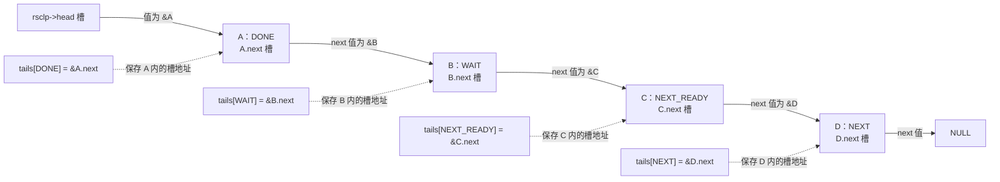
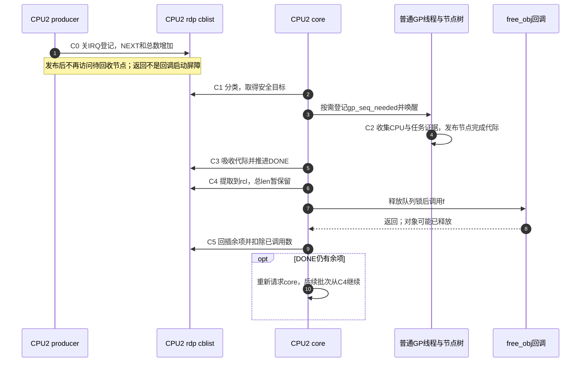

# 第9章\_Linux\_6.12\_Tree\_RCU\_回调分段与批处理源码实现

## 9.1\_从GP的完成值走到一次实际回调

上一阶段已经看见普通 GP 怎样发布完成代际。现在设 CPU2 用 `call_rcu(&obj->head, free_obj)` 交出一个旧对象：GP 完成只能证明旧读者不再阻挡回收，尚未证明 `free_obj()` 已经运行。队列还要把该节点标成可执行，由执行者取出，并在函数返回后结算这次责任。本章沿同一个节点追这条链，解释分段、执行预算和计数为何都不能省略。

本章是版本化实现阅读，前置概念见 [回调与 NOCB 模块导读](../navigation/P07_Linux_6.12_Tree_RCU_回调与NOCB模块源码概念导读.md#7.1_GP完成为什么还不等于callback执行)。稳定模型见 [四段不是四条链表](../../../../knowledge/linux/synchronization_and_asynchrony/synchronization/rcu/P11_Tree_RCU_rcu_segcblist回调状态机.md#11.2_四段不是四条链表) 和 [取得资格与执行完成](../../../../knowledge/linux/synchronization_and_asynchrony/synchronization/rcu/P12_Tree_RCU_回调执行_批处理与限流.md#12.2_资格取得与执行完成之间还隔着什么)。普通 GP 的请求、初始化、取证和 cleanup 仍由 [GP 全局生命周期实现](P05_Linux_6.12_Tree_RCU_GP全局生命周期源码实现.md#5.14_端到端源码时序) 展开。

源码身份为 NXP `linux-imx`、Linux 6.12.20、固定提交 `dfaf2136deb2af2e60b994421281ba42f1c087e0`，出处见 [源码基线](../../linux/SOURCE_BASELINE.md#1.5.1_RCU家族证据)。这里阅读 `CONFIG_TREE_RCU` 对应实现，抢占、NOCB、lazy 与严格 GP 等分支各受配置约束；这不是当前目标 `.config` 已启用这些选项的实测结论。

上游相对位置：[`kernel/rcu/tree.c`](../../linux/kernel/rcu/tree.c)、[`kernel/rcu/rcu_segcblist.c`](../../linux/kernel/rcu/rcu_segcblist.c)、[`include/linux/rcu_segcblist.h`](../../linux/include/linux/rcu_segcblist.h)。下列函数保留完整语句，仅去掉原英文注释并加入仓库中文阅读说明；未知业务函数仍受公共 RCU 回调不得阻塞的契约约束。

## 9.2\_源码入口与本章分工

先沿普通 CPU 路径建立一次完整生命周期，再进入卸载路径。NOCB 会改变生产者入队、管理者推进和执行者通知，但仍使用本章的分段资格与普通 GP 证明。它的唯一实现已独立到 [NOCB 队列与执行交接](P15_Linux_6.12_Tree_RCU_NOCB队列与执行交接源码实现.md#15.1_本地回调处理怎样变成远端协作)。

| 阅读问题 | 唯一实现符号 | 本地入口 |
| --- | --- | --- |
| 节点何时交出，普通/NOCB 如何分流 | `__call_rcu_common`、`call_rcu`、`call_rcu_hurry` | [公共分流](#9.4.1_公共分流) |
| 主链怎样入队，洪峰如何触发推进 | `rcutree_enqueue`、`call_rcu_core`、`rcu_segcblist_enqueue` | [普通入队](#9.4.2_普通CPU_enqueue和core触发) |
| 段界怎样移动而不逐项扫描 | `rcu_segcblist_advance/accelerate` | [底层分段](#9.5.1_底层分段算法) |
| callback 需求怎样接上 GP 树 | `rcu_accelerate_cbs`、`rcu_accelerate_cbs_unlocked`、`rcu_advance_cbs`、`rcu_advance_cbs_nowake` | [代际与需求](#9.5.2_连接全局GP需求) |
| 已成熟节点怎样锁外执行并结算 | `rcu_segcblist_extract_done_cbs/insert_done_cbs`、`rcu_do_batch_check_time`、`rcu_do_batch` | [批次执行](#9.6_rcu_do_batch为何先抽取再锁外执行) |
| core 怎样获得运行机会与重排余项 | `rcu_core`、`invoke_rcu_core`、`invoke_rcu_core_kthread`、`rcu_wake_cond`、`rcu_cpu_kthread` | [执行者](#9.7_普通CPU怎样选择softirq或rcuc执行者) |

`rcu_barrier_entrain()` 的哨兵证明在 P10，CPU offline 的队列 merge 在 P06；这些路径共享分段结构，但不能把它们分别维护的等待责任都叫作“等一次 GP”。

## 9.3\_一条链表怎样表达四段

CPU2 先登记 A，稍后登记 B。若 A 已被某轮 GP 覆盖而 B 还没有，队列不能只记一个总长度，也不能执行时才逐个猜目标。因此 `rcu_segcblist` 把同资格的一批节点放在连续区间，用四个边界保存区间末尾；等待段再保存目标代际。节点仍只靠 `rcu_head.next` 串成一条链。

以下例子每段恰好一个节点。实线是指针槽中的值，虚线是 `tails[]` 保存的槽地址。比如 `tails[DONE] = &A.next`，而 `*tails[DONE] = &B`；两者差一次解引用，不能都画成“指向 B”。



空段可与相邻段共享同一个边界；整链为空时，边界可以指向 `&rsclp->head`。`gp_seq[i]` 仅在对应等待段非空时有效，DONE 不需要再等，NEXT 尚未绑定目标。把 WAIT 推进 DONE，主要是在重写边界、段长度和代际，而不是改每个业务对象里的状态字段。

| 状态落点 | 谁修改，谁读取 | 当前作用 |
| --- | --- | --- |
| `head`、`tails[4]`、`seglen[4]` | 入队、分类、提取、回插路径；后续队列操作读取 | 节点位置和资格区间 |
| `gp_seq[WAIT/NEXT_READY]` | accelerate 赋目标，advance 读目标 | 必须等到的完成代际 |
| `cblist.len` | 入队增加，批次结算减少；barrier/过载路径读取 | 覆盖主链、旁路和已提取但未结算责任的保守总数 |
| `rnp->gp_seq`、`gp_seq_needed` | GP 发布与请求漏斗；队列推进读取 | 已推进代际与未来需求，二者不是同一个值 |
| 栈上 `rcu_cblist rcl` | 当前批次执行者独占 | 从 DONE 暂时摘出的可执行链及余项 |
| `rdp->rcu_cpu_has_work` | 唤起 core 和预算退出路径写；`rcuc` 读 | 执行者待办通知，不表示 GP 完成 |

普通路径依赖本 CPU IRQ 保护；NOCB 管理/执行者可以在其他 CPU 访问该 `rdp`，因此另需 `nocb_lock`。关本地 IRQ 不能阻挡远端线程。NOCB 更改的是这些所有者和通信步骤，并未另造一套“无需 GP”的资格。

## 9.4\_call\_rcu怎样把所有权交给每CPU队列

生产者先保存回调函数和节点链接，再交给当前 CPU 的队列。接口不等待回收完成；一旦发布节点，调用者就不能继续把 `head` 当成自己独占的可修改内存。回调有可能在生产者从 `call_rcu()` 返回前已于另一 CPU 执行，因此“返回以后才转移所有权”是错误的时间边界。

### 9.4.1\_公共分流

先读公共入口，再看两个外层接口传入的 lazy 选择。debug 检查是检测非法重复登记的辅助；关闭该检查并不会使重复登记合法，检测到以后也不是自动修成两次正确回收。

```c
/**
 * @brief 初始化节点并按普通或卸载路径交付；hurry 受 CONFIG_RCU_LAZY 约束。
 * @note 中文说明为仓库补充；下方保留 kernel/rcu/tree.c 函数的完整语句，省去原英文注释。
 */
static void
__call_rcu_common(struct rcu_head *head, rcu_callback_t func, bool lazy_in)
{
	static atomic_t doublefrees;
	unsigned long flags;
	bool lazy;
	struct rcu_data *rdp;

	WARN_ON_ONCE((unsigned long)head & (sizeof(void *) - 1));

	if (debug_rcu_head_queue(head)) {

		if (atomic_inc_return(&doublefrees) < 4) {
			pr_err("%s(): Double-freed CB %p->%pS()!!!  ", __func__, head, head->func);
			mem_dump_obj(head);
		}
		WRITE_ONCE(head->func, rcu_leak_callback);
		return;
	}
	head->func = func;
	head->next = NULL;
	kasan_record_aux_stack_noalloc(head);
	local_irq_save(flags);
	rdp = this_cpu_ptr(&rcu_data);
	lazy = lazy_in && !rcu_async_should_hurry();

	if (unlikely(!rcu_segcblist_is_enabled(&rdp->cblist))) {

		WARN_ON_ONCE(rcu_scheduler_active != RCU_SCHEDULER_INACTIVE);
		WARN_ON_ONCE(!rcu_is_watching());

		if (rcu_segcblist_empty(&rdp->cblist))
			rcu_segcblist_init(&rdp->cblist);
	}

	check_cb_ovld(rdp);

	if (unlikely(rcu_rdp_is_offloaded(rdp)))
		call_rcu_nocb(rdp, head, func, flags, lazy);
	else
		call_rcu_core(rdp, head, func, flags);
	local_irq_restore(flags);
}

/**
 * @brief 初始化节点并按普通或卸载路径交付；hurry 受 CONFIG_RCU_LAZY 约束。
 * @note 中文说明为仓库补充；下方保留 kernel/rcu/tree.c 函数的完整语句，省去原英文注释。
 */
void call_rcu(struct rcu_head *head, rcu_callback_t func)
{
	__call_rcu_common(head, func, enable_rcu_lazy);
}

/**
 * @brief 初始化节点并按普通或卸载路径交付；hurry 受 CONFIG_RCU_LAZY 约束。
 * @note 中文说明为仓库补充；下方保留 kernel/rcu/tree.c 函数的完整语句，省去原英文注释。
 */
void call_rcu_hurry(struct rcu_head *head, rcu_callback_t func)
{
	__call_rcu_common(head, func, false);
}
```

`debug_rcu_head_queue()` 报出疑似重复时，源码把函数指针改为泄漏回调并返回，避免继续按原函数释放；前几次还输出对象诊断。正常路径保存 `func/next`，记录 KASAN 辅助栈，随后关 IRQ 取得当前 `rdp`。队列未启用分支允许很早的启动阶段初始化空链，但还带有调度器状态和 watching 告警；不能据此把任意离线 CPU 调用当成受支持接口。

`call_rcu_hurry()` 的函数体只存在于 `CONFIG_RCU_LAZY` 分支，传入 false 使本次不采用 lazy 延迟；未启用 lazy 时公共头文件提供对应接口关系。hurry 不跳过 GP，也不等待函数实际执行。`check_cb_ovld()` 则在需要更新过载位时可能取得叶节点锁，因此只有最小链表入队是局部操作，整个 `call_rcu()` 不能被描述成“绝不碰共享锁”。

### 9.4.2\_普通CPU\_enqueue和core触发

普通队列先累计总数和 NEXT 段数，再把旧尾槽填为新节点、把尾槽地址移到新节点的 `next`。先计数使并发观察者可以保守地多等，不能漏掉正在交付的回调。

```c
/**
 * @brief 先记录队列责任，再按执行上下文与压力条件安排推进。
 * @note 中文说明为仓库补充；下方保留 kernel/rcu/rcu_segcblist.c 函数的完整语句，省去原英文注释。
 */
void rcu_segcblist_enqueue(struct rcu_segcblist *rsclp,
			   struct rcu_head *rhp)
{
	rcu_segcblist_inc_len(rsclp);
	rcu_segcblist_inc_seglen(rsclp, RCU_NEXT_TAIL);
	rhp->next = NULL;
	WRITE_ONCE(*rsclp->tails[RCU_NEXT_TAIL], rhp);
	WRITE_ONCE(rsclp->tails[RCU_NEXT_TAIL], &rhp->next);
}

/**
 * @brief 先记录队列责任，再按执行上下文与压力条件安排推进。
 * @note 中文说明为仓库补充；下方保留 kernel/rcu/tree.c 函数的完整语句，省去原英文注释。
 */
static void rcutree_enqueue(struct rcu_data *rdp, struct rcu_head *head, rcu_callback_t func)
{
	rcu_segcblist_enqueue(&rdp->cblist, head);
	if (__is_kvfree_rcu_offset((unsigned long)func))
		trace_rcu_kvfree_callback(rcu_state.name, head,
					 (unsigned long)func,
					 rcu_segcblist_n_cbs(&rdp->cblist));
	else
		trace_rcu_callback(rcu_state.name, head,
				   rcu_segcblist_n_cbs(&rdp->cblist));
	trace_rcu_segcb_stats(&rdp->cblist, TPS("SegCBQueued"));
}

/**
 * @brief 先记录队列责任，再按执行上下文与压力条件安排推进。
 * @note 中文说明为仓库补充；下方保留 kernel/rcu/tree.c 函数的完整语句，省去原英文注释。
 */
static void call_rcu_core(struct rcu_data *rdp, struct rcu_head *head,
			  rcu_callback_t func, unsigned long flags)
{
	rcutree_enqueue(rdp, head, func);

	if (!rcu_is_watching())
		invoke_rcu_core();

	if (irqs_disabled_flags(flags) || cpu_is_offline(smp_processor_id()))
		return;

	if (unlikely(rcu_segcblist_n_cbs(&rdp->cblist) >
		     rdp->qlen_last_fqs_check + qhimark)) {

		note_gp_changes(rdp);

		if (!rcu_gp_in_progress()) {
			rcu_accelerate_cbs_unlocked(rdp->mynode, rdp);
		} else {

			rdp->blimit = DEFAULT_MAX_RCU_BLIMIT;
			if (READ_ONCE(rcu_state.n_force_qs) == rdp->n_force_qs_snap &&
			    rcu_segcblist_first_pend_cb(&rdp->cblist) != head)
				rcu_force_quiescent_state();
			rdp->n_force_qs_snap = READ_ONCE(rcu_state.n_force_qs);
			rdp->qlen_last_fqs_check = rcu_segcblist_n_cbs(&rdp->cblist);
		}
	}
}
```

`flags` 记录的是进入公共路径以前的 IRQ 状态；当前 IRQ 已关闭，不能再用当前状态决定是否允许这次主动推进。从 EQS 发起时先请求 core 重看空闲状态；若原来关 IRQ 或 CPU 已离线则提前返回。通常入队以后由后续 tick/core 路径发现待办，**并非每个 `call_rcu()` 都立即唤醒 core**。

队列超过“上次检查长度 + qhimark”时才吸收 GP 变化：没有 GP 就提出需求；已有 GP 则放大批次上限，并按 FQS 快照和“本节点不是唯一待等项”条件催促。`qlen_last_fqs_check` 与 `n_force_qs_snap` 形成迟滞，避免每个新节点都触发同一次催促。它改变调度压力，不给节点越过宽限期的权限。

## 9.5\_accelerate与advance怎样连接callback和GP

现在节点已在 NEXT，但“何时可以执行”尚未落实为代际。底层分段算法只接受一个序列值，上层才负责从全局 GP 状态取得安全目标、把需求写入节点树。理解这两层，才不会把“边界已移动”误当成“全局 GP 已被请求”。

### 9.5.1\_底层分段算法

`advance(seq)` 从较早等待段向后检查：目标已被输入代际覆盖，就并入 DONE；遇到仍要等待的段就停，再压紧剩余等待区间。`accelerate(seq)` 反向找到需要保留的较早段，将不早于新安全目标的后部与 NEXT 合并，赋同一个目标。这个名字说的是改善保守估计，并非缩短安全证明。

```c
/**
 * @brief 只改变分段资格及代际，不调用业务函数。
 * @note 中文说明为仓库补充；下方保留 kernel/rcu/rcu_segcblist.c 函数的完整语句，省去原英文注释。
 */
void rcu_segcblist_advance(struct rcu_segcblist *rsclp, unsigned long seq)
{
	int i, j;

	WARN_ON_ONCE(!rcu_segcblist_is_enabled(rsclp));
	if (rcu_segcblist_restempty(rsclp, RCU_DONE_TAIL))
		return;

	for (i = RCU_WAIT_TAIL; i < RCU_NEXT_TAIL; i++) {
		if (ULONG_CMP_LT(seq, rsclp->gp_seq[i]))
			break;
		WRITE_ONCE(rsclp->tails[RCU_DONE_TAIL], rsclp->tails[i]);
		rcu_segcblist_move_seglen(rsclp, i, RCU_DONE_TAIL);
	}

	if (i == RCU_WAIT_TAIL)
		return;

	for (j = RCU_WAIT_TAIL; j < i; j++)
		WRITE_ONCE(rsclp->tails[j], rsclp->tails[RCU_DONE_TAIL]);

	for (j = RCU_WAIT_TAIL; i < RCU_NEXT_TAIL; i++, j++) {
		if (rsclp->tails[j] == rsclp->tails[RCU_NEXT_TAIL])
			break;
		WRITE_ONCE(rsclp->tails[j], rsclp->tails[i]);
		rcu_segcblist_move_seglen(rsclp, i, j);
		rsclp->gp_seq[j] = rsclp->gp_seq[i];
	}
}

/**
 * @brief 只改变分段资格及代际，不调用业务函数。
 * @note 中文说明为仓库补充；下方保留 kernel/rcu/rcu_segcblist.c 函数的完整语句，省去原英文注释。
 */
bool rcu_segcblist_accelerate(struct rcu_segcblist *rsclp, unsigned long seq)
{
	int i, j;

	WARN_ON_ONCE(!rcu_segcblist_is_enabled(rsclp));
	if (rcu_segcblist_restempty(rsclp, RCU_DONE_TAIL))
		return false;

	for (i = RCU_NEXT_READY_TAIL; i > RCU_DONE_TAIL; i--)
		if (!rcu_segcblist_segempty(rsclp, i) &&
		    ULONG_CMP_LT(rsclp->gp_seq[i], seq))
			break;

	if (rcu_segcblist_restempty(rsclp, i) || ++i >= RCU_NEXT_TAIL)
		return false;

	for (j = i + 1; j <= RCU_NEXT_TAIL; j++)
		rcu_segcblist_move_seglen(rsclp, j, i);

	for (; i < RCU_NEXT_TAIL; i++) {
		WRITE_ONCE(rsclp->tails[i], rsclp->tails[RCU_NEXT_TAIL]);
		rsclp->gp_seq[i] = seq;
	}
	return true;
}
```

做一个具体推演：设 WAIT 的 A 目标为 12，NEXT_READY 的 B 目标为 16，NEXT 有尚未分类的 C。`advance(12)` 后 A 进入 DONE，B 压到 WAIT，C 仍未分类；再给 `accelerate(16)`，B 与 C 可以合为目标 16 的等待段。若输入目标是 20，就不能把目标 16 的 B 改成已经成熟，只会为更晚的 C 建立等待位置。这里数值代表该实现的完成序列示例，并非“等待 12/16 个时钟”。

两个算法都不执行函数。重复调用可以不改变结果；段槽不足、没有可分类项等情况下返回 false，也不能被上层解释为“所有回调执行完”。

### 9.5.2\_连接全局GP需求

上层 `rcu_accelerate_cbs()` 在叶锁内取全局 snapshot，局部重分类后用 `rcu_start_this_gp()` 登记未来需求。它的返回值表示是否需要唤醒 GP 线程。未持叶锁的包装先检查 `rdp` 缓存需求是否仍覆盖新目标，能复用时只更新本地分段，否则才拿叶锁并在解锁后唤醒。

```c
/**
 * @brief 在规定队列保护下衔接节点代际与全局需求。
 * @note 中文说明为仓库补充；下方保留 kernel/rcu/tree.c 函数的完整语句，省去原英文注释。
 */
static bool rcu_accelerate_cbs(struct rcu_node *rnp, struct rcu_data *rdp)
{
	unsigned long gp_seq_req;
	bool ret = false;

	rcu_lockdep_assert_cblist_protected(rdp);
	raw_lockdep_assert_held_rcu_node(rnp);

	if (!rcu_segcblist_pend_cbs(&rdp->cblist))
		return false;

	trace_rcu_segcb_stats(&rdp->cblist, TPS("SegCbPreAcc"));

	gp_seq_req = rcu_seq_snap(&rcu_state.gp_seq);
	if (rcu_segcblist_accelerate(&rdp->cblist, gp_seq_req))
		ret = rcu_start_this_gp(rnp, rdp, gp_seq_req);

	if (rcu_segcblist_restempty(&rdp->cblist, RCU_WAIT_TAIL))
		trace_rcu_grace_period(rcu_state.name, gp_seq_req, TPS("AccWaitCB"));
	else
		trace_rcu_grace_period(rcu_state.name, gp_seq_req, TPS("AccReadyCB"));

	trace_rcu_segcb_stats(&rdp->cblist, TPS("SegCbPostAcc"));

	return ret;
}

/**
 * @brief 在规定队列保护下衔接节点代际与全局需求。
 * @note 中文说明为仓库补充；下方保留 kernel/rcu/tree.c 函数的完整语句，省去原英文注释。
 */
static void rcu_accelerate_cbs_unlocked(struct rcu_node *rnp,
					struct rcu_data *rdp)
{
	unsigned long c;
	bool needwake;

	rcu_lockdep_assert_cblist_protected(rdp);
	c = rcu_seq_snap(&rcu_state.gp_seq);
	if (!READ_ONCE(rdp->gpwrap) && ULONG_CMP_GE(rdp->gp_seq_needed, c)) {

		(void)rcu_segcblist_accelerate(&rdp->cblist, c);
		return;
	}
	raw_spin_lock_rcu_node(rnp);
	needwake = rcu_accelerate_cbs(rnp, rdp);
	raw_spin_unlock_rcu_node(rnp);
	if (needwake)
		rcu_gp_kthread_wake();
}

/**
 * @brief 在规定队列保护下衔接节点代际与全局需求。
 * @note 中文说明为仓库补充；下方保留 kernel/rcu/tree.c 函数的完整语句，省去原英文注释。
 */
static bool rcu_advance_cbs(struct rcu_node *rnp, struct rcu_data *rdp)
{
	rcu_lockdep_assert_cblist_protected(rdp);
	raw_lockdep_assert_held_rcu_node(rnp);

	if (!rcu_segcblist_pend_cbs(&rdp->cblist))
		return false;

	rcu_segcblist_advance(&rdp->cblist, rnp->gp_seq);

	return rcu_accelerate_cbs(rnp, rdp);
}

/**
 * @brief 在规定队列保护下衔接节点代际与全局需求。
 * @note 中文说明为仓库补充；下方保留 kernel/rcu/tree.c 函数的完整语句，省去原英文注释。
 */
static void __maybe_unused rcu_advance_cbs_nowake(struct rcu_node *rnp,
						  struct rcu_data *rdp)
{
	rcu_lockdep_assert_cblist_protected(rdp);
	if (!rcu_seq_state(rcu_seq_current(&rnp->gp_seq)) || !raw_spin_trylock_rcu_node(rnp))
		return;

	if (rcu_seq_state(rcu_seq_current(&rnp->gp_seq)))
		WARN_ON_ONCE(rcu_advance_cbs(rnp, rdp));
	raw_spin_unlock_rcu_node(rnp);
}
```

`rcu_advance_cbs()` 先消费节点代际，再给剩余节点分配目标，调用者必须满足队列保护和叶锁要求。NOCB 的 `rcu_advance_cbs_nowake()` 是有条件的优化：只在观察到 GP 进行中且 trylock 成功后继续，并在锁内重查；持叶锁时该节点不能结束当前 GP，所以这条路径要求不产生必须另唤醒 GP 的结果。它不是无锁地强制推进，也不能拿来替代普通的唤醒协议。

需求树传播由 [请求漏斗实现](P05_Linux_6.12_Tree_RCU_GP全局生命周期源码实现.md#5.6_rcu_start_this_gp漏斗记录未来需求) 展开。节点完成值可能已经发布，而本地还没 advance；这时链表保守地晚成熟，不能反推 GP 尚未完成。

## 9.6\_rcu\_do\_batch为何先抽取再锁外执行

DONE 资格已经成立，但业务回调可能释放对象、继续排队或做较长计算。若拿着共享队列锁逐个执行，远端 producer 和管理线程都会被未知函数阻住。因此执行者先把 DONE 摘到栈上 `rcl`，放开锁后调用，最后重新加锁回插余项并扣除已调用数量。

```c
/**
 * @brief 搬移 DONE 节点与段数，保留共享总数供后续结算。
 * @note 中文说明为仓库补充；下方保留 kernel/rcu/rcu_segcblist.c 函数的完整语句，省去原英文注释。
 */
void rcu_segcblist_extract_done_cbs(struct rcu_segcblist *rsclp,
				    struct rcu_cblist *rclp)
{
	int i;

	if (!rcu_segcblist_ready_cbs(rsclp))
		return;
	rclp->len = rcu_segcblist_get_seglen(rsclp, RCU_DONE_TAIL);
	*rclp->tail = rsclp->head;
	WRITE_ONCE(rsclp->head, *rsclp->tails[RCU_DONE_TAIL]);
	WRITE_ONCE(*rsclp->tails[RCU_DONE_TAIL], NULL);
	rclp->tail = rsclp->tails[RCU_DONE_TAIL];
	for (i = RCU_CBLIST_NSEGS - 1; i >= RCU_DONE_TAIL; i--)
		if (rsclp->tails[i] == rsclp->tails[RCU_DONE_TAIL])
			WRITE_ONCE(rsclp->tails[i], &rsclp->head);
	rcu_segcblist_set_seglen(rsclp, RCU_DONE_TAIL, 0);
}

/**
 * @brief 搬移 DONE 节点与段数，保留共享总数供后续结算。
 * @note 中文说明为仓库补充；下方保留 kernel/rcu/rcu_segcblist.c 函数的完整语句，省去原英文注释。
 */
void rcu_segcblist_insert_done_cbs(struct rcu_segcblist *rsclp,
				   struct rcu_cblist *rclp)
{
	int i;

	if (!rclp->head)
		return;
	rcu_segcblist_add_seglen(rsclp, RCU_DONE_TAIL, rclp->len);
	*rclp->tail = rsclp->head;
	WRITE_ONCE(rsclp->head, rclp->head);
	for (i = RCU_DONE_TAIL; i < RCU_CBLIST_NSEGS; i++)
		if (&rsclp->head == rsclp->tails[i])
			WRITE_ONCE(rsclp->tails[i], rclp->tail);
		else
			break;
	rclp->head = NULL;
	rclp->tail = &rclp->head;
}
```

提取函数把 DONE 后面的节点变为主链新头，将摘出链尾置 NULL，并修正原来共享 DONE 边界的空段。它把 DONE 段数清零，却保留 `rsclp->len`；回插只恢复余项的位置和段数，不能把总数再加一次。

假设 DONE 只有 A、B：提取后主链可能为空，总数仍为 2；执行 A 后因预算退出，将 B 放回 DONE，再扣 1，总数成为 1。若提取时就清总数，`rcu_barrier()` 可能把正在执行的 A 当成不存在；若回插 B 又增加总数，则责任会被重复计入。

```c
/**
 * @brief 在回调之间检查预算，锁外执行，回插余项后结算。
 * @note 中文说明为仓库补充；下方保留 kernel/rcu/tree.c 函数的完整语句，省去原英文注释。
 */
static bool rcu_do_batch_check_time(long count, long tlimit,
				    bool jlimit_check, unsigned long jlimit)
{

	return unlikely(tlimit) &&
	       (!likely(count & 31) ||
		(IS_ENABLED(CONFIG_RCU_DOUBLE_CHECK_CB_TIME) &&
		 jlimit_check && time_after(jiffies, jlimit))) &&
	       local_clock() >= tlimit;
}

/**
 * @brief 在回调之间检查预算，锁外执行，回插余项后结算。
 * @note 中文说明为仓库补充；下方保留 kernel/rcu/tree.c 函数的完整语句，省去原英文注释。
 */
static void rcu_do_batch(struct rcu_data *rdp)
{
	long bl;
	long count = 0;
	int div;
	bool __maybe_unused empty;
	unsigned long flags;
	unsigned long jlimit;
	bool jlimit_check = false;
	long pending;
	struct rcu_cblist rcl = RCU_CBLIST_INITIALIZER(rcl);
	struct rcu_head *rhp;
	long tlimit = 0;

	if (!rcu_segcblist_ready_cbs(&rdp->cblist)) {
		trace_rcu_batch_start(rcu_state.name,
				      rcu_segcblist_n_cbs(&rdp->cblist), 0);
		trace_rcu_batch_end(rcu_state.name, 0,
				    !rcu_segcblist_empty(&rdp->cblist),
				    need_resched(), is_idle_task(current),
				    rcu_is_callbacks_kthread(rdp));
		return;
	}

	rcu_nocb_lock_irqsave(rdp, flags);
	WARN_ON_ONCE(cpu_is_offline(smp_processor_id()));
	pending = rcu_segcblist_get_seglen(&rdp->cblist, RCU_DONE_TAIL);
	div = READ_ONCE(rcu_divisor);
	div = div < 0 ? 7 : div > sizeof(long) * 8 - 2 ? sizeof(long) * 8 - 2 : div;
	bl = max(rdp->blimit, pending >> div);
	if ((in_serving_softirq() || rdp->rcu_cpu_kthread_status == RCU_KTHREAD_RUNNING) &&
	    (IS_ENABLED(CONFIG_RCU_DOUBLE_CHECK_CB_TIME) || unlikely(bl > 100))) {
		const long npj = NSEC_PER_SEC / HZ;
		long rrn = READ_ONCE(rcu_resched_ns);

		rrn = rrn < NSEC_PER_MSEC ? NSEC_PER_MSEC : rrn > NSEC_PER_SEC ? NSEC_PER_SEC : rrn;
		tlimit = local_clock() + rrn;
		jlimit = jiffies + (rrn + npj + 1) / npj;
		jlimit_check = true;
	}
	trace_rcu_batch_start(rcu_state.name,
			      rcu_segcblist_n_cbs(&rdp->cblist), bl);
	rcu_segcblist_extract_done_cbs(&rdp->cblist, &rcl);
	if (rcu_rdp_is_offloaded(rdp))
		rdp->qlen_last_fqs_check = rcu_segcblist_n_cbs(&rdp->cblist);

	trace_rcu_segcb_stats(&rdp->cblist, TPS("SegCbDequeued"));
	rcu_nocb_unlock_irqrestore(rdp, flags);

	tick_dep_set_task(current, TICK_DEP_BIT_RCU);
	rhp = rcu_cblist_dequeue(&rcl);

	for (; rhp; rhp = rcu_cblist_dequeue(&rcl)) {
		rcu_callback_t f;

		count++;
		debug_rcu_head_unqueue(rhp);

		rcu_lock_acquire(&rcu_callback_map);
		trace_rcu_invoke_callback(rcu_state.name, rhp);

		f = rhp->func;
		debug_rcu_head_callback(rhp);
		WRITE_ONCE(rhp->func, (rcu_callback_t)0L);
		f(rhp);

		rcu_lock_release(&rcu_callback_map);

		if (in_serving_softirq()) {
			if (count >= bl && (need_resched() || !is_idle_task(current)))
				break;

			if (rcu_do_batch_check_time(count, tlimit, jlimit_check, jlimit))
				break;
		} else {

			local_bh_enable();
			lockdep_assert_irqs_enabled();
			cond_resched_tasks_rcu_qs();
			lockdep_assert_irqs_enabled();
			local_bh_disable();

			if (rdp->rcu_cpu_kthread_status == RCU_KTHREAD_RUNNING &&
			    rcu_do_batch_check_time(count, tlimit, jlimit_check, jlimit)) {
				rdp->rcu_cpu_has_work = 1;
				break;
			}
		}
	}

	rcu_nocb_lock_irqsave(rdp, flags);
	rdp->n_cbs_invoked += count;
	trace_rcu_batch_end(rcu_state.name, count, !!rcl.head, need_resched(),
			    is_idle_task(current), rcu_is_callbacks_kthread(rdp));

	rcu_segcblist_insert_done_cbs(&rdp->cblist, &rcl);
	rcu_segcblist_add_len(&rdp->cblist, -count);

	count = rcu_segcblist_n_cbs(&rdp->cblist);
	if (rdp->blimit >= DEFAULT_MAX_RCU_BLIMIT && count <= qlowmark)
		rdp->blimit = blimit;

	if (count == 0 && rdp->qlen_last_fqs_check != 0) {
		rdp->qlen_last_fqs_check = 0;
		rdp->n_force_qs_snap = READ_ONCE(rcu_state.n_force_qs);
	} else if (count < rdp->qlen_last_fqs_check - qhimark)
		rdp->qlen_last_fqs_check = count;

	empty = rcu_segcblist_empty(&rdp->cblist);
	WARN_ON_ONCE(count == 0 && !empty);
	WARN_ON_ONCE(!IS_ENABLED(CONFIG_RCU_NOCB_CPU) &&
		     count != 0 && empty);
	WARN_ON_ONCE(count == 0 && rcu_segcblist_n_segment_cbs(&rdp->cblist) != 0);
	WARN_ON_ONCE(!empty && rcu_segcblist_n_segment_cbs(&rdp->cblist) == 0);

	rcu_nocb_unlock_irqrestore(rdp, flags);

	tick_dep_clear_task(current, TICK_DEP_BIT_RCU);
}
```

调用 `f(rhp)` 前保存函数指针、解除 debug 排队状态并清函数槽。`f()` 可以释放包含 `rhp` 的对象，所以返回后只能继续使用执行器自己的链和计数，不能再读已释放对象。它也可以按业务协议重新登记节点；旧一轮与新一轮的计数责任必须分别结算。

| 执行环境 | 停止或让出条件 | 不能推出什么 |
| --- | --- | --- |
| softirq | 达到数量预算且有调度需要或非 idle；或者时间检查成立 | 不是达到 `bl` 就无条件停止，也不能中断单个长回调 |
| `rcuc` | 回调间开放 BH 并尝试重调度；达到时间条件则置待办并退出批次 | 线程上下文不授权回调本身睡眠 |
| NOCB CB 线程 | 同样在回调之间重调度；此处不按普通 core 的 `RUNNING` 状态套时间退出 | 不能把普通 softirq 的批次数量阈值当作所有执行者的统一上限 |

时间检查通常每 32 个回调才读一次 `local_clock()`；开启双重检查时，jiffies 越过辅助期限也能触发这次时钟检查，最终仍要求 `local_clock() >= tlimit`。它不是两个彼此独立的超时完成条件。预算参数只约束继续调用下一项的时机，不能抢占正在执行的 `f()`。

执行与前一 GP 的内存顺序由推进时的节点锁及其 `smp_mb__after_unlock_lock()` 参与建立，NOCB 再通过保护推进与提取的锁传递。不能仅凭看见 DONE 位置信息就省去规定的锁与顺序。批次末的 tick 依赖清理、长度迟滞复位和一致性告警都保留在代码中；是否还有 DONE 需要重新安排，由下一节的调用者处理。

## 9.7\_普通CPU怎样选择softirq或rcuc执行者

“存在可执行回调”是一种队列状态，“有人获得 CPU 去执行它”是另一种状态。`invoke_rcu_core()` 只负责提出执行需求：普通模式 raise RCU softirq，线程模式置 `rcu_cpu_has_work` 并在允许时唤醒 `rcuc/%u`。反复请求可以合并成同一个待办位。

```c
/**
 * @brief 通过待办位或 softirq 安排 core 运行并控制连续占用。
 * @note 中文说明为仓库补充；下方保留 kernel/rcu/tree.c 函数的完整语句，省去原英文注释。
 */
static void rcu_wake_cond(struct task_struct *t, int status)
{

	if (t && (status != RCU_KTHREAD_YIELDING || is_idle_task(current)))
		wake_up_process(t);
}

/**
 * @brief 通过待办位或 softirq 安排 core 运行并控制连续占用。
 * @note 中文说明为仓库补充；下方保留 kernel/rcu/tree.c 函数的完整语句，省去原英文注释。
 */
static void invoke_rcu_core_kthread(void)
{
	struct task_struct *t;
	unsigned long flags;

	local_irq_save(flags);
	__this_cpu_write(rcu_data.rcu_cpu_has_work, 1);
	t = __this_cpu_read(rcu_data.rcu_cpu_kthread_task);
	if (t != NULL && t != current)
		rcu_wake_cond(t, __this_cpu_read(rcu_data.rcu_cpu_kthread_status));
	local_irq_restore(flags);
}

/**
 * @brief 通过待办位或 softirq 安排 core 运行并控制连续占用。
 * @note 中文说明为仓库补充；下方保留 kernel/rcu/tree.c 函数的完整语句，省去原英文注释。
 */
static void invoke_rcu_core(void)
{
	if (!cpu_online(smp_processor_id()))
		return;
	if (use_softirq)
		raise_softirq(RCU_SOFTIRQ);
	else
		invoke_rcu_core_kthread();
}

/**
 * @brief 通过待办位或 softirq 安排 core 运行并控制连续占用。
 * @note 中文说明为仓库补充；下方保留 kernel/rcu/tree.c 函数的完整语句，省去原英文注释。
 */
static void rcu_cpu_kthread(unsigned int cpu)
{
	unsigned int *statusp = this_cpu_ptr(&rcu_data.rcu_cpu_kthread_status);
	char work, *workp = this_cpu_ptr(&rcu_data.rcu_cpu_has_work);
	unsigned long *j = this_cpu_ptr(&rcu_data.rcuc_activity);
	int spincnt;

	trace_rcu_utilization(TPS("Start CPU kthread@rcu_run"));
	for (spincnt = 0; spincnt < 10; spincnt++) {
		WRITE_ONCE(*j, jiffies);
		local_bh_disable();
		*statusp = RCU_KTHREAD_RUNNING;
		local_irq_disable();
		work = *workp;
		WRITE_ONCE(*workp, 0);
		local_irq_enable();
		if (work)
			rcu_core();
		local_bh_enable();
		if (!READ_ONCE(*workp)) {
			trace_rcu_utilization(TPS("End CPU kthread@rcu_wait"));
			*statusp = RCU_KTHREAD_WAITING;
			return;
		}
	}
	*statusp = RCU_KTHREAD_YIELDING;
	trace_rcu_utilization(TPS("Start CPU kthread@rcu_yield"));
	schedule_timeout_idle(2);
	trace_rcu_utilization(TPS("End CPU kthread@rcu_yield"));
	*statusp = RCU_KTHREAD_WAITING;
	WRITE_ONCE(*j, jiffies);
}
```

`rcuc` 在关 IRQ 的短区间读取并清除待办，再在 BH 禁用环境运行 core。若处理期间出现新工作，生产者或预算退出路径再次写 1，下一次迭代即可看见。一次最多连续循环 10 次，仍有工作就进入 YIELDING 并短暂休眠；`rcu_wake_cond()` 在这一状态通常不提前唤醒，idle 调用是例外。这是控制执行占用的策略，不是 GP 完成条件。

```c
/**
 * @brief 处理本地责任与回调，并为尚余 DONE 重新安排执行。
 * @note 中文说明为仓库补充；下方保留 kernel/rcu/tree.c 函数的完整语句，省去原英文注释。
 */
static __latent_entropy void rcu_core(void)
{
	unsigned long flags;
	struct rcu_data *rdp = raw_cpu_ptr(&rcu_data);
	struct rcu_node *rnp = rdp->mynode;

	if (cpu_is_offline(smp_processor_id()))
		return;
	trace_rcu_utilization(TPS("Start RCU core"));
	WARN_ON_ONCE(!rdp->beenonline);

	if (IS_ENABLED(CONFIG_PREEMPT_COUNT) && (!(preempt_count() & PREEMPT_MASK))) {
		rcu_preempt_deferred_qs(current);
	} else if (rcu_preempt_need_deferred_qs(current)) {
		set_tsk_need_resched(current);
		set_preempt_need_resched();
	}

	rcu_check_quiescent_state(rdp);

	if (!rcu_gp_in_progress() &&
	    rcu_segcblist_is_enabled(&rdp->cblist) && !rcu_rdp_is_offloaded(rdp)) {
		local_irq_save(flags);
		if (!rcu_segcblist_restempty(&rdp->cblist, RCU_NEXT_READY_TAIL))
			rcu_accelerate_cbs_unlocked(rnp, rdp);
		local_irq_restore(flags);
	}

	rcu_check_gp_start_stall(rnp, rdp, rcu_jiffies_till_stall_check());

	if (!rcu_rdp_is_offloaded(rdp) && rcu_segcblist_ready_cbs(&rdp->cblist) &&
	    likely(READ_ONCE(rcu_scheduler_fully_active))) {
		rcu_do_batch(rdp);

		if (rcu_segcblist_ready_cbs(&rdp->cblist))
			invoke_rcu_core();
	}

	do_nocb_deferred_wakeup(rdp);
	trace_rcu_utilization(TPS("End RCU core"));

	if (IS_ENABLED(CONFIG_RCU_STRICT_GRACE_PERIOD))
		queue_work_on(rdp->cpu, rcu_gp_wq, &rdp->strict_work);
}
```

core 先处理延后 QS 和本 CPU 状态变化，再按条件分类新节点；之后检查 **GP 迟迟没有启动** 的问题，最后执行非 offloaded 的 DONE 批次，并在仍有 DONE 时重新请求 core。一般 CPU stall 的 `check_cpu_stall()` 属于 tick→`rcu_pending()` 检查链，不能与这里的 `rcu_check_gp_start_stall()` 合成一个模糊的“core 检查所有 stall”。

即使本 CPU 卸载回调，core 仍可能承担 QS 或 NOCB 延后唤醒等工作。NOCB 只更换 callback 管理/执行责任，不把 CPU 从普通 GP 中移除；具体 CB 线程名称由 `rcuo%c/%d` 格式和 RCU flavor 决定，不把源码注释中的 `rcuoc` 当成所有配置的固定进程名。

## 9.8\_C0到C5\_把节点位置资格和执行责任接起来

回调生命周期由链表分段、GP 代际和执行者调度三组状态共同构成。下面阶段是阅读坐标，源码并未在每个 `rcu_head` 存一份 C0～C5 枚举。

| 阶段 | 触发与写入者 | 状态与后续读取者 | 退出条件 |
| --- | --- | --- | --- |
| C0 登记 | producer 保存函数并 enqueue | NEXT、总数；core/管理者读取 | RCU 接管节点 |
| C1 分配 | accelerate 分类并按需登记 GP | 段目标、节点需求；GP 路径读取 | 已有安全目标和相应需求 |
| C2 等待 | 普通 GP 取证并发布节点代际 | 节点完成值；advance 读取 | 目标代际已被覆盖 |
| C3 成熟 | advance 移动边界 | DONE；批次执行者读取 | 具备调用资格 |
| C4 执行 | 执行者提取，锁外调用 | 栈上 `rcl`；共享总数仍保留 | 此次 `f()` 已返回或到达预算边界 |
| C5 结算 | 执行者回插余项，扣已调用数 | DONE 和总数；barrier/后续执行读取 | 已执行责任结算，余项有继续路径 |



图省略了 GP 证据收集的内部展开，但没有把 GP 线程画成直接调用业务回调。局部 core 若暂未运行，C2 可以完成而 C3 尚未发生；执行者没有获得调度时，C3 成立仍不等于 C4 已开始。

## 9.9\_沿同一节点检查修改边界

修改代码时先回答：节点还在 NEXT、等待段、DONE，还是已经在执行者栈上？总数包含哪些在途责任？谁负责下一次运行？只有这三问都明确，才能判断一次移动或减数是否合法。

1. 同一节点排队期间不可重复登记；debug 辅助不能替代调用者协议。
2. accelerate 只赋安全目标并请求 GP，advance 只改变资格，两者都不调用函数。
3. 本地 IRQ 保护不能代替 NOCB 的跨 CPU 队列锁。
4. DONE 提取期间保守总数仍覆盖执行责任，回插余项不重复加总数。
5. 未知函数在队列锁外执行，但仍不得阻塞；时间预算不能修复单个无限运行的回调。
6. callback migration 与 barrier 的入队操作需保留资格、计数和顺序，分别沿 P06、P10 核对。

练习：主链为空且 `len=1` 能否证明计数损坏？不能；节点可能已被提取而尚未结算，NOCB 中还可能在 bypass。反过来 `len=1` 也不能证明已经成熟，仍要看资格和执行现场。接着阅读 [NOCB 的生产者、管理线程与执行线程交接](P15_Linux_6.12_Tree_RCU_NOCB队列与执行交接源码实现.md#15.1_本地回调处理怎样变成远端协作)，把上述不变量放到远端协作中检验。

总索引：[Linux 6.12 RCU 源码总阅读索引](../navigation/P01_Linux_6.12_RCU源码总阅读索引.md#1.4_模块概念导读入口)。
