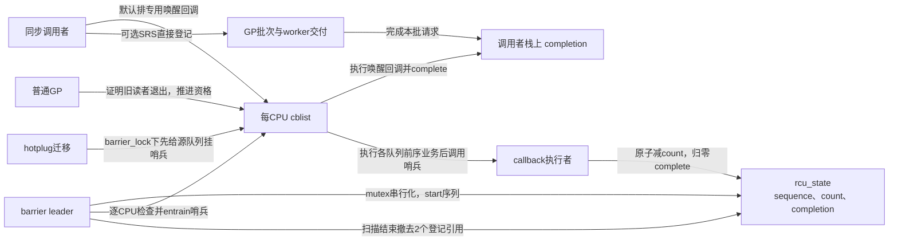
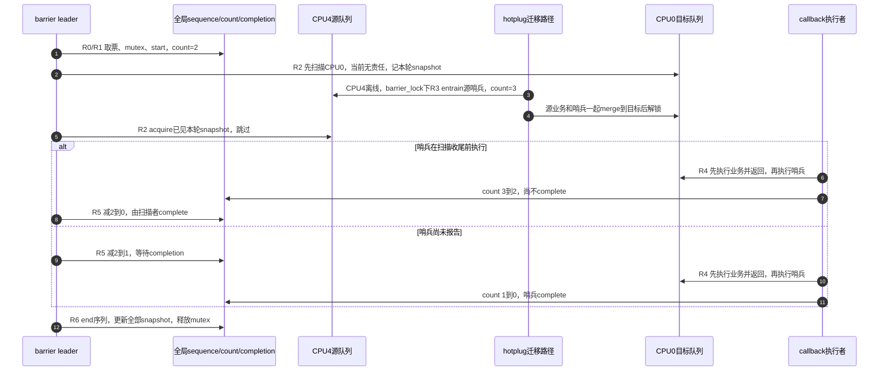

# 第10章\_Linux\_6.12\_Tree\_RCU\_同步等待与rcu\_barrier源码实现

## 10.1\_实现所有权与版本边界

上一阶段已经看见 callback 从入队到 DONE，再到实际函数调用的过程。现在一个模块准备退出：它的旧读者都结束了，但回调仍可能停在 DONE，函数地址还指向模块代码。如果此时释放代码，后续执行者就会跳到失效地址。这里需要等待的已不是另一轮读者证明，而是先前回调实际执行完毕。

本章从这个缺口比较 `synchronize_rcu()` 与 `rcu_barrier()`，再沿每 CPU 哨兵、全局计数和热插拔交接解释 barrier 怎样证明没有漏等。退出前还必须关闭新生产入口并排除在途生产者；barrier 不会禁止未来再登记回调，也不自动等待回调派生的其他异步工作。

为了保持一个函数体一个权威位置：

- `wakeme_after_rcu()` 与通用 `__wait_rcu_gp()` 函数体仍由 [P02 等待桥](P02_Linux_6.12_Tree_RCU_等待桥_QS与节点汇聚关键函数源码实现.md#2.3_同步调用怎样借回调等待GP结束)展开；
- SRS 直接 GP wake 的请求划批由 [P14 SRS 请求入口](P14_Linux_6.12_Tree_RCU_同步等待批处理源码实现.md#14.3_请求登记与dummy节点怎样划定本轮)展开，cleanup 与 workqueue 交付由 [P14 SRS 完成路径](P14_Linux_6.12_Tree_RCU_同步等待批处理源码实现.md#14.4_cleanup与workqueue怎样分担交付)展开；
- callback 分段与批次由 [P09 回调实现](P09_Linux_6.12_Tree_RCU_回调分段与批处理源码实现.md#9.3_一条链表怎样表达四段)展开，旁路与卸载交接见 [P15 NOCB](P15_Linux_6.12_Tree_RCU_NOCB队列与执行交接源码实现.md#15.3_nocb_bypass怎样降低生产者锁竞争又避免搁浅)；
- 本章只在调用点解释它们如何组成同步/barrier 协议。

源码基线：NXP Linux 6.12.20 固定提交 `dfaf2136deb2af2e60b994421281ba42f1c087e0`，阅读 `CONFIG_TREE_RCU` 对应实现，抢占和 NOCB 分支分别受配置限制；未据此确认当前目标配置。上游相对位置：[`kernel/rcu/tree.c`](../../linux/kernel/rcu/tree.c)、[`kernel/rcu/update.c`](../../linux/kernel/rcu/update.c)、[`kernel/rcu/tree.h`](../../linux/kernel/rcu/tree.h)。

概念入口：[同步等待与 rcu_barrier 模块源码概念导读](../navigation/P08_Linux_6.12_Tree_RCU_同步等待与rcu_barrier模块源码概念导读.md#8.1_等RCU至少有三种不同对象)。稳定正文：[Tree RCU 同步等待与 rcu_barrier](../../../../knowledge/linux/synchronization_and_asynchrony/synchronization/rcu/P13_Tree_RCU_同步等待与rcu_barrier.md#13.3_四个相近接口等待什么)。

## 10.2\_源码符号覆盖账本

| 唯一展开符号 | 本章标题 | 核心副作用 |
| --- | --- | --- |
| `rcu_blocking_is_gp()`、`synchronize_rcu()` | [10.4](#10.4_synchronize_rcu怎样选择普通expedited或早期空GP) | 合法上下文检查、普通/expedited/早期退化分流 |
| `synchronize_rcu_normal()` 调用关系 | [10.5](#10.5_默认分支为何等待调用者自己的completion) | 在 P02 默认 callback wait 与 P14 SRS 唯一实现之间分流；本章不复制函数体 |
| `rcu_barrier_callback()` | [10.6](#10.6_barrier_callback与entrain如何证明队列前序已执行) | 哨兵执行、原子减计数、最后者 complete |
| `rcu_barrier_entrain()`、`rcu_segcblist_entrain()` | [10.6](#10.6_barrier_callback与entrain如何证明队列前序已执行) | flush bypass、队尾挂哨兵、更新 per-CPU snapshot |
| `rcu_barrier_handler()`、`rcu_rdp_cpu_online()` | [10.7](#10.7_barrier_lock怎样封住CPU热插拔与迁移竞态) | 在线目标 CPU 本地 IRQ 上下文登记哨兵 |
| `rcu_barrier()` | [10.8](#10.8_rcu_barrier怎样扫描所有队列并等待真实执行) | leader/follower、全 CPU 扫描、登记期护栏与完成发布 |

## 10.3\_两个等待证明不能相互替代

读者退出证明由 GP 提供；回调完成证明还依赖队列的实际执行。比如 A 已进 DONE 但执行线程被更高优先级任务长期挤占，新的 GP 可以继续完成，A 仍没有运行。同步 API 的名字相似，不能因此交换它们的等待对象。



图中只展开普通同步路径；expedited 分支在下一节说明，不用其独立完成序列替普通 callback 成熟。默认同步与 barrier 都可能借助 callback，但前者只安排自己的唤醒节点，后者要覆盖所有相关队列。可选 SRS 则直接交付同步等待者，不改变其旧读者覆盖契约。

| 状态地址 | 谁写、谁读取 | 作用与生命周期 |
| --- | --- | --- |
| 调用者栈上 `rcu_synchronize.head/completion` | 同步调用者初始化；专用回调或 SRS 完成路径交付 | 活到自身完成交接，区别于全局 barrier completion |
| `rcu_state.barrier_sequence` | leader start/end；调用者 snapshot 与去重检查 | barrier 代次，独立于普通 GP 序列；静态初值为 0 |
| `rcu_state.barrier_mutex` | 全部 barrier 调用者 | 串行化整轮和预分配哨兵复用 |
| `rcu_state.barrier_lock` | leader、目标 handler、hotplug 迁移 | 保护登记与迁移交界，不包住业务函数执行 |
| `rcu_state.barrier_cpu_count` | leader 设 2、登记加 1、哨兵减 1、扫描末减 2 | 未报告哨兵加登记引用，并非在线 CPU 数 |
| `rcu_state.barrier_completion` | leader 每轮初始化；最后减到 0 者 complete | leader 等待整体覆盖证明 |
| `rdp->barrier_seq_snap` | 登记路径发布，扫描 acquire 读取；轮末归一 | 每 CPU 本轮是否已处理，随 `rdp` 存在 |
| `rdp->barrier_head` | 登记设函数，执行器调用，轮次串行复用 | 每 CPU 预分配哨兵，迁移时可随源队列搬走 |

这些状态没有汇总成单一“RCU 已同步”位。读者代际、回调资格、实际执行和 barrier 轮次各自回答不同问题，后文用 R0～R6 把它们的交接固定下来。

## 10.4\_synchronize\_rcu怎样选择普通expedited或早期空GP

```c
/**
 * @brief 按固定版本保留完整语句，核对本轮等待责任与完成发布。
 * @note 中文说明为仓库补充；下方保留 kernel/rcu/tree.c 函数的完整语句，省去原英文注释。
 */
static int rcu_blocking_is_gp(void)
{
	if (rcu_scheduler_active != RCU_SCHEDULER_INACTIVE) {
		might_sleep();
		return false;
	}
	return true;
}

/**
 * @brief 按固定版本保留完整语句，核对本轮等待责任与完成发布。
 * @note 中文说明为仓库补充；下方保留 kernel/rcu/tree.c 函数的完整语句，省去原英文注释。
 */
void synchronize_rcu(void)
{
	unsigned long flags;
	struct rcu_node *rnp;

	RCU_LOCKDEP_WARN(lock_is_held(&rcu_bh_lock_map) ||
			 lock_is_held(&rcu_lock_map) ||
			 lock_is_held(&rcu_sched_lock_map),
			 "Illegal synchronize_rcu() in RCU read-side critical section");
	if (!rcu_blocking_is_gp()) {
		if (rcu_gp_is_expedited())
			synchronize_rcu_expedited();
		else
			synchronize_rcu_normal();
		return;
	}

	rcu_poll_gp_seq_start_unlocked(&rcu_state.gp_seq_polled_snap);
	rcu_poll_gp_seq_end_unlocked(&rcu_state.gp_seq_polled_snap);

	local_irq_save(flags);
	WARN_ON_ONCE(num_online_cpus() > 1);
	rcu_state.gp_seq += (1 << RCU_SEQ_CTR_SHIFT);
	for (rnp = this_cpu_ptr(&rcu_data)->mynode; rnp; rnp = rnp->parent)
		rnp->gp_seq_needed = rnp->gp_seq = rcu_state.gp_seq;
	local_irq_restore(flags);
}
```

`rcu_blocking_is_gp()` 的实际判断是调度器启动状态，不是检查编译配置是否同时 `!CONFIG_PREEMPT && !CONFIG_SMP`。早期 `INACTIVE` 阶段还未创建通常的多任务并发环境，代码沿启动 CPU 路径记录退化 GP，其他同类推进只能完全嵌套；源码注释中的 `!PREEMPT && !SMP` 描述这段代码运行时的早期条件，不能解释成整个内核必须以这两个选项关闭来构建。

这条分支推进 poll 状态和启动 CPU 到根的节点序列，其余节点由调度器启动路径接续。进入 INIT/RUNNING 后捷径关闭，`might_sleep()` 执行上下文诊断；告警不是阻止非法调用继续运行的安全修复。正常调用必须先满足可阻塞、未处于自身等待的 RCU 读侧等契约。

`rcu_gp_is_expedited()` 是全局运行策略，不表示调用者显式调用 expedited API；普通公开 API可能按策略转 expedited。两条路径都满足旧读者覆盖契约，但 expedited 使用自己的代次与汇聚路径，不会单凭 expedited 完成就把普通 callback 推入 DONE。

## 10.5\_默认分支为何等待调用者自己的completion

下面是调用关系示意，不是第二份裁剪源码；`synchronize_rcu_normal()` 的唯一函数体在 [P14 SRS 实现](P14_Linux_6.12_Tree_RCU_同步等待批处理源码实现.md#14.3_请求登记与dummy节点怎样划定本轮)：

```text
synchronize_rcu_normal()
├── rcu_normal_wake_from_gp == 0（默认）
│   └── wait_rcu_gp(call_rcu_hurry)
│       └── __wait_rcu_gp()建立栈上rcu_synchronize
│           └── callback执行wakeme_after_rcu()并complete
└── rcu_normal_wake_from_gp != 0（可选）
    ├── 初始化栈上head与completion
    ├── rcu_sr_normal_add_req()
    ├── start_poll_synchronize_rcu()提出GP需求
    └── GP init/cleanup按批次complete
```

默认分支 `wait_rcu_gp(call_rcu_hurry)` 展开为 `__wait_rcu_gp()`：调用者栈上 `rs.head` 被排入 callback 队列，`rs.completion` 只属于该调用者；callback 走到执行点后 `wakeme_after_rcu()` 用 `container_of()` 找回 `rs` 并 complete。等待者等到的是 `complete` 的交接，不能说它一直睡到整个 callback 已返回。`wakeme_after_rcu()` 在调用 `complete()` 以后不再访问 `rs`，执行器调用前已取走链节点、调用后也不再读取该业务对象，因此等待者被唤醒并离开栈不依赖回调已经完成函数返回指令。相反，若修改唤醒回调，在 complete 之后再读 `rs->head`，就可能访问已失效的栈。

默认分支实际比“只等 GP sequence”多走一步 callback 执行，但 API 契约仍只承诺 reader 覆盖，不承诺系统其他 callback 全部执行。专用唤醒 callback 只证明排在它自身前的相应队列进展，不能替代全 CPU `rcu_barrier()`。

可选 `rcu_normal_wake_from_gp=1` 分支不排 callback，而把 `rs` 加入 SRS 请求链；GP init 划定批次，cleanup/work 直接 complete。`start_poll_synchronize_rcu()` 负责确保有一轮 GP需求，SRS 请求链负责谁在完成点被唤醒。两个职责不能压成一个 sequence 比较。

## 10.6\_barrier\_callback与entrain如何证明队列前序已执行

barrier 利用每个队列的前序执行关系：在已有业务责任之后插入一个哨兵，哨兵执行时即可报告这条队列的前序业务已经返回。与普通 enqueue 进入 NEXT 不同，entrain 会沿用最后一个非空段的资格，不强求额外 GP；最后一个哨兵或扫描收尾者把全局计数减到 0 时完成等待。

### 10.6.1\_哨兵执行

```c
/**
 * @brief 按固定版本保留完整语句，核对本轮等待责任与完成发布。
 * @note 中文说明为仓库补充；下方保留 kernel/rcu/tree.c 函数的完整语句，省去原英文注释。
 */
static void rcu_barrier_callback(struct rcu_head *rhp)
{
	unsigned long __maybe_unused s = rcu_state.barrier_sequence;

	rhp->next = rhp;
	if (atomic_dec_and_test(&rcu_state.barrier_cpu_count)) {
		rcu_barrier_trace(TPS("LastCB"), -1, s);
		complete(&rcu_state.barrier_completion);
	} else {
		rcu_barrier_trace(TPS("CB"), -1, s);
	}
}
```

先 snapshot `barrier_sequence` 再减计数，是因为其他哨兵可能随后归零并让下一轮开始；trace 若后读全局 sequence 会把旧 callback 错记到新轮。`rhp->next = rhp` 在减数以前完成，减数以后不再访问预分配哨兵节点。

barrier 保证前序业务回调完成，不需要再等待内部哨兵的所有函数尾声：其他哨兵可以尚在做 trace，最后者调用 complete 后也可能尚未返回。只有节点的最后访问先于完成交接，下一轮复用才成立，不能用“所有内部哨兵已经 return”来解释生命周期安全。

### 10.6.2\_队尾entrain

```c
/**
 * @brief 按固定版本保留完整语句，核对本轮等待责任与完成发布。
 * @note 中文说明为仓库补充；下方保留 kernel/rcu/tree.c 函数的完整语句，省去原英文注释。
 */
static void rcu_barrier_entrain(struct rcu_data *rdp)
{
	unsigned long gseq = READ_ONCE(rcu_state.barrier_sequence);
	unsigned long lseq = READ_ONCE(rdp->barrier_seq_snap);
	bool wake_nocb = false;
	bool was_alldone = false;

	lockdep_assert_held(&rcu_state.barrier_lock);
	if (rcu_seq_state(lseq) || !rcu_seq_state(gseq) || rcu_seq_ctr(lseq) != rcu_seq_ctr(gseq))
		return;
	rcu_barrier_trace(TPS("IRQ"), -1, rcu_state.barrier_sequence);
	rdp->barrier_head.func = rcu_barrier_callback;
	debug_rcu_head_queue(&rdp->barrier_head);
	rcu_nocb_lock(rdp);

	was_alldone = rcu_rdp_is_offloaded(rdp) && !rcu_segcblist_pend_cbs(&rdp->cblist);
	WARN_ON_ONCE(!rcu_nocb_flush_bypass(rdp, NULL, jiffies, false));
	wake_nocb = was_alldone && rcu_segcblist_pend_cbs(&rdp->cblist);
	if (rcu_segcblist_entrain(&rdp->cblist, &rdp->barrier_head)) {
		atomic_inc(&rcu_state.barrier_cpu_count);
	} else {
		debug_rcu_head_unqueue(&rdp->barrier_head);
		rcu_barrier_trace(TPS("IRQNQ"), -1, rcu_state.barrier_sequence);
	}
	rcu_nocb_unlock(rdp);
	if (wake_nocb)
		wake_nocb_gp(rdp, false);
	smp_store_release(&rdp->barrier_seq_snap, gseq);
}
```

先解释上层去重条件：`gseq` 必须是进行态，`lseq` 必须是同代数的结束态；若本 CPU 已记为进行态就不再登记。成功处理后 release 发布本轮 `gseq`，扫描 acquire 看见即可跳过。队列锁在加 `barrier_cpu_count` 之前仍未释放，所以该哨兵不能抢先执行而漏掉其计数。

底层 `rcu_segcblist_entrain()` 只在保守总数非零时添加哨兵，然后从 NEXT 向 DONE 找最后一个非空段，更新该段数和后续共享边界。它的完整实现位于 `kernel/rcu/rcu_segcblist.c`：

```c
/**
 * @brief 沿用最后一段资格；主链为空而总数非零时仍可登记 DONE 哨兵。
 * @note 中文说明为仓库补充；下方保留 kernel/rcu/rcu_segcblist.c 函数的完整语句，省去原英文注释。
 */
bool rcu_segcblist_entrain(struct rcu_segcblist *rsclp,
			   struct rcu_head *rhp)
{
	int i;

	if (rcu_segcblist_n_cbs(rsclp) == 0)
		return false;
	rcu_segcblist_inc_len(rsclp);
	smp_mb();
	rhp->next = NULL;
	for (i = RCU_NEXT_TAIL; i > RCU_DONE_TAIL; i--)
		if (!rcu_segcblist_segempty(rsclp, i))
			break;
	rcu_segcblist_inc_seglen(rsclp, i);
	WRITE_ONCE(*rsclp->tails[i], rhp);
	for (; i <= RCU_NEXT_TAIL; i++)
		WRITE_ONCE(rsclp->tails[i], &rhp->next);
	return true;
}
```

特殊情况是 **主链空，但总数非零**：旧回调已经提取到执行者私有批次，尚未结算。循环此时落到 DONE，哨兵进入主链 DONE；同一队列执行者必须先完成手中的旧批次，余项也回插在 DONE 前部，随后才可能执行哨兵。因此证明依赖串行执行责任，不是哨兵与所有旧节点始终物理相邻。

总数为零时直接返回 false，barrier 不插哨兵、不增全局计数，但仍可发布“这个 CPU 已处理本轮”。所以空系统上的 `rcu_barrier()` 可以不等待任何 GP；不能用它代替 `synchronize_rcu()`。

NOCB bypass 必须先 flush：bypass 里的节点逻辑上更早，但不在分段链上；若先给 cblist 挂哨兵再 flush，业务 callback 可能排到哨兵之后而被漏等。`was_alldone/wake_nocb` 检查的是主链此前没有 pending、flush 以后出现 pending，不是整条主链必然从空变非空；它原来可以已有 DONE。此时叫醒 NOCB GP 管理者，避免继续等可能很迟的 lazy timer。

## 10.7\_barrier\_lock怎样封住CPU热插拔与迁移竞态

```c
/**
 * @brief 按固定版本保留完整语句，核对本轮等待责任与完成发布。
 * @note 中文说明为仓库补充；下方保留 kernel/rcu/tree.c 函数的完整语句，省去原英文注释。
 */
static void rcu_barrier_handler(void *cpu_in)
{
	uintptr_t cpu = (uintptr_t)cpu_in;
	struct rcu_data *rdp = per_cpu_ptr(&rcu_data, cpu);

	lockdep_assert_irqs_disabled();
	WARN_ON_ONCE(cpu != rdp->cpu);
	WARN_ON_ONCE(cpu != smp_processor_id());
	raw_spin_lock(&rcu_state.barrier_lock);
	rcu_barrier_entrain(rdp);
	raw_spin_unlock(&rcu_state.barrier_lock);
}
```

目标 handler 在本 CPU IRQ 禁用环境重新取得 `barrier_lock` 后登记。发起者必须先放开此锁才能调用同步的 `smp_call_function_single(..., 1)`；否则它等待 handler 返回，handler 又等它手中的锁，会形成自造死锁。

在线分支使用的是 RCU 自己的在线视图：

```c
/**
 * @brief 依据 RCU 叶节点的下一次在线集合判断该 CPU 的交接状态。
 * @note 中文说明为仓库补充；下方保留 kernel/rcu/tree.c 函数的完整语句，省去原英文注释。
 */
static bool rcu_rdp_cpu_online(struct rcu_data *rdp)
{
	return !!(rdp->grpmask & rcu_rnp_online_cpus(rdp->mynode));
}
```

`rcu_rnp_online_cpus(rdp->mynode)` 读取叶节点 `qsmaskinitnext`，再与该 CPU 的 `grpmask` 相交。它不是直接读取全局 `cpu_online_mask`，也不是当前 GP 的未偿还 `qsmask`。若发 IPI 时 CPU 状态已变化，发送失败就等待一个 jiffy 后重试，重新检查 snapshot、长度和在线状态；这不是靠固定等待保证“硬件一定完成”。

更隐蔽的窗口是目标 CPU0 已扫描、源 CPU4 尚未扫描，源此时离线并把回调搬到 CPU0。如果只搬队列，后续看 CPU4 已空、CPU0 又不重扫，旧回调就漏出覆盖。`rcutree_migrate_callbacks()` 因而也持 `barrier_lock`，merge 前先对源调用 entrain，把本轮哨兵随源责任一起搬走。源已登记本轮时去重早退，未有 barrier 或代数不匹配时也不乱插新哨兵。

迁移的完整函数体见 [CPU 热插拔实现](P06_Linux_6.12_Tree_RCU_拓扑与CPU热插拔源码实现.md#6.7_rcutree_migrate_callbacks保持成熟边界与barrier证明)。`barrier_lock` 只把本轮扫描、源哨兵登记与迁移组成有序交界，不保护业务函数执行，也没有在整轮持有 `cpus_read_lock()` 冻结热插拔。NOCB 队列另遵守其自身锁和线程所有权协议。

## 10.8\_rcu\_barrier怎样扫描所有队列并等待真实执行

```c
/**
 * @brief 按固定版本保留完整语句，核对本轮等待责任与完成发布。
 * @note 中文说明为仓库补充；下方保留 kernel/rcu/tree.c 函数的完整语句，省去原英文注释。
 */
void rcu_barrier(void)
{
	uintptr_t cpu;
	unsigned long flags;
	unsigned long gseq;
	struct rcu_data *rdp;
	unsigned long s = rcu_seq_snap(&rcu_state.barrier_sequence);

	rcu_barrier_trace(TPS("Begin"), -1, s);

	mutex_lock(&rcu_state.barrier_mutex);

	if (rcu_seq_done(&rcu_state.barrier_sequence, s)) {
		rcu_barrier_trace(TPS("EarlyExit"), -1, rcu_state.barrier_sequence);
		smp_mb();
		mutex_unlock(&rcu_state.barrier_mutex);
		return;
	}

	raw_spin_lock_irqsave(&rcu_state.barrier_lock, flags);
	rcu_seq_start(&rcu_state.barrier_sequence);
	gseq = rcu_state.barrier_sequence;
	rcu_barrier_trace(TPS("Inc1"), -1, rcu_state.barrier_sequence);

	init_completion(&rcu_state.barrier_completion);
	atomic_set(&rcu_state.barrier_cpu_count, 2);
	raw_spin_unlock_irqrestore(&rcu_state.barrier_lock, flags);

	for_each_possible_cpu(cpu) {
		rdp = per_cpu_ptr(&rcu_data, cpu);
retry:
		if (smp_load_acquire(&rdp->barrier_seq_snap) == gseq)
			continue;
		raw_spin_lock_irqsave(&rcu_state.barrier_lock, flags);
		if (!rcu_segcblist_n_cbs(&rdp->cblist)) {
			WRITE_ONCE(rdp->barrier_seq_snap, gseq);
			raw_spin_unlock_irqrestore(&rcu_state.barrier_lock, flags);
			rcu_barrier_trace(TPS("NQ"), cpu, rcu_state.barrier_sequence);
			continue;
		}
		if (!rcu_rdp_cpu_online(rdp)) {
			rcu_barrier_entrain(rdp);
			WARN_ON_ONCE(READ_ONCE(rdp->barrier_seq_snap) != gseq);
			raw_spin_unlock_irqrestore(&rcu_state.barrier_lock, flags);
			rcu_barrier_trace(TPS("OfflineNoCBQ"), cpu, rcu_state.barrier_sequence);
			continue;
		}
		raw_spin_unlock_irqrestore(&rcu_state.barrier_lock, flags);
		if (smp_call_function_single(cpu, rcu_barrier_handler, (void *)cpu, 1)) {
			schedule_timeout_uninterruptible(1);
			goto retry;
		}
		WARN_ON_ONCE(READ_ONCE(rdp->barrier_seq_snap) != gseq);
		rcu_barrier_trace(TPS("OnlineQ"), cpu, rcu_state.barrier_sequence);
	}

	if (atomic_sub_and_test(2, &rcu_state.barrier_cpu_count))
		complete(&rcu_state.barrier_completion);

	wait_for_completion(&rcu_state.barrier_completion);

	rcu_barrier_trace(TPS("Inc2"), -1, rcu_state.barrier_sequence);
	rcu_seq_end(&rcu_state.barrier_sequence);
	gseq = rcu_state.barrier_sequence;
	for_each_possible_cpu(cpu) {
		rdp = per_cpu_ptr(&rcu_data, cpu);

		WRITE_ONCE(rdp->barrier_seq_snap, gseq);
	}

	mutex_unlock(&rcu_state.barrier_mutex);
}
```

### 10.8.1\_leader与follower

每个调用者在拿 mutex 前 snapshot。只有排队期间已有轮次覆盖该目标，拿锁后的 `rcu_seq_done()` 才允许屏障后早退；“看到另一个 barrier 正在运行”本身不够。

例如结束值为 0 时，A、B 都先取到目标 4，A 随后 start 到 1 并完成到 4，B 才能复用。C 若在进行值 1 时才取票，其目标是 8，不能拿本轮完成值 4 返回，因为本轮可能已经扫描过某 CPU，而 C 之前的新回调还未被覆盖。这里低两位为状态，数值例子用于说明代次条件，不是 API 可依赖的等待次数。

### 10.8.2\_为什么初始计数为2

扫描尚未结束时，刚 entrain 的哨兵可能立即执行。如果计数从 0 起步，第一个 callback 会减到错误值或过早 complete。两个临时引用表示“登记阶段仍在进行”；每个真正哨兵再加一。扫描完统一减 2，剩余值恰是未执行哨兵数；没有任何 callback 时减 2 直接归零完成。

### 10.8.3\_为什么遍历possible\_CPU

RCU 视图下已经离线的 CPU，在交接窗口仍可能有未迁走的普通队列；NOCB 队列还可由卸载线程继续负责。因此只遍历 online CPU 会漏责任。对 RCU 视图在线的项用目标 handler，对离线项在当前 CPU 持锁直接 entrain；是否 isolated 并不改变这个判断条件。

### 10.8.4\_完成发布

登记结束且哨兵计数归零后，leader `rcu_seq_end()`，再把每 CPU snapshot 更新到 end 值，最后放 mutex。下一 leader 因而看到一致的轮次边界，且旧哨兵已经停止访问自身节点。前序业务回调已完成；内部哨兵函数尾声可能尚在执行，这与节点可复用并不矛盾。

## 10.9\_端到端源码时序

把分散队列的局部证据汇成全局结果，需要同时观察登记状态、哨兵执行和轮次发布。下面 R4 可发生在 R2/R3 之间，不是扫描结束后的固定阶段。

| 阶段 | 写入者与状态 | 通信与退出条件 |
| --- | --- | --- |
| R0 取票 | 调用者 snapshot 后取 mutex | 已有完成覆盖则屏障后返回，否则成为 leader |
| R1 开始 | leader 持 barrier_lock start、初始化 completion、count=2 | 登记窗口打开，迁移可识别本轮 |
| R2 扫描 | leader 读 per-CPU snapshot 和总数 | 已处理或无责任则跳过，否则选择 handler/直接路径 |
| R3 登记 | entrain 在锁内 flush、插哨兵、加计数、发布 snapshot | 本队列旧责任被覆盖，包括迁移中的源责任 |
| R4 报告 | 执行者先完成旧业务，再运行哨兵减数 | 本队列证据汇入全局，归零者 complete |
| R5 关闭登记 | leader 减 2 并等待 completion | 不再有本轮新登记，且全部已登记责任报告 |
| R6 发布 | leader end、归一 per-CPU snapshot、释放 mutex | 后继者可以复用已覆盖代次或开始下一轮 |



第 2～4 步是迁移最容易漏等的窗口：目标已经扫描，源尚未扫描；源先挂哨兵再搬运，才让第 5 步跳过仍然安全。两个分支则说明 complete 的执行者取决于最后撤去的是哨兵责任还是登记引用。若所有队列本来都没有责任，R3/R4 可以完全不发生，由 R5 的 2→0 直接交付。

## 10.10\_修改与验证边界

先关闭生产并等在途 producer，再选择需要的等待对象；barrier 自身不会替模块执行这项退出协议。

1. `synchronize_rcu()` 与 `rcu_barrier()` 的等待对象不能互换；
2. 默认同步等待者的栈对象必须活到专用 callback complete；
3. SRS dummy 节点只划分批次，调用者仍睡自己的 completion；
4. barrier 每 CPU哨兵必须位于所有既有 callback 后方；
5. NOCB bypass 必须先 flush 再 entrain；
6. `barrier_cpu_count=2` 的登记阶段护栏不能改成从 0 起步；
7. 在线 IPI失败必须重试并重新观察 hotplug；
8. callback migration 必须与 barrier 扫描共享 `barrier_lock` 并先 entrain 源队列；
9. per-CPU `barrier_seq_snap` 的 release/acquire 用于本轮去重，字段不在 `rcu_state`；
10. follower early exit 必须基于 sequence 覆盖自己的 pre-mutex snapshot；
11. 结束 sequence 前必须已看到所有哨兵实际调用，不可用一轮额外 GP 代替；
12. 并发/错误验证至少覆盖空队列、已提取在途回调、NOCB bypass、CPU offline 迁移、不同取票时刻的 barrier 和立即执行哨兵；这些是验证建议，不是本章已经运行过的压力测试。

练习：主链空、总数为 1，能否跳过该 CPU？不能，可能有已提取回调，entrain 仍须挂 DONE 哨兵。再设总数为 0，但模块仍有 producer 可能明天登记回调，barrier 返回是否允许卸载？也不能；未来生产不在本次覆盖范围内。这两个反例分别检验在途责任与入口关闭。

总索引：[Linux 6.12 RCU 源码总阅读索引](../navigation/P01_Linux_6.12_RCU源码总阅读索引.md#1.4_模块概念导读入口)。
