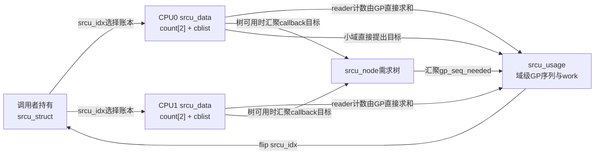
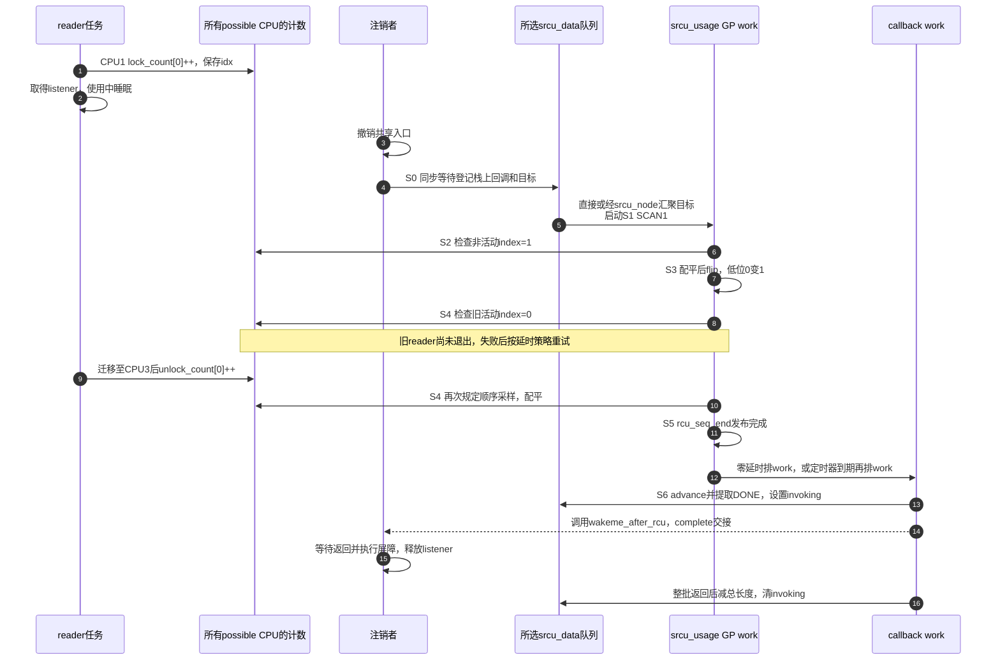

# 第11章\_Linux\_6.12\_Tree\_SRCU源码实现

## 11.1\_实现所有权与版本边界

**讲解层次：实现层。** 本章以 Linux 6.12.20 的 Tree SRCU 为对象。前面的 barrier 已经说明“GP 完成”和“回调执行完”不同；现在把 reader 换成可主动睡眠的 listener 通知任务，继续追踪注销者怎样得到安全释放证据。以下问题连成一轮可执行过程：

1. reader 进入和退出分别把债务写到哪里；
2. reader 睡眠、迁移以后，更新者怎样仍然判断旧 reader 已退出；
3. `call_srcu()` 怎样把 callback 和目标 GP 登记到当前 SRCU 私有域；
4. delayed work 怎样推进 `IDLE→SCAN1→flip→SCAN2→IDLE`；
5. GP 完成怎样使 callback 可执行，并怎样唤醒 `synchronize_srcu()`；
6. `srcu_barrier()` 为什么还要在每条 callback 队列尾部追加哨兵。

模块角色、普通 Tree RCU 与 Tree SRCU 的边界、建议阅读顺序见 [Tree SRCU 模块源码概念导读](../navigation/P09_Linux_6.12_Tree_SRCU模块源码概念导读.md#9.1_先分清Tree_RCU与Tree_SRCU)，跨版本稳定机制和应用选择见 [SRCU 私有域与双 index 状态机](../../../../knowledge/linux/synchronization_and_asynchrony/synchronization/rcu/P18_SRCU_私有域与双_index_状态机.md#18.1_问题场景_注销监听器时不能释放正在睡眠的回调对象)。对照表中的普通 Tree RCU 长期任务与普通 GP 生命周期由 [P05 GP 全局生命周期源码实现](P05_Linux_6.12_Tree_RCU_GP全局生命周期源码实现.md#5.14_端到端源码时序)唯一维护，本章不重复其函数体。

源码基线为 NXP Linux 6.12.20 固定提交 `dfaf2136deb2af2e60b994421281ba42f1c087e0`；本章分析 `CONFIG_TREE_SRCU` 分支，不表示当前目标机已启用该配置。上游相对位置为 [`include/linux/srcu.h`](../../linux/include/linux/srcu.h)、[`include/linux/srcutree.h`](../../linux/include/linux/srcutree.h) 和 [`kernel/rcu/srcutree.c`](../../linux/kernel/rcu/srcutree.c)。本章中的 `/** ... */` 中文 Doxygen 和中文行内注释均由仓库补充，不是上游原注释；函数片段保留所展开函数的完整语句与条件分支，只省去原英文注释。当前工作树配置及内核运行轨迹未在本次核验；源码结论限定于此固定提交。

实例建立、从小域扩展为大域，以及停止使用后释放资源，继续见 [SRCU 生命周期实现](P16_Linux_6.12_Tree_SRCU实例建立扩展与销毁源码实现.md#16.1_一轮GP之外还有实例寿命)。本章先假设实例已经合法建立，闭合 S0～S6 的一次请求。

## 11.2\_源码符号覆盖账本

| 唯一展开符号 | 本章标题 | 主要状态副作用 |
| --- | --- | --- |
| `struct srcu_data/srcu_node/srcu_usage/srcu_struct`、`SRCU_STATE_*` | [11.3](#11.3_四层对象不是一棵reader证明树) | 定义私有域入口、per-CPU reader/callback 状态、callback 需求树与域级 GP 状态 |
| `srcu_read_lock/unlock()`、普通及 NMI-safe 内部原语 | [11.4](#11.4_reader进入退出写的是累计账本) | 选择 index，累计进入/退出，建立临界区边界 |
| `srcu_readers_lock_idx()`、`srcu_readers_unlock_idx()`、`srcu_readers_active_idx_check()` | [11.5](#11.5_GP怎样从分散累计值构造零reader证据) | 跨所有 possible CPU 求和并检查指定 index 是否曾经配平 |
| `srcu_gp_start()`、`try_check_zero()`、`srcu_flip()`、`srcu_advance_state()` | [11.6](#11.6_双扫描GP状态机怎样推进) | 开始 GP、排空非活动 index、翻转、排空旧活动 index |
| `call_srcu()`、`__call_srcu()`、`srcu_gp_start_if_needed()`、普通/加急漏斗 | [11.7](#11.7_callback怎样登记并提出GP需求) | callback 入队、分段加速、沿树汇聚目标、启动 GP work |
| `srcu_gp_end()`、四个调度辅助函数、`srcu_invoke_callbacks()`、`srcu_get_delay()`、`srcu_reschedule()`、`process_srcu()` | [11.8](#11.8_GP完成怎样交付callback并承接下一代) | 发布完成、调度对应 CPU callback work、执行 ready callback、继续或休眠 |
| `srcu_might_be_idle()`、`synchronize_srcu()`、`synchronize_srcu_expedited()`、`__synchronize_srcu()` | [11.9](#11.9_synchronize_srcu怎样把异步callback变成同步等待) | 栈上 completion callback 入队并阻塞当前任务 |
| `srcu_barrier_cb()`、`srcu_barrier_one_cpu()`、`srcu_barrier()` | [11.10](#11.10_srcu_barrier为什么要在每条非空队列后追加哨兵) | 给已有 callback 队列追加哨兵，等待调用前 callback 实际执行 |

以后解释这些函数体时应链接本表中的标题，不在稳定机制正文或模块导读中复制另一套实现。

本章复核每个函数的 **实现原理** 时统一追问四件事：进入前由哪把锁、哪次 index 选择或哪一代序列限定上下文；函数修改哪个具体地址；后续由哪个 reader、GP work、callback work 或等待者读取；这段顺序封住的是漏记 reader、丢失 GP 请求、跨代 callback，还是过早完成 barrier。后续各节都按这四项解释，不能用函数名直译代替状态与通信过程。

## 11.3\_四层对象不是一棵reader证明树

Tree SRCU 把 reader 累计值、callback 队列、需求汇聚和域级 GP 控制放在 per-CPU、节点、usage 与公开域四层对象中。小域仍为每个 possible CPU 分配 reader 账本，但把 callback 暂集中到 boot CPU；只有请求量需要分散时才使用节点树。因此应先核对所有权，再解释 `srcu_gp_seq` 低位状态，避免把它们误画成普通 Tree RCU 的 `qsmask` 证明树。

### 11.3.1\_结构体之间的所有权

```c
/** @brief 每 CPU 的累计账本、回调队列及其执行与定时载体。 中文说明为仓库补充。 */
struct srcu_data {
	atomic_long_t srcu_lock_count[2];
	atomic_long_t srcu_unlock_count[2];
	int srcu_nmi_safety;
	spinlock_t __private lock ____cacheline_internodealigned_in_smp;
	struct rcu_segcblist srcu_cblist;
	unsigned long srcu_gp_seq_needed;
	unsigned long srcu_gp_seq_needed_exp;
	bool srcu_cblist_invoking;
	struct timer_list delay_work;
	struct work_struct work;
	struct rcu_head srcu_barrier_head;
	struct srcu_node *mynode;
	unsigned long grpmask;
	int cpu;
	struct srcu_struct *ssp;
};

/** @brief 汇聚回调需求；不保存 reader 的完成证明。 中文说明为仓库补充。 */
struct srcu_node {
	spinlock_t __private lock;
	unsigned long srcu_have_cbs[4];
	unsigned long srcu_data_have_cbs[4];
	unsigned long srcu_gp_seq_needed_exp;
	struct srcu_node *srcu_parent;
	int grplo;
	int grphi;
};

/** @brief 本域的 GP、回调交付、尺寸转换与 barrier 控制。 中文说明为仓库补充。 */
struct srcu_usage {
	struct srcu_node *node;
	struct srcu_node *level[RCU_NUM_LVLS + 1];
	int srcu_size_state;
	struct mutex srcu_cb_mutex;
	spinlock_t __private lock;
	struct mutex srcu_gp_mutex;
	unsigned long srcu_gp_seq;
	unsigned long srcu_gp_seq_needed;
	unsigned long srcu_gp_seq_needed_exp;
	unsigned long srcu_gp_start;
	unsigned long srcu_last_gp_end;
	unsigned long srcu_size_jiffies;
	unsigned long srcu_n_lock_retries;
	unsigned long srcu_n_exp_nodelay;
	bool sda_is_static;
	unsigned long srcu_barrier_seq;
	struct mutex srcu_barrier_mutex;
	struct completion srcu_barrier_completion;
	atomic_t srcu_barrier_cpu_cnt;
	unsigned long reschedule_jiffies;
	unsigned long reschedule_count;
	struct delayed_work work;
	struct srcu_struct *srcu_ssp;
};

/** @brief 公开域入口，连接读侧计数与更新侧控制。 中文说明为仓库补充。 */
struct srcu_struct {
	unsigned int srcu_idx;
	struct srcu_data __percpu *sda;
	struct lockdep_map dep_map;
	struct srcu_usage *srcu_sup;
};
```

这四层要回答四个不同问题：

| 地址 | 谁拥有/写入 | 后续谁读取 | 回答的问题 |
| --- | --- | --- | --- |
| `srcu_struct.srcu_idx` | 本域 GP work 翻转 | 新 reader | 新进入者记到哪一组账 |
| 每 CPU `srcu_data.*count[2]` | reader 在进入/退出时写当前 CPU | GP work 跨所有 CPU 求和 | 某 index 的累计债务是否配平 |
| `srcu_node.srcu_have_cbs[]` | callback 请求漏斗 | GP 完成和 callback 调度路径 | 哪些子树有等待某代 GP 的 callback |
| `srcu_usage.srcu_gp_seq*` | 请求路径与本域 GP work | GP work、callback、poll 和等待者 | 本域正在推进哪一代、还欠到哪一代 |



所以 `srcu_node` 不是“另一个 `rcu_node` reader 证明树”。reader 的安全证据没有逐节点清位，而是 GP work 直接读取所有 possible CPU 上同一 index 的累计值。

### 11.3.2\_域级GP的低位状态

```c
#define SRCU_STATE_IDLE  0
#define SRCU_STATE_SCAN1 1
#define SRCU_STATE_SCAN2 2
```

它们编码在 `srcu_usage.srcu_gp_seq` 的低位。这里没有普通 Tree RCU 的 `RCU_GP_WAIT_FQS`、`qsmask` 或长期 `rcu_gp_kthread()`：每个 SRCU 域用自己的 delayed work 周期性调用 `process_srcu()`。

## 11.4\_reader进入退出写的是累计账本

```c
/**
 * @brief 保留实际控制分支，按正文解释核对状态、锁与交接。
 * @note 中文说明为仓库补充；下方保留 kernel/rcu/srcutree.c 函数的完整语句，省去原英文注释。
 */
int __srcu_read_lock(struct srcu_struct *ssp)
{
	int idx;

	idx = READ_ONCE(ssp->srcu_idx) & 0x1;
	this_cpu_inc(ssp->sda->srcu_lock_count[idx].counter);
	smp_mb(); /* B：先登记进入，再进行受保护访问。 */
	return idx;
}

/**
 * @brief 保留实际控制分支，按正文解释核对状态、锁与交接。
 * @note 中文说明为仓库补充；下方保留 kernel/rcu/srcutree.c 函数的完整语句，省去原英文注释。
 */
void __srcu_read_unlock(struct srcu_struct *ssp, int idx)
{
	smp_mb(); /* C：受保护访问先于退出登记。 */
	this_cpu_inc(ssp->sda->srcu_unlock_count[idx].counter);
}
```

这里使用两个按机器字宽累加、允许回绕的累计量，而不是“进入加一、退出减一”的同一 per-CPU 活跃计数，原因是 reader 可以这样迁移：

```text
CPU1：lock_count[0] += 1
        ↓ 睡眠、唤醒、迁移
CPU3：unlock_count[0] += 1
```

此时 CPU1 的局部差值为 `+1`，CPU3 的局部差值为 `-1`，但全 CPU 总和仍然配平。安全判断只能使用：

```text
Σ所有CPU lock_count[idx] == Σ所有CPU unlock_count[idx]
```

`idx` 不是可选提示，而是债务身份。换域退出、拿当前 `srcu_idx` 代替原返回值，都会破坏账本。普通 `srcu_read_lock/unlock` 还要求同一执行上下文配对，不能让另一个任务或 IRQ 代为退出。另有 `srcu_down_read/up_read` 提供跨上下文的类信号量契约，不能把该例外反推到普通接口。

### 11.4.1\_公开接口与NMI安全路径增加什么约束

前面的两次加一是功能记账。公开接口还检查 NMI 使用方式、登记 Lockdep 依赖，并在退出时检查 `idx` 的取值。这些检查不能代替功能计数：关闭调试后，reader 仍必须遵守同域、同 index 和执行上下文配对要求。

```c
/**
 * @brief 公开普通接口：功能计数之外增加使用检查与依赖登记。
 * @note 中文说明为仓库补充；下方保留 include/linux/srcu.h 函数的完整语句，省去原英文注释。
 */
static inline int srcu_read_lock(struct srcu_struct *ssp) __acquires(ssp)
{
	int retval;

	srcu_check_nmi_safety(ssp, false);
	retval = __srcu_read_lock(ssp);
	srcu_lock_acquire(&ssp->dep_map);
	return retval;
}

/**
 * @brief 公开普通接口：功能计数之外增加使用检查与依赖登记。
 * @note 中文说明为仓库补充；下方保留 include/linux/srcu.h 函数的完整语句，省去原英文注释。
 */
static inline void srcu_read_unlock(struct srcu_struct *ssp, int idx)
	__releases(ssp)
{
	WARN_ON_ONCE(idx & ~0x1);
	srcu_check_nmi_safety(ssp, false);
	srcu_lock_release(&ssp->dep_map);
	__srcu_read_unlock(ssp, idx);
}
```

下面是 `CONFIG_NEED_SRCU_NMI_SAFE` 分支的内部原语。原子读改写保证 NMI 打断时不会丢失一次累加；B/C 的职责仍是把临界区访问放在进入登记之后、退出登记之前。

```c
/**
 * @brief 需要显式 NMI 安全实现时，以原子加一完成累计登记。
 * @note 中文说明为仓库补充；下方保留 kernel/rcu/srcutree.c 函数的完整语句，省去原英文注释。
 */
int __srcu_read_lock_nmisafe(struct srcu_struct *ssp)
{
	int idx;
	struct srcu_data *sdp = raw_cpu_ptr(ssp->sda);

	idx = READ_ONCE(ssp->srcu_idx) & 0x1;
	atomic_long_inc(&sdp->srcu_lock_count[idx]);
	smp_mb__after_atomic();
	return idx;
}

/**
 * @brief 需要显式 NMI 安全实现时，以原子加一完成累计登记。
 * @note 中文说明为仓库补充；下方保留 kernel/rcu/srcutree.c 函数的完整语句，省去原英文注释。
 */
void __srcu_read_unlock_nmisafe(struct srcu_struct *ssp, int idx)
{
	struct srcu_data *sdp = raw_cpu_ptr(ssp->sda);

	smp_mb__before_atomic();
	atomic_long_inc(&sdp->srcu_unlock_count[idx]);
}
```

未启用该配置时，`srcu.h` 的同名 inline 直接调用普通内部原语；是否需要这种指令实现是架构配置边界，不是软件随意选择更快版本的开关。应用如需 NMI-safe 契约，应成对使用公开的 `srcu_read_lock_nmisafe/unlock_nmisafe`，同一域不要混用普通与 NMI-safe 读侧。后文请求和 barrier 使用带双下划线的内部版本，不进行公开接口的 Lockdep 登记，不能照抄成应用绕过检查的办法。

## 11.5\_GP怎样从分散累计值构造零reader证据

更新者按 index 汇总所有 possible CPU 的进入与退出累计值；相等提供的是指定 index 在本次观察区间内曾有无未偿债务时刻的证据，还要经过内存序与双扫描状态机封住并发进入窗口。下面先看求和，再看采样成立后的边界。

### 11.5.1\_求和路径

```c
/**
 * @brief 保留实际控制分支，按正文解释核对状态、锁与交接。
 * @note 中文说明为仓库补充；下方保留 kernel/rcu/srcutree.c 函数的完整语句，省去原英文注释。
 */
static unsigned long srcu_readers_lock_idx(struct srcu_struct *ssp, int idx)
{
	int cpu;
	unsigned long sum = 0;

	for_each_possible_cpu(cpu) {
		struct srcu_data *cpuc = per_cpu_ptr(ssp->sda, cpu);

		sum += atomic_long_read(&cpuc->srcu_lock_count[idx]);
	}
	return sum;
}

/**
 * @brief 保留实际控制分支，按正文解释核对状态、锁与交接。
 * @note 中文说明为仓库补充；下方保留 kernel/rcu/srcutree.c 函数的完整语句，省去原英文注释。
 */
static unsigned long srcu_readers_unlock_idx(struct srcu_struct *ssp, int idx)
{
	int cpu;
	unsigned long mask = 0;
	unsigned long sum = 0;

	for_each_possible_cpu(cpu) {
		struct srcu_data *cpuc = per_cpu_ptr(ssp->sda, cpu);

		sum += atomic_long_read(&cpuc->srcu_unlock_count[idx]);
		if (IS_ENABLED(CONFIG_PROVE_RCU))
			mask = mask | READ_ONCE(cpuc->srcu_nmi_safety);
	}
	WARN_ONCE(IS_ENABLED(CONFIG_PROVE_RCU) && (mask & (mask >> 1)),
		  "Mixed NMI-safe readers for srcu_struct at %ps.\n", ssp);
	return sum;
}

/**
 * @brief 保留实际控制分支，按正文解释核对状态、锁与交接。
 * @note 中文说明为仓库补充；下方保留 kernel/rcu/srcutree.c 函数的完整语句，省去原英文注释。
 */
static bool srcu_readers_active_idx_check(struct srcu_struct *ssp, int idx)
{
	unsigned long unlocks;

	unlocks = srcu_readers_unlock_idx(ssp, idx);

	smp_mb();

	return srcu_readers_lock_idx(ssp, idx) == unlocks;
}
```

这不是把所有 per-CPU 值锁住以后取得的事务快照。先读 unlock、经过全屏障、再读 lock，使已观察的退出不能漏掉对应进入；A/B/C 同时约束 GP 与临界区访问的先后。源码由这些关系证明指定 index 在观察区间中曾经无未偿债务，而不是取得一个“现在所有 CPU 都没有 reader”的原子快照。计数按机器字宽回绕，因此也不能用“永远递增的数学整数”草率证明；固定源码的长注释进一步结合翻转后旧 index 使用次数的界限，论证累计比较的回绕边界。

### 11.5.2\_为什么相等以后还不能立即完成整轮GP

reader 可能已经读取旧 `srcu_idx`，却在增加 `lock_count[old]` 前被抢占。一次扫描恰好相等，不足以说明这个“拿到旧票但尚未记账”的 reader 不会稍后出现。因此 SRCU 不是“一次求和相等就完成”，而是：

1. 先排空当前 **非活动** index；
2. 在屏障约束下翻转 `srcu_idx`；
3. 再排空翻转前的 **活动** index。

第一阶段检查即将重新启用的组，第二阶段检查翻转前的组，屏障把两次检查与读侧访问连起来。**这不保证所有提前读到旧 index 的任务都已返回。** 若任务还没登记、也未开始受保护访问，它可以稍后才继续；协议必须保证它不能在本轮释放后再合法使用旧对象，而不是要求每个拿到旧 index 的任务都被本轮计数看见。应用仍必须先撤销共享入口，并在读侧登记之后取得受保护指针。

## 11.6\_双扫描GP状态机怎样推进

一轮 GP 先排空当前非活动 index，再翻转新 reader 的 index，最后排空旧活动 index。`srcu_advance_state()` 用 delayed work 串联这些阶段，并在每次采样不成立时重新调度，而不是固定睡眠后猜测完成。

### 11.6.1\_开始与翻转

```c
/**
 * @brief 保留实际控制分支，按正文解释核对状态、锁与交接。
 * @note 中文说明为仓库补充；下方保留 kernel/rcu/srcutree.c 函数的完整语句，省去原英文注释。
 */
static void srcu_gp_start(struct srcu_struct *ssp)
{
	int state;

	lockdep_assert_held(&ACCESS_PRIVATE(ssp->srcu_sup, lock));
	WARN_ON_ONCE(ULONG_CMP_GE(ssp->srcu_sup->srcu_gp_seq, ssp->srcu_sup->srcu_gp_seq_needed));
	WRITE_ONCE(ssp->srcu_sup->srcu_gp_start, jiffies);
	WRITE_ONCE(ssp->srcu_sup->srcu_n_exp_nodelay, 0);
	smp_mb();
	rcu_seq_start(&ssp->srcu_sup->srcu_gp_seq);
	state = rcu_seq_state(ssp->srcu_sup->srcu_gp_seq);
	WARN_ON_ONCE(state != SRCU_STATE_SCAN1);
}

/**
 * @brief 保留实际控制分支，按正文解释核对状态、锁与交接。
 * @note 中文说明为仓库补充；下方保留 kernel/rcu/srcutree.c 函数的完整语句，省去原英文注释。
 */
static void srcu_flip(struct srcu_struct *ssp)
{

	smp_mb();

	WRITE_ONCE(ssp->srcu_idx, ssp->srcu_idx + 1);

	smp_mb();
}
```

`srcu_gp_seq_needed > srcu_gp_seq` 表示存在尚未兑现的目标；`rcu_seq_start()` 才表示一轮物理 GP 真正进入 SCAN1。`srcu_idx` 使用递增值而非只写 0/1，选择账本时才取低位；这也为批次观察保留了递增信息。

### 11.6.2\_srcu\_advance\_state串联SCAN1与SCAN2

先看它调用的检查器。`trycount` 是失败后的有限重试预算；第一次相等就返回 true。因此 SCAN2 传入 2 不表示“必须连续两次都为零”。加急且当前允许零延时的时候再增加一次尝试，失败间用微秒级 `udelay` 短等，耗尽后交回 workqueue。

```c
/**
 * @brief 一次成功即可退出，失败才消耗重试次数。
 * @note 中文说明为仓库补充；下方保留 kernel/rcu/srcutree.c 函数的完整语句，省去原英文注释。
 */
static bool try_check_zero(struct srcu_struct *ssp, int idx, int trycount)
{
	unsigned long curdelay;

	curdelay = !srcu_get_delay(ssp);

	for (;;) {
		if (srcu_readers_active_idx_check(ssp, idx))
			return true;
		if ((--trycount + curdelay) <= 0)
			return false;
		udelay(srcu_retry_check_delay);
	}
}
```


```c
/**
 * @brief 保留实际控制分支，按正文解释核对状态、锁与交接。
 * @note 中文说明为仓库补充；下方保留 kernel/rcu/srcutree.c 函数的完整语句，省去原英文注释。
 */
static void srcu_advance_state(struct srcu_struct *ssp)
{
	int idx;

	mutex_lock(&ssp->srcu_sup->srcu_gp_mutex);

	idx = rcu_seq_state(smp_load_acquire(&ssp->srcu_sup->srcu_gp_seq));
	if (idx == SRCU_STATE_IDLE) {
		spin_lock_irq_rcu_node(ssp->srcu_sup);
		if (ULONG_CMP_GE(ssp->srcu_sup->srcu_gp_seq, ssp->srcu_sup->srcu_gp_seq_needed)) {
			WARN_ON_ONCE(rcu_seq_state(ssp->srcu_sup->srcu_gp_seq));
			spin_unlock_irq_rcu_node(ssp->srcu_sup);
			mutex_unlock(&ssp->srcu_sup->srcu_gp_mutex);
			return;
		}
		idx = rcu_seq_state(READ_ONCE(ssp->srcu_sup->srcu_gp_seq));
		if (idx == SRCU_STATE_IDLE)
			srcu_gp_start(ssp);
		spin_unlock_irq_rcu_node(ssp->srcu_sup);
		if (idx != SRCU_STATE_IDLE) {
			mutex_unlock(&ssp->srcu_sup->srcu_gp_mutex);
			return;
		}
	}

	if (rcu_seq_state(READ_ONCE(ssp->srcu_sup->srcu_gp_seq)) == SRCU_STATE_SCAN1) {
		idx = 1 ^ (ssp->srcu_idx & 1);
		if (!try_check_zero(ssp, idx, 1)) {
			mutex_unlock(&ssp->srcu_sup->srcu_gp_mutex);
			return;
		}
		srcu_flip(ssp);
		spin_lock_irq_rcu_node(ssp->srcu_sup);
		rcu_seq_set_state(&ssp->srcu_sup->srcu_gp_seq, SRCU_STATE_SCAN2);
		ssp->srcu_sup->srcu_n_exp_nodelay = 0;
		spin_unlock_irq_rcu_node(ssp->srcu_sup);
	}

	if (rcu_seq_state(READ_ONCE(ssp->srcu_sup->srcu_gp_seq)) == SRCU_STATE_SCAN2) {

		idx = 1 ^ (ssp->srcu_idx & 1);
		if (!try_check_zero(ssp, idx, 2)) {
			mutex_unlock(&ssp->srcu_sup->srcu_gp_mutex);
			return;
		}
		ssp->srcu_sup->srcu_n_exp_nodelay = 0;
		srcu_gp_end(ssp);
	}
}
```

统一状态周期如下：

| 阶段 | 写入地址 | 写入者 | 退出条件 | 下一位读取者 |
| --- | --- | --- | --- | --- |
| S0 请求 | `srcu_data/srcu_node/srcu_usage.srcu_gp_seq_needed` | `call_srcu()`/同步请求路径 | 域级目标大于已完成序列 | `process_srcu()` |
| S1 开始 | `srcu_usage.srcu_gp_seq=SCAN1` | `srcu_gp_start()` | 物理 GP 已标记进行中 | `srcu_advance_state()` |
| S2 SCAN1 | 所有 CPU 的非活动 `count[idx]` | reader 写、GP 读 | lock/unlock 总数配平 | `srcu_flip()` |
| S3 flip | `srcu_struct.srcu_idx` | GP work | 新 reader 改用另一组 | 新 reader 与 SCAN2 |
| S4 SCAN2 | 所有 CPU 的旧活动 `count[idx]` | reader 写、GP 读 | lock/unlock 总数配平 | `srcu_gp_end()` |
| S5 完成 | `srcu_usage.srcu_gp_seq`、callback 调度状态 | `srcu_gp_end()` | 发布完成并安排对应 callback work | callback work/下一代请求 |
| S6 交付 | `srcu_cblist_invoking`、队列长度、completion | callback work | 函数调用或 completion 交接达到各自边界 | 回调生产者或同步等待者 |

## 11.7\_callback怎样登记并提出GP需求

`call_srcu()` 先按尺寸阶段选择分段队列，再把所需代际直接或经 SRCU 节点树汇聚到域级状态，必要时启动 GP work。局部 enqueue、目标绑定和全局唤醒是三个不同通信步骤。

### 11.7.1\_从公开call\_srcu进入所选队列

```c
/**
 * @brief 保留实际控制分支，按正文解释核对状态、锁与交接。
 * @note 中文说明为仓库补充；下方保留 kernel/rcu/srcutree.c 函数的完整语句，省去原英文注释。
 */
static void __call_srcu(struct srcu_struct *ssp, struct rcu_head *rhp,
			rcu_callback_t func, bool do_norm)
{
	if (debug_rcu_head_queue(rhp)) {

		WRITE_ONCE(rhp->func, srcu_leak_callback);
		WARN_ONCE(1, "call_srcu(): Leaked duplicate callback\n");
		return;
	}
	rhp->func = func;
	(void)srcu_gp_start_if_needed(ssp, rhp, do_norm);
}
```

```c
/**
 * @brief 公开异步接口指定普通请求，交出 callback 责任后返回。
 * @note 中文说明为仓库补充；下方保留 kernel/rcu/srcutree.c 函数的完整语句，省去原英文注释。
 */
void call_srcu(struct srcu_struct *ssp, struct rcu_head *rhp,
	       rcu_callback_t func)
{
	__call_srcu(ssp, rhp, func, true);
}
```

`do_norm=true` 表示普通请求，`false` 表示 expedited 请求。两者等待的是相同的旧 reader 安全条件，区别主要在重试延时和 expedited 目标传播，不是另一套 reader 证明。

### 11.7.2\_srcu\_gp\_start\_if\_needed完成四件事

该函数的完整实现较长，但不能压缩成“启动 GP”。它按固定顺序完成：

```c
/**
 * @brief 保留实际控制分支，按正文解释核对状态、锁与交接。
 * @note 中文说明为仓库补充；下方保留 kernel/rcu/srcutree.c 函数的完整语句，省去原英文注释。
 */
static unsigned long srcu_gp_start_if_needed(struct srcu_struct *ssp,
					     struct rcu_head *rhp, bool do_norm)
{
	unsigned long flags;
	int idx;
	bool needexp = false;
	bool needgp = false;
	unsigned long s;
	struct srcu_data *sdp;
	struct srcu_node *sdp_mynode;
	int ss_state;

	check_init_srcu_struct(ssp);

	idx = __srcu_read_lock_nmisafe(ssp);
	ss_state = smp_load_acquire(&ssp->srcu_sup->srcu_size_state);
	if (ss_state < SRCU_SIZE_WAIT_CALL)
		sdp = per_cpu_ptr(ssp->sda, get_boot_cpu_id());
	else
		sdp = raw_cpu_ptr(ssp->sda);
	spin_lock_irqsave_sdp_contention(sdp, &flags);
	if (rhp)
		rcu_segcblist_enqueue(&sdp->srcu_cblist, rhp);

	s = rcu_seq_snap(&ssp->srcu_sup->srcu_gp_seq);
	if (rhp) {
		rcu_segcblist_advance(&sdp->srcu_cblist,
				      rcu_seq_current(&ssp->srcu_sup->srcu_gp_seq));

		WARN_ON_ONCE(!rcu_segcblist_accelerate(&sdp->srcu_cblist, s));
	}
	if (ULONG_CMP_LT(sdp->srcu_gp_seq_needed, s)) {
		sdp->srcu_gp_seq_needed = s;
		needgp = true;
	}
	if (!do_norm && ULONG_CMP_LT(sdp->srcu_gp_seq_needed_exp, s)) {
		sdp->srcu_gp_seq_needed_exp = s;
		needexp = true;
	}
	spin_unlock_irqrestore_rcu_node(sdp, flags);

	if (ss_state < SRCU_SIZE_WAIT_BARRIER)
		sdp_mynode = NULL;
	else
		sdp_mynode = sdp->mynode;

	if (needgp)
		srcu_funnel_gp_start(ssp, sdp, s, do_norm);
	else if (needexp)
		srcu_funnel_exp_start(ssp, sdp_mynode, s);
	__srcu_read_unlock_nmisafe(ssp, idx);
	return s;
}
```

尺寸转换有两个不同门槛，不能笼统写成“转换结束前都在 boot CPU”。树先供 barrier 看见，再允许新请求分散到当前 CPU；中间的 GP 把旧选择者隔开。四个历史槽还没有全部更新前，完成路径保守地调度叶节点范围内的全部 callback work。

| `srcu_size_state` | callback 入队 | barrier 扫描与完成交付 |
| --- | --- | --- |
| `SMALL=0`、`ALLOC=1` | boot CPU 队列 | 只使用 boot CPU 队列；分配期间树尚不可用 |
| `WAIT_BARRIER=2` | 仍为 boot CPU 队列 | 树已发布，barrier 开始扫描全部 possible CPU |
| `WAIT_CALL=3` | 当前 CPU 队列 | 全部队列可见，等待旧入队选择者退出 |
| `WAIT_CBS1～4=4～7` | 当前 CPU 队列 | 等待四个槽逐代刷新，暂不完全信任精确掩码 |
| `BIG=8` | 当前 CPU 队列 | 使用槽的代际与 CPU 掩码选择有需求的队列 |

请求在读取尺寸和序列之前进入内部 SRCU 读侧，退出放在漏斗提交之后。尺寸按 GP 推进，所以这个临时 reader 阻止转换越过仍在使用旧选择的路径；它还防止序列快照在长时间抢占中跨过完整回绕。reader 的安全证明仍由所有 possible CPU 的两组账本完成，与回调入队位置分开。

四个动作不可乱序：

1. `enqueue` 把 callback 所有权交给 `srcu_cblist`；
2. `rcu_seq_snap()` 取得该 callback 的目标代际；
3. `advance/accelerate` 把 callback 移入匹配目标的分段；
4. 只有本地目标被前推时，才沿 `srcu_node` 漏斗向域级提交。

特别是 `snap` 必须早于 `advance`。设 WAIT 段等 `X+4`、NEXT_READY 段等 `X+8`，新回调还在 NEXT。若先 advance，它看到 GP 仍进行中，没有腾出前两段；这时旧 GP 结束、新 GP 又开始，后取的 snap 就可能成为 `X+12`。新回调既不能塞进目标为 `X+8` 的段，又没有空段可用，便可能留在 NEXT，漏掉有效的目标绑定。先 snap 再 advance，把目标选取与后来能腾出的段按正确顺序衔接。四段队列的指针槽语义见 [回调分段实现](P09_Linux_6.12_Tree_RCU_回调分段与批处理源码实现.md#9.5.1_底层分段算法)。

`enqueue` 后就应按所有权已经交给 SRCU 处理，不能假定回调必然晚于 `call_srcu()` 返回才执行。函数内已经发生的锁、屏障和 work 排队也不能压缩为“一个无锁指针插入”。

### 11.7.3\_需求树怎样到达域级控制状态

```c
/**
 * @brief 保留实际控制分支，按正文解释核对状态、锁与交接。
 * @note 中文说明为仓库补充；下方保留 kernel/rcu/srcutree.c 函数的完整语句，省去原英文注释。
 */
static void srcu_funnel_gp_start(struct srcu_struct *ssp, struct srcu_data *sdp,
				 unsigned long s, bool do_norm)
{
	unsigned long flags;
	int idx = rcu_seq_ctr(s) % ARRAY_SIZE(sdp->mynode->srcu_have_cbs);
	unsigned long sgsne;
	struct srcu_node *snp;
	struct srcu_node *snp_leaf;
	unsigned long snp_seq;
	struct srcu_usage *sup = ssp->srcu_sup;

	if (smp_load_acquire(&sup->srcu_size_state) < SRCU_SIZE_WAIT_BARRIER)
		snp_leaf = NULL;
	else
		snp_leaf = sdp->mynode;

	if (snp_leaf)

		for (snp = snp_leaf; snp != NULL; snp = snp->srcu_parent) {
			if (WARN_ON_ONCE(rcu_seq_done(&sup->srcu_gp_seq, s)) && snp != snp_leaf)
				return;
			spin_lock_irqsave_rcu_node(snp, flags);
			snp_seq = snp->srcu_have_cbs[idx];
			if (!srcu_invl_snp_seq(snp_seq) && ULONG_CMP_GE(snp_seq, s)) {
				if (snp == snp_leaf && snp_seq == s)
					snp->srcu_data_have_cbs[idx] |= sdp->grpmask;
				spin_unlock_irqrestore_rcu_node(snp, flags);
				if (snp == snp_leaf && snp_seq != s) {
					srcu_schedule_cbs_sdp(sdp, do_norm ? SRCU_INTERVAL : 0);
					return;
				}
				if (!do_norm)
					srcu_funnel_exp_start(ssp, snp, s);
				return;
			}
			snp->srcu_have_cbs[idx] = s;
			if (snp == snp_leaf)
				snp->srcu_data_have_cbs[idx] |= sdp->grpmask;
			sgsne = snp->srcu_gp_seq_needed_exp;
			if (!do_norm && (srcu_invl_snp_seq(sgsne) || ULONG_CMP_LT(sgsne, s)))
				WRITE_ONCE(snp->srcu_gp_seq_needed_exp, s);
			spin_unlock_irqrestore_rcu_node(snp, flags);
		}

	spin_lock_irqsave_ssp_contention(ssp, &flags);
	if (ULONG_CMP_LT(sup->srcu_gp_seq_needed, s)) {

		smp_store_release(&sup->srcu_gp_seq_needed, s);
	}
	if (!do_norm && ULONG_CMP_LT(sup->srcu_gp_seq_needed_exp, s))
		WRITE_ONCE(sup->srcu_gp_seq_needed_exp, s);

	if (!WARN_ON_ONCE(rcu_seq_done(&sup->srcu_gp_seq, s)) &&
	    rcu_seq_state(sup->srcu_gp_seq) == SRCU_STATE_IDLE) {
		WARN_ON_ONCE(ULONG_CMP_GE(sup->srcu_gp_seq, sup->srcu_gp_seq_needed));
		srcu_gp_start(ssp);

		if (likely(srcu_init_done))
			queue_delayed_work(rcu_gp_wq, &sup->work,
					   !!srcu_get_delay(ssp));
		else if (list_empty(&sup->work.work.entry))
			list_add(&sup->work.work.entry, &srcu_boot_list);
	}
	spin_unlock_irqrestore_rcu_node(sup, flags);
}
```

```c
/**
 * @brief 普通 GP 已有请求时，仅把加急目标继续向上汇聚。
 * @note 中文说明为仓库补充；下方保留 kernel/rcu/srcutree.c 函数的完整语句，省去原英文注释。
 */
static void srcu_funnel_exp_start(struct srcu_struct *ssp, struct srcu_node *snp,
				  unsigned long s)
{
	unsigned long flags;
	unsigned long sgsne;

	if (snp)
		for (; snp != NULL; snp = snp->srcu_parent) {
			sgsne = READ_ONCE(snp->srcu_gp_seq_needed_exp);
			if (WARN_ON_ONCE(rcu_seq_done(&ssp->srcu_sup->srcu_gp_seq, s)) ||
			    (!srcu_invl_snp_seq(sgsne) && ULONG_CMP_GE(sgsne, s)))
				return;
			spin_lock_irqsave_rcu_node(snp, flags);
			sgsne = snp->srcu_gp_seq_needed_exp;
			if (!srcu_invl_snp_seq(sgsne) && ULONG_CMP_GE(sgsne, s)) {
				spin_unlock_irqrestore_rcu_node(snp, flags);
				return;
			}
			WRITE_ONCE(snp->srcu_gp_seq_needed_exp, s);
			spin_unlock_irqrestore_rcu_node(snp, flags);
		}
	spin_lock_irqsave_ssp_contention(ssp, &flags);
	if (ULONG_CMP_LT(ssp->srcu_sup->srcu_gp_seq_needed_exp, s))
		WRITE_ONCE(ssp->srcu_sup->srcu_gp_seq_needed_exp, s);
	spin_unlock_irqrestore_rcu_node(ssp->srcu_sup, flags);
}
```

这个循环从 `sdp->mynode` 向父节点逐层更新对应槽位的 `srcu_have_cbs[idx]`；在叶节点还把 `sdp->grpmask` 写入 `srcu_data_have_cbs[idx]`。若某层已经记录不早于 `s` 的目标，请求者停止向上争锁，由先到达者负责继续传播；若本地 callback 对应的 GP 已完成，则直接调度本 CPU callback work，不再制造多余 GP。

这条通信链是：

```text
call_srcu调用者
  → 当前CPU srcu_data.cblist / gp_seq_needed
  → srcu_node叶到根的需求槽位
  → srcu_usage.srcu_gp_seq_needed
  → srcu_usage.work
```

槽下标是 `rcu_seq_ctr(s) % 4`，先去掉低位状态再按代数循环，不是直接取 `s` 的两个低位。叶节点记录相同目标时合并 CPU 掩码；若叶槽已经越过该目标，就直接安排这条队列的回调 work。祖先已有目标时可以停止争锁，已有请求负责向上传播。`ARRAY_SIZE(sdp->mynode->srcu_have_cbs)` 只计算类型尺寸，不实际读取空 `mynode`，因此小域可在随后分支中跳过树。

`srcu_funnel_exp_start()` 用于普通目标已存在、现在又要求加急的情况。它更新 expedited 目标，不创建另一种 reader 证明，也不向睡眠 reader 发 IPI。树减少重复目标到达域级锁的次数，代价是节点、槽和锁；GP 判断 reader 是否退出时仍扫描 per-CPU 计数。

工作队列尚未建立的早期启动分支把请求连到 `srcu_boot_list`，之后由启动初始化排队。这段无额外链表锁的代码依赖单 boot CPU、关闭中断的早期环境，不能复制到正常并发路径。

## 11.8\_GP完成怎样交付callback并承接下一代

域级 GP 完成只发布代际并选择有工作的 CPU；每 CPU work 才推进并执行 ready callback，域级 work 随后根据剩余需求继续下一轮或休眠。三类执行上下文通过状态和 workqueue 交接，不能把 GP 的完成发布当作 callback 已执行。

### 11.8.1\_srcu\_gp\_end先发布完成再选择有callback的CPU

`srcu_gp_end()` 在 SCAN2 已配平后执行，关键顺序是：

```c
/**
 * @brief 保留实际控制分支，按正文解释核对状态、锁与交接。
 * @note 中文说明为仓库补充；下方保留 kernel/rcu/srcutree.c 函数的完整语句，省去原英文注释。
 */
static void srcu_gp_end(struct srcu_struct *ssp)
{
	unsigned long cbdelay = 1;
	bool cbs;
	bool last_lvl;
	int cpu;
	unsigned long gpseq;
	int idx;
	unsigned long mask;
	struct srcu_data *sdp;
	unsigned long sgsne;
	struct srcu_node *snp;
	int ss_state;
	struct srcu_usage *sup = ssp->srcu_sup;

	mutex_lock(&sup->srcu_cb_mutex);

	spin_lock_irq_rcu_node(sup);
	idx = rcu_seq_state(sup->srcu_gp_seq);
	WARN_ON_ONCE(idx != SRCU_STATE_SCAN2);
	if (ULONG_CMP_LT(READ_ONCE(sup->srcu_gp_seq), READ_ONCE(sup->srcu_gp_seq_needed_exp)))
		cbdelay = 0;

	WRITE_ONCE(sup->srcu_last_gp_end, ktime_get_mono_fast_ns());
	rcu_seq_end(&sup->srcu_gp_seq);
	gpseq = rcu_seq_current(&sup->srcu_gp_seq);
	if (ULONG_CMP_LT(sup->srcu_gp_seq_needed_exp, gpseq))
		WRITE_ONCE(sup->srcu_gp_seq_needed_exp, gpseq);
	spin_unlock_irq_rcu_node(sup);
	mutex_unlock(&sup->srcu_gp_mutex);

	ss_state = smp_load_acquire(&sup->srcu_size_state);
	if (ss_state < SRCU_SIZE_WAIT_BARRIER) {
		srcu_schedule_cbs_sdp(per_cpu_ptr(ssp->sda, get_boot_cpu_id()),
					cbdelay);
	} else {
		idx = rcu_seq_ctr(gpseq) % ARRAY_SIZE(snp->srcu_have_cbs);
		srcu_for_each_node_breadth_first(ssp, snp) {
			spin_lock_irq_rcu_node(snp);
			cbs = false;
			last_lvl = snp >= sup->level[rcu_num_lvls - 1];
			if (last_lvl)
				cbs = ss_state < SRCU_SIZE_BIG || snp->srcu_have_cbs[idx] == gpseq;
			snp->srcu_have_cbs[idx] = gpseq;
			rcu_seq_set_state(&snp->srcu_have_cbs[idx], 1);
			sgsne = snp->srcu_gp_seq_needed_exp;
			if (srcu_invl_snp_seq(sgsne) || ULONG_CMP_LT(sgsne, gpseq))
				WRITE_ONCE(snp->srcu_gp_seq_needed_exp, gpseq);
			if (ss_state < SRCU_SIZE_BIG)
				mask = ~0;
			else
				mask = snp->srcu_data_have_cbs[idx];
			snp->srcu_data_have_cbs[idx] = 0;
			spin_unlock_irq_rcu_node(snp);
			if (cbs)
				srcu_schedule_cbs_snp(ssp, snp, mask, cbdelay);
		}
	}

	if (!(gpseq & counter_wrap_check))
		for_each_possible_cpu(cpu) {
			sdp = per_cpu_ptr(ssp->sda, cpu);
			spin_lock_irq_rcu_node(sdp);
			if (ULONG_CMP_GE(gpseq, sdp->srcu_gp_seq_needed + 100))
				sdp->srcu_gp_seq_needed = gpseq;
			if (ULONG_CMP_GE(gpseq, sdp->srcu_gp_seq_needed_exp + 100))
				sdp->srcu_gp_seq_needed_exp = gpseq;
			spin_unlock_irq_rcu_node(sdp);
		}

	mutex_unlock(&sup->srcu_cb_mutex);

	spin_lock_irq_rcu_node(sup);
	gpseq = rcu_seq_current(&sup->srcu_gp_seq);
	if (!rcu_seq_state(gpseq) &&
	    ULONG_CMP_LT(gpseq, sup->srcu_gp_seq_needed)) {
		srcu_gp_start(ssp);
		spin_unlock_irq_rcu_node(sup);
		srcu_reschedule(ssp, 0);
	} else {
		spin_unlock_irq_rcu_node(sup);
	}

	if (ss_state != SRCU_SIZE_SMALL && ss_state != SRCU_SIZE_BIG) {
		if (ss_state == SRCU_SIZE_ALLOC)
			init_srcu_struct_nodes(ssp, GFP_KERNEL);
		else
			smp_store_release(&sup->srcu_size_state, ss_state + 1);
	}
}
```

S5 内部有三个边界：`rcu_seq_end()` 先发布 GP 完成；释放 `srcu_gp_mutex` 后可以开始下一轮；callback 调度准备仍在 `srcu_cb_mutex` 保护的串行阶段内。后一把锁限制后续完成进度，防止四个需求槽在本轮调度尚未结束时被连续复用，不阻止那一轮新 GP 开始。

中间的低频校正更新的是每 CPU 缓存的 `srcu_gp_seq_needed/needed_exp`，避免长久未使用的目标序列落后太远，**没有清零 reader 的 lock/unlock 账本**。最后按尺寸状态分配树或发布下一阶段；分配失败仍保留待分配状态，不把未构造的树交给请求者。

`srcu_cb_mutex` 不是 reader 安全锁。它限制 callback 调度准备期间最多再启动一轮 GP，使四槽 `srcu_have_cbs[]` 能安全复用。真正的 GP 完成发布是 `rcu_seq_end(&sup->srcu_gp_seq)`。

安排 work 也不是直接调用回调。下面四个辅助函数补齐 S5 到 S6 的通信载体：零延时直接排 `sdp->work`，非零延时调整 `sdp->delay_work` 定时器，到时才由定时器回调排 work。字段名 `delay_work` 在此是 `timer_list`，与域级 `srcu_usage.work` 的 `delayed_work` 类型不同。

```c
/**
 * @brief 把叶节点 CPU 掩码转换为定时器或 callback work 的排队动作。
 * @note 中文说明为仓库补充；下方保留 kernel/rcu/srcutree.c 函数的完整语句，省去原英文注释。
 */
static void srcu_delay_timer(struct timer_list *t)
{
	struct srcu_data *sdp = container_of(t, struct srcu_data, delay_work);

	queue_work_on(sdp->cpu, rcu_gp_wq, &sdp->work);
}

/**
 * @brief 把叶节点 CPU 掩码转换为定时器或 callback work 的排队动作。
 * @note 中文说明为仓库补充；下方保留 kernel/rcu/srcutree.c 函数的完整语句，省去原英文注释。
 */
static void srcu_queue_delayed_work_on(struct srcu_data *sdp,
				       unsigned long delay)
{
	if (!delay) {
		queue_work_on(sdp->cpu, rcu_gp_wq, &sdp->work);
		return;
	}

	timer_reduce(&sdp->delay_work, jiffies + delay);
}

/**
 * @brief 把叶节点 CPU 掩码转换为定时器或 callback work 的排队动作。
 * @note 中文说明为仓库补充；下方保留 kernel/rcu/srcutree.c 函数的完整语句，省去原英文注释。
 */
static void srcu_schedule_cbs_sdp(struct srcu_data *sdp, unsigned long delay)
{
	srcu_queue_delayed_work_on(sdp, delay);
}

/**
 * @brief 把叶节点 CPU 掩码转换为定时器或 callback work 的排队动作。
 * @note 中文说明为仓库补充；下方保留 kernel/rcu/srcutree.c 函数的完整语句，省去原英文注释。
 */
static void srcu_schedule_cbs_snp(struct srcu_struct *ssp, struct srcu_node *snp,
				  unsigned long mask, unsigned long delay)
{
	int cpu;

	for (cpu = snp->grplo; cpu <= snp->grphi; cpu++) {
		if (!(mask & (1UL << (cpu - snp->grplo))))
			continue;
		srcu_schedule_cbs_sdp(per_cpu_ptr(ssp->sda, cpu), delay);
	}
}
```

`timer_reduce()` 可提前已有期限，不用更晚的请求反复延后旧工作。`queue_work_on` 指定关联 CPU；离线等运行条件下不能据此承诺回调必定在该 CPU 执行，安全性依赖队列与锁的所有权。

### 11.8.2\_每CPUwork怎样执行ready\_callback

```c
/**
 * @brief 保留实际控制分支，按正文解释核对状态、锁与交接。
 * @note 中文说明为仓库补充；下方保留 kernel/rcu/srcutree.c 函数的完整语句，省去原英文注释。
 */
static void srcu_invoke_callbacks(struct work_struct *work)
{
	long len;
	bool more;
	struct rcu_cblist ready_cbs;
	struct rcu_head *rhp;
	struct srcu_data *sdp;
	struct srcu_struct *ssp;

	sdp = container_of(work, struct srcu_data, work);

	ssp = sdp->ssp;
	rcu_cblist_init(&ready_cbs);
	spin_lock_irq_rcu_node(sdp);
	WARN_ON_ONCE(!rcu_segcblist_segempty(&sdp->srcu_cblist, RCU_NEXT_TAIL));
	rcu_segcblist_advance(&sdp->srcu_cblist,
			      rcu_seq_current(&ssp->srcu_sup->srcu_gp_seq));

	if (sdp->srcu_cblist_invoking ||
	    !rcu_segcblist_ready_cbs(&sdp->srcu_cblist)) {
		spin_unlock_irq_rcu_node(sdp);
		return;
	}

	sdp->srcu_cblist_invoking = true;
	rcu_segcblist_extract_done_cbs(&sdp->srcu_cblist, &ready_cbs);
	len = ready_cbs.len;
	spin_unlock_irq_rcu_node(sdp);
	rhp = rcu_cblist_dequeue(&ready_cbs);
	for (; rhp != NULL; rhp = rcu_cblist_dequeue(&ready_cbs)) {
		debug_rcu_head_unqueue(rhp);
		debug_rcu_head_callback(rhp);
		local_bh_disable();
		rhp->func(rhp);
		local_bh_enable();
	}
	WARN_ON_ONCE(ready_cbs.len);

	spin_lock_irq_rcu_node(sdp);
	rcu_segcblist_add_len(&sdp->srcu_cblist, -len);
	sdp->srcu_cblist_invoking = false;
	more = rcu_segcblist_ready_cbs(&sdp->srcu_cblist);
	spin_unlock_irq_rcu_node(sdp);

	if (more)
		srcu_schedule_cbs_sdp(sdp, 0);
}
```

“GP 已完成”和“callback 已执行”在两个不同时间点：`rcu_seq_end()` 先发布安全代际，per-CPU callback work 以后才提取 DONE 段并调用函数。同步等待还需自己的唤醒回调到达 completion；barrier 则要覆盖调用前全部已登记回调。两者不能互换。

提取 DONE 段时，原 `srcu_cblist` 的总长度仍覆盖正在执行的私有批次；只有整批返回后才减去 `len`。`srcu_cblist_invoking` 阻止另一路 work 抢先执行后来加入的哨兵。这两个状态共同使 barrier 即使看见链表 head 为空，也能识别“还有执行中的旧回调”。

S6 的循环处理本次提取的整批，没有普通 Tree RCU 的 `blimit` 预算分支。每次调用前解除 debug 排队登记，调用期间关闭本地 BH；**SRCU reader 可以睡眠，SRCU callback 仍不得阻塞**。工作运行在进程上下文并不自动授予回调睡眠契约。

### 11.8.3\_域级work怎样重试或休眠

```c
/**
 * @brief 保留实际控制分支，按正文解释核对状态、锁与交接。
 * @note 中文说明为仓库补充；下方保留 kernel/rcu/srcutree.c 函数的完整语句，省去原英文注释。
 */
static void process_srcu(struct work_struct *work)
{
	unsigned long curdelay;
	unsigned long j;
	struct srcu_struct *ssp;
	struct srcu_usage *sup;

	sup = container_of(work, struct srcu_usage, work.work);
	ssp = sup->srcu_ssp;

	srcu_advance_state(ssp);
	curdelay = srcu_get_delay(ssp);
	if (curdelay) {
		WRITE_ONCE(sup->reschedule_count, 0);
	} else {
		j = jiffies;
		if (READ_ONCE(sup->reschedule_jiffies) == j) {
			ASSERT_EXCLUSIVE_WRITER(sup->reschedule_count);
			WRITE_ONCE(sup->reschedule_count, READ_ONCE(sup->reschedule_count) + 1);
			if (READ_ONCE(sup->reschedule_count) > srcu_max_nodelay)
				curdelay = 1;
		} else {
			WRITE_ONCE(sup->reschedule_count, 1);
			WRITE_ONCE(sup->reschedule_jiffies, j);
		}
	}
	srcu_reschedule(ssp, curdelay);
}
```

```c
/**
 * @brief 综合加急目标、GP 年龄与本阶段零延时次数计算下次等待。
 * @note 中文说明为仓库补充；下方保留 kernel/rcu/srcutree.c 函数的完整语句，省去原英文注释。
 */
static unsigned long srcu_get_delay(struct srcu_struct *ssp)
{
	unsigned long gpstart;
	unsigned long j;
	unsigned long jbase = SRCU_INTERVAL;
	struct srcu_usage *sup = ssp->srcu_sup;

	if (ULONG_CMP_LT(READ_ONCE(sup->srcu_gp_seq), READ_ONCE(sup->srcu_gp_seq_needed_exp)))
		jbase = 0;
	if (rcu_seq_state(READ_ONCE(sup->srcu_gp_seq))) {
		j = jiffies - 1;
		gpstart = READ_ONCE(sup->srcu_gp_start);
		if (time_after(j, gpstart))
			jbase += j - gpstart;
		if (!jbase) {
			ASSERT_EXCLUSIVE_WRITER(sup->srcu_n_exp_nodelay);
			WRITE_ONCE(sup->srcu_n_exp_nodelay, READ_ONCE(sup->srcu_n_exp_nodelay) + 1);
			if (READ_ONCE(sup->srcu_n_exp_nodelay) > srcu_max_nodelay_phase)
				jbase = 1;
		}
	}
	return jbase > SRCU_MAX_INTERVAL ? SRCU_MAX_INTERVAL : jbase;
}
```

`srcu_get_delay()` 先选普通基值 1 jiffy 或加急基值 0，再按 GP 年龄增加，最多 10 jiffies；处于 GP 中而结果为零时，还累计本阶段零延时次数，超过 `srcu_max_nodelay_phase` 则改为 1。即便持续取得零延时，`reschedule_count` 也会在同一 jiffy 超过 `srcu_max_nodelay` 后强制至少等待一个 jiffy，限制短时间反复排队。这些等待值控制检查频率，不提供 GP 在多少毫秒内必定完成的保证；睡眠 reader 仍可把 GP 延长。

```c
/**
 * @brief 保留实际控制分支，按正文解释核对状态、锁与交接。
 * @note 中文说明为仓库补充；下方保留 kernel/rcu/srcutree.c 函数的完整语句，省去原英文注释。
 */
static void srcu_reschedule(struct srcu_struct *ssp, unsigned long delay)
{
	bool pushgp = true;

	spin_lock_irq_rcu_node(ssp->srcu_sup);
	if (ULONG_CMP_GE(ssp->srcu_sup->srcu_gp_seq, ssp->srcu_sup->srcu_gp_seq_needed)) {
		if (!WARN_ON_ONCE(rcu_seq_state(ssp->srcu_sup->srcu_gp_seq))) {

			pushgp = false;
		}
	} else if (!rcu_seq_state(ssp->srcu_sup->srcu_gp_seq)) {

		srcu_gp_start(ssp);
	}
	spin_unlock_irq_rcu_node(ssp->srcu_sup);

	if (pushgp)
		queue_delayed_work(rcu_gp_wq, &ssp->srcu_sup->work, delay);
}
```

因此 SRCU 没有一个系统全局的 `gp_thread` 替每个域扫描，它使用全局 RCU workqueue 上的 **每域 delayed work**。目标已兑现且状态为空闲时，`pushgp=false` 让这条域级推进链自然休眠；下一个请求再负责重新排队。

## 11.9\_synchronize\_srcu怎样把异步callback变成同步等待

```c
/**
 * @brief 保留实际控制分支，按正文解释核对状态、锁与交接。
 * @note 中文说明为仓库补充；下方保留 kernel/rcu/srcutree.c 函数的完整语句，省去原英文注释。
 */
static void __synchronize_srcu(struct srcu_struct *ssp, bool do_norm)
{
	struct rcu_synchronize rcu;

	srcu_lock_sync(&ssp->dep_map);

	RCU_LOCKDEP_WARN(lockdep_is_held(ssp) ||
			 lock_is_held(&rcu_bh_lock_map) ||
			 lock_is_held(&rcu_lock_map) ||
			 lock_is_held(&rcu_sched_lock_map),
			 "Illegal synchronize_srcu() in same-type SRCU (or in RCU) read-side critical section");

	if (rcu_scheduler_active == RCU_SCHEDULER_INACTIVE)
		return;
	might_sleep();
	check_init_srcu_struct(ssp);
	init_completion(&rcu.completion);
	init_rcu_head_on_stack(&rcu.head);
	__call_srcu(ssp, &rcu.head, wakeme_after_rcu, do_norm);
	wait_for_completion(&rcu.completion);
	destroy_rcu_head_on_stack(&rcu.head);

	smp_mb();
}
```

同步等待没有创建另一种 GP。它把 `wakeme_after_rcu` 当作普通 SRCU callback 登记：

```text
当前任务的栈上 rcu_synchronize
  → head进入本域srcu_cblist
  → 双扫描GP完成
  → srcu_invoke_callbacks调用wakeme_after_rcu
  → completion完成
  → wait_for_completion返回
```

所以在同一 `ssp` 的读侧调用 `synchronize_srcu(ssp)` 会等待自己归还的债务，构成自锁。`synchronize_rcu()` 也不能替代它，因为普通 Tree RCU 根本不读取该 `ssp->sda` 的计数。

### 11.9.1\_普通名称为何仍可能进入加急路径

公开同步接口先判断本域是否“可能空闲”，也服从全局 GP 策略。这个判断只决定延时政策，不能当成“没有 reader”而跳过 GP 的证据。

```c
/**
 * @brief 空闲启发式只选择策略，实际完成仍走双扫描和同步回调。
 * @note 中文说明为仓库补充；下方保留 kernel/rcu/srcutree.c 函数的完整语句，省去原英文注释。
 */
static bool srcu_might_be_idle(struct srcu_struct *ssp)
{
	unsigned long curseq;
	unsigned long flags;
	struct srcu_data *sdp;
	unsigned long t;
	unsigned long tlast;

	check_init_srcu_struct(ssp);

	sdp = raw_cpu_ptr(ssp->sda);
	spin_lock_irqsave_rcu_node(sdp, flags);
	if (rcu_segcblist_pend_cbs(&sdp->srcu_cblist)) {
		spin_unlock_irqrestore_rcu_node(sdp, flags);
		return false;
	}
	spin_unlock_irqrestore_rcu_node(sdp, flags);

	t = ktime_get_mono_fast_ns();
	tlast = READ_ONCE(ssp->srcu_sup->srcu_last_gp_end);
	if (exp_holdoff == 0 ||
	    time_in_range_open(t, tlast, tlast + exp_holdoff))
		return false;

	curseq = rcu_seq_current(&ssp->srcu_sup->srcu_gp_seq);
	smp_mb();
	if (ULONG_CMP_LT(curseq, READ_ONCE(ssp->srcu_sup->srcu_gp_seq_needed)))
		return false;
	smp_mb();
	if (curseq != rcu_seq_current(&ssp->srcu_sup->srcu_gp_seq))
		return false;
	return true;
}

/**
 * @brief 空闲启发式只选择策略，实际完成仍走双扫描和同步回调。
 * @note 中文说明为仓库补充；下方保留 kernel/rcu/srcutree.c 函数的完整语句，省去原英文注释。
 */
void synchronize_srcu_expedited(struct srcu_struct *ssp)
{
	__synchronize_srcu(ssp, rcu_gp_is_normal());
}

/**
 * @brief 空闲启发式只选择策略，实际完成仍走双扫描和同步回调。
 * @note 中文说明为仓库补充；下方保留 kernel/rcu/srcutree.c 函数的完整语句，省去原英文注释。
 */
void synchronize_srcu(struct srcu_struct *ssp)
{
	if (srcu_might_be_idle(ssp) || rcu_gp_is_expedited())
		synchronize_srcu_expedited(ssp);
	else
		__synchronize_srcu(ssp, true);
}
```

启发式先看本 CPU 是否有 pending 回调，再看距上轮结束的时间、域级目标以及两次序列读数是否变化。它没有锁住全域，允许误判；误判只改变检查积极程度。`exp_holdoff=0` 时该启发式直接不建议加急；显式 expedited 入口也可能被 `rcu_gp_is_normal()` 政策转成普通请求。

`__synchronize_srcu()` 的调试登记不负责阻塞功能。只有调度器仍为 `RCU_SCHEDULER_INACTIVE` 的早期分支直接返回；正常路径必须等 completion。最后的 `smp_mb()` 使等待者返回后的访问满足顺序，即便这个 CPU 没参与读侧扫描交互。completion 交接可以早于唤醒回调的函数尾声返回，不能把“等待者醒了”写成每条机器指令都已退出；业务旧 reader 的保护责任则已经在 GP 中完成。

## 11.10\_srcu\_barrier为什么要在每条非空队列后追加哨兵

`srcu_barrier()` 等的是调用前 callback 的实际执行，不是再完成一轮 SRCU GP。它对每条非空 per-CPU 队列追加哨兵，再用共享计数等待所有哨兵被各自 callback work 调用。

### 11.10.1\_哨兵证明的是callback执行顺序

```c
/**
 * @brief 保留实际控制分支，按正文解释核对状态、锁与交接。
 * @note 中文说明为仓库补充；下方保留 kernel/rcu/srcutree.c 函数的完整语句，省去原英文注释。
 */
static void srcu_barrier_cb(struct rcu_head *rhp)
{
	struct srcu_data *sdp;
	struct srcu_struct *ssp;

	rhp->next = rhp;
	sdp = container_of(rhp, struct srcu_data, srcu_barrier_head);
	ssp = sdp->ssp;
	if (atomic_dec_and_test(&ssp->srcu_sup->srcu_barrier_cpu_cnt))
		complete(&ssp->srcu_sup->srcu_barrier_completion);
}

/**
 * @brief 保留实际控制分支，按正文解释核对状态、锁与交接。
 * @note 中文说明为仓库补充；下方保留 kernel/rcu/srcutree.c 函数的完整语句，省去原英文注释。
 */
static void srcu_barrier_one_cpu(struct srcu_struct *ssp, struct srcu_data *sdp)
{
	spin_lock_irq_rcu_node(sdp);
	atomic_inc(&ssp->srcu_sup->srcu_barrier_cpu_cnt);
	sdp->srcu_barrier_head.func = srcu_barrier_cb;
	debug_rcu_head_queue(&sdp->srcu_barrier_head);
	if (!rcu_segcblist_entrain(&sdp->srcu_cblist,
				   &sdp->srcu_barrier_head)) {
		debug_rcu_head_unqueue(&sdp->srcu_barrier_head);
		atomic_dec(&ssp->srcu_sup->srcu_barrier_cpu_cnt);
	}
	spin_unlock_irq_rcu_node(sdp);
}
```

`rcu_segcblist_entrain()` 按总长度判断有没有责任，再把哨兵追加到最后非空段。总长度为零才无需等待；若 head 为空但旧批次已被提取执行，总长度仍非零，哨兵会进入 DONE 段，依赖 `srcu_cblist_invoking` 排在旧批次之后执行。该辅助函数的完整实现见 [barrier 的队列哨兵](P10_Linux_6.12_Tree_RCU_同步等待与rcu_barrier源码实现.md#10.6.2_队尾entrain)。入队失败必须同时撤销计数与 debug 登记。哨兵能执行，就证明该队列上调用 `srcu_barrier()` 前已经排队的 callback 都已经执行，而不只是它们对应的 GP 已结束。

### 11.10.2\_完整barrier控制流程

```c
/**
 * @brief 保留实际控制分支，按正文解释核对状态、锁与交接。
 * @note 中文说明为仓库补充；下方保留 kernel/rcu/srcutree.c 函数的完整语句，省去原英文注释。
 */
void srcu_barrier(struct srcu_struct *ssp)
{
	int cpu;
	int idx;
	unsigned long s = rcu_seq_snap(&ssp->srcu_sup->srcu_barrier_seq);

	check_init_srcu_struct(ssp);
	mutex_lock(&ssp->srcu_sup->srcu_barrier_mutex);
	if (rcu_seq_done(&ssp->srcu_sup->srcu_barrier_seq, s)) {
		smp_mb();
		mutex_unlock(&ssp->srcu_sup->srcu_barrier_mutex);
		return;
	}
	rcu_seq_start(&ssp->srcu_sup->srcu_barrier_seq);
	init_completion(&ssp->srcu_sup->srcu_barrier_completion);

	atomic_set(&ssp->srcu_sup->srcu_barrier_cpu_cnt, 1);

	idx = __srcu_read_lock_nmisafe(ssp);
	if (smp_load_acquire(&ssp->srcu_sup->srcu_size_state) < SRCU_SIZE_WAIT_BARRIER)
		srcu_barrier_one_cpu(ssp, per_cpu_ptr(ssp->sda,	get_boot_cpu_id()));
	else
		for_each_possible_cpu(cpu)
			srcu_barrier_one_cpu(ssp, per_cpu_ptr(ssp->sda, cpu));
	__srcu_read_unlock_nmisafe(ssp, idx);

	if (atomic_dec_and_test(&ssp->srcu_sup->srcu_barrier_cpu_cnt))
		complete(&ssp->srcu_sup->srcu_barrier_completion);
	wait_for_completion(&ssp->srcu_sup->srcu_barrier_completion);

	rcu_seq_end(&ssp->srcu_sup->srcu_barrier_seq);
	mutex_unlock(&ssp->srcu_sup->srcu_barrier_mutex);
}
```

初始计数 1 是“扫描尚未结束”的保护引用，不是一个 CPU 数量。每条有责任的队列加一，哨兵减一；扫描结束撤去初始引用，即使所有哨兵已经先执行也能正确完成。

临时内部 reader 约束尺寸转换的跨 GP 进度：看到旧布局、只扫 boot 队列的 barrier 尚未退出时，转换不能越过必要宽限期去开放新的 per-CPU 入队。`WAIT_BARRIER` 先于 `WAIT_CALL`，才使新布局可被 barrier 覆盖。它不意味着整个扫描期间尺寸字段绝不变化，也不是 barrier 要等待的业务 reader。

`barrier_mutex + barrier_seq` 允许被同一完成代次覆盖的并发请求共用结论。快照取得在前一轮 start 之前的 follower 可复用那轮；start 之后才取得快照的调用者通常需要下一轮，不能说“后来的都由前一位代办”。这些边界与普通 Tree RCU barrier 相同，但 SRCU 只处理指定域。

## 11.11\_一轮注销操作的端到端源码时序



步骤 1 与 9 可以写不同 CPU 的账本；步骤 6～10 由 GP 主动读取，reader 不直接唤醒注销者。步骤 11 发布安全代次，步骤 12 仅安排执行，步骤 14 才交接 completion；步骤 15 与回调批次的尾部收账可以并发。这条时序显示三种通信：

- reader 只写当前 CPU 的累计账本，GP work 主动扫描；
- callback 请求按尺寸阶段直接或经 `srcu_node` 漏斗写到域级目标；
- 同步等待者通过普通 callback 和 completion 获知结果。

不存在“GP thread 直接通知每个 reader”的路径，也不存在普通 Tree RCU 的 CPU QS 上报树。

## 11.12\_实现不变量与常见误读

把 reader 计数、GP work 和 callback work 串起来以后，最终需要核对每层所有权、代际单调性和完成条件。下面先列必须同时成立的不变量，再与普通 Tree RCU 逐项对照，防止按相似函数名套模型。

### 11.12.1\_必须同时成立的实现不变量

1. 每次 unlock 必须归还同一 `ssp`、同一 lock 返回的 `idx`；全 CPU 总数相等才有意义。
2. `SCAN1` 检查 flip 前的非活动组，`SCAN2` 检查 flip 前的活动组；两次都不能省略。
3. `srcu_gp_mutex` 串行化本域扫描和 flip，`srcu_usage.lock` 保护域级目标/序列决策，两者职责不同。
4. `srcu_node` 只汇聚 callback GP 需求和归属，不能用它判断 reader 已退出。
5. `rcu_seq_end()` 只发布 GP 完成；callback 还要等 `srcu_invoke_callbacks()` 真正执行。
6. `synchronize_srcu()` 等调用边界前的 reader，`srcu_barrier()` 等调用边界前已排队 callback；销毁含异步 callback 的域时不能互换。

### 11.12.2\_与普通Tree\_RCU逐项对照

| 问题 | 普通 Tree RCU | Tree SRCU |
| --- | --- | --- |
| 域身份 | 系统普通 RCU 域 | 调用者传入的每个 `srcu_struct` 私有域 |
| reader 高频状态 | 普通路径主要依赖执行约束，抢占等分支另记任务债务 | 每次进入/退出都写域内 per-CPU 累计量 |
| reader 主动睡眠 | 禁止 | 允许 |
| 安全证据 | CPU QS/EQS 和必要的 blocked-task 债务 | 两次扫描中指定 index 的全 CPU累计进入/退出配平 |
| 需求汇聚树 | `rcu_node.gp_seq_needed` 与 `qsmask` 同处节点但职责分开 | `srcu_node` 汇聚 callback 目标，不保存 reader 证明 |
| GP 执行者 | 全局长期 `rcu_gp_kthread()` | 每个域的 `srcu_usage.work` 在 RCU workqueue 上运行 |
| 同步等待 | 普通 Tree RCU callback/SRS 等交付 | 栈上 SRCU callback + completion |
| callback barrier | `rcu_barrier()` | 仅扫描指定域队列的 `srcu_barrier(ssp)` |

源码阅读到这里，才能把“可睡眠 RCU”展开为可检查的实现结论：它不是给普通 Tree RCU reader 放宽一个调度限制，而是换成了私有域、读侧显式记账、双 index 扫描和每域 GP work 的另一套证明系统。

模块概念入口：[Tree SRCU 模块源码概念导读](../navigation/P09_Linux_6.12_Tree_SRCU模块源码概念导读.md#9.3_源码文件和对象层次)。

总阅读索引：[Linux 6.12 RCU 源码总阅读索引](../navigation/P01_Linux_6.12_RCU源码总阅读索引.md#1.6_建议的源码阅读顺序)。
